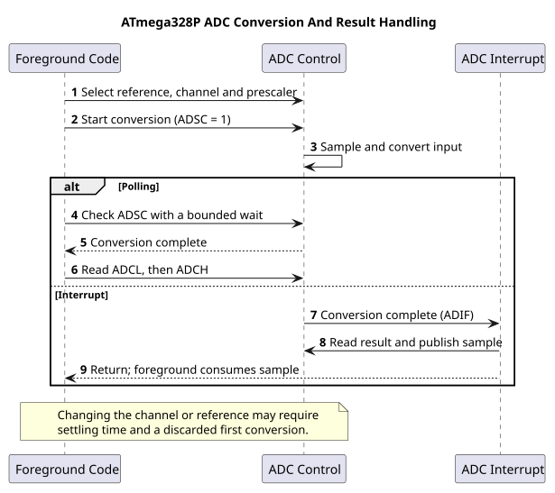

# ADC Concepts and Sampling

## From Voltage to a Number

An analogue-to-digital converter (ADC) measures an input voltage relative to a selected reference. The ATmega328P ADC returns a 10-bit code from 0 to 1023. The input must remain within the device's allowed ADC range; the reference is not a voltage limiter.

With an ideal 5,000 mV reference, the nominal code width is:

`5,000 mV / 1,024 ≈ 4.883 mV per code`

An input near 2,500 mV would produce approximately code 512. The result is quantised: many voltages map to the same integer code. Reference error, sensor tolerance, noise and wiring affect the measurement too.

## Reference and Settling

The Uno can use AVCC, an external AREF input or the nominal internal 1.1 V reference. The actual AVCC may differ from exactly 5 V, so measure or calibrate it when better voltage scaling is required. Do not drive AREF externally while firmware selects AVCC or the internal reference.

The ADC's sample-and-hold capacitor must charge from the source. High source impedance can prevent settling during the acquisition time. At 16 MHz, divide the ADC clock by 128 to get 125 kHz, within the usual 50–200 kHz range for full 10-bit resolution. Allow the reference to settle after changing it and discard an initial conversion when required.

## Exercise with Answer

At a calibrated 5,000 mV reference, what voltage does ideal ADC code 512 represent using 1,024 bins?

**Answer:** `512 × 5,000 / 1,024 = 2,500 mV`. This is an ideal scale calculation; it does not remove reference, sensor or ADC error.

## Code Walkthrough

**Example code on GitHub:**
- [LM35 temperature measurement (`18-lm35`)](https://github.com/arnabdasbwn/atmega328p-labs/blob/main/examples/18-lm35/main.c)

### Measure an analog voltage
The example's `main()` configures its peripherals, runs the algorithm and reports or displays the result. These source operations are listed in execution order:

- `(void)avr_uart_init(9600UL);` - Configures USART0 for asynchronous 8N1. It chooses a baud divisor and normal/double-speed mode, programs UBRR0/UCSR0A/UCSR0C, then enables receive and transmit in UCSR0B.
- `(void)avr_adc_init(AVR_ADC_AVCC);` - Selects the reference in ADMUX and enables the ADC in ADCSRA with a divide-by-128 prescaler. At 16 MHz, the ADC clock is 125 kHz. The HAL keeps the result right-adjusted, waits for reference settling and leaves ADC interrupts disabled.
- `for (;;)` - Repeats the foreground task indefinitely; each pass checks inputs, advances the calculation or services the peripheral shown below.
- `if (avr_adc_read(0U, &sample, AVR_POLL_BUDGET) == AVR_OK)` - The body runs only when the conversion succeeds and its code is between 1 and 1022. The HAL selects the channel in ADMUX, disables the digital buffer through DIDR0, discards the first conversion after a channel change, and polls with a finite budget.
- `(void)avr_uart_u16(avr_adc_millivolts(sample, 5000U));` - Formats an unsigned integer as decimal digits and sends them on USART0; it does not add a newline. Scales the ADC code with a 32-bit intermediate and the supplied reference voltage. This ideal calculation does not calibrate the reference.
- `(void)avr_uart_put('\n', AVR_POLL_BUDGET);` - Waits for the USART transmit buffer within its poll budget, then writes the byte to UDR0.
- `_delay_ms(100);` - Waits for the stated interval; the foreground does no other work during this blocking delay.

Algorithm: With a nominal 5000 mV reference, one step is 5000/1024=4.8828125 mV. Measure AVCC for accurate scaling; USB supply is not a precision reference.
Expected behaviour: Terminal reports approximately 0..4995 mV as the wiper moves
**HAL source files in this repository:** [ATmega328P HAL on GitHub](https://github.com/arnabdasbwn/atmega328p-hal)

- [`include/avr_hal/adc.h`](https://github.com/arnabdasbwn/atmega328p-hal/blob/main/include/avr_hal/adc.h)
- [`include/avr_hal/uart.h`](https://github.com/arnabdasbwn/atmega328p-hal/blob/main/include/avr_hal/uart.h)
- [`src/adc.c`](https://github.com/arnabdasbwn/atmega328p-hal/blob/main/src/adc.c)
- [`src/uart.c`](https://github.com/arnabdasbwn/atmega328p-hal/blob/main/src/uart.c)

### LM35 temperature measurement
The example's `main()` configures its peripherals, runs the algorithm and reports or displays the result. These source operations are listed in execution order:

- `(void)avr_adc_init(AVR_ADC_AVCC);` - Selects the reference in ADMUX and enables the ADC in ADCSRA with a divide-by-128 prescaler. At 16 MHz, the ADC clock is 125 kHz. The HAL keeps the result right-adjusted, waits for reference settling and leaves ADC interrupts disabled.
- `(void)avr_uart_init(9600UL);` - Configures USART0 for asynchronous 8N1. It chooses a baud divisor and normal/double-speed mode, programs UBRR0/UCSR0A/UCSR0C, then enables receive and transmit in UCSR0B.
- `for (;;)` - Repeats the foreground task indefinitely; each pass checks inputs, advances the calculation or services the peripheral shown below.
- `if (avr_adc_read(0U, &sample, AVR_POLL_BUDGET) == AVR_OK)` - The body runs only when the conversion succeeds and its code is between 1 and 1022. The HAL selects the channel in ADMUX, disables the digital buffer through DIDR0, discards the first conversion after a channel change, and polls with a finite budget.
- `(void)avr_uart_u16(avr_adc_millivolts(sample, 5000U));` - Formats an unsigned integer as decimal digits and sends them on USART0; it does not add a newline. Scales the ADC code with a 32-bit intermediate and the supplied reference voltage. This ideal calculation does not calibrate the reference.
- `(void)avr_uart_put('\n', AVR_POLL_BUDGET);` - Waits for the USART transmit buffer within its poll budget, then writes the byte to UDR0.
- `_delay_ms(500);` - Waits for the stated interval; the foreground does no other work during this blocking delay.

Algorithm: The simple single-supply circuit measures positive temperatures. At 10 mV/C, a 4.883 mV ADC step is approximately 0.488 C; displayed digits do not imply higher accuracy.
Expected behaviour: Printed millivolts equal tenths of a degree Celsius: 250 means about 25.0 C
**HAL source files in this repository:** [ATmega328P HAL on GitHub](https://github.com/arnabdasbwn/atmega328p-hal)

- [`include/avr_hal/adc.h`](https://github.com/arnabdasbwn/atmega328p-hal/blob/main/include/avr_hal/adc.h)
- [`include/avr_hal/uart.h`](https://github.com/arnabdasbwn/atmega328p-hal/blob/main/include/avr_hal/uart.h)
- [`src/adc.c`](https://github.com/arnabdasbwn/atmega328p-hal/blob/main/src/adc.c)
- [`src/uart.c`](https://github.com/arnabdasbwn/atmega328p-hal/blob/main/src/uart.c)

## References

- Microchip, [ATmega328P device documentation](https://www.microchip.com/en-us/product/ATMEGA328P), ADC characteristics and electrical limits.
- Microchip, [Using and Testing the AVR ADC](https://developerhelp.microchip.com/xwiki/bin/view/products/mcu-mpu/8-bit-avr/getting-started/8-bit-avr-adc/)
- [Measure an analogue voltage](<https://github.com/arnabdasbwn/atmega328p-labs/blob/main/examples/15-adc-voltage/main.c>)
- [ADC registers](adc-registers.md)
