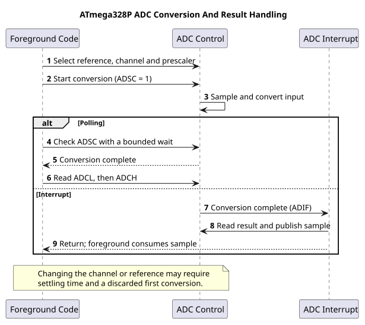

# Using the ADC HAL

## Initialize and Sample

The ADC API is declared in [`avr_hal/adc.h`](https://github.com/arnabdasbwn/atmega328p-hal/blob/main/include/avr_hal/adc.h) and implemented in [`adc.c`](https://github.com/arnabdasbwn/atmega328p-hal/blob/main/src/adc.c). `avr_adc_init()` selects external AREF, AVCC or the nominal internal 1.1 V reference, then waits for initial reference settling. `avr_adc_read(channel, &sample, budget)` reads channels 0–5, corresponding to Uno A0–A5.

The returned code is in the range 0–1023. The API discards one conversion after initialization or channel changes. Its bounded polling budget limits unsuccessful checks, not elapsed milliseconds. It owns ADC configuration, disables ADC interrupts and does not change global interrupt state.

## Scale with a Calibrated Reference

`avr_adc_millivolts(sample, reference_mv)` uses a 32-bit intermediate and returns a rounded ideal scale based on 1,024 quantisation bins. Values above 1023 are clamped. The function does not measure the reference or correct sensor error; supply a measured or calibrated reference if the application needs improved scaling.

Do not use the polling HAL at the same time as an application-owned ADC interrupt. For interrupt-driven acquisition, configure the ADC and ISR as one documented owner, as in the [ADC interrupt lab](<https://github.com/arnabdasbwn/atmega328p-labs/blob/main/examples/39-adc-interrupt/main.c>).

## Example and Exercise

Build the [voltage measurement lab](<https://github.com/arnabdasbwn/atmega328p-labs/blob/main/examples/15-adc-voltage/main.c>) with XC8. Its potentiometer wiper connects to A0. The result is software-build validated, but physical voltage accuracy has not been measured.

Does `avr_adc_millivolts()` calibrate the Uno's AVCC reference automatically?

**Answer:** No. It scales using the reference value supplied by the caller. Measure or calibrate AVCC separately when the application needs it.

## Code Walkthrough

**Example code on GitHub:**
- [LM35 temperature measurement (`18-lm35`)](https://github.com/arnabdasbwn/atmega328p-labs/blob/main/examples/18-lm35/main.c)

### Measure an analog voltage
The example's `main()` configures its peripherals, runs the algorithm and reports or displays the result. These source operations are listed in execution order:

- `(void)avr_uart_init(9600UL);` - Configures USART0 for asynchronous 8N1. It chooses a baud divisor and normal/double-speed mode, programs UBRR0/UCSR0A/UCSR0C, then enables receive and transmit in UCSR0B.
- `(void)avr_adc_init(AVR_ADC_AVCC);` - Selects the reference in ADMUX and enables the ADC in ADCSRA with a divide-by-128 prescaler. At 16 MHz, the ADC clock is 125 kHz. The HAL keeps the result right-adjusted, waits for reference settling and leaves ADC interrupts disabled.
- `for (;;)` - Repeats the foreground task indefinitely; each pass checks inputs, advances the calculation or services the peripheral shown below.
- `if (avr_adc_read(0U, &sample, AVR_POLL_BUDGET) == AVR_OK)` - The body runs only when the conversion succeeds and its code is between 1 and 1022. The HAL selects the channel in ADMUX, disables the digital buffer through DIDR0, discards the first conversion after a channel change, and polls with a finite budget.
- `(void)avr_uart_u16(avr_adc_millivolts(sample, 5000U));` - Formats an unsigned integer as decimal digits and sends them on USART0; it does not add a newline. Scales the ADC code with a 32-bit intermediate and the supplied reference voltage. This ideal calculation does not calibrate the reference.
- `(void)avr_uart_put('\n', AVR_POLL_BUDGET);` - Waits for the USART transmit buffer within its poll budget, then writes the byte to UDR0.
- `_delay_ms(100);` - Waits for the stated interval; the foreground does no other work during this blocking delay.

Algorithm: With a nominal 5000 mV reference, one step is 5000/1024=4.8828125 mV. Measure AVCC for accurate scaling; USB supply is not a precision reference.
Expected behaviour: Terminal reports approximately 0..4995 mV as the wiper moves
**HAL source files in this repository:** [ATmega328P HAL on GitHub](https://github.com/arnabdasbwn/atmega328p-hal)

- [`include/avr_hal/adc.h`](https://github.com/arnabdasbwn/atmega328p-hal/blob/main/include/avr_hal/adc.h)
- [`include/avr_hal/uart.h`](https://github.com/arnabdasbwn/atmega328p-hal/blob/main/include/avr_hal/uart.h)
- [`src/adc.c`](https://github.com/arnabdasbwn/atmega328p-hal/blob/main/src/adc.c)
- [`src/uart.c`](https://github.com/arnabdasbwn/atmega328p-hal/blob/main/src/uart.c)

### LM35 temperature measurement
The example's `main()` configures its peripherals, runs the algorithm and reports or displays the result. These source operations are listed in execution order:

- `(void)avr_adc_init(AVR_ADC_AVCC);` - Selects the reference in ADMUX and enables the ADC in ADCSRA with a divide-by-128 prescaler. At 16 MHz, the ADC clock is 125 kHz. The HAL keeps the result right-adjusted, waits for reference settling and leaves ADC interrupts disabled.
- `(void)avr_uart_init(9600UL);` - Configures USART0 for asynchronous 8N1. It chooses a baud divisor and normal/double-speed mode, programs UBRR0/UCSR0A/UCSR0C, then enables receive and transmit in UCSR0B.
- `for (;;)` - Repeats the foreground task indefinitely; each pass checks inputs, advances the calculation or services the peripheral shown below.
- `if (avr_adc_read(0U, &sample, AVR_POLL_BUDGET) == AVR_OK)` - The body runs only when the conversion succeeds and its code is between 1 and 1022. The HAL selects the channel in ADMUX, disables the digital buffer through DIDR0, discards the first conversion after a channel change, and polls with a finite budget.
- `(void)avr_uart_u16(avr_adc_millivolts(sample, 5000U));` - Formats an unsigned integer as decimal digits and sends them on USART0; it does not add a newline. Scales the ADC code with a 32-bit intermediate and the supplied reference voltage. This ideal calculation does not calibrate the reference.
- `(void)avr_uart_put('\n', AVR_POLL_BUDGET);` - Waits for the USART transmit buffer within its poll budget, then writes the byte to UDR0.
- `_delay_ms(500);` - Waits for the stated interval; the foreground does no other work during this blocking delay.

Algorithm: The simple single-supply circuit measures positive temperatures. At 10 mV/C, a 4.883 mV ADC step is approximately 0.488 C; displayed digits do not imply higher accuracy.
Expected behaviour: Printed millivolts equal tenths of a degree Celsius: 250 means about 25.0 C
**HAL source files in this repository:** [ATmega328P HAL on GitHub](https://github.com/arnabdasbwn/atmega328p-hal)

- [`include/avr_hal/adc.h`](https://github.com/arnabdasbwn/atmega328p-hal/blob/main/include/avr_hal/adc.h)
- [`include/avr_hal/uart.h`](https://github.com/arnabdasbwn/atmega328p-hal/blob/main/include/avr_hal/uart.h)
- [`src/adc.c`](https://github.com/arnabdasbwn/atmega328p-hal/blob/main/src/adc.c)
- [`src/uart.c`](https://github.com/arnabdasbwn/atmega328p-hal/blob/main/src/uart.c)

### ADC conversion-complete event
The example's `main()` configures its peripherals, runs the algorithm and reports or displays the result. These source operations are listed in execution order:

- `(void)avr_uart_init(9600UL);` - Configures USART0 for asynchronous 8N1. It chooses a baud divisor and normal/double-speed mode, programs UBRR0/UCSR0A/UCSR0C, then enables receive and transmit in UCSR0B.
- `(void)avr_adc_init(AVR_ADC_AVCC);` - Selects the reference in ADMUX and enables the ADC in ADCSRA with a divide-by-128 prescaler. At 16 MHz, the ADC clock is 125 kHz. The HAL keeps the result right-adjusted, waits for reference settling and leaves ADC interrupts disabled.
- `ADMUX = (uint8_t)(ADMUX & 0xF0U);` - Clears the ADMUX channel-selection nibble to choose ADC0 while preserving REFS1:0 reference settings.
- `ADCSRA |= _BV(ADIF);` - Writes one to ADIF to clear a pending ADC completion flag; ADIF is write-one-to-clear.
- `ADCSRA |= _BV(ADIE);` - Sets ADIE so ADC conversion completion requests the configured ADC interrupt.
- `sei();` - Enables global interrupts after the example has configured its sources and shared state.
- `for (;;)` - Repeats the foreground task indefinitely; each pass checks inputs, advances the calculation or services the peripheral shown below.
- `ADCSRA = (uint8_t)((ADCSRA & (uint8_t)~_BV(ADIF)) | _BV(ADSC));` - Controls ADC enable, prescaling, conversion start and optional interrupt. ADSC starts a conversion; ADIF is write-one-to-clear.
- `uint32_t budget = AVR_POLL_BUDGET;` - Stores this intermediate or output value for the next algorithm step. Check the units and range represented by each operand.
- `while (ready == 0U && budget > 0UL)` - Waits for this condition to change; inspect the nearby counter or budget to see the bound on blocking.
- `--budget;` - This statement advances the operation sequence; follow its expression to see the state change.
- `uint16_t sample = 0U;` - Clears the state/counter after its threshold is reached so the next interval starts from zero.
- `bool available = false;` - Stores this intermediate or output value for the next algorithm step. Check the units and range represented by each operand.
- `if (ready != 0U)` - Tests the stated condition; the following block handles the matching case and the other path is skipped.
- `sample = latest;` - Stores this intermediate value for the next step of the algorithm; check the operands and units.
- `ready = 0U;` - Clears the state/counter after its threshold is reached so the next interval starts from zero.
- `available = true;` - Stores this intermediate or output value for the next algorithm step. Check the units and range represented by each operand.
- `if (available)` - Tests the stated condition; the following block handles the matching case and the other path is skipped.
- `(void)avr_uart_u16(sample);` - Formats an unsigned integer as decimal digits and sends them on USART0; it does not add a newline.
- `(void)avr_uart_put('\n', AVR_POLL_BUDGET);` - Waits for the USART transmit buffer within its poll budget, then writes the byte to UDR0.
- `_delay_ms(100);` - Waits for the stated interval; the foreground does no other work during this blocking delay.

Algorithm: The interrupt reports completion; it does not make the conversion faster. The two-byte sample and ready flag must be transferred consistently.
Expected behaviour: Conversion ISR saves a result; foreground prints it
**HAL source files in this repository:** [ATmega328P HAL on GitHub](https://github.com/arnabdasbwn/atmega328p-hal)

- [`include/avr_hal/adc.h`](https://github.com/arnabdasbwn/atmega328p-hal/blob/main/include/avr_hal/adc.h)
- [`include/avr_hal/uart.h`](https://github.com/arnabdasbwn/atmega328p-hal/blob/main/include/avr_hal/uart.h)
- [`src/adc.c`](https://github.com/arnabdasbwn/atmega328p-hal/blob/main/src/adc.c)
- [`src/uart.c`](https://github.com/arnabdasbwn/atmega328p-hal/blob/main/src/uart.c)

## References

- [ADC HAL header](https://github.com/arnabdasbwn/atmega328p-hal/blob/main/include/avr_hal/adc.h) and [implementation](https://github.com/arnabdasbwn/atmega328p-hal/blob/main/src/adc.c)
- [ADC programming](adc-programming.md)
- [ADC interrupt example](adc-interrupt.md)
