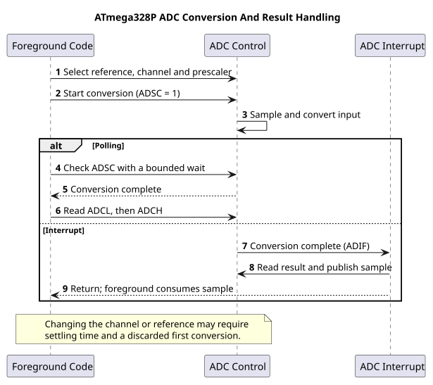

# Handle ADC Completion with an Interrupt

## Conversion Completion Is an Event

The ADC can raise an interrupt when a conversion completes. This lets foreground code continue other bounded work instead of polling `ADSC` until the result is ready. An interrupt does not make the conversion itself faster; the ADC clock and conversion sequence still determine its duration.

The [ADC interrupt example](<https://github.com/arnabdasbwn/atmega328p-labs/blob/main/examples/39-adc-interrupt/main.c>) stores the completed sample in shared state and marks it ready. Foreground code takes the result and sends it over UART. Printing stays out of the ADC ISR because serial transmission can wait on another peripheral.

## Transfer Shared Data Safely

The ADC result has ten bits, while the ATmega328P CPU is eight bits. A foreground read of a multi-byte shared result can be interrupted between byte accesses. Use an atomic snapshot or a deliberate sequence protocol. `volatile` alone does not make that snapshot atomic.

The interrupt vector and ADC configuration need one owner. Do not combine the polling ADC HAL with the example's ADC ISR in one target; both manage the same peripheral. Disable the ADC interrupt when the design returns to polling ownership.

## Build and Exercise

Build with `python "atmega328p-labs/tools/build.py" 39-adc-interrupt --compiler xc8`. The example uses a potentiometer wiper on A0, with the other ends connected to compatible supply and ground. Its build is verified; analogue measurement and ISR timing have not been physically tested.

Why should the ISR save the result instead of formatting and printing it?

**Answer:** Formatting and UART transmission take more time and can block on the transmit register. The ISR should capture the event quickly; foreground code can process and print the sample.

## Code Walkthrough

### ADC conversion-complete event
The example's `main()` configures its peripherals, runs the algorithm and reports or displays the result. These source operations are listed in execution order:

- `(void)avr_uart_init(9600UL);` - Configures USART0 for asynchronous 8N1. It chooses a baud divisor and normal/double-speed mode, programs UBRR0/UCSR0A/UCSR0C, then enables receive and transmit in UCSR0B.
- `(void)avr_adc_init(AVR_ADC_AVCC);` - Selects the reference in ADMUX and enables the ADC in ADCSRA with a divide-by-128 prescaler. At 16 MHz, the ADC clock is 125 kHz. The HAL keeps the result right-adjusted, waits for reference settling and leaves ADC interrupts disabled.
- `ADMUX = (uint8_t)(ADMUX & 0xF0U);` - Clears the ADMUX channel-selection nibble to choose ADC0 while preserving REFS1:0 reference settings.
- `ADCSRA |= _BV(ADIF);` - Writes one to ADIF to clear a pending ADC completion flag; ADIF is write-one-to-clear.
- `ADCSRA |= _BV(ADIE);` - Sets ADIE so ADC conversion completion requests the configured ADC interrupt.
- `sei();` - Enables global interrupts after the example has configured its sources and shared state.
- `for (;;)` - Repeats the foreground task indefinitely; each pass checks inputs, advances the calculation or services the peripheral shown below.
- `ADCSRA = (uint8_t)((ADCSRA & (uint8_t)~_BV(ADIF)) | _BV(ADSC));` - Controls ADC enable, prescaling, conversion start and optional interrupt. ADSC starts a conversion; ADIF is write-one-to-clear.
- `uint32_t budget = AVR_POLL_BUDGET;` - Stores this intermediate or output value for the next algorithm step. Check the units and range represented by each operand.
- `while (ready == 0U && budget > 0UL)` - Waits for this condition to change; inspect the nearby counter or budget to see the bound on blocking.
- `--budget;` - This statement advances the operation sequence; follow its expression to see the state change.
- `uint16_t sample = 0U;` - Clears the state/counter after its threshold is reached so the next interval starts from zero.
- `bool available = false;` - Stores this intermediate or output value for the next algorithm step. Check the units and range represented by each operand.
- `if (ready != 0U)` - Tests the stated condition; the following block handles the matching case and the other path is skipped.
- `sample = latest;` - Stores this intermediate value for the next step of the algorithm; check the operands and units.
- `ready = 0U;` - Clears the state/counter after its threshold is reached so the next interval starts from zero.
- `available = true;` - Stores this intermediate or output value for the next algorithm step. Check the units and range represented by each operand.
- `if (available)` - Tests the stated condition; the following block handles the matching case and the other path is skipped.
- `(void)avr_uart_u16(sample);` - Formats an unsigned integer as decimal digits and sends them on USART0; it does not add a newline.
- `(void)avr_uart_put('\n', AVR_POLL_BUDGET);` - Waits for the USART transmit buffer within its poll budget, then writes the byte to UDR0.
- `_delay_ms(100);` - Waits for the stated interval; the foreground does no other work during this blocking delay.

Algorithm: The interrupt reports completion; it does not make the conversion faster. The two-byte sample and ready flag must be transferred consistently.
Expected behaviour: Conversion ISR saves a result; foreground prints it
**HAL source files in this repository:** [ATmega328P HAL on GitHub](https://github.com/arnabdasbwn/atmega328p-hal)

- [`include/avr_hal/adc.h`](https://github.com/arnabdasbwn/atmega328p-hal/blob/main/include/avr_hal/adc.h)
- [`include/avr_hal/uart.h`](https://github.com/arnabdasbwn/atmega328p-hal/blob/main/include/avr_hal/uart.h)
- [`src/adc.c`](https://github.com/arnabdasbwn/atmega328p-hal/blob/main/src/adc.c)
- [`src/uart.c`](https://github.com/arnabdasbwn/atmega328p-hal/blob/main/src/uart.c)

## References

- [ADC interrupt source and wiring](<https://github.com/arnabdasbwn/atmega328p-labs/blob/main/examples/39-adc-interrupt/main.c>)
- [ADC registers](adc-registers.md)
- [Volatile and atomic access](volatile-atomic.md)
