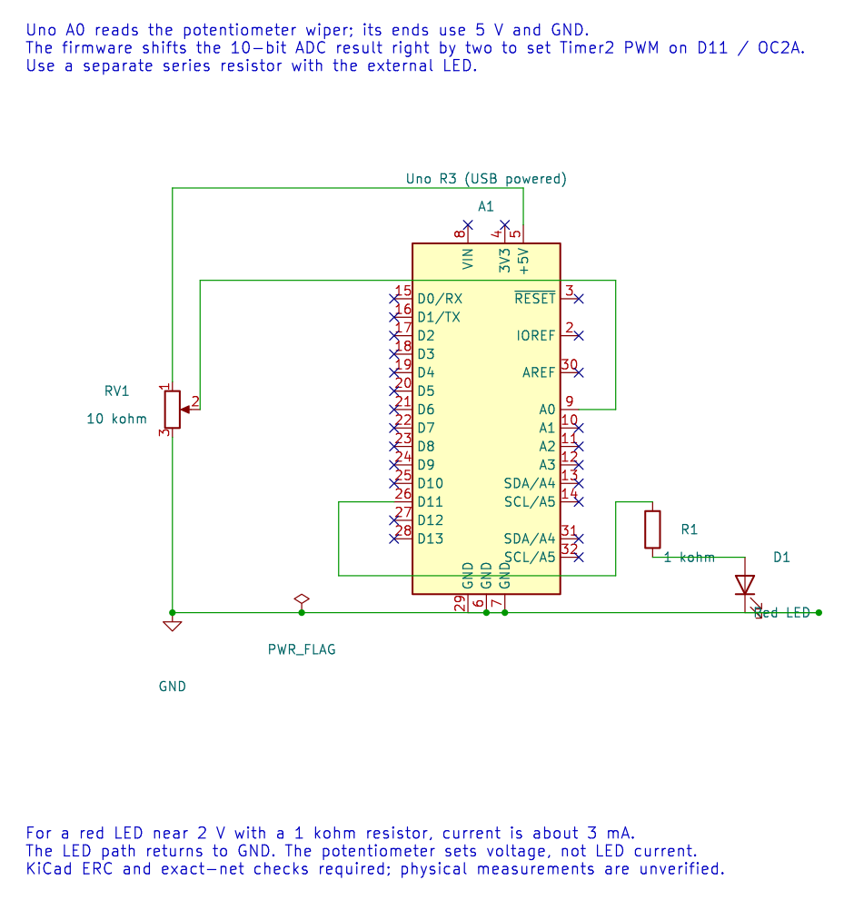

# Read an ADC Channel in C

## Connect a Potentiometer

Use a 10 kΩ potentiometer as a voltage divider: connect its two ends to compatible supply and ground, and connect its wiper to A0. The wiper voltage should stay between ground and the selected ADC reference. Confirm the wiring before powering the Uno.

The editable KiCad circuit includes the ADC input and an LED output from the following PWM exercise. The [voltage-reading example](<https://github.com/arnabdasbwn/atmega328p-labs/blob/main/examples/15-adc-voltage/main.c>) selects AVCC as its reference, waits for initial settling through the HAL, and reads ADC channel 0. The right-adjusted result is an integer from 0 to 1023.

## Convert the Code to Millivolts

For a measured reference of 4,995 mV, ideal code 512 corresponds to:

`512 × 4,995 / 1,024 ≈ 2,498 mV`

Use a wide intermediate for multiplication. The course helper rounds the scaled result and accepts a calibrated reference in millivolts. Measuring AVCC improves the arithmetic input, but noise, reference variation and sensor error still set the real accuracy.

Build with `python "atmega328p-labs/tools/build.py" 15-adc-voltage --compiler xc8`. After wiring and upload, move the wiper slowly; reported voltage should change across most of the reference range. Quantisation means adjacent readings do not represent continuous voltage.

## Exercise with Answer

What code is expected near half of a 5 V reference?

**Answer:** About `1024 × 0.5 = 512`. The actual result can vary with AVCC, noise and the potentiometer connection.

## Code Walkthrough

### Measure an analog voltage
The example's `main()` configures its peripherals, runs the algorithm and reports or displays the result. These source operations are listed in execution order:

- `(void)avr_uart_init(9600UL);` - Configures USART0 for asynchronous 8N1. It chooses a baud divisor and normal/double-speed mode, programs UBRR0/UCSR0A/UCSR0C, then enables receive and transmit in UCSR0B.
- `(void)avr_adc_init(AVR_ADC_AVCC);` - Selects the reference in ADMUX and enables the ADC in ADCSRA with a divide-by-128 prescaler. At 16 MHz, the ADC clock is 125 kHz. The HAL keeps the result right-adjusted, waits for reference settling and leaves ADC interrupts disabled.
- `for (;;)` - Repeats the foreground task indefinitely; each pass checks inputs, advances the calculation or services the peripheral shown below.
- `if (avr_adc_read(0U, &sample, AVR_POLL_BUDGET) == AVR_OK)` - The body runs only when the conversion succeeds and its code is between 1 and 1022. The HAL selects the channel in ADMUX, disables the digital buffer through DIDR0, discards the first conversion after a channel change, and polls with a finite budget.
- `(void)avr_uart_u16(avr_adc_millivolts(sample, 5000U));` - Formats an unsigned integer as decimal digits and sends them on USART0; it does not add a newline. Scales the ADC code with a 32-bit intermediate and the supplied reference voltage. This ideal calculation does not calibrate the reference.
- `(void)avr_uart_put('\n', AVR_POLL_BUDGET);` - Waits for the USART transmit buffer within its poll budget, then writes the byte to UDR0.
- `_delay_ms(100);` - Waits for the stated interval; the foreground does no other work during this blocking delay.

Algorithm: With a nominal 5000 mV reference, one step is 5000/1024=4.8828125 mV. Measure AVCC for accurate scaling; USB supply is not a precision reference.
Expected behaviour: Terminal reports approximately 0..4995 mV as the wiper moves
**HAL source files in this repository:** [ATmega328P HAL on GitHub](https://github.com/arnabdasbwn/atmega328p-hal)

- [`include/avr_hal/adc.h`](https://github.com/arnabdasbwn/atmega328p-hal/blob/main/include/avr_hal/adc.h)
- [`include/avr_hal/uart.h`](https://github.com/arnabdasbwn/atmega328p-hal/blob/main/include/avr_hal/uart.h)
- [`src/adc.c`](https://github.com/arnabdasbwn/atmega328p-hal/blob/main/src/adc.c)
- [`src/uart.c`](https://github.com/arnabdasbwn/atmega328p-hal/blob/main/src/uart.c)

## References

- [ADC concepts](adc-concepts.md) and [ADC registers](adc-registers.md)
- [Voltage measurement source and wiring](<https://github.com/arnabdasbwn/atmega328p-labs/blob/main/examples/15-adc-voltage/main.c>)
- [ADC HAL](adc-hal.md)
