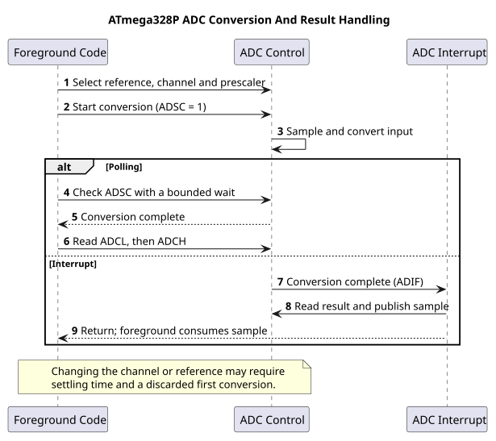

# ATmega328P ADC Registers



## The Registers in One Conversion

The ADC converts an input voltage to a number from 0 to 1023. The result depends on the selected reference voltage, input channel and result alignment. These registers control the conversion:

| Register | Purpose |
| --- | --- |
| `ADMUX` | Reference selection, input channel and result alignment |
| `ADCSRA` | ADC enable, start, prescaler, interrupt enable and completion flag |
| `ADCSRB` | Auto-trigger source and comparator input-multiplexer control |
| `ADCL` and `ADCH` | The low and high portions of the 10-bit result |
| `DIDR0` | Optional disable for digital input buffers on ADC pins |

For a usual Uno setup, `REFS0 = 1` selects AVCC as the reference, while `REFS1 = 0`. AVCC should be connected and decoupled as the board design requires. The input channel number goes in `MUX3:0`; A0 corresponds to ADC0. Set `ADLAR = 0` for a right-adjusted result, which is convenient when using all ten bits.

## Choose the ADC Clock

The ADC clock is the CPU clock divided by a prescaler. With a 16 MHz clock and a divide-by-128 prescaler:

`f_ADC = 16 MHz / 128 = 125 kHz`

The ATmega328P data sheet recommends an ADC clock in the 50-200 kHz range for maximum resolution. A normal conversion takes 13 ADC clock cycles after the first conversion, which takes longer. At 125 kHz, the nominal steady conversion time is about `13 / 125000 = 104 microseconds`. This is a conversion time, not a guarantee that your program can collect samples at exactly that rate.

## Start a Conversion and Read It Safely

The order is reference and channel selection, conversion start, completion check, then low-byte/high-byte result read. The figure in [ADC concepts](adc-concepts.md) shows the polling and interrupt paths.

This short example shows the register order. It assumes the application owns the ADC and that the ADC clock has already been selected. A production polling function should also have a timeout, so a peripheral fault cannot hold the program forever.

```c
/**
 * @brief Read ADC0 using AVCC and a right-adjusted result.
 * @return The ten-bit conversion result in the range 0 to 1023.
 */
static uint16_t adc0_read(void)
{
    uint8_t low_byte;
    uint8_t high_byte;

    ADMUX = (uint8_t)(_BV(REFS0) | 0U);
    ADCSRA |= _BV(ADSC);
    while ((ADCSRA & _BV(ADSC)) != 0U) {
        /* Wait for the conversion; add a bounded timeout in production. */
    }

    low_byte = ADCL; /* Required first: reading it locks the result pair. */
    high_byte = ADCH;
    return (uint16_t)(((uint16_t)high_byte << 8U) | (uint16_t)low_byte);
}
```

This is a teaching fragment, not a complete translation unit: include the device header and `<stdint.h>`, select `ADPS2:0`, and provide a timeout before using the pattern in a product. Do not let a second function or an ADC ISR read `ADCL`/`ADCH` at the same time. That would give two pieces of code ownership of one conversion result.

`ADIF` is a write-one-to-clear flag. Avoid a generic read-modify-write on a register containing write-one-to-clear flags: writing back a one can clear a flag that became set after the read. Follow the data-sheet sequence when acknowledging it. For interrupt-driven conversion, enable `ADIE` only after the ISR and shared-result handling are ready; peripheral setup should not unexpectedly enable global interrupts.

## Practical Accuracy Checks

The ADC measures the input relative to its reference. If AVCC is actually 4.85 V, using 5.00 V in a calculation introduces a scale error. For a divider or sensor output, calculate the expected input range first and keep it between ground and the selected reference. Do not connect a negative voltage or a signal above the board supply to an ADC pin.

Disable the digital input buffer with the matching `DIDR0` bit when the pin is used only as an analog input. This reduces digital switching current; it does not improve a poor reference or repair noisy wiring. For low source impedance and stable readings, use sensible grounding, short connections and appropriate decoupling.

## Exercises with Answers

1. **At 16 MHz, what ADC clock results from a divide-by-64 prescaler?**
   `16 MHz / 64 = 250 kHz`, which is above the data sheet's usual 50-200 kHz range for full ten-bit performance.
2. **Why read `ADCL` before `ADCH` for a right-adjusted result?**
   Reading the low byte locks the result pair until the high byte is read, preventing a conversion from changing half of the value during the read.
3. **Does selecting AVCC guarantee a 5.000 V reference?**
   No. The ADC uses the actual AVCC voltage. Measure or otherwise establish the reference when the application needs calibrated voltage values.

## Related Work

- Buildable voltage and interrupt examples: [Lab 15](<https://github.com/arnabdasbwn/atmega328p-labs/blob/main/examples/15-adc-voltage/main.c>) and [Lab 39](<https://github.com/arnabdasbwn/atmega328p-labs/blob/main/examples/39-adc-interrupt/main.c>).
- [ADC concepts](adc-concepts.md) and [ADC HAL](adc-hal.md).
- Microchip, [ATmega328P device documentation](https://www.microchip.com/en-us/product/ATMEGA328P), ADC characteristics and register descriptions.

## Code Walkthrough

### Measure an analog voltage
The example's `main()` configures its peripherals, runs the algorithm and reports or displays the result. These source operations are listed in execution order:

- `(void)avr_uart_init(9600UL);` - Configures USART0 for asynchronous 8N1. It chooses a baud divisor and normal/double-speed mode, programs UBRR0/UCSR0A/UCSR0C, then enables receive and transmit in UCSR0B.
- `(void)avr_adc_init(AVR_ADC_AVCC);` - Selects the reference in ADMUX and enables the ADC in ADCSRA with a divide-by-128 prescaler. At 16 MHz, the ADC clock is 125 kHz. The HAL keeps the result right-adjusted, waits for reference settling and leaves ADC interrupts disabled.
- `for (;;)` - Repeats the foreground task indefinitely; each pass checks inputs, advances the calculation or services the peripheral shown below.
- `if (avr_adc_read(0U, &sample, AVR_POLL_BUDGET) == AVR_OK)` - The body runs only when the conversion succeeds and its code is between 1 and 1022. The HAL selects the channel in ADMUX, disables the digital buffer through DIDR0, discards the first conversion after a channel change, and polls with a finite budget.
- `(void)avr_uart_u16(avr_adc_millivolts(sample, 5000U));` - Formats an unsigned integer as decimal digits and sends them on USART0; it does not add a newline. Scales the ADC code with a 32-bit intermediate and the supplied reference voltage. This ideal calculation does not calibrate the reference.
- `(void)avr_uart_put('\n', AVR_POLL_BUDGET);` - Waits for the USART transmit buffer within its poll budget, then writes the byte to UDR0.
- `_delay_ms(100);` - Waits for the stated interval; the foreground does no other work during this blocking delay.

Algorithm: With a nominal 5000 mV reference, one step is 5000/1024=4.8828125 mV. Measure AVCC for accurate scaling; USB supply is not a precision reference.
Expected behaviour: Terminal reports approximately 0..4995 mV as the wiper moves
**HAL source files in this repository:** [ATmega328P HAL on GitHub](https://github.com/arnabdasbwn/atmega328p-hal)

- [`include/avr_hal/adc.h`](https://github.com/arnabdasbwn/atmega328p-hal/blob/main/include/avr_hal/adc.h)
- [`include/avr_hal/uart.h`](https://github.com/arnabdasbwn/atmega328p-hal/blob/main/include/avr_hal/uart.h)
- [`src/adc.c`](https://github.com/arnabdasbwn/atmega328p-hal/blob/main/src/adc.c)
- [`src/uart.c`](https://github.com/arnabdasbwn/atmega328p-hal/blob/main/src/uart.c)


### ADC conversion-complete event
The example's `main()` configures its peripherals, runs the algorithm and reports or displays the result. These source operations are listed in execution order:

- `(void)avr_uart_init(9600UL);` - Configures USART0 for asynchronous 8N1. It chooses a baud divisor and normal/double-speed mode, programs UBRR0/UCSR0A/UCSR0C, then enables receive and transmit in UCSR0B.
- `(void)avr_adc_init(AVR_ADC_AVCC);` - Selects the reference in ADMUX and enables the ADC in ADCSRA with a divide-by-128 prescaler. At 16 MHz, the ADC clock is 125 kHz. The HAL keeps the result right-adjusted, waits for reference settling and leaves ADC interrupts disabled.
- `ADMUX = (uint8_t)(ADMUX & 0xF0U);` - Clears the ADMUX channel-selection nibble to choose ADC0 while preserving REFS1:0 reference settings.
- `ADCSRA |= _BV(ADIF);` - Writes one to ADIF to clear a pending ADC completion flag; ADIF is write-one-to-clear.
- `ADCSRA |= _BV(ADIE);` - Sets ADIE so ADC conversion completion requests the configured ADC interrupt.
- `sei();` - Enables global interrupts after the example has configured its sources and shared state.
- `for (;;)` - Repeats the foreground task indefinitely; each pass checks inputs, advances the calculation or services the peripheral shown below.
- `ADCSRA = (uint8_t)((ADCSRA & (uint8_t)~_BV(ADIF)) | _BV(ADSC));` - Controls ADC enable, prescaling, conversion start and optional interrupt. ADSC starts a conversion; ADIF is write-one-to-clear.
- `uint32_t budget = AVR_POLL_BUDGET;` - Stores this intermediate or output value for the next algorithm step. Check the units and range represented by each operand.
- `while (ready == 0U && budget > 0UL)` - Waits for this condition to change; inspect the nearby counter or budget to see the bound on blocking.
- `--budget;` - This statement advances the operation sequence; follow its expression to see the state change.
- `uint16_t sample = 0U;` - Clears the state/counter after its threshold is reached so the next interval starts from zero.
- `bool available = false;` - Stores this intermediate or output value for the next algorithm step. Check the units and range represented by each operand.
- `if (ready != 0U)` - Tests the stated condition; the following block handles the matching case and the other path is skipped.
- `sample = latest;` - Stores this intermediate value for the next step of the algorithm; check the operands and units.
- `ready = 0U;` - Clears the state/counter after its threshold is reached so the next interval starts from zero.
- `available = true;` - Stores this intermediate or output value for the next algorithm step. Check the units and range represented by each operand.
- `if (available)` - Tests the stated condition; the following block handles the matching case and the other path is skipped.
- `(void)avr_uart_u16(sample);` - Formats an unsigned integer as decimal digits and sends them on USART0; it does not add a newline.
- `(void)avr_uart_put('\n', AVR_POLL_BUDGET);` - Waits for the USART transmit buffer within its poll budget, then writes the byte to UDR0.
- `_delay_ms(100);` - Waits for the stated interval; the foreground does no other work during this blocking delay.

Algorithm: The interrupt reports completion; it does not make the conversion faster. The two-byte sample and ready flag must be transferred consistently.
Expected behaviour: Conversion ISR saves a result; foreground prints it
**HAL source files in this repository:** [ATmega328P HAL on GitHub](https://github.com/arnabdasbwn/atmega328p-hal)

- [`include/avr_hal/adc.h`](https://github.com/arnabdasbwn/atmega328p-hal/blob/main/include/avr_hal/adc.h)
- [`include/avr_hal/uart.h`](https://github.com/arnabdasbwn/atmega328p-hal/blob/main/include/avr_hal/uart.h)
- [`src/adc.c`](https://github.com/arnabdasbwn/atmega328p-hal/blob/main/src/adc.c)
- [`src/uart.c`](https://github.com/arnabdasbwn/atmega328p-hal/blob/main/src/uart.c)
