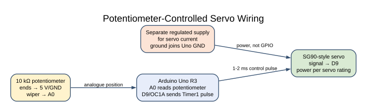
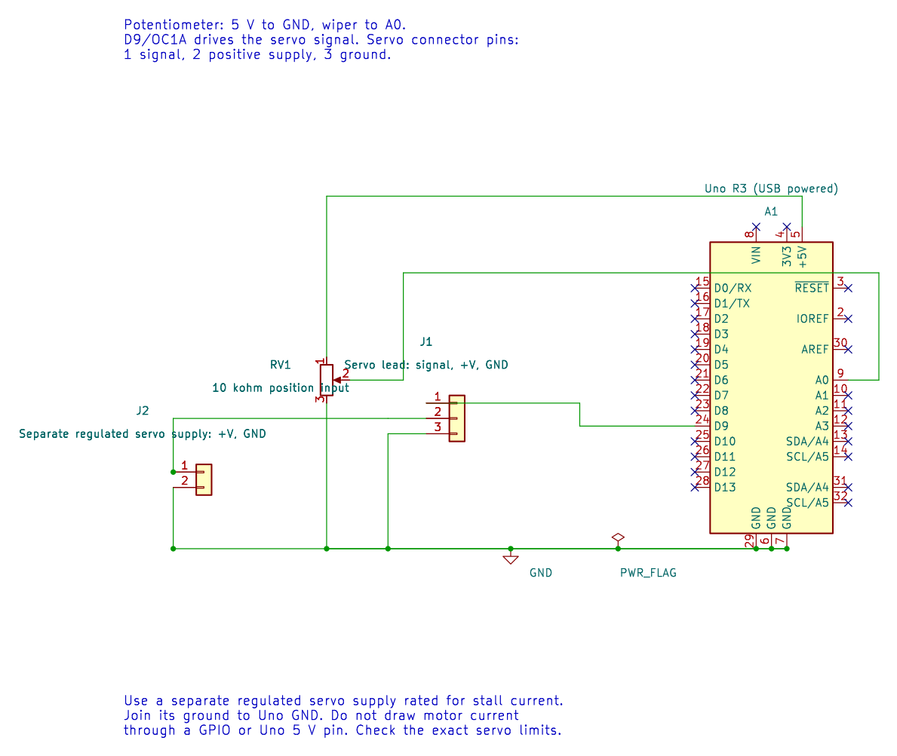

# Potentiometer-Controlled Servo

## What You Will Learn

This exercise reads a 10 kΩ potentiometer with the ADC and maps its position to a timer pulse for an SG90-style hobby servo. It joins analogue input, integer scaling, Timer1 PWM and safe power wiring.

## Wiring

| Connection | Uno R3 | Purpose |
| --- | --- | --- |
| Potentiometer outer pins | 5 V and GND | Divider endpoints |
| Potentiometer wiper | A0 | Adjustable ADC voltage |
| Servo signal | D9 / OC1A | Timer1 output |
| Servo supply positive | Separate regulated 5 V supply | Servo current |
| Servo and Uno grounds | Join together | Signal reference |

Do not power the servo from a GPIO pin. A servo's startup/stall current can disturb the Uno supply; use a suitable supply and keep a common ground. Verify the connector wire order before applying power.

## From ADC Code to Pulse Width



The 10-bit ADC returns `sample` from 0 through 1023. The example calculates:

```text
timer_ticks = 2000 + sample × 2000 / 1023
```

At 16 MHz with Timer1 prescaled by 8, one timer tick is 0.5 µs. Lab 13 sets `OCR1A` from 2,000 to 4,000 ticks, which corresponds to 1–2 ms. The 20 ms period uses a top count of 40,000 ticks.

The multiplication is widened to 32 bits before scaling because the intermediate value exceeds 16-bit AVR integer range. This map includes both ADC endpoints by dividing by 1023. It is a teaching range; the exact safe pulse range depends on the servo and linkage.


### KiCad Connection Drawing



Open the editable KiCad schematic or its pin map. The drawing has passed ERC and exact-net checks; the physical circuit has not been tested.

## Build and Try the Lab

```powershell
python atmega328p-labs/tools/build.py 13-adc-servo --compiler gcc
python atmega328p-labs/tools/build.py 13-adc-servo --compiler xc8
```

After build and upload, turn the potentiometer slowly. The servo should move across its configured range. Do not force the shaft against a hard stop. If the servo buzzes or warms, disconnect it and reduce the commanded pulse range.

## Code Walkthrough

### Potentiometer-controlled servo
The example's `main()` configures its peripherals, runs the algorithm and reports or displays the result. These source operations are listed in execution order:

- `uint16_t sample = 0U;` - Clears the state/counter after its threshold is reached so the next interval starts from zero.
- `(void)avr_adc_init(AVR_ADC_AVCC);` - Selects the reference in ADMUX and enables the ADC in ADCSRA with a divide-by-128 prescaler. At 16 MHz, the ADC clock is 125 kHz. The HAL keeps the result right-adjusted, waits for reference settling and leaves ADC interrupts disabled.
- `(void)avr_timer1_pwm(8U, 40000U, 3000U);` - Configures Timer1 mode 14 with prescaler 8; ICR1 becomes 39999, giving a 20 ms frame, and OCR1A starts at 3000 ticks (1500 us high).
- `for (;;)` - Repeats the foreground task indefinitely; each pass checks inputs, advances the calculation or services the peripheral shown below.
- `if (avr_adc_read(0U, &sample, AVR_POLL_BUDGET) == AVR_OK)` - The body runs only when the conversion succeeds and its code is between 1 and 1022. The HAL selects the channel in ADMUX, disables the digital buffer through DIDR0, discards the first conversion after a channel change, and polls with a finite budget.
- `OCR1A = (uint16_t)(2000UL + ((uint32_t)sample * 2000UL) / 1023UL);` - Maps ADC codes 0..1023 linearly to 2000..4000 Timer1 ticks, or about 1..2 ms at 0.5 us per tick.
- `_delay_ms(20);` - Waits for the stated interval; the foreground does no other work during this blocking delay.

Algorithm: Widen before multiplying: 1023*2000 exceeds 16-bit unsigned range. The formula intentionally maps both endpoints using 1023; this differs from ADC quantization-step conversion.
Expected behaviour: Potentiometer maps ADC endpoints to 1..2 ms pulses
**HAL source files in this repository:** [ATmega328P HAL on GitHub](https://github.com/arnabdasbwn/atmega328p-hal)

- [`include/avr_hal/adc.h`](https://github.com/arnabdasbwn/atmega328p-hal/blob/main/include/avr_hal/adc.h)
- [`include/avr_hal/timer.h`](https://github.com/arnabdasbwn/atmega328p-hal/blob/main/include/avr_hal/timer.h)
- [`src/adc.c`](https://github.com/arnabdasbwn/atmega328p-hal/blob/main/src/adc.c)
- [`src/timer.c`](https://github.com/arnabdasbwn/atmega328p-hal/blob/main/src/timer.c)


## Common Problems

- **Servo jitters or resets the Uno:** Use a supply with adequate current and connect grounds.
- **Motion is reversed:** Swap the potentiometer's outer connections or reverse the software mapping.
- **Servo reaches a mechanical stop:** Narrow the 1–2 ms range for the specific servo and linkage.
- **ADC reading is unstable:** Check the wiper connection and keep the analogue ground common.

## Check Your Understanding

1. What pulse width does an ADC reading near 512 request?
2. Why is the ADC value multiplied after widening to 32 bits?
3. Why does the servo supply need a common ground with the Uno?

**Suggested answers:** About 1.5 ms, the midpoint of the 1–2 ms map. The product can exceed a 16-bit AVR integer. Without a shared reference, the servo cannot reliably interpret the signal voltage.

## Source and Further Reading

- [Lab 13 source](<https://github.com/arnabdasbwn/atmega328p-labs/blob/main/examples/13-adc-servo/main.c>)
- [ATmega328P Documentation](https://www.microchip.com/en-us/product/ATMEGA328P), ADC and Timer1 sections.
- Check the selected servo datasheet for supply range, current and pulse limits.
