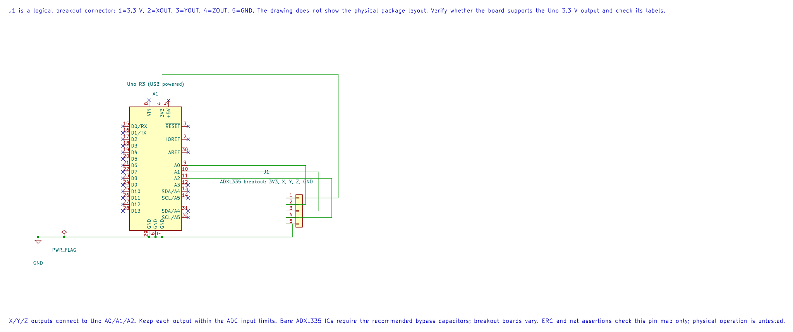

# ADXL335 Three-Axis Accelerometer

## What You Will Learn

The ADXL335 is an analogue three-axis accelerometer. It produces one voltage for each axis; the Uno samples those voltages with ADC channels A0, A1 and A2. Raw ADC codes show how the outputs change, but calibration is required before converting them into acceleration units.

## Module and Wiring

The sensor IC operates from a low-voltage supply. Use a breakout that includes the required regulation and confirm its pin labels. Do not connect a bare ADXL335 supply pin to 5 V. Connect the analogue outputs only within the Uno ADC input range.

| ADXL335 breakout | Uno R3 | Purpose |
| --- | --- | --- |
| VCC | Regulated 3.3 V, if required by the exact board | Sensor supply |
| GND | GND | Shared analogue reference |
| XOUT | A0 | X-axis voltage |
| YOUT | A1 | Y-axis voltage |
| ZOUT | A2 | Z-axis voltage |

Check whether your breakout has a regulator or filtering capacitors. Board implementations differ even when they use the same sensor IC.



The editable KiCad schematic shows a logical breakout header, not the sensor package pinout. Confirm the exact breakout's supply support and signal limits before wiring.

## Read and Calibrate the Axes

Lab 20 prints three ADC codes separated by commas. Turn the board slowly and observe which values change. The ADC reference is AVCC, so the codes depend on both sensor output voltage and Uno reference voltage.

To estimate offset and sensitivity for one axis, record stationary readings with the axis at +1 g and −1 g. If the two codes are `Cplus` and `Cminus`, estimate:

```text
zero_code = (Cplus + Cminus) / 2
codes_per_g = (Cplus − Cminus) / 2
```

Then `acceleration_g ≈ (sample − zero_code) / codes_per_g`. Repeat for each axis. This simple two-point method does not remove cross-axis sensitivity, board misalignment or temperature error.

## Build and Observe

```powershell
python atmega328p-labs/tools/build.py 20-adxl335 --compiler gcc
python atmega328p-labs/tools/build.py 20-adxl335 --compiler xc8
```

After uploading, open a 9600-baud serial terminal and rotate the board gently. Record the raw values in several known orientations. Lab 20 does not print calibrated acceleration; apply the calibration formula separately and compare it with gravity's direction and magnitude.

## Code Walkthrough

### ADXL335 three-axis measurement
The example's `main()` configures its peripherals, runs the algorithm and reports or displays the result. These source operations are listed in execution order:

- `(void)avr_adc_init(AVR_ADC_AVCC);` - Selects the reference in ADMUX and enables the ADC in ADCSRA with a divide-by-128 prescaler. At 16 MHz, the ADC clock is 125 kHz. The HAL keeps the result right-adjusted, waits for reference settling and leaves ADC interrupts disabled.
- `(void)avr_uart_init(9600UL);` - Configures USART0 for asynchronous 8N1. It chooses a baud divisor and normal/double-speed mode, programs UBRR0/UCSR0A/UCSR0C, then enables receive and transmit in UCSR0B.
- `for (;;)` - Repeats the foreground task indefinitely; each pass checks inputs, advances the calculation or services the peripheral shown below.
- `for (uint8_t ch = 0U; ch < 3U; ++ch)` - Repeats while `ch < 3U` is true; `uint8_t ch = 0U` sets the starting state and `++ch` advances it each pass.
- `if (avr_adc_read(ch, &sample, AVR_POLL_BUDGET) == AVR_OK)` - The body runs only when the conversion succeeds and its code is between 1 and 1022. The HAL selects the channel in ADMUX, disables the digital buffer through DIDR0, discards the first conversion after a channel change, and polls with a finite budget.
- `(void)avr_uart_u16(sample);` - Formats an unsigned integer as decimal digits and sends them on USART0; it does not add a newline.
- `(void)avr_uart_put(ch == 2U ? '\n' : ',', AVR_POLL_BUDGET);` - Waits for the USART transmit buffer within its poll budget, then writes the byte to UDR0.
- `_delay_ms(100);` - Waits for the stated interval; the foreground does no other work during this blocking delay.

Algorithm: Calibrate each axis at +1 g and -1 g. Zero offset is the mean of these readings; sensitivity in codes/g is half their difference. This avoids assuming a breakout supply or ideal offset.
Expected behaviour: Three raw codes change as the board is tilted
**HAL source files in this repository:** [ATmega328P HAL on GitHub](https://github.com/arnabdasbwn/atmega328p-hal)

- [`include/avr_hal/adc.h`](https://github.com/arnabdasbwn/atmega328p-hal/blob/main/include/avr_hal/adc.h)
- [`include/avr_hal/uart.h`](https://github.com/arnabdasbwn/atmega328p-hal/blob/main/include/avr_hal/uart.h)
- [`src/adc.c`](https://github.com/arnabdasbwn/atmega328p-hal/blob/main/src/adc.c)
- [`src/uart.c`](https://github.com/arnabdasbwn/atmega328p-hal/blob/main/src/uart.c)


## Common Problems

- **One axis is stuck near zero or full scale:** Check the output connection, sensor supply and common ground.
- **Values move in the wrong direction:** Confirm axis orientation and which breakout pin is X, Y or Z.
- **Raw values are noisy:** Use short wiring, check supply decoupling and average multiple samples for slow measurements.
- **A raw ADC count is treated as g:** Convert using a measured zero offset and sensitivity; do not assume ideal sensor values.

## Check Your Understanding

1. Why is an ADC code not directly an acceleration value?
2. If the +1 g and −1 g readings are 620 and 410, what are the estimated zero code and codes per g?
3. What does the AVCC ADC reference contribute to the result?

**Suggested answers:** The output has offset and sensitivity that vary by device and setup. The midpoint is 515 codes and half-difference is 105 codes/g. AVCC defines the voltage-to-code scale, so supply/reference variation changes the raw reading.

## Source and Further Reading

- [Lab 20 source](<https://github.com/arnabdasbwn/atmega328p-labs/blob/main/examples/20-adxl335/main.c>)
- [Analog Devices ADXL335 Product Documentation](https://www.analog.com/en/products/adxl335.html)
- [ATmega328P Documentation](https://www.microchip.com/en-us/product/ATMEGA328P), ADC section.
