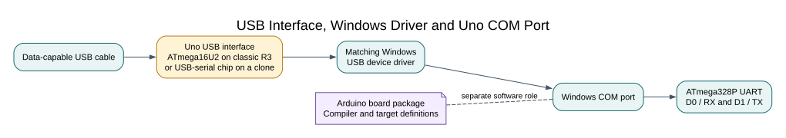

# Connecting an Uno R3 on Windows

## What the USB Cable Connects

On a classic Uno R3, the ATmega16U2 USB interface converts USB data into the ATmega328P's UART signals. Windows normally presents this connection as a COM port. Some Uno-compatible boards use a different USB-to-serial chip, such as CH340, and need that chip's matching driver.

The USB cable must carry data. A charge-only cable may power the board while leaving no serial port. The Arduino AVR Boards package supplies board definitions and tools; it is not a universal driver for every USB interface.

## Check the USB Interface in Windows

1. Connect the Uno with a data-capable USB cable, then open **Device Manager**.
2. Expand **Ports (COM & LPT)**. Note the port name and number, such as `COM4`.
3. If no port appears, also check **Other devices**. Open the unknown device's **Properties → Details → Hardware Ids** and record its vendor and product IDs.
4. Identify the USB-interface chip and board revision before choosing a driver. On the classic Uno R3, an ATmega16U2 bridges USB and the ATmega328P UART. Some compatible boards use CH340, FTDI or another interface and need that manufacturer's driver.

If Windows already shows a working COM port, do not install another driver. If it shows an unknown device, use the matching board or interface manufacturer's support page. Avoid driver-download sites that do not identify the chip or publisher. Arduino's support article lists cases where missing USB-to-serial firmware can make a genuine Uno appear as a DFU or unknown device; recovery is a separate procedure, not a driver-install step.

## Check the Port in Your Tools

In Arduino IDE 2, choose **Arduino Uno** as the board and select the detected COM port. In the VS Code build tasks, compilation does not use a COM port; upload and serial-monitor tasks do. Close the serial monitor before another application opens the same port.

For a text check, open a serial monitor only after uploading a program that uses UART. Match its baud rate and framing to the firmware. The USB serial link is not the same thing as a debug probe, and seeing a COM port does not prove that the ATmega328P bootloader is responding.

## Troubleshooting

If no port appears, try a data cable and a direct USB port, then recheck Device Manager. If an unknown interface remains, identify its chip before installing a driver. If uploads report that the COM port is busy, close serial monitors and other applications using it. If an upload fails at the synchronization stage, confirm the board and port first; do not change fuses or reinstall unrelated drivers as a guess.

## Code Walkthrough

**Example code on GitHub:**
- [Register-level Blink (`01-blink-register`)](https://github.com/arnabdasbwn/atmega328p-labs/blob/main/examples/01-blink-register/main.c)

### Register-level Blink
The example's `main()` configures its peripherals, runs the algorithm and reports or displays the result. These source operations are listed in execution order:

- `PORTB &= (uint8_t)~_BV(PORTB5);` - Sets or clears the Port B output latch. When the pin is an output, this determines its output level; on an input, it controls the pull-up.
- `DDRB |= _BV(DDB5);` - Sets the Port B direction bits; a set bit selects output mode.
- `for (;;)` - Repeats the foreground task indefinitely; each pass checks inputs, advances the calculation or services the peripheral shown below.
- `PINB = _BV(PINB5);` - Writing a one to a PINB bit toggles that pin's PORTB output latch on the ATmega328P.
- `_delay_ms(500);` - Waits for the stated interval; the foreground does no other work during this blocking delay.

Algorithm: Pin direction and output latch are separate hardware state.
Expected behaviour: L toggles every 500 ms
**HAL source files in this repository:** [ATmega328P HAL on GitHub](https://github.com/arnabdasbwn/atmega328p-hal)

## Check Your Understanding

The board powers on, but no COM port appears. What is one safe first check?

**Answer:** Try a known data-capable USB cable and inspect Device Manager for the USB interface. Do not install a driver for a chip that has not been identified.

## References

- [Arduino Help: Identify unknown devices and ports](https://support.arduino.cc/hc/en-us/articles/16884223752220-If-there-are-Unknown-devices-in-the-board-selector-or-ports-without-a-board-name-in-the-Tools-Port-menu)
- [Arduino Help: CH340 serial-port issue](https://support.arduino.cc/hc/en-us/articles/13148652511260-avrdude-ser-open-can-t-set-com-state-for-COMn)
- [Arduino Help: Uno or Mega not recognized by the computer](https://support.arduino.cc/hc/en-us/articles/4411209176722-If-Arduino-UNO-Rev3-or-earlier-or-Mega-is-not-recognized-by-the-computer)
- [Arduino Uno R3 board documentation](https://docs.arduino.cc/hardware/uno-rev3/)
