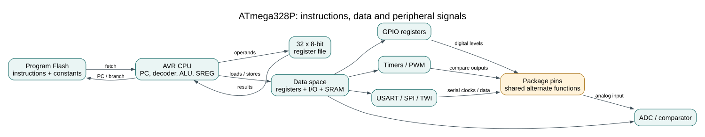

# ATmega328P Specifications and Practical Limits
## Objectives and Prerequisites

After this lesson you can find key device resources in the datasheet, distinguish the ATmega328P chip from the Uno R3 board, and explain why a headline specification is not a safe design limit. You should know the [architecture](avr-architecture.md) and [memory spaces](memory-architecture.md).



## Start with the Exact Part

The course target is an **Arduino Uno R3 fitted with an ATmega328P at 16 MHz**. That board choice fixes a clock, package, USB-to-serial interface, power circuitry, bootloader and exposed connector pinout. The ATmega328P device itself is a separate component; other boards may use different chips, clocks, bootloaders and pin mappings.

| ATmega328P resource | Device-level summary | What it means in this course |
| --- | --- | --- |
| CPU | 8-bit AVR core, 32 working registers | Values and pointers have sizes defined by the compiler and C types |
| Program memory | 32 KiB Flash | Instructions and program constants; part may be reserved by a bootloader |
| Data memory | 2 KiB SRAM | Globals, static data, stack and runtime buffers share a small budget |
| Nonvolatile data | 1 KiB EEPROM | Retained bytes for infrequently changed settings |
| Digital I/O | Up to 23 general-purpose I/O lines on supported packages | Not every line is exposed as a header pin on the Uno |
| Timers | Two 8-bit and one 16-bit timer/counter | PWM channels and timing resources have shared ownership |
| Serial peripherals | USART, SPI and TWI (commonly called I2C) | Peripheral pins are multiplexed with GPIO functions |
| Analog conversion | 10-bit ADC; six inputs on the Uno package, more on 32-pin packages | Input count depends on package; the Uno exposes A0-A5 |
| PWM outputs | Six hardware compare outputs | They are tied to timer channels and specific pins, not available on every GPIO |
| Supply range | 1.8 V to 5.5 V for the device under specified conditions | This is a chip operating range, not a promise that every speed works at every voltage |

For current device details, use the [Microchip ATmega328P documentation](https://www.microchip.com/en-us/product/ATMEGA328P). Check the document listed for your exact device and package; board-level pin labels and circuitry are covered by the [Uno R3 pinout](https://www.arnabkumardas.com/pinout/arduino-uno-r3/).

## Worked Calculation: ADC Steps

A 10-bit ADC has `2^10 = 1024` output codes, numbered 0 through 1023. If an ideal conversion spans 0 V to a 5.00 V reference, one least-significant-bit step is approximately:

```text
5.00 V / 1024 = 0.0048828 V = 4.88 mV per code
```

This is an ideal code width, not a claim of 4.88 mV absolute measurement accuracy. Reference tolerance, ADC offset/gain error, noise, source impedance and board layout affect real readings. Use the actual reference voltage in calculations and calibrate when accuracy matters.

## Limits Are Not Recommended Operating Points

A datasheet may specify absolute maximum ratings, recommended operating conditions and electrical characteristics in different tables. An **absolute maximum** is a stress boundary; it is not a current or voltage target for routine use. A GPIO pin also cannot safely power motors, relays or high-current LED loads directly. Use a suitable driver, common reference/ground where required, and protection components appropriate to the load.

Clock speed and supply voltage are related: do not assume the Uno's 16 MHz clock is valid at every voltage allowed for the silicon. Follow the datasheet speed grade and operating-condition graphs for the exact part. In this course, keep the Uno at its installed 16 MHz clock and use the 5 V board logic as the interface reference. Check a module's input tolerance before connecting it; a 3.3 V sensor may not tolerate a 5 V Uno output.

## Read the Build Report Against the Resource Budget

Build the small register-level example and its HAL counterpart:

```powershell
python "atmega328p-labs/tools/build.py" 01-blink-register --compiler gcc
python "atmega328p-labs/tools/build.py" 01-blink-register --compiler xc8
python "atmega328p-labs/tools/build.py" 02-blink-hal --compiler gcc
python "atmega328p-labs/tools/build.py" 02-blink-hal --compiler xc8
```

Both use the same ATmega328P resources but may produce different Flash sizes because abstraction and compiler choices affect generated instructions. A successful compile says the image fits the configured software limit; it does not establish electrical safety, timing accuracy or hardware operation. The [self-test lab](<https://github.com/arnabdasbwn/atmega328p-labs/blob/main/examples/90-selftest/main.c>) checks selected software assumptions without replacing external measurements.

## Exercise with Answer

An Uno reading uses the default 10-bit ADC setting and a measured reference of 4.80 V. What is the ideal voltage per ADC code? Does that value prove the measurement is accurate to one code?

**Answer:** `4.80 V / 1024 = 0.0046875 V`, about `4.69 mV` per code. No. Quantization step is not total measurement accuracy; reference error, converter error, noise and source conditions also matter.

## Code Walkthrough


**Example code on GitHub:**
- [Register-level Blink (`01-blink-register`)](https://github.com/arnabdasbwn/atmega328p-labs/blob/main/examples/01-blink-register/main.c)

### Register-level Blink
The example's `main()` configures its peripherals, runs the algorithm and reports or displays the result. These source operations are listed in execution order:

- `PORTB &= (uint8_t)~_BV(PORTB5);` - Sets or clears the Port B output latch. When the pin is an output, this determines its output level; on an input, it controls the pull-up.
- `DDRB |= _BV(DDB5);` - Sets the Port B direction bits; a set bit selects output mode.
- `for (;;)` - Repeats the foreground task indefinitely; each pass checks inputs, advances the calculation or services the peripheral shown below.
- `PINB = _BV(PINB5);` - Writing a one to a PINB bit toggles that pin's PORTB output latch on the ATmega328P.
- `_delay_ms(500);` - Waits for the stated interval; the foreground does no other work during this blocking delay.

Algorithm: Pin direction and output latch are separate hardware state.
Expected behaviour: L toggles every 500 ms
**HAL source files in this repository:** [ATmega328P HAL on GitHub](https://github.com/arnabdasbwn/atmega328p-hal)


### HAL Software Self-Test
The example's `main()` configures its peripherals, runs the algorithm and reports or displays the result. These source operations are listed in execution order:

- `avr_debounce_t button;` - Use the linked public header for this function's parameters, register ownership, blocking behavior and status values.
- `uint8_t result = 0U;` - Clears the state/counter after its threshold is reached so the next interval starts from zero.
- `(void)avr_uart_init(9600UL);` - Configures USART0 for asynchronous 8N1. It chooses a baud divisor and normal/double-speed mode, programs UBRR0/UCSR0A/UCSR0C, then enables receive and transmit in UCSR0B.
- `CHECK(avr_gpio_mode(20U, AVR_GPIO_OUTPUT) == AVR_ERROR_ARGUMENT);` - Maps the Uno header pin to its AVR port, sets its DDR direction bit and prepares the PORT latch for the requested initial level or pull-up.
- `CHECK(avr_gpio_read(13U, NULL) == AVR_ERROR_ARGUMENT);` - Reads the electrical level through PINx without changing direction or the output latch.
- `CHECK(avr_timer_ctc(AVR_TIMER0, 32U, 100U) == AVR_ERROR_ARGUMENT);` - Configures 0 in CTC mode with prescaler 32 and OCRnA TOP 100; event rate is 16 MHz / (32 x (100 + 1)) = 4950.5 Hz. The HAL disables this timer's interrupt sources and leaves flag polling to the caller.
- `CHECK(avr_timer_ctc(AVR_TIMER0, 64U, 256U) == AVR_ERROR_ARGUMENT);` - Configures 0 in CTC mode with prescaler 64 and OCRnA TOP 256; event rate is 16 MHz / (64 x (256 + 1)) = 972.763 Hz. The HAL disables this timer's interrupt sources and leaves flag polling to the caller.
- `CHECK(avr_timer_ctc(AVR_TIMER2, 128U, 124U) == AVR_OK);` - Configures 2 in CTC mode with prescaler 128 and OCRnA TOP 124; event rate is 16 MHz / (128 x (124 + 1)) = 1000 Hz. The HAL disables this timer's interrupt sources and leaves flag polling to the caller.
- `CHECK((TCCR2B & 7U) == 5U);` - Selects Timer2 clock/prescaler and remaining waveform bits. Timer2 has distinct prescaler encodings.
- `CHECK(avr_timer1_pwm(8U, 40000U, 3000U) == AVR_OK);` - Configures Timer1 mode 14 with prescaler 8; ICR1 becomes 39999, giving a 20 ms frame, and OCR1A starts at 3000 ticks (1500 us high).
- `CHECK(ICR1 == 39999U && OCR1A == 3000U);` - Timer1 input-capture register and, in the selected PWM mode, the TOP value. Timer1 Compare A; it sets the match point or PWM pulse width.
- `CHECK(avr_adc_millivolts(512U, 5000U) == 2500U);` - Calls `avr_adc_millivolts()`; its public HAL header defines the arguments, register ownership, blocking behavior and status results.
- `CHECK(avr_adc_read(6U, NULL, 0U) == AVR_ERROR_ARGUMENT);` - Calls `avr_adc_read()`; its public HAL header defines the arguments, register ownership, blocking behavior and status results.
- `CHECK(avr_eeprom_read(1024U, &result, 0UL) == AVR_ERROR_ARGUMENT);` - Calls `avr_eeprom_read()`; its public HAL header defines the arguments, register ownership, blocking behavior and status results.
- `CHECK(avr_twi_transfer(0U, NULL, 0U, NULL, 0U, 0UL) == AVR_ERROR_ARGUMENT);` - Calls `avr_twi_transfer()`; its public HAL header defines the arguments, register ownership, blocking behavior and status results.
- `CHECK(avr_elapsed(5UL, UINT32_MAX - 4UL, 10UL));` - Calls `avr_elapsed()`; its public HAL header defines the arguments, register ownership, blocking behavior and status results.
- `CHECK(!avr_elapsed(5UL, UINT32_MAX - 4UL, 11UL));` - Calls `avr_elapsed()`; its public HAL header defines the arguments, register ownership, blocking behavior and status results.
- `avr_debounce_init(&button, true, UINT32_MAX - 10UL);` - Calls `avr_debounce_init()`; its public HAL header defines the arguments, register ownership, blocking behavior and status results.
- `CHECK(!avr_debounce_update(&button, false, UINT32_MAX - 9UL, 20U));` - Calls `avr_debounce_update()`; its public HAL header defines the arguments, register ownership, blocking behavior and status results.
- `CHECK(!avr_debounce_update(&button, false, 9UL, 20U));` - Calls `avr_debounce_update()`; its public HAL header defines the arguments, register ownership, blocking behavior and status results.
- `CHECK(avr_debounce_update(&button, false, 10UL, 20U));` - Accepts a changed input only after it remains stable for the requested interval, then reports that accepted change once.
- `CHECK(!avr_debounce_update(&button, false, 11UL, 20U));` - Accepts a changed input only after it remains stable for the requested interval, then reports that accepted change once.
- `(void)avr_uart_write((const uint8_t *)"PASS\n", 5U, AVR_POLL_BUDGET);` - Sends the specified bytes through USART0; a timeout can occur after a prefix has already been sent.
- `for (;;)` - Repeats the foreground task indefinitely; each pass checks inputs, advances the calculation or services the peripheral shown below.

Algorithm: A bounded self-test checks software contracts and links a second source file so header-owned definitions are detected.
Expected behaviour: The fixture prints PASS after argument, timer-range, debounce and independent-translation-unit checks; otherwise it prints FAIL and stops
**HAL source files in this repository:** [ATmega328P HAL on GitHub](https://github.com/arnabdasbwn/atmega328p-hal)

- [`include/avr_hal/adc.h`](https://github.com/arnabdasbwn/atmega328p-hal/blob/main/include/avr_hal/adc.h)
- [`include/avr_hal/common.h`](https://github.com/arnabdasbwn/atmega328p-hal/blob/main/include/avr_hal/common.h)
- [`include/avr_hal/eeprom.h`](https://github.com/arnabdasbwn/atmega328p-hal/blob/main/include/avr_hal/eeprom.h)
- [`include/avr_hal/gpio.h`](https://github.com/arnabdasbwn/atmega328p-hal/blob/main/include/avr_hal/gpio.h)
- [`include/avr_hal/timer.h`](https://github.com/arnabdasbwn/atmega328p-hal/blob/main/include/avr_hal/timer.h)
- [`include/avr_hal/twi.h`](https://github.com/arnabdasbwn/atmega328p-hal/blob/main/include/avr_hal/twi.h)
- [`include/avr_hal/uart.h`](https://github.com/arnabdasbwn/atmega328p-hal/blob/main/include/avr_hal/uart.h)
- [`lib/drivers/debounce.c`](https://github.com/arnabdasbwn/atmega328p-hal/blob/main/lib/drivers/debounce.c)
- [`lib/drivers/debounce.h`](https://github.com/arnabdasbwn/atmega328p-hal/blob/main/lib/drivers/debounce.h)
- [`src/adc.c`](https://github.com/arnabdasbwn/atmega328p-hal/blob/main/src/adc.c)
- [`src/common.c`](https://github.com/arnabdasbwn/atmega328p-hal/blob/main/src/common.c)
- [`src/eeprom.c`](https://github.com/arnabdasbwn/atmega328p-hal/blob/main/src/eeprom.c)
- [`src/gpio.c`](https://github.com/arnabdasbwn/atmega328p-hal/blob/main/src/gpio.c)
- [`src/timer.c`](https://github.com/arnabdasbwn/atmega328p-hal/blob/main/src/timer.c)
- [`src/twi.c`](https://github.com/arnabdasbwn/atmega328p-hal/blob/main/src/twi.c)
- [`src/uart.c`](https://github.com/arnabdasbwn/atmega328p-hal/blob/main/src/uart.c)


## References

For current device details, use the [Microchip ATmega328P documentation](https://www.microchip.com/en-us/product/ATMEGA328P). Check the document listed for your exact device and package; board-level pin labels and circuitry are covered by the [Uno R3 pinout](https://www.arnabkumardas.com/pinout/arduino-uno-r3/).
