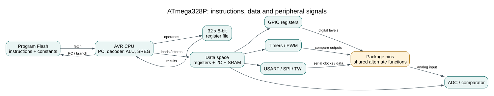

# The ATmega328P at a Glance
## Objectives and Prerequisites

Name the main parts of the ATmega328P, trace how a value reaches a physical pin,
and explain why a board pin can have several hardware functions. You should have
read the [CPU execution](cpu-core.md) and [memory spaces](memory-architecture.md)
lessons.

## Follow an Instruction to a Pin



The CPU fetches instructions from program Flash. It loads and stores working values
through data space, where the CPU register file, I/O registers and SRAM have
different addresses and behavior. When software writes a GPIO register, the port
peripheral updates its output latch; the corresponding package pin then drives the
selected electrical level. A timer or serial peripheral can use the same pin when
its alternate function is selected.

Peripherals work alongside the CPU. A timer counts clock events without a C loop
checking every edge. The USART shifts serial bits while software handles bytes.
The ADC converts an analog voltage into a numeric result. These peripherals expose
control and status registers in data space, so C code configures them and checks
their results.

## Worked Mapping: Uno D13

On the Uno R3, digital header D13 maps to ATmega328P port bit PB5. That package pin
also has the SPI clock function SCK. A basic Blink example selects the GPIO role by
setting `DDB5` in `DDRB`, then changes the output latch with `PINB`.

The board's onboard LED connects to D13 through board circuitry. When an SPI
peripheral is active, the same pin carries SCK. The header number, port bit and
alternate function are three names for related parts of one path; code must use
the naming convention expected by the API it calls. The [interactive Uno pinout](https://www.arnabkumardas.com/pinout/arduino-uno-r3/)
shows board-header mappings.

## Why Peripherals Need Ownership

Two pieces of software cannot safely configure one hardware resource independently.
For example, Arduino core timing uses Timer0, while a register-level experiment may
want Timer0 for a periodic interrupt. If both configure its prescaler and compare
registers, timing changes unexpectedly. Each lab therefore names its timer, pins
and interrupt vectors, and Arduino comparisons are separate projects from the
bare-metal HAL examples.

The same rule applies to pins: the SPI loopback lab uses the SPI pins as a bus,
while Blink uses D13 as an LED output. Check the wiring table and pin owner before
adding a second device. Never infer electrical compatibility from a matching pin
name; module voltage, pull-ups and driver requirements still matter.

## Try the Model

Build the register-level Blink and UART echo programs:

```powershell
python "atmega328p-labs/tools/build.py" 01-blink-register --compiler gcc
python "atmega328p-labs/tools/build.py" 01-blink-register --compiler xc8
python "atmega328p-labs/tools/build.py" 14-uart-echo --compiler gcc
python "atmega328p-labs/tools/build.py" 14-uart-echo --compiler xc8
```

Blink changes a GPIO output. UART echo configures the USART peripheral and exchanges
bytes through the Uno serial connection. Their source code uses different
peripherals, but both follow the same pattern: configure registers, perform bounded
work, and observe a result. Compilation does not verify the pin voltage or a
physical serial connection.

## Exercise with Answer

You want to produce a periodic waveform on D9 while also using D13 for the onboard
LED. Which peripheral should you inspect first, and why can the Arduino pin numbers
alone not answer the question?

**Answer:** inspect the Uno pinout and the timer output mapping for D9, then check
timer ownership in the example. Arduino header numbers do not show which timer
compare output or AVR port bit is connected internally.

## Code Walkthrough


**Example code on GitHub:**
- [Register-level Blink (`01-blink-register`)](https://github.com/arnabdasbwn/atmega328p-labs/blob/main/examples/01-blink-register/main.c)
- [Debounced push button (`03-button`)](https://github.com/arnabdasbwn/atmega328p-labs/blob/main/examples/03-button/main.c)
- [Bounded UART echo (`14-uart-echo`)](https://github.com/arnabdasbwn/atmega328p-labs/blob/main/examples/14-uart-echo/main.c)

### Register-level Blink
The example's `main()` configures its peripherals, runs the algorithm and reports or displays the result. These source operations are listed in execution order:

- `PORTB &= (uint8_t)~_BV(PORTB5);` - Sets or clears the Port B output latch. When the pin is an output, this determines its output level; on an input, it controls the pull-up.
- `DDRB |= _BV(DDB5);` - Sets the Port B direction bits; a set bit selects output mode.
- `for (;;)` - Repeats the foreground task indefinitely; each pass checks inputs, advances the calculation or services the peripheral shown below.
- `PINB = _BV(PINB5);` - Writing a one to a PINB bit toggles that pin's PORTB output latch on the ATmega328P.
- `_delay_ms(500);` - Waits for the stated interval; the foreground does no other work during this blocking delay.

Algorithm: Pin direction and output latch are separate hardware state.
Expected behaviour: L toggles every 500 ms
**HAL source files in this repository:** [ATmega328P HAL on GitHub](https://github.com/arnabdasbwn/atmega328p-hal)


### Debounced push button
The example's `main()` configures its peripherals, runs the algorithm and reports or displays the result. These source operations are listed in execution order:

- `avr_debounce_t button;` - Use the linked public header for this function's parameters, register ownership, blocking behavior and status values.
- `bool level = true;` - Stores this intermediate or output value for the next algorithm step. Check the units and range represented by each operand.
- `bool led = false;` - Stores this intermediate or output value for the next algorithm step. Check the units and range represented by each operand.
- `(void)avr_gpio_mode(2U, AVR_GPIO_INPUT_PULLUP);` - Maps the Uno header pin to its AVR port, sets its DDR direction bit and prepares the PORT latch for the requested initial level or pull-up.
- `(void)avr_gpio_mode(13U, AVR_GPIO_OUTPUT);` - Maps the Uno header pin to its AVR port, sets its DDR direction bit and prepares the PORT latch for the requested initial level or pull-up.
- `avr_tick_init();` - Configures the course millisecond tick interrupt source; it does not enable global interrupts itself.
- `avr_debounce_init(&button, true, 0UL);` - Seeds the stable/candidate input state and timestamp so the next transition is timed consistently.
- `sei();` - Enables global interrupts after the example has configured its sources and shared state.
- `for (;;)` - Repeats the foreground task indefinitely; each pass checks inputs, advances the calculation or services the peripheral shown below.
- `(void)avr_gpio_read(2U, &level);` - Reads the electrical level through PINx without changing direction or the output latch.
- `if (avr_debounce_update(&button, level, avr_tick_ms(), 20U) && !button.stable)` - This condition chooses the next path based on the API result. Accepts a changed input only after it remains stable for the requested interval, then reports that accepted change once.
- `led = !led;` - Stores this intermediate or output value for the next algorithm step. Check the units and range represented by each operand.
- `(void)avr_gpio_write(13U, led);` - Changes the pin's PORT output latch; for an input pin this selects its pull-up state.

Algorithm: A candidate input must remain unchanged for 20 ms before becoming stable. No delay occurs inside an ISR.
Expected behaviour: Each press toggles L once; holding the button does not repeat
**HAL source files in this repository:** [ATmega328P HAL on GitHub](https://github.com/arnabdasbwn/atmega328p-hal)

- [`include/avr_hal/gpio.h`](https://github.com/arnabdasbwn/atmega328p-hal/blob/main/include/avr_hal/gpio.h)
- [`include/avr_hal/tick.h`](https://github.com/arnabdasbwn/atmega328p-hal/blob/main/include/avr_hal/tick.h)
- [`lib/drivers/debounce.c`](https://github.com/arnabdasbwn/atmega328p-hal/blob/main/lib/drivers/debounce.c)
- [`lib/drivers/debounce.h`](https://github.com/arnabdasbwn/atmega328p-hal/blob/main/lib/drivers/debounce.h)
- [`lib/interrupts/tick.c`](https://github.com/arnabdasbwn/atmega328p-hal/blob/main/lib/interrupts/tick.c)
- [`src/gpio.c`](https://github.com/arnabdasbwn/atmega328p-hal/blob/main/src/gpio.c)


### Bounded UART echo
The example's `main()` configures its peripherals, runs the algorithm and reports or displays the result. These source operations are listed in execution order:

- `(void)avr_uart_init(9600UL);` - Configures USART0 for asynchronous 8N1. It chooses a baud divisor and normal/double-speed mode, programs UBRR0/UCSR0A/UCSR0C, then enables receive and transmit in UCSR0B.
- `for (;;)` - Repeats the foreground task indefinitely; each pass checks inputs, advances the calculation or services the peripheral shown below.
- `avr_status_t status = avr_uart_get(&byte, AVR_POLL_BUDGET);` - Use the linked public header for this function's parameters, register ownership, blocking behavior and status values.
- `if (status == AVR_OK)` - Only enters the following block when the operation reports success.
- `(void)avr_uart_put(byte, AVR_POLL_BUDGET);` - Waits for the USART transmit buffer within its poll budget, then writes the byte to UDR0.

Algorithm: One 8N1 frame contains ten bits. At 9600 baud, a frame takes approximately 1.042 ms; the application must service reception before hardware buffering overflows.
Expected behaviour: Each received byte is echoed once
**HAL source files in this repository:** [ATmega328P HAL on GitHub](https://github.com/arnabdasbwn/atmega328p-hal)

- [`include/avr_hal/uart.h`](https://github.com/arnabdasbwn/atmega328p-hal/blob/main/include/avr_hal/uart.h)
- [`src/uart.c`](https://github.com/arnabdasbwn/atmega328p-hal/blob/main/src/uart.c)


## References

For current device details, use the [Microchip ATmega328P documentation](https://www.microchip.com/en-us/product/ATMEGA328P). Check the document listed for your exact device and package; board-level pin labels and circuitry are covered by the [Uno R3 pinout](https://www.arnabkumardas.com/pinout/arduino-uno-r3/).
