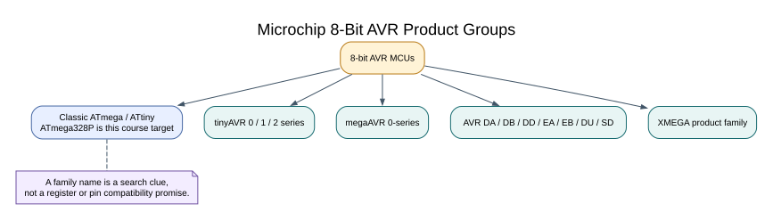

# The AVR Microcontroller Families

## Objectives and Prerequisites

This lesson places the ATmega328P in Microchip's 8-bit AVR range. You will learn why names such as ATtiny, ATmega and AVR DA are useful clues, but are not enough to determine a device's pins, registers or toolchain support.

## Family Names Are a Starting Point

The classic **ATmega328P** on the Uno R3 is an 8-bit AVR microcontroller with the familiar register set and peripheral organisation taught in this course. Microchip documentation covers classic ATtiny and ATmega devices, XMEGA parts, tinyAVR 0/1/2, megaAVR 0-Series, and newer AVR DA, DB, DD, DU, EA, EB and SD groups. These names help you find the right documentation; they do not promise that register layouts, peripherals or board pins match. Check the exact part and device pack before carrying code across families.

Product names can also look similar while describing parts with different memory sizes, package pins, supply limits or peripherals. A board pin named `D2` is a board-level label; the corresponding physical pin depends on the exact MCU package and board schematic.

| What to check | Why it matters |
| --- | --- |
| Full part number and revision | Confirms the exact device and supported features |
| Package and pin count | Determines which signals are physically available |
| Device datasheet and errata | Defines register behaviour, limits and known corrections |
| Compiler and device pack support | Determines available headers, linker settings and project support |
| Board schematic and clock source | Maps logical board pins and timing to the actual hardware |



## Worked Selection Example

Suppose a design uses the Uno's D2 interrupt input and an ADC sensor on A0. Those names describe the Uno R3 headers. Before moving the firmware to another AVR board, trace D2 and A0 through that board's schematic, then confirm the matching alternate functions and electrical limits in the exact MCU datasheet. If either signal maps differently, the source and wiring need to change.

The same rule applies to code. Similar register names do not guarantee identical flags, write behaviour or interrupt vectors. Porting means checking and adapting the hardware contract, then rebuilding and testing on the new target.

## Keep This Course on One Device

All register-level examples here target the **ATmega328P at 16 MHz on an Arduino Uno R3**. The course's build settings, pin tables and memory limits are for that target. Do not select an ATmega328PB, Uno R4 or an arbitrary ATtiny as a substitute without adapting the project.

## Build the Uno Example

The family names do not change this course's target. Build [Lab 01](<https://github.com/arnabdasbwn/atmega328p-labs/blob/main/examples/01-blink-register/main.c>) for the Uno using either supported compiler:

```powershell
python "atmega328p-labs/tools/build.py" 01-blink-register --compiler gcc
python "atmega328p-labs/tools/build.py" 01-blink-register --compiler xc8
```

Both commands select the ATmega328P build configuration. They do not demonstrate that the same code runs unchanged on another AVR family.

## Exercise with Answer

You find another AVR chip with more Flash than the ATmega328P. Can you assume the Uno's timer code will compile and behave identically?

**Answer:** No. Check the exact part's timer instances, register definitions, clock and pin mapping, interrupt vectors, compiler support and errata. A larger memory size does not guarantee peripheral compatibility.

## Code Walkthrough

### Register-level Blink
The example's `main()` configures its peripherals, runs the algorithm and reports or displays the result. These source operations are listed in execution order:

- `PORTB &= (uint8_t)~_BV(PORTB5);` - Sets or clears the Port B output latch. When the pin is an output, this determines its output level; on an input, it controls the pull-up.
- `DDRB |= _BV(DDB5);` - Sets the Port B direction bits; a set bit selects output mode.
- `for (;;)` - Repeats the foreground task indefinitely; each pass checks inputs, advances the calculation or services the peripheral shown below.
- `PINB = _BV(PINB5);` - Writing a one to a PINB bit toggles that pin's PORTB output latch on the ATmega328P.
- `_delay_ms(500);` - Waits for the stated interval; the foreground does no other work during this blocking delay.

Algorithm: Pin direction and output latch are separate hardware state.
Expected behaviour: L toggles every 500 ms
**HAL source files in this repository:** [ATmega328P HAL on GitHub](https://github.com/arnabdasbwn/atmega328p-hal)


## References

- Microchip, [AVR microcontroller product range](https://www.microchip.com/en-us/products/microcontrollers/8-bit-mcus/avr-mcus)
- Microchip, [ATmega328P product page and device documents](https://www.microchip.com/en-us/product/ATMEGA328P)
- [ATmega328P specifications and practical limits](atmega328p-specs.md)
- [Uno pin names and ATmega328P alternate functions](pin-multiplexing.md)
