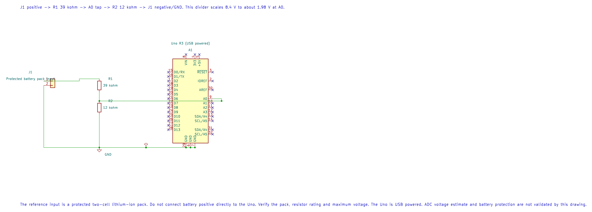

# Battery Voltage Indicator

## What You Will Learn

- Scale a battery voltage so it stays within the ADC input range.
- Calculate the divider ratio, ADC source resistance and measurement formula.
- Convert an ADC sample to millivolts using a wider integer type.
- Distinguish a measured voltage from state-of-charge estimation or battery protection.

The reference is a protected two-cell lithium-ion pack. Its maximum charging voltage is 8.4 V. This demonstration only measures the pack while the Uno is powered from USB. It is not a charger, balancing circuit, undervoltage cutoff or safety monitor.

## Select the Divider

The circuit uses 39 kOhm from battery positive to A0 and 12 kOhm from A0 to ground. At 8.4 V, the ADC input is:

```text
V_A0 = 8.4 x 12 / (39 + 12) = 1.976 V
R_source = 39 kOhm || 12 kOhm = 9.18 kOhm
```

The divider keeps A0 below AVCC and gives the ADC a source resistance near the ATmega328P's recommended range. Keep the battery's negative terminal connected to Uno GND. Never connect the battery directly to A0, the 5 V pin, or USB.



| Connection | Destination | Reason |
| --- | --- | --- |
| Protected pack positive | 39 kOhm resistor, then A0 | Scales the pack voltage |
| A0 | 12 kOhm resistor, then pack negative | Divider return |
| Pack negative | Uno GND | Shared voltage reference |
| Uno | USB power | Keeps the demo independent of the pack input |

Measure resistor values and supply reference if accuracy matters. Use resistors with adequate voltage and power ratings. This divider slowly draws current from the pack while connected.

## Convert ADC Counts to Pack Voltage

With a nominal 5.000 V AVCC reference and a 10-bit ADC, the code estimates:

```text
V_pack_mV = ADC_code x 5000 x (39 + 12) / (1024 x 12)
```

The code widens the sample before multiplication because AVR `int` is only 16 bits. It prints a voltage twice per second. AVCC is not a precision reference; USB voltage, regulator drop, resistor tolerance and ADC error all affect the result. Calibrate the reference and divider against a meter before using the number for decisions.

Build the program with either supported compiler:

```powershell
python "atmega328p-labs/tools/build.py" 78-battery-indicator --compiler gcc
python "atmega328p-labs/tools/build.py" 78-battery-indicator --compiler xc8
```

Expected output is a decimal voltage reading with three fractional digits. The source is a measurement example, not a battery state-of-charge meter. Voltage changes with load, temperature, age and cell chemistry; do not infer a safe discharge limit from this exercise.

<!-- source: atmega328p-labs/examples/78-battery-indicator/main.c -->

```c
/**
 * @file main.c
 * @brief Measure a protected two-cell battery with an ADC divider.
 * @details Uno R3 at 16 MHz. A 39 kohm top resistor and 12 kohm bottom resistor scale an 8.4 V
 * maximum input to about 1.98 V at A0. Use a protected pack and a separately powered measurement
 * circuit; connect grounds. AVCC is treated as 5000 mV in this example and must be calibrated.
 * This reports voltage, not state of charge or a protective cutoff. Hardware has not been tested.
 * @copyright Copyright (c) 2026 Arnab Kumar Das. CC-BY-SA-3.0.
 */
#include "avr_hal/adc.h"
#include "avr_hal/uart.h"
#include <util/delay.h>

/**
 * @brief Print a bounded decimal voltage reading.
 * @param[in] millivolts Measurement in millivolts, 0..65535.
 * @retval AVR_OK Digits and unit were queued.
 * @retval AVR_ERROR_TIMEOUT A prefix may have been sent.
 * @details Prints integer volts with three fractional digits. Foreground only after UART setup.
 */
static avr_status_t print_millivolts(uint16_t millivolts)
{
    avr_status_t status = avr_uart_u16((uint16_t)(millivolts / 1000U));
    if (status == AVR_OK)
    {
        status = avr_uart_put((uint8_t)'.', AVR_POLL_BUDGET);
    }
    if (status == AVR_OK)
    {
        uint16_t fraction = (uint16_t)(millivolts % 1000U);
        status = avr_uart_put((uint8_t)('0' + (fraction / 100U)), AVR_POLL_BUDGET);
        if (status == AVR_OK)
        {
            status = avr_uart_put((uint8_t)('0' + ((fraction / 10U) % 10U)), AVR_POLL_BUDGET);
        }
        if (status == AVR_OK)
        {
            status = avr_uart_put((uint8_t)('0' + (fraction % 10U)), AVR_POLL_BUDGET);
        }
    }
    if (status == AVR_OK)
    {
        status = avr_uart_write((const uint8_t *)" V\r\n", 4U, AVR_POLL_BUDGET);
    }
    return status;
}

/**
 * @brief Sample the divider and print the estimated pack voltage.
 * @return Does not return after successful peripheral setup.
 * @details Configures AVCC ADC reference, A0, and USART0 at 9600 8N1. Formula assumes 5000 mV
 * AVCC and the 39 kohm/12 kohm divider: code * 5000 * 51 / (1024 * 12). Use 32-bit intermediates.
 * Any setup or runtime timeout enters a terminal loop; no battery protection is implemented.
 */
int main(void)
{
    if ((avr_adc_init(AVR_ADC_AVCC) != AVR_OK) || (avr_uart_init(9600UL) != AVR_OK))
    {
        for (;;)
        {
        }
    }
    for (;;)
    {
        uint16_t sample = 0U;
        avr_status_t status = avr_adc_read(0U, &sample, AVR_POLL_BUDGET);
        uint32_t millivolts = ((uint32_t)sample * 5000UL * 51UL) / (1024UL * 12UL);
        if ((status == AVR_OK) && (millivolts <= UINT16_MAX))
        {
            status = print_millivolts((uint16_t)millivolts);
        }
        if (status != AVR_OK)
        {
            for (;;)
            {
            }
        }
        _delay_ms(500);
    }
}
```

<!-- /source -->

## Code Walkthrough

### Protected battery voltage indicator
The example's `main()` configures its peripherals, runs the algorithm and reports or displays the result. These source operations are listed in execution order:

- `if ((avr_adc_init(AVR_ADC_AVCC) != AVR_OK) || (avr_uart_init(9600UL) != AVR_OK))` - This checks for any setup or transfer error before the program continues. Selects the reference in ADMUX and enables the ADC in ADCSRA with a divide-by-128 prescaler. At 16 MHz, the ADC clock is 125 kHz. The HAL keeps the result right-adjusted, waits for reference settling and leaves ADC interrupts disabled. Configures USART0 for asynchronous 8N1. It chooses a baud divisor and normal/double-speed mode, programs UBRR0/UCSR0A/UCSR0C, then enables receive and transmit in UCSR0B.
- `for (;;)` - Repeats the foreground task indefinitely; each pass checks inputs, advances the calculation or services the peripheral shown below.
- `uint16_t sample = 0U;` - Clears the state/counter after its threshold is reached so the next interval starts from zero.
- `avr_status_t status = avr_adc_read(0U, &sample, AVR_POLL_BUDGET);` - Selects the requested ADC channel in ADMUX, disables that pin's digital buffer through DIDR0, discards the first conversion after a channel change, then polls with a finite budget and returns the 10-bit result.
- `uint32_t millivolts = ((uint32_t)sample * 5000UL * 51UL) / (1024UL * 12UL);` - Converts the integer ADC code into millivolts using the reference or divider ratio stated in the expression.
- `if ((status == AVR_OK) && (millivolts <= UINT16_MAX))` - Only enters the following block when the operation reports success.
- `status = print_millivolts((uint16_t)millivolts);` - Stores this intermediate or output value for the next algorithm step. Check the units and range represented by each operand.
- `if (status != AVR_OK)` - Tests the stated condition; the following block handles the matching case and the other path is skipped.
- `_delay_ms(500);` - Waits for the stated interval; the foreground does no other work during this blocking delay.

Algorithm: The divider scales 8.4 V to about 1.976 V. Its 9.18 kohm Thevenin resistance stays near the ADC's recommended source range; quantization and AVCC tolerance limit accuracy.
Expected behaviour: For a protected 2-cell pack constrained to 0..8.4 V, the terminal reports a reading near the applied input twice per second. Quantization, AVCC and resistor tolerances affect the result
**HAL source files in this repository:** [ATmega328P HAL on GitHub](https://github.com/arnabdasbwn/atmega328p-hal)

- [`include/avr_hal/adc.h`](https://github.com/arnabdasbwn/atmega328p-hal/blob/main/include/avr_hal/adc.h)
- [`include/avr_hal/uart.h`](https://github.com/arnabdasbwn/atmega328p-hal/blob/main/include/avr_hal/uart.h)
- [`src/adc.c`](https://github.com/arnabdasbwn/atmega328p-hal/blob/main/src/adc.c)
- [`src/uart.c`](https://github.com/arnabdasbwn/atmega328p-hal/blob/main/src/uart.c)


## Common Problems

- **Reading is consistently high or low:** Measure AVCC and the divider resistors; the example assumes 5.000 V and nominal resistor values.
- **A0 reads zero:** Check the divider return, pack negative and common ground.
- **A0 voltage exceeds the reference:** Disconnect the pack and recheck the divider values and maximum pack voltage before reconnecting.
- **Readings jump:** Check wiring, use short leads and average samples only after understanding ADC source settling and noise.
- **Battery drains while idle:** The resistor divider remains connected and consumes current even when the Uno is not sampling.

## Try It Yourself

If the real AVCC is 4.85 V but the conversion formula uses 5.00 V, which way will the calculated battery reading shift?

**Answer:** It will read high. The ADC code is based on 4.85 V, but the calculation multiplies it by 5.00 V.

## References

- [Lab 78 source and wiring metadata](<https://github.com/arnabdasbwn/atmega328p-labs/blob/main/examples/78-battery-indicator/main.c>)
- [ATmega328P documentation and datasheet](https://www.microchip.com/en-us/product/ATMEGA328P), ADC electrical characteristics and conversion formula
- [ADC concepts](adc-concepts.md)
- [Electrical levels and safe loads](electrical.md)
