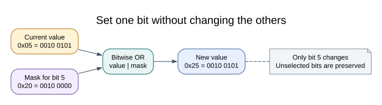

# Binary, Hexadecimal and Bit Masks

## What You Will Learn

Read an eight-bit register, convert between binary and hexadecimal, and construct a
mask that changes one bit. You need basic C expressions and the Uno pin naming from
[Blink](first-blink.md). No extra hardware is needed for the paper exercises.

## One Byte, Eight Decisions

A byte holds eight bits. From bit 7 down to bit 0 their weights are 128, 64, 32, 16,
8, 4, 2 and 1. The pattern `0010 0101` therefore represents 32 + 4 + 1 = **37**.
Grouping bits into nibbles makes hexadecimal convenient: `0010` is 2 and `0101`
is 5, so the same value is `0x25`. A hex digit represents four bits, not four bytes.

| Bit | 7 | 6 | 5 | 4 | 3 | 2 | 1 | 0 |
| --- | --- | --- | --- | --- | --- | --- | --- | --- |
| Value in `0x25` | 0 | 0 | 1 | 0 | 0 | 1 | 0 | 1 |
| Weight | 128 | 64 | 32 | 16 | 8 | 4 | 2 | 1 |

In a register, the same byte may represent eight independent controls rather than
the number 37. For `DDRB`, a one selects output direction for that port bit. The
datasheet defines the meaning; C does not know whether a byte is a count or control.

## Set, Clear, Test and Toggle

PB5 needs the mask `0x20`: only bit 5 is one. `_BV(PB5)` is the AVR header's spelling
for that mask. The complete, documented program is
[01-blink-register/main.c](<https://github.com/arnabdasbwn/atmega328p-labs/blob/main/examples/01-blink-register/main.c>).

| Purpose for an ordinary byte `value` | Expression | Other bits |
| --- | --- | --- |
| Set bit 5 | `value = (uint8_t)(value | 0x20U);` | Preserved |
| Clear bit 5 | `value = (uint8_t)(value & (uint8_t)~0x20U);` | Preserved |
| Test bit 5 | `(value & 0x20U) != 0U` | No write |
| Toggle bit 5 | `value = (uint8_t)(value ^ 0x20U);` | Preserved |

For example, `0x05 | 0x20` produces `0x25`. Clearing bit 2 then produces `0x21`.
The cast narrows the complemented mask deliberately; see
[integer promotions](integer-width.md) for why the intermediate expression is wider.
Logical `&&` and `||` combine truth values. Bitwise `&` and `|` combine individual
bits. Substituting one family for the other changes the calculation.

## Registers Have Special Behavior

The table applies to ordinary byte storage. Some registers clear flags when a one
is written. Others, such as PINB, toggle an output latch on a write of one. A
read-modify-write can accidentally acknowledge or toggle every bit that was read
as one. Read the register's access rules before borrowing a familiar expression.

Blink uses `PINB = _BV(PINB5);` to toggle only PB5. It does not use `PINB |= mask`.
For DDRB and PORTB, read-modify-write is useful, but shared updates from an ISR and
foreground code still need an ownership or atomicity rule.

## Build and Observe

Build `01-blink-register` with the commands in [Blink](first-blink.md). Its source
connects the mask calculation to the onboard LED without an external circuit.
Predict the mask before viewing the code. A mask of `0x10` selects PB4/D12, so it
will not control LED L even though the program compiles.

## Exercises with Answers

1. Convert `1010 0011` to hex and decimal. **Answer:** `0xA3`, 128 + 32 + 2 + 1 = 163.
2. Start at `0x81`, set bits 2 and 3, then clear bit 7. **Answer:** OR with `0x0C`
   gives `0x8D`; AND with `0x7F` gives `0x0D`.
3. Why not assign `DDRB = 0x20` in a shared module? **Answer:** it also sets every
   other Port B direction to input, potentially breaking another peripheral.

## References and Evidence

For current device details, use the [Microchip ATmega328P documentation](https://www.microchip.com/en-us/product/ATMEGA328P). Check the document listed for your exact device and package; board-level pin labels and circuitry are covered by the [Uno R3 pinout](https://www.arnabkumardas.com/pinout/arduino-uno-r3/).

## Code Walkthrough

**Example code on GitHub:**
- [HAL Software Self-Test (`90-selftest`)](https://github.com/arnabdasbwn/atmega328p-labs/blob/main/examples/90-selftest/main.c)

### Register-level Blink
The example's `main()` configures its peripherals, runs the algorithm and reports or displays the result. These source operations are listed in execution order:

- `PORTB &= (uint8_t)~_BV(PORTB5);` - Sets or clears the Port B output latch. When the pin is an output, this determines its output level; on an input, it controls the pull-up.
- `DDRB |= _BV(DDB5);` - Sets the Port B direction bits; a set bit selects output mode.
- `for (;;)` - Repeats the foreground task indefinitely; each pass checks inputs, advances the calculation or services the peripheral shown below.
- `PINB = _BV(PINB5);` - Writing a one to a PINB bit toggles that pin's PORTB output latch on the ATmega328P.
- `_delay_ms(500);` - Waits for the stated interval; the foreground does no other work during this blocking delay.

Algorithm: Pin direction and output latch are separate hardware state.
Expected behaviour: L toggles every 500 ms
**HAL source files in this repository:** [ATmega328P HAL on GitHub](https://github.com/arnabdasbwn/atmega328p-hal)

### HAL Software Self-Test
The example's `main()` configures its peripherals, runs the algorithm and reports or displays the result. These source operations are listed in execution order:

- `avr_debounce_t button;` - Use the linked public header for this function's parameters, register ownership, blocking behavior and status values.
- `uint8_t result = 0U;` - Clears the state/counter after its threshold is reached so the next interval starts from zero.
- `(void)avr_uart_init(9600UL);` - Configures USART0 for asynchronous 8N1. It chooses a baud divisor and normal/double-speed mode, programs UBRR0/UCSR0A/UCSR0C, then enables receive and transmit in UCSR0B.
- `CHECK(avr_gpio_mode(20U, AVR_GPIO_OUTPUT) == AVR_ERROR_ARGUMENT);` - Maps the Uno header pin to its AVR port, sets its DDR direction bit and prepares the PORT latch for the requested initial level or pull-up.
- `CHECK(avr_gpio_read(13U, NULL) == AVR_ERROR_ARGUMENT);` - Reads the electrical level through PINx without changing direction or the output latch.
- `CHECK(avr_timer_ctc(AVR_TIMER0, 32U, 100U) == AVR_ERROR_ARGUMENT);` - Configures 0 in CTC mode with prescaler 32 and OCRnA TOP 100; event rate is 16 MHz / (32 x (100 + 1)) = 4950.5 Hz. The HAL disables this timer's interrupt sources and leaves flag polling to the caller.
- `CHECK(avr_timer_ctc(AVR_TIMER0, 64U, 256U) == AVR_ERROR_ARGUMENT);` - Configures 0 in CTC mode with prescaler 64 and OCRnA TOP 256; event rate is 16 MHz / (64 x (256 + 1)) = 972.763 Hz. The HAL disables this timer's interrupt sources and leaves flag polling to the caller.
- `CHECK(avr_timer_ctc(AVR_TIMER2, 128U, 124U) == AVR_OK);` - Configures 2 in CTC mode with prescaler 128 and OCRnA TOP 124; event rate is 16 MHz / (128 x (124 + 1)) = 1000 Hz. The HAL disables this timer's interrupt sources and leaves flag polling to the caller.
- `CHECK((TCCR2B & 7U) == 5U);` - Selects Timer2 clock/prescaler and remaining waveform bits. Timer2 has distinct prescaler encodings.
- `CHECK(avr_timer1_pwm(8U, 40000U, 3000U) == AVR_OK);` - Configures Timer1 mode 14 with prescaler 8; ICR1 becomes 39999, giving a 20 ms frame, and OCR1A starts at 3000 ticks (1500 us high).
- `CHECK(ICR1 == 39999U && OCR1A == 3000U);` - Timer1 input-capture register and, in the selected PWM mode, the TOP value. Timer1 Compare A; it sets the match point or PWM pulse width.
- `CHECK(avr_adc_millivolts(512U, 5000U) == 2500U);` - Calls `avr_adc_millivolts()`; its public HAL header defines the arguments, register ownership, blocking behavior and status results.
- `CHECK(avr_adc_read(6U, NULL, 0U) == AVR_ERROR_ARGUMENT);` - Calls `avr_adc_read()`; its public HAL header defines the arguments, register ownership, blocking behavior and status results.
- `CHECK(avr_eeprom_read(1024U, &result, 0UL) == AVR_ERROR_ARGUMENT);` - Calls `avr_eeprom_read()`; its public HAL header defines the arguments, register ownership, blocking behavior and status results.
- `CHECK(avr_twi_transfer(0U, NULL, 0U, NULL, 0U, 0UL) == AVR_ERROR_ARGUMENT);` - Calls `avr_twi_transfer()`; its public HAL header defines the arguments, register ownership, blocking behavior and status results.
- `CHECK(avr_elapsed(5UL, UINT32_MAX - 4UL, 10UL));` - Calls `avr_elapsed()`; its public HAL header defines the arguments, register ownership, blocking behavior and status results.
- `CHECK(!avr_elapsed(5UL, UINT32_MAX - 4UL, 11UL));` - Calls `avr_elapsed()`; its public HAL header defines the arguments, register ownership, blocking behavior and status results.
- `avr_debounce_init(&button, true, UINT32_MAX - 10UL);` - Calls `avr_debounce_init()`; its public HAL header defines the arguments, register ownership, blocking behavior and status results.
- `CHECK(!avr_debounce_update(&button, false, UINT32_MAX - 9UL, 20U));` - Calls `avr_debounce_update()`; its public HAL header defines the arguments, register ownership, blocking behavior and status results.
- `CHECK(!avr_debounce_update(&button, false, 9UL, 20U));` - Calls `avr_debounce_update()`; its public HAL header defines the arguments, register ownership, blocking behavior and status results.
- `CHECK(avr_debounce_update(&button, false, 10UL, 20U));` - Accepts a changed input only after it remains stable for the requested interval, then reports that accepted change once.
- `CHECK(!avr_debounce_update(&button, false, 11UL, 20U));` - Accepts a changed input only after it remains stable for the requested interval, then reports that accepted change once.
- `(void)avr_uart_write((const uint8_t *)"PASS\n", 5U, AVR_POLL_BUDGET);` - Sends the specified bytes through USART0; a timeout can occur after a prefix has already been sent.
- `for (;;)` - Repeats the foreground task indefinitely; each pass checks inputs, advances the calculation or services the peripheral shown below.

Algorithm: A bounded self-test checks software contracts and links a second source file so header-owned definitions are detected.
Expected behaviour: The fixture prints PASS after argument, timer-range, debounce and independent-translation-unit checks; otherwise it prints FAIL and stops
**HAL source files in this repository:** [ATmega328P HAL on GitHub](https://github.com/arnabdasbwn/atmega328p-hal)

- [`include/avr_hal/adc.h`](https://github.com/arnabdasbwn/atmega328p-hal/blob/main/include/avr_hal/adc.h)
- [`include/avr_hal/common.h`](https://github.com/arnabdasbwn/atmega328p-hal/blob/main/include/avr_hal/common.h)
- [`include/avr_hal/eeprom.h`](https://github.com/arnabdasbwn/atmega328p-hal/blob/main/include/avr_hal/eeprom.h)
- [`include/avr_hal/gpio.h`](https://github.com/arnabdasbwn/atmega328p-hal/blob/main/include/avr_hal/gpio.h)
- [`include/avr_hal/timer.h`](https://github.com/arnabdasbwn/atmega328p-hal/blob/main/include/avr_hal/timer.h)
- [`include/avr_hal/twi.h`](https://github.com/arnabdasbwn/atmega328p-hal/blob/main/include/avr_hal/twi.h)
- [`include/avr_hal/uart.h`](https://github.com/arnabdasbwn/atmega328p-hal/blob/main/include/avr_hal/uart.h)
- [`lib/drivers/debounce.c`](https://github.com/arnabdasbwn/atmega328p-hal/blob/main/lib/drivers/debounce.c)
- [`lib/drivers/debounce.h`](https://github.com/arnabdasbwn/atmega328p-hal/blob/main/lib/drivers/debounce.h)
- [`src/adc.c`](https://github.com/arnabdasbwn/atmega328p-hal/blob/main/src/adc.c)
- [`src/common.c`](https://github.com/arnabdasbwn/atmega328p-hal/blob/main/src/common.c)
- [`src/eeprom.c`](https://github.com/arnabdasbwn/atmega328p-hal/blob/main/src/eeprom.c)
- [`src/gpio.c`](https://github.com/arnabdasbwn/atmega328p-hal/blob/main/src/gpio.c)
- [`src/timer.c`](https://github.com/arnabdasbwn/atmega328p-hal/blob/main/src/timer.c)
- [`src/twi.c`](https://github.com/arnabdasbwn/atmega328p-hal/blob/main/src/twi.c)
- [`src/uart.c`](https://github.com/arnabdasbwn/atmega328p-hal/blob/main/src/uart.c)
