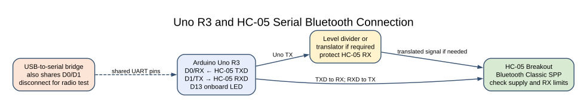
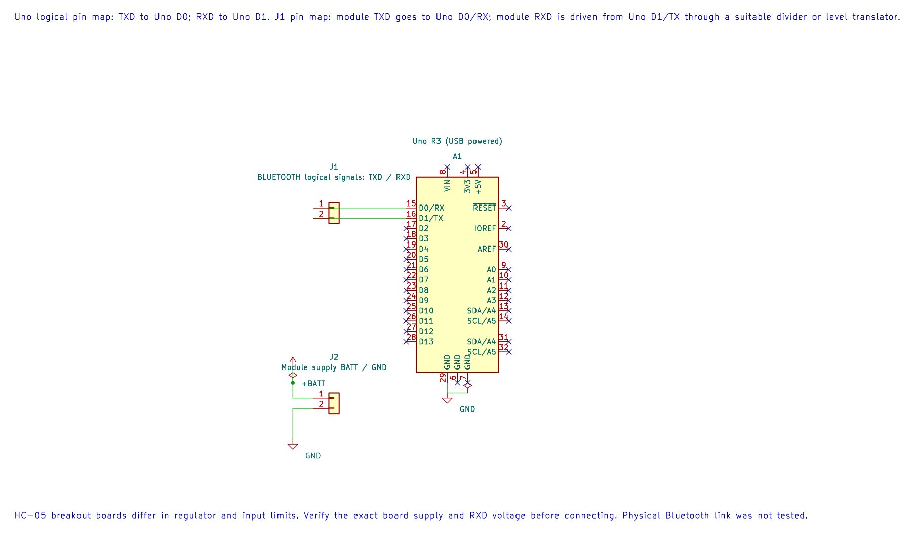

# HC-05 Bluetooth Serial Link

## Learning Goals

You will connect an HC-05 serial Bluetooth breakout, send a small command to an Uno, and see how firmware can reject unexpected input before it controls an output.

## How the Link Works

An HC-05 configured for data mode carries bytes over Bluetooth Classic. To the microcontroller, it behaves much like a wireless serial cable. The phone or computer still needs a Bluetooth serial terminal, and the module must be paired first. Bluetooth Classic serial profiles are not supported by every modern phone; check the client device before choosing this module.

This lab uses the Uno's hardware USART at 9600 baud. It accepts one byte per command: `1` turns on the built-in LED at D13, and `0` turns it off. Any other byte is rejected. Since each command has a fixed length of one byte, the program does not need a text buffer or string parser.

## Wiring and Voltage Checks

HC-05 breakout boards differ in regulator and input protection. Follow the markings and instructions for your exact board. The radio's RX input may not tolerate the Uno's 5 V TX signal. Use a suitable resistor divider or logic-level translator unless the breakout documentation explicitly permits 5 V on that pin.

| Arduino Uno R3 | HC-05 Breakout | Note |
| --- | --- | --- |
| D0 / RX | TXD | Cross the serial transmit and receive lines |
| D1 / TX | RXD through a suitable divider or level translator | Protect the module's input |
| GND | GND | Common ground is required |
| Supply | VCC or VIN as specified by the board maker | Breakout power circuits vary |

The Uno's D0 and D1 are also connected to the USB-to-serial interface. Disconnect the Uno's USB data connection after programming before using the HC-05 on these pins. Power the board from a suitable regulated source during the wireless test. If USB remains connected, its serial bridge may contend with the module and corrupt data.

## Build and Upload





The editable KiCad pin map shows the UART assignment. Protect the module RXD input from 5 V and follow the exact breakout supply rating.

Build the maintained example with AVR GCC and XC8:

```powershell
python atmega328p-labs/tools/build.py 50-bluetooth --compiler gcc
python atmega328p-labs/tools/build.py 50-bluetooth --compiler xc8
```

Upload the generated HEX file through the Uno bootloader while the HC-05 is disconnected from D0/D1. After uploading, remove the USB data connection, reconnect the module, and power the Uno safely. Pair with the HC-05 using the procedure and PIN supplied for your board. Open a Bluetooth serial terminal at **9600 baud, 8 data bits, no parity, 1 stop bit**.

Send `1` and `0` separately. The D13 LED should turn on or off, and the terminal should receive a short confirmation. Send another character to see the invalid-command reply. Enter one byte at a time; this example deliberately does not implement line endings or commands such as `ON`.

## Why Validate Commands

Input from a communication link is not automatically safe or complete. This example accepts only two exact byte values and changes the LED only after a match. A command timeout leaves the output unchanged. For longer commands, add a fixed buffer, a defined terminator, an overflow policy and tests for partial and malformed input.

The example uses blocking polling and is intended for slow manual commands. A production application that must handle frequent serial traffic while doing other work should use a receive queue and a clear overflow policy, as described in the [ring-buffer lesson](ring-buffer.md).

## Source and Build Records

- [Uno Example](<https://github.com/arnabdasbwn/atmega328p-labs/blob/main/examples/50-bluetooth/main.c>)
- [Wiring And Exercise Metadata](<https://github.com/arnabdasbwn/atmega328p-labs/blob/main/examples/50-bluetooth/lab.json>)
- [USART Concepts](uart-concepts.md)
- [USART Register Programming](uart-registers.md)

The build report records Flash and static SRAM use. Build success confirms compilation and linking; the exact breakout, phone compatibility, pairing and wireless behaviour still need a physical test.

## Troubleshooting

- **Upload fails:** disconnect the HC-05 from D0/D1 before using the serial bootloader.
- **No pairing option:** confirm the exact module variant and whether the phone supports Bluetooth Classic serial profiles.
- **No command reaches the Uno:** check crossed TXD/RXD wiring, common ground, module power, pairing and terminal baud rate.
- **Garbled replies or unexpected LED changes:** disconnect the USB data interface during the Bluetooth test and verify voltage-level translation.
- **Module resets when the LED changes:** use a suitable regulated supply; do not power a radio breakout from a GPIO pin.

## Code Walkthrough

### HC-05 Bluetooth LED Control
The example's `main()` configures its peripherals, runs the algorithm and reports or displays the result. These source operations are listed in execution order:

- `if ((avr_gpio_mode(13U, AVR_GPIO_OUTPUT) != AVR_OK) || (avr_uart_init(9600UL) != AVR_OK))` - This checks for any setup or transfer error before the program continues. Maps the Uno header pin to its AVR port, sets its DDR direction bit and prepares the PORT latch for the requested initial level or pull-up. Configures USART0 for asynchronous 8N1. It chooses a baud divisor and normal/double-speed mode, programs UBRR0/UCSR0A/UCSR0C, then enables receive and transmit in UCSR0B.
- `return 1;` - Stops this path and returns the indicated status when setup or validation cannot continue.
- `(void)avr_uart_write((const uint8_t *)"HC-05 ready: send 1 or 0\r\n", 26U, AVR_POLL_BUDGET);` - Sends the specified bytes through USART0; a timeout can occur after a prefix has already been sent.
- `for (;;)` - Repeats the foreground task indefinitely; each pass checks inputs, advances the calculation or services the peripheral shown below.
- `if (avr_uart_get(&command, AVR_HC05_TIMEOUT_POLLS) == AVR_OK)` - The operation runs only after this API reports AVR_OK. Use the linked public header for this function's parameters, register ownership, blocking behavior and status values.
- `if (command == (uint8_t)'1')` - Tests the stated condition; the following block handles the matching case and the other path is skipped.
- `(void)avr_gpio_write(13U, true);` - Changes the pin's PORT output latch; for an input pin this selects its pull-up state.
- `(void)avr_uart_write((const uint8_t *)"LED on\r\n", 8U, AVR_POLL_BUDGET);` - Sends the specified bytes through USART0; a timeout can occur after a prefix has already been sent.
- `else if (command == (uint8_t)'0')` - This statement participates in the operation sequence; follow its expression to see which state or output changes.
- `(void)avr_gpio_write(13U, false);` - Changes the pin's PORT output latch; for an input pin this selects its pull-up state.
- `(void)avr_uart_write((const uint8_t *)"LED off\r\n", 9U, AVR_POLL_BUDGET);` - Sends the specified bytes through USART0; a timeout can occur after a prefix has already been sent.
- `(void)avr_uart_write((const uint8_t *)"Use 1 or 0\r\n", 12U, AVR_POLL_BUDGET);` - Sends the specified bytes through USART0; a timeout can occur after a prefix has already been sent.

Algorithm: A framed command can be bounded to one byte and validated before it changes an output. The Uno hardware USART shares D0/D1 with its USB-to-serial bridge.
Expected behaviour: Send byte 1 to turn on the onboard D13 LED, or 0 to turn it off. Other received bytes return a short error response
**HAL source files in this repository:** [ATmega328P HAL on GitHub](https://github.com/arnabdasbwn/atmega328p-hal)

- [`include/avr_hal/gpio.h`](https://github.com/arnabdasbwn/atmega328p-hal/blob/main/include/avr_hal/gpio.h)
- [`include/avr_hal/uart.h`](https://github.com/arnabdasbwn/atmega328p-hal/blob/main/include/avr_hal/uart.h)
- [`src/gpio.c`](https://github.com/arnabdasbwn/atmega328p-hal/blob/main/src/gpio.c)
- [`src/uart.c`](https://github.com/arnabdasbwn/atmega328p-hal/blob/main/src/uart.c)


## Check Your Understanding

1. Why must D1/TX be level-shifted for some HC-05 boards?
2. Why should the Uno USB data connection be removed during this test?
3. What does the program do if it receives the letter `x`?

**Suggested answers:** The breakout's serial input may be a 3.3 V signal and not 5 V tolerant. The USB-to-serial bridge shares D0/D1 and can contend with the Bluetooth module. `x` is rejected and the LED state does not change.

## References

- Microchip, [ATmega328P Device Documentation](https://www.microchip.com/en-us/product/ATMEGA328P), USART chapter.
- Review the datasheet and electrical limits for the exact HC-05 breakout; board-level regulators and RX protection are not standardised.
- See the [Arduino Uno R3 Pinout](https://www.arnabkumardas.com/pinout/arduino-uno-r3/) for header locations.

**Validation status:** AVR GCC and XC8 builds passed. No HC-05 module or compatible terminal was available, so pairing, voltage adaptation and wireless behaviour are unverified.
