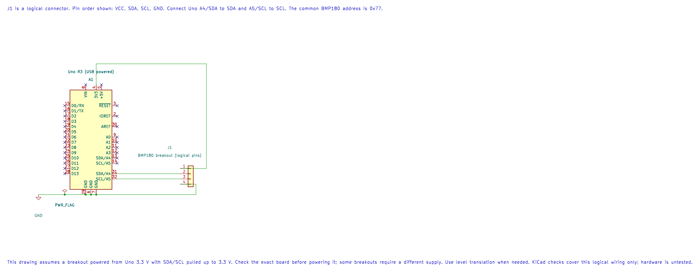

# BMP180 Pressure Sensor

## Learning Goals

By the end of this lesson, you should be able to explain why the BMP180 stores calibration data, connect a suitable breakout to an Uno, and build a C program that reports compensated readings over the serial monitor.

## What the BMP180 Measures

The BMP180 is a digital barometric pressure sensor. It also measures its own temperature because temperature is needed to compensate the pressure result. The chip returns raw conversion values and eleven factory calibration coefficients from its internal memory. Firmware combines them using Bosch's fixed-point equations to produce temperature in 0.1 °C and pressure in pascals.

For example, a result of `151` means 15.1 °C. A pressure result of `100325 Pa` is `1003.25 hPa` because one hectopascal equals 100 pascals. The example prints whole hPa to keep the serial output compact.

## Check Your Breakout Before Wiring

The BMP180 chip operates from a low-voltage supply. Breakout boards vary: some include a regulator, some include pull-ups, and some do not tolerate 5 V logic. Read the board's pin labels and documentation. If its I²C pins are not 5 V tolerant, use a bidirectional level shifter between the Uno and module.

| Arduino Uno R3 | BMP180 Breakout | Note |
| --- | --- | --- |
| A4 / SDA | SDA through level translation when required | I²C data |
| A5 / SCL | SCL through level translation when required | I²C clock |
| GND | GND | Grounds must be common |
| Supply | VIN or VCC as specified by the breakout maker | Never infer voltage from the sensor name |



This is a logical breakout pin diagram. The editable KiCad schematic assumes a breakout whose supply and pull-ups are suitable for 3.3 V. Verify the board's voltage requirements and pull-up connections before wiring.

The chip's default I²C address is `0x77`. The Bosch datasheet gives 1.8–3.6 V supply limits for the sensor IC and recommends I²C pull-ups. A breakout's regulator and pull-up network change how it should be connected, so check the exact board before powering it.

## How a Measurement Is Taken

The driver first reads the calibration block beginning at register `0xAA`. It then requests a temperature conversion and waits 5 ms. Next it requests pressure using one of four oversampling settings. Higher settings take longer and produce more pressure bits. The driver waits the mode-specific conversion time, reads the raw values and applies the Bosch compensation calculation.

The TWI driver uses bounded polling for each bus state. The conversion delay is a documented sensor wait; an I²C timeout is returned as an error. The application keeps the last output unchanged when a read fails.

## Build and Run the Example

From the course folder, build the source with either installed toolchain:

```powershell
python atmega328p-labs/tools/build.py 49-bmp180 --compiler gcc
python atmega328p-labs/tools/build.py 49-bmp180 --compiler xc8
```

The build writes a HEX image and a resource report under `atmega328p-labs/build/`. It does not upload firmware. After checking the wiring and tool output, upload the HEX through the Uno's serial bootloader using the documented upload workflow. Set the serial monitor to **9600 baud, 8 data bits, no parity, 1 stop bit**.

The example reports a line similar to:

```text
Temperature C: 25.3  Pressure hPa: 1003
```

Your readings depend on the sensor, altitude, weather and breakout. A pressure sensor does not directly report altitude. An altitude estimate also needs a sea-level pressure reference, and weather changes make that estimate drift.

## Read the Driver and Example

- [BMP180 Driver Header](https://github.com/arnabdasbwn/atmega328p-hal/blob/main/lib/drivers/bmp180.h)
- [BMP180 Driver Implementation](https://github.com/arnabdasbwn/atmega328p-hal/blob/main/lib/drivers/bmp180.c)
- [Uno Example And Wiring Metadata](<https://github.com/arnabdasbwn/atmega328p-labs/blob/main/examples/49-bmp180/main.c>)
- [Experiment Build Instructions](https://github.com/arnabdasbwn/atmega328p-labs/blob/main/README.md)

The public API returns temperature in tenths of a degree Celsius and pressure in pascals. Oversampling must be in the range 0–3. The example selects mode 1, which balances conversion time and pressure resolution for a beginner experiment.

## Troubleshooting

- **No I²C acknowledgement:** check the breakout's supply, common ground, SDA/SCL orientation, pull-ups and level shifter. An address scan alone does not test the compensation code.
- **Initialization error:** the sensor may be missing, the bus may be wired incorrectly, or the calibration block may be invalid.
- **Values look unreasonable:** confirm that the breakout is actually a BMP180, check its logic voltage and compare the raw bus transactions with the Bosch register map.
- **Pressure differs from a weather app:** compare the same kind of pressure reading. Weather services often show sea-level-adjusted pressure, while the sensor reports local absolute pressure.
- **Serial output is garbled:** verify 9600 baud and that another program is not using the Uno's serial port.

## Code Walkthrough

### BMP180 Temperature and Pressure
The example's `main()` configures its peripherals, runs the algorithm and reports or displays the result. These source operations are listed in execution order:

- `avr_bmp180_calibration_t calibration;` - Use the linked public header for this function's parameters, register ownership, blocking behavior and status values.
- `avr_bmp180_measurement_t measurement;` - Use the linked public header for this function's parameters, register ownership, blocking behavior and status values.
- `(void)avr_uart_init(9600UL);` - Configures USART0 for asynchronous 8N1. It chooses a baud divisor and normal/double-speed mode, programs UBRR0/UCSR0A/UCSR0C, then enables receive and transmit in UCSR0B.
- `if ((avr_twi_init(100000UL) != AVR_OK) || (avr_bmp180_init(&calibration) != AVR_OK))` - This checks for any setup or transfer error before the program continues. Configures TWI for the requested bus rate and enables the peripheral. The bus still requires suitable external pull-ups and compatible signal voltage.
- `(void)avr_uart_write((const uint8_t *)"BMP180 init error\r\n", 19U, AVR_POLL_BUDGET);` - Sends the specified bytes through USART0; a timeout can occur after a prefix has already been sent.
- `return 1;` - Stops this path and returns the indicated status when setup or validation cannot continue.
- `for (;;)` - Repeats the foreground task indefinitely; each pass checks inputs, advances the calculation or services the peripheral shown below.
- `if (avr_bmp180_read(&calibration, 1U, &measurement) == AVR_OK)` - The operation runs only after this API reports AVR_OK. Use the linked public header for this function's parameters, register ownership, blocking behavior and status values.
- `(void)avr_uart_write((const uint8_t *)"Temperature C: ", 15U, AVR_POLL_BUDGET);` - Sends the specified bytes through USART0; a timeout can occur after a prefix has already been sent.
- `(void)avr_uart_write((const uint8_t *)"  Pressure hPa: ", 16U, AVR_POLL_BUDGET);` - Sends the specified bytes through USART0; a timeout can occur after a prefix has already been sent.
- `(void)avr_uart_u16((uint16_t)(measurement.pressure_pa / 100U));` - Formats an unsigned integer as decimal digits and sends them on USART0; it does not add a newline.
- `(void)avr_uart_write((const uint8_t *)"BMP180 read error", 17U, AVR_POLL_BUDGET);` - Sends the specified bytes through USART0; a timeout can occur after a prefix has already been sent.
- `for (uint8_t delay_step = 0U; delay_step < 10U; delay_step++)` - Repeats while `delay_step < 10U` is true; `uint8_t delay_step = 0U` sets the starting state and `delay_step++` advances it each pass.
- `_delay_ms(100);` - Waits for the stated interval; the foreground does no other work during this blocking delay.

Algorithm: BMP180 pressure is oversampled and compensated using the individual calibration coefficients stored in the sensor.
Expected behaviour: The serial monitor reports compensated temperature in degrees Celsius and pressure in whole hectopascals
**HAL source files in this repository:** [ATmega328P HAL on GitHub](https://github.com/arnabdasbwn/atmega328p-hal)

- [`include/avr_hal/twi.h`](https://github.com/arnabdasbwn/atmega328p-hal/blob/main/include/avr_hal/twi.h)
- [`include/avr_hal/uart.h`](https://github.com/arnabdasbwn/atmega328p-hal/blob/main/include/avr_hal/uart.h)
- [`lib/drivers/bmp180.c`](https://github.com/arnabdasbwn/atmega328p-hal/blob/main/lib/drivers/bmp180.c)
- [`lib/drivers/bmp180.h`](https://github.com/arnabdasbwn/atmega328p-hal/blob/main/lib/drivers/bmp180.h)
- [`src/twi.c`](https://github.com/arnabdasbwn/atmega328p-hal/blob/main/src/twi.c)
- [`src/uart.c`](https://github.com/arnabdasbwn/atmega328p-hal/blob/main/src/uart.c)


## Check Your Understanding

1. Why is the raw pressure conversion not a value in pascals?
2. What changes when the pressure oversampling setting increases?
3. Why can two correct pressure readings differ between a sensor and a weather service?

**Suggested answers:** The raw result needs compensation using the device-specific factory coefficients. Higher oversampling improves resolution but takes longer and uses more energy. A weather service may report pressure adjusted to sea level, while the BMP180 reports pressure at its location.

## References

- Bosch Sensortec, [BMP180 Datasheet, BST-BMP180-DS000-12, Revision 2.8, May 2015](https://www.mouser.com/datasheet/2/783/BST-BMP180-DS000-1509579.pdf), especially sections 3.3–3.5 and register map 5.3.
- Microchip, [ATmega328P Device Documentation](https://www.microchip.com/en-us/product/ATMEGA328P), TWI chapter and Uno R3 pin mapping.
- For a visual reference to the Uno header, see the [Arduino Uno R3 Pinout](https://www.arnabkumardas.com/pinout/arduino-uno-r3/).

**Validation status:** Both compiler builds are software-validated. No physical BMP180 module was available in this run; do not treat the example output or wiring as hardware-tested.
