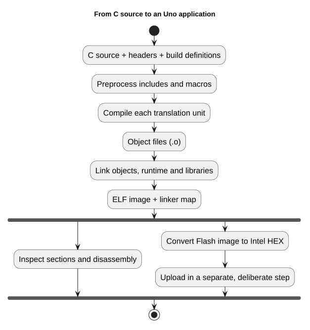

# Compile, Link and Inspect Firmware

## The Build Pipeline



A source file is not directly copied to the Uno. Preprocessing expands includes
and macros. Compilation translates one C translation unit into machine code and
data, producing an object file. Linking resolves references between objects,
selects runtime support and assigns addresses. Conversion to Intel HEX makes a
text representation suitable for a programmer.

An object file can contain a call to `avr_gpio_toggle` without knowing its final
address. The linker resolves that reference using the object compiled from
`gpio.c`. Including `gpio.h` provides its declaration; it does not provide the
implementation. An undefined-reference error is often a missing source/library
in the link, not a missing header.

## Produce the Artifacts

From the course root, run:

```powershell
python "atmega328p-labs/tools/build.py" 02-blink-hal --compiler gcc
python "atmega328p-labs/tools/build.py" 02-blink-hal --compiler xc8
```

Inspect `atmega328p-labs/build/gcc/02-blink-hal/`, then the corresponding XC8
directory. Every build writes:

| File | Use |
| --- | --- |
| `*.o` | Relocatable machine code for one C source |
| `firmware.elf` | Linked image with sections, symbols and debugging information |
| `firmware.hex` | Addressed bytes for programming Flash; not a source listing |
| `firmware.map` | Which sections and symbols occupy memory and where they came from |
| `build-report.json` | Exact compiler commands, resource counts and diagnostics |

The builder never uploads. A successful build means the configured toolchain
accepted the code; it does not establish that a board contains that image.

## Inspect Instructions

Use `avr-objdump` from the same toolchain's binary directory. Replace the first
path with the installed utility; do not copy a username from another computer.

```powershell
& "<toolchain-bin>/avr-objdump.exe" -d -S "atmega328p-labs/build/gcc/02-blink-hal/firmware.elf"
```

`-d` disassembles instructions and `-S` includes available source lines. Optimization
can reorder or eliminate operations, so the display is not a one-to-one C trace.
Find `main`, its call to the GPIO initializer and the repeating toggle/delay path.
The HAL variant has validation and pin mapping that the direct-register example
does not need; compare the resulting Flash sizes before guessing their cost.

## Headers, Implementations and Shared State

An include guard prevents repeated declarations within one translation unit. It
does not protect a non-static function definition copied into two different C
files. Both object files can then define the same external symbol and linking
fails. Put public declarations in `.h`, definitions in `.c`, and compile the C file
once. The course self-test uses a second C file to exercise this arrangement.

Likewise, defining `static` mutable state in a header creates an independent copy
per translation unit. That may compile successfully while producing the wrong
program behavior. The HAL keeps shared peripheral state in implementation files.

## Worked Memory Example

Suppose a report has `.text = 1000`, `.data = 20` and `.bss = 30` bytes. Flash
consumption is 1020 bytes because initialized SRAM data needs an initial image.
Static SRAM consumption is 50 bytes. Subtracting 50 from 2048 leaves 1998 bytes for
stack and other dynamic requirements; it does not prove the stack fits.

## Troubleshooting and Exercises

A missing `avr/io.h` usually means the host compiler was selected. An unknown MCU
can mean the wrong device pack or target spelling. A duplicate symbol often means
a C implementation was included or linked twice. Read the first useful diagnostic,
not just the final “build failed” line.

Why is HEX smaller on disk sometimes a misleading size comparison? **Answer:**
HEX uses text records and checksums; ELF also contains debugging and symbol data.
Use section sizes or the build report to compare programmed bytes.

Why must `F_CPU` agree across compilation units? **Answer:** delay and timing
calculations are compiled separately. Inconsistent definitions can produce one
image containing mutually inconsistent timing assumptions.

References: installed AVR GCC/XC8 tool help, GNU binutils ELF/objdump conventions,
and the build script committed with these examples. The commands and linked images
have software validation; this lesson does not require a hardware upload.

## Code Walkthrough


**Example code on GitHub:**
- [Register-level Blink (`01-blink-register`)](https://github.com/arnabdasbwn/atmega328p-labs/blob/main/examples/01-blink-register/main.c)
- [HAL Blink (`02-blink-hal`)](https://github.com/arnabdasbwn/atmega328p-labs/blob/main/examples/02-blink-hal/main.c)
- [HAL Software Self-Test (`90-selftest`)](https://github.com/arnabdasbwn/atmega328p-labs/blob/main/examples/90-selftest/main.c)

### Register-level Blink
The example's `main()` configures its peripherals, runs the algorithm and reports or displays the result. These source operations are listed in execution order:

- `PORTB &= (uint8_t)~_BV(PORTB5);` - Sets or clears the Port B output latch. When the pin is an output, this determines its output level; on an input, it controls the pull-up.
- `DDRB |= _BV(DDB5);` - Sets the Port B direction bits; a set bit selects output mode.
- `for (;;)` - Repeats the foreground task indefinitely; each pass checks inputs, advances the calculation or services the peripheral shown below.
- `PINB = _BV(PINB5);` - Writing a one to a PINB bit toggles that pin's PORTB output latch on the ATmega328P.
- `_delay_ms(500);` - Waits for the stated interval; the foreground does no other work during this blocking delay.

Algorithm: Pin direction and output latch are separate hardware state.
Expected behaviour: L toggles every 500 ms
**HAL source files in this repository:** [ATmega328P HAL on GitHub](https://github.com/arnabdasbwn/atmega328p-hal)


### HAL Blink
The example's `main()` configures its peripherals, runs the algorithm and reports or displays the result. These source operations are listed in execution order:

- `if (avr_gpio_mode(AVR_BOARD_LED, AVR_GPIO_OUTPUT) != AVR_OK)` - This checks for any setup or transfer error before the program continues. Maps the Uno header pin to its AVR port, sets its DDR direction bit and prepares the PORT latch for the requested initial level or pull-up.
- `return 1;` - Stops this path and returns the indicated status when setup or validation cannot continue.
- `for (;;)` - Repeats the foreground task indefinitely; each pass checks inputs, advances the calculation or services the peripheral shown below.
- `(void)avr_gpio_toggle(AVR_BOARD_LED);` - Atomically toggles the selected pin output latch.
- `_delay_ms(500);` - Waits for the stated interval; the foreground does no other work during this blocking delay.

Algorithm: Pin direction and output latch are separate hardware state.
Expected behaviour: L toggles every 500 ms
**HAL source files in this repository:** [ATmega328P HAL on GitHub](https://github.com/arnabdasbwn/atmega328p-hal)

- [`include/avr_hal/gpio.h`](https://github.com/arnabdasbwn/atmega328p-hal/blob/main/include/avr_hal/gpio.h)
- [`src/gpio.c`](https://github.com/arnabdasbwn/atmega328p-hal/blob/main/src/gpio.c)


### HAL Software Self-Test
The example's `main()` configures its peripherals, runs the algorithm and reports or displays the result. These source operations are listed in execution order:

- `avr_debounce_t button;` - Use the linked public header for this function's parameters, register ownership, blocking behavior and status values.
- `uint8_t result = 0U;` - Clears the state/counter after its threshold is reached so the next interval starts from zero.
- `(void)avr_uart_init(9600UL);` - Configures USART0 for asynchronous 8N1. It chooses a baud divisor and normal/double-speed mode, programs UBRR0/UCSR0A/UCSR0C, then enables receive and transmit in UCSR0B.
- `CHECK(avr_gpio_mode(20U, AVR_GPIO_OUTPUT) == AVR_ERROR_ARGUMENT);` - Maps the Uno header pin to its AVR port, sets its DDR direction bit and prepares the PORT latch for the requested initial level or pull-up.
- `CHECK(avr_gpio_read(13U, NULL) == AVR_ERROR_ARGUMENT);` - Reads the electrical level through PINx without changing direction or the output latch.
- `CHECK(avr_timer_ctc(AVR_TIMER0, 32U, 100U) == AVR_ERROR_ARGUMENT);` - Configures 0 in CTC mode with prescaler 32 and OCRnA TOP 100; event rate is 16 MHz / (32 x (100 + 1)) = 4950.5 Hz. The HAL disables this timer's interrupt sources and leaves flag polling to the caller.
- `CHECK(avr_timer_ctc(AVR_TIMER0, 64U, 256U) == AVR_ERROR_ARGUMENT);` - Configures 0 in CTC mode with prescaler 64 and OCRnA TOP 256; event rate is 16 MHz / (64 x (256 + 1)) = 972.763 Hz. The HAL disables this timer's interrupt sources and leaves flag polling to the caller.
- `CHECK(avr_timer_ctc(AVR_TIMER2, 128U, 124U) == AVR_OK);` - Configures 2 in CTC mode with prescaler 128 and OCRnA TOP 124; event rate is 16 MHz / (128 x (124 + 1)) = 1000 Hz. The HAL disables this timer's interrupt sources and leaves flag polling to the caller.
- `CHECK((TCCR2B & 7U) == 5U);` - Selects Timer2 clock/prescaler and remaining waveform bits. Timer2 has distinct prescaler encodings.
- `CHECK(avr_timer1_pwm(8U, 40000U, 3000U) == AVR_OK);` - Configures Timer1 mode 14 with prescaler 8; ICR1 becomes 39999, giving a 20 ms frame, and OCR1A starts at 3000 ticks (1500 us high).
- `CHECK(ICR1 == 39999U && OCR1A == 3000U);` - Timer1 input-capture register and, in the selected PWM mode, the TOP value. Timer1 Compare A; it sets the match point or PWM pulse width.
- `CHECK(avr_adc_millivolts(512U, 5000U) == 2500U);` - Calls `avr_adc_millivolts()`; its public HAL header defines the arguments, register ownership, blocking behavior and status results.
- `CHECK(avr_adc_read(6U, NULL, 0U) == AVR_ERROR_ARGUMENT);` - Calls `avr_adc_read()`; its public HAL header defines the arguments, register ownership, blocking behavior and status results.
- `CHECK(avr_eeprom_read(1024U, &result, 0UL) == AVR_ERROR_ARGUMENT);` - Calls `avr_eeprom_read()`; its public HAL header defines the arguments, register ownership, blocking behavior and status results.
- `CHECK(avr_twi_transfer(0U, NULL, 0U, NULL, 0U, 0UL) == AVR_ERROR_ARGUMENT);` - Calls `avr_twi_transfer()`; its public HAL header defines the arguments, register ownership, blocking behavior and status results.
- `CHECK(avr_elapsed(5UL, UINT32_MAX - 4UL, 10UL));` - Calls `avr_elapsed()`; its public HAL header defines the arguments, register ownership, blocking behavior and status results.
- `CHECK(!avr_elapsed(5UL, UINT32_MAX - 4UL, 11UL));` - Calls `avr_elapsed()`; its public HAL header defines the arguments, register ownership, blocking behavior and status results.
- `avr_debounce_init(&button, true, UINT32_MAX - 10UL);` - Calls `avr_debounce_init()`; its public HAL header defines the arguments, register ownership, blocking behavior and status results.
- `CHECK(!avr_debounce_update(&button, false, UINT32_MAX - 9UL, 20U));` - Calls `avr_debounce_update()`; its public HAL header defines the arguments, register ownership, blocking behavior and status results.
- `CHECK(!avr_debounce_update(&button, false, 9UL, 20U));` - Calls `avr_debounce_update()`; its public HAL header defines the arguments, register ownership, blocking behavior and status results.
- `CHECK(avr_debounce_update(&button, false, 10UL, 20U));` - Accepts a changed input only after it remains stable for the requested interval, then reports that accepted change once.
- `CHECK(!avr_debounce_update(&button, false, 11UL, 20U));` - Accepts a changed input only after it remains stable for the requested interval, then reports that accepted change once.
- `(void)avr_uart_write((const uint8_t *)"PASS\n", 5U, AVR_POLL_BUDGET);` - Sends the specified bytes through USART0; a timeout can occur after a prefix has already been sent.
- `for (;;)` - Repeats the foreground task indefinitely; each pass checks inputs, advances the calculation or services the peripheral shown below.

Algorithm: A bounded self-test checks software contracts and links a second source file so header-owned definitions are detected.
Expected behaviour: The fixture prints PASS after argument, timer-range, debounce and independent-translation-unit checks; otherwise it prints FAIL and stops
**HAL source files in this repository:** [ATmega328P HAL on GitHub](https://github.com/arnabdasbwn/atmega328p-hal)

- [`include/avr_hal/adc.h`](https://github.com/arnabdasbwn/atmega328p-hal/blob/main/include/avr_hal/adc.h)
- [`include/avr_hal/common.h`](https://github.com/arnabdasbwn/atmega328p-hal/blob/main/include/avr_hal/common.h)
- [`include/avr_hal/eeprom.h`](https://github.com/arnabdasbwn/atmega328p-hal/blob/main/include/avr_hal/eeprom.h)
- [`include/avr_hal/gpio.h`](https://github.com/arnabdasbwn/atmega328p-hal/blob/main/include/avr_hal/gpio.h)
- [`include/avr_hal/timer.h`](https://github.com/arnabdasbwn/atmega328p-hal/blob/main/include/avr_hal/timer.h)
- [`include/avr_hal/twi.h`](https://github.com/arnabdasbwn/atmega328p-hal/blob/main/include/avr_hal/twi.h)
- [`include/avr_hal/uart.h`](https://github.com/arnabdasbwn/atmega328p-hal/blob/main/include/avr_hal/uart.h)
- [`lib/drivers/debounce.c`](https://github.com/arnabdasbwn/atmega328p-hal/blob/main/lib/drivers/debounce.c)
- [`lib/drivers/debounce.h`](https://github.com/arnabdasbwn/atmega328p-hal/blob/main/lib/drivers/debounce.h)
- [`src/adc.c`](https://github.com/arnabdasbwn/atmega328p-hal/blob/main/src/adc.c)
- [`src/common.c`](https://github.com/arnabdasbwn/atmega328p-hal/blob/main/src/common.c)
- [`src/eeprom.c`](https://github.com/arnabdasbwn/atmega328p-hal/blob/main/src/eeprom.c)
- [`src/gpio.c`](https://github.com/arnabdasbwn/atmega328p-hal/blob/main/src/gpio.c)
- [`src/timer.c`](https://github.com/arnabdasbwn/atmega328p-hal/blob/main/src/timer.c)
- [`src/twi.c`](https://github.com/arnabdasbwn/atmega328p-hal/blob/main/src/twi.c)
- [`src/uart.c`](https://github.com/arnabdasbwn/atmega328p-hal/blob/main/src/uart.c)
