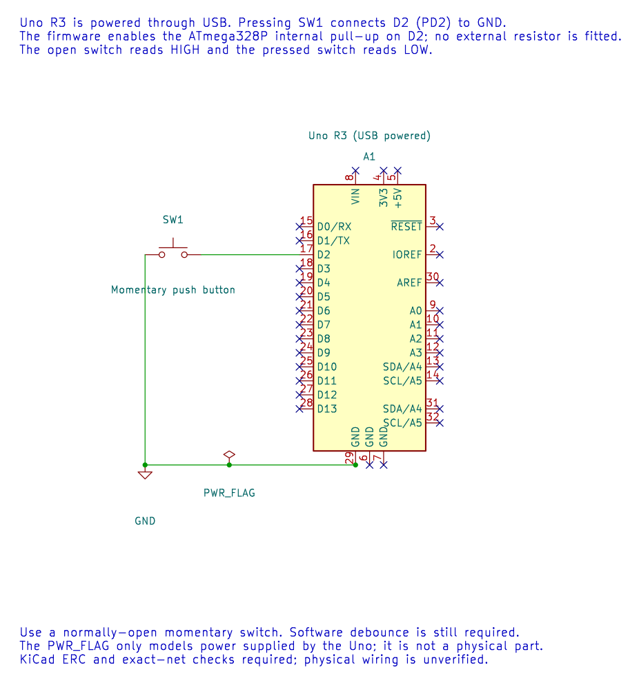

# Reading and Debouncing a Push Button

## Objectives and Prerequisites

You will wire a normally-open button to Uno D2, read it as an active-low input and explain why one press can create several transitions. This lab uses the maintained 20 ms debounce example. Review [GPIO concepts](gpio-concepts.md) and [state machines](state-machines.md) first.

## Parts and Wiring

| Uno pin | Connection |
| --- | --- |
| D2 | One side of the normally-open button |
| GND | Other side of the button |
| D13 | Onboard LED, used as the output indicator |

The firmware enables D2's internal pull-up. Leave the other button terminal unconnected to 5 V; closing the switch connects D2 to ground. Confirm the button's contact pairs with a continuity tester if the breadboard orientation is unclear.



The editable KiCad schematic has zero ERC findings and passes exact-net checks. The physical breadboard wiring still needs a hardware check.

## What the Firmware Does

The [complete Button lab](<https://github.com/arnabdasbwn/atmega328p-labs/blob/main/examples/03-button/main.c>) configures D2 as `AVR_GPIO_INPUT_PULLUP`, configures D13 as an output and starts the course tick. Each pass samples D2 and gives the sample and elapsed time to the debounce state machine. A candidate level must remain unchanged for 20 ms before it is accepted. On a stable press, the program toggles the LED once.

Contact bounce is a short burst of transitions as the metal contacts settle. A raw edge counter can count several edges from one press. The time filter waits until the reading has remained stable for the debounce interval, then reports the new state. A longer interval filters slower bounce but also adds response delay.

## Build and Expected Result

Build from the course root:

```powershell
python "atmega328p-labs/tools/build.py" 03-button --compiler xc8
```

After a verified upload to a suitable Uno, each press should toggle the onboard LED once; holding the button should not repeatedly toggle it. The program is build-validated, but the button circuit has not been physically tested as part of this course validation.

## Troubleshooting and Exercise

If the input stays low, inspect whether D2 is shorted to ground or the button is placed across the wrong breadboard contacts. If it stays high, check the ground connection and confirm the internal pull-up setup. The onboard LED should not need an external resistor; an external LED does.

What happens if contact bounce lasts 25 ms while the filter interval is 20 ms?

**Answer:** A temporary stable level could be accepted before the bounce ends, so the debounce interval may need adjustment for that switch and circuit. The example filters a 20 ms quiet period; it is not a universal guarantee for every component.

## Code Walkthrough

### Debounced push button
The example's `main()` configures its peripherals, runs the algorithm and reports or displays the result. These source operations are listed in execution order:

- `avr_debounce_t button;` - Use the linked public header for this function's parameters, register ownership, blocking behavior and status values.
- `bool level = true;` - Stores this intermediate or output value for the next algorithm step. Check the units and range represented by each operand.
- `bool led = false;` - Stores this intermediate or output value for the next algorithm step. Check the units and range represented by each operand.
- `(void)avr_gpio_mode(2U, AVR_GPIO_INPUT_PULLUP);` - Maps the Uno header pin to its AVR port, sets its DDR direction bit and prepares the PORT latch for the requested initial level or pull-up.
- `(void)avr_gpio_mode(13U, AVR_GPIO_OUTPUT);` - Maps the Uno header pin to its AVR port, sets its DDR direction bit and prepares the PORT latch for the requested initial level or pull-up.
- `avr_tick_init();` - Configures the course millisecond tick interrupt source; it does not enable global interrupts itself.
- `avr_debounce_init(&button, true, 0UL);` - Seeds the stable/candidate input state and timestamp so the next transition is timed consistently.
- `sei();` - Enables global interrupts after the example has configured its sources and shared state.
- `for (;;)` - Repeats the foreground task indefinitely; each pass checks inputs, advances the calculation or services the peripheral shown below.
- `(void)avr_gpio_read(2U, &level);` - Reads the electrical level through PINx without changing direction or the output latch.
- `if (avr_debounce_update(&button, level, avr_tick_ms(), 20U) && !button.stable)` - This condition chooses the next path based on the API result. Accepts a changed input only after it remains stable for the requested interval, then reports that accepted change once.
- `led = !led;` - Stores this intermediate or output value for the next algorithm step. Check the units and range represented by each operand.
- `(void)avr_gpio_write(13U, led);` - Changes the pin's PORT output latch; for an input pin this selects its pull-up state.

Algorithm: A candidate input must remain unchanged for 20 ms before becoming stable. No delay occurs inside an ISR.
Expected behaviour: Each press toggles L once; holding the button does not repeat
**HAL source files in this repository:** [ATmega328P HAL on GitHub](https://github.com/arnabdasbwn/atmega328p-hal)

- [`include/avr_hal/gpio.h`](https://github.com/arnabdasbwn/atmega328p-hal/blob/main/include/avr_hal/gpio.h)
- [`include/avr_hal/tick.h`](https://github.com/arnabdasbwn/atmega328p-hal/blob/main/include/avr_hal/tick.h)
- [`lib/drivers/debounce.c`](https://github.com/arnabdasbwn/atmega328p-hal/blob/main/lib/drivers/debounce.c)
- [`lib/drivers/debounce.h`](https://github.com/arnabdasbwn/atmega328p-hal/blob/main/lib/drivers/debounce.h)
- [`lib/interrupts/tick.c`](https://github.com/arnabdasbwn/atmega328p-hal/blob/main/lib/interrupts/tick.c)
- [`src/gpio.c`](https://github.com/arnabdasbwn/atmega328p-hal/blob/main/src/gpio.c)


## References

- [Button lab source and wiring record](<https://github.com/arnabdasbwn/atmega328p-labs/blob/main/examples/03-button/main.c>)
- [Uno pinout](https://www.arnabkumardas.com/pinout/arduino-uno-r3/)
- [GPIO concepts](gpio-concepts.md) and [GPIO registers](gpio-registers.md)
