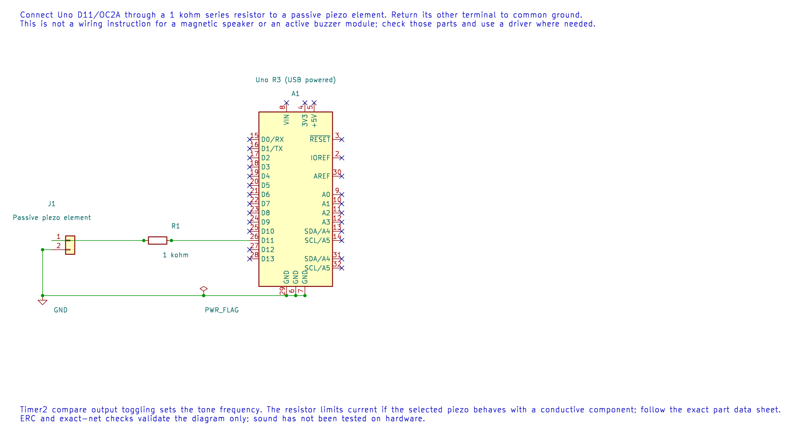

# Generate Tones with a Buzzer

## Passive Piezo and Active Buzzer

A passive piezo element needs an alternating waveform to produce a tone. An active buzzer contains an oscillator and usually sounds when supplied with the correct DC voltage. The course example targets a passive piezo. A magnetic buzzer or speaker may draw more current and needs a suitable driver rather than a direct GPIO connection.

Connect Uno D11/OC2A through a 1 kΩ resistor to the passive piezo and return the other terminal to GND. Check the component's voltage and current requirements before connecting it.

The editable KiCad schematic shows the passive piezo connection. It is not a wiring guide for an active buzzer or a magnetic speaker.

## Calculate the Tone

In CTC mode with Timer2 prescaled by 64 and `OCR2A=124`, the compare rate is:

`16,000,000 / (64 × 125) = 2,000 compare events per second`

If OC2A toggles on each compare, two events make one full high-low waveform cycle, so the tone is 1,000 Hz. Forgetting the factor of two gives an octave error.

The [Timer2 buzzer lab](<https://github.com/arnabdasbwn/atmega328p-labs/blob/main/examples/40-buzzer/main.c>) configures the output compare and creates the nominal 1 kHz tone. Build it with `python "atmega328p-labs/tools/build.py" 40-buzzer --compiler xc8`. Timer2 is then owned by the tone generator and cannot be independently used by another Timer2 feature.

## Exercise with Answer

At the same compare rate, what tone would result if the hardware toggled once per compare instead of generating one full cycle per event?

**Answer:** The output toggles 2,000 times per second, but a full period needs two toggles. The waveform frequency is 1,000 Hz.

## Code Walkthrough

### Timer2 square-wave tone
The example's `main()` configures its peripherals, runs the algorithm and reports or displays the result. These source operations are listed in execution order:

- `(void)avr_timer_ctc(AVR_TIMER2, 64U, 124U);` - Configures 2 in CTC mode with prescaler 64 and OCRnA TOP 124; event rate is 16 MHz / (64 x (124 + 1)) = 2000 Hz. The HAL disables this timer's interrupt sources and leaves flag polling to the caller.
- `DDRB |= _BV(DDB3);` - Sets the Port B direction bits; a set bit selects output mode.
- `TCCR2A |= _BV(COM2A0);` - Selects Timer2 waveform mode and compare-output behavior.
- `for (;;)` - Repeats the foreground task indefinitely; each pass checks inputs, advances the calculation or services the peripheral shown below.

Algorithm: A compare event toggles OC2A, so two compare periods make one waveform period: 16 MHz/(2*64*125)=1 kHz.
Expected behaviour: Produces nominally 1 kHz tone
**HAL source files in this repository:** [ATmega328P HAL on GitHub](https://github.com/arnabdasbwn/atmega328p-hal)

- [`include/avr_hal/timer.h`](https://github.com/arnabdasbwn/atmega328p-hal/blob/main/include/avr_hal/timer.h)
- [`src/timer.c`](https://github.com/arnabdasbwn/atmega328p-hal/blob/main/src/timer.c)

## References

- [Buzzer source and wiring record](<https://github.com/arnabdasbwn/atmega328p-labs/blob/main/examples/40-buzzer/main.c>)
- [Timer2 overview](timer2.md)
- Check the piezo or buzzer data sheet for its rated frequency range and drive requirements.
