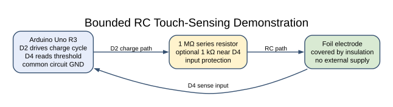
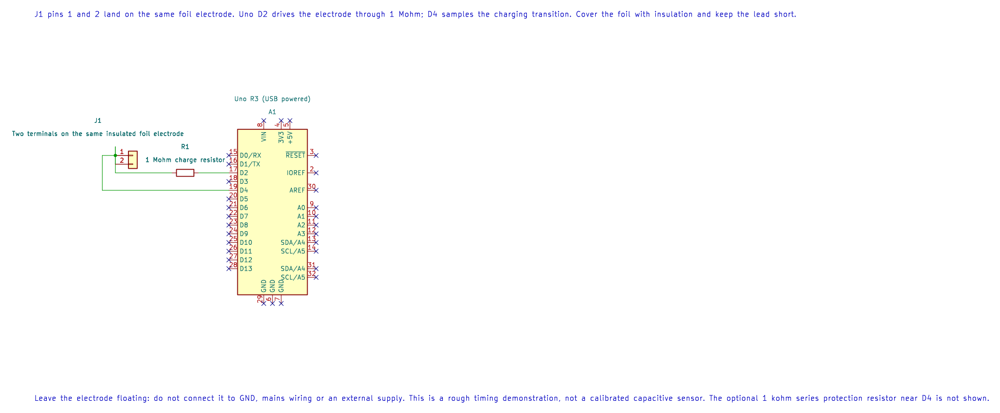

# Capacitive Touch with an RC Timing Method

## What You Will Learn

This simple experiment uses a resistor to charge an electrode and measures how many software polls pass before an input reads high. Touching or approaching the insulated foil changes its capacitance and therefore changes the charging time. This is a teaching demonstration, not a calibrated touch controller.

## Parts and Wiring

Use a foil electrode covered by insulating tape or plastic. Lab 45 connects D2 through a 1 MΩ resistor to the electrode, and connects the electrode to D4. The 1 MΩ resistor limits current and forms the RC path; an optional 1 kΩ resistor can be placed close to D4 for additional input protection.

| Uno R3 | Connection | Purpose |
| --- | --- | --- |
| D2 | 1 MΩ resistor, then foil electrode | Charge source |
| D4 | Foil electrode | Digital threshold input |
| GND | None to electrode | Keep the foil insulated and floating |

Do not connect the electrode to mains wiring, an external supply or a grounded object. Keep the lead short and use an insulated surface.

## What the Firmware Measures



Each cycle drives D2 low, waits 5 ms, drives D2 high and polls D4 up to 10,000 times. The count at which D4 first reads high is printed over UART. If the limit is reached, the printed value is 10,000 and means “threshold not seen within the loop limit,” not a calibrated capacitance.

The charge time depends on the resistor, electrode size, wiring, compiler optimization and the input's switching threshold. A software loop counter is not a time unit. For more stable products, use a dedicated capacitive sensing method, an analogue comparator with a calibrated timer, or a sensor IC designed for touch input.


### KiCad Connection Drawing



Open the editable KiCad schematic or its pin map. The drawing has passed ERC and exact-net checks; the physical circuit has not been tested.

## Build and Try the Lab

```powershell
python atmega328p-labs/tools/build.py 45-capacitive-touch --compiler gcc
python atmega328p-labs/tools/build.py 45-capacitive-touch --compiler xc8
```

After uploading, open a 9600-baud terminal and record several untouched readings. Then approach the electrode with a finger and compare the counts. Keep the setup unchanged while comparing; moving the wire or changing nearby objects changes the capacitance too.

## Common Problems and Limits

- **The count is always near zero:** Check that D4 and the electrode are connected and that the resistor is in series from D2.
- **The count always reaches 10,000:** Check the D4 path and whether the electrode is shorted or too large for the current arrangement.
- **Readings change when the cable moves:** This circuit measures the cable and nearby objects as part of its capacitance.
- **Touch detection is inconsistent:** Establish a baseline and threshold for the physical setup; this lesson does not implement calibration or hysteresis.

## Code Walkthrough

### RC capacitive touch timing
The example's `main()` configures its peripherals, runs the algorithm and reports or displays the result. These source operations are listed in execution order:

- `(void)avr_gpio_mode(2U, AVR_GPIO_OUTPUT);` - Maps the Uno header pin to its AVR port, sets its DDR direction bit and prepares the PORT latch for the requested initial level or pull-up.
- `(void)avr_gpio_mode(4U, AVR_GPIO_INPUT);` - Maps the Uno header pin to its AVR port, sets its DDR direction bit and prepares the PORT latch for the requested initial level or pull-up.
- `(void)avr_uart_init(9600UL);` - Configures USART0 for asynchronous 8N1. It chooses a baud divisor and normal/double-speed mode, programs UBRR0/UCSR0A/UCSR0C, then enables receive and transmit in UCSR0B.
- `for (;;)` - Repeats the foreground task indefinitely; each pass checks inputs, advances the calculation or services the peripheral shown below.
- `(void)avr_gpio_write(2U, false);` - Changes the pin's PORT output latch; for an input pin this selects its pull-up state.
- `_delay_ms(5);` - Waits for the stated interval; the foreground does no other work during this blocking delay.
- `(void)avr_gpio_write(2U, true);` - Changes the pin's PORT output latch; for an input pin this selects its pull-up state.
- `uint16_t count = 0U;` - Clears the state/counter after its threshold is reached so the next interval starts from zero.
- `bool high = false;` - Stores this intermediate or output value for the next algorithm step. Check the units and range represented by each operand.
- `for (; count < 10000U; ++count)` - Repeats while `count < 10000U` is true; `` sets the starting state and `++count` advances it each pass.
- `(void)avr_gpio_read(4U, &high);` - Calls `avr_gpio_read()`; its public HAL header defines the arguments, register ownership, blocking behavior and status results.
- `if (high)` - Tests the stated condition; the following block handles the matching case and the other path is skipped.
- `(void)avr_uart_u16(count);` - Formats an unsigned integer as decimal digits and sends them on USART0; it does not add a newline.
- `(void)avr_uart_put('\n', AVR_POLL_BUDGET);` - Waits for the USART transmit buffer within its poll budget, then writes the byte to UDR0.
- `_delay_ms(50);` - Waits for the stated interval; the foreground does no other work during this blocking delay.

Algorithm: Added capacitance lengthens RC charging time. Counts depend on compiler speed and threshold voltage; calibrate a baseline and use hysteresis. This is an educational RC sensor, not a calibrated touch controller.
Expected behaviour: Touch/proximity changes bounded charge-time counts
**HAL source files in this repository:** [ATmega328P HAL on GitHub](https://github.com/arnabdasbwn/atmega328p-hal)

- [`include/avr_hal/gpio.h`](https://github.com/arnabdasbwn/atmega328p-hal/blob/main/include/avr_hal/gpio.h)
- [`include/avr_hal/uart.h`](https://github.com/arnabdasbwn/atmega328p-hal/blob/main/include/avr_hal/uart.h)
- [`src/gpio.c`](https://github.com/arnabdasbwn/atmega328p-hal/blob/main/src/gpio.c)
- [`src/uart.c`](https://github.com/arnabdasbwn/atmega328p-hal/blob/main/src/uart.c)


## Check Your Understanding

1. Why can a finger change the charging time without touching a bare electrical connection?
2. Does the printed count directly report capacitance in farads?
3. Why is the loop bounded at 10,000 polls?

**Suggested answers:** The body couples capacitively to the insulated electrode and changes its effective capacitance. No; the count is a setup-dependent software measurement. The bound prevents a disconnected or unsuitable sensor from holding the program indefinitely.

## Source and Further Reading

- [Lab 45 source](<https://github.com/arnabdasbwn/atmega328p-labs/blob/main/examples/45-capacitive-touch/main.c>)
- [ATmega328P Documentation](https://www.microchip.com/en-us/product/ATMEGA328P), digital-input threshold and GPIO chapters.
- This experiment is for low-voltage bench use; it is not a substitute for an isolated touch-sensing design.
