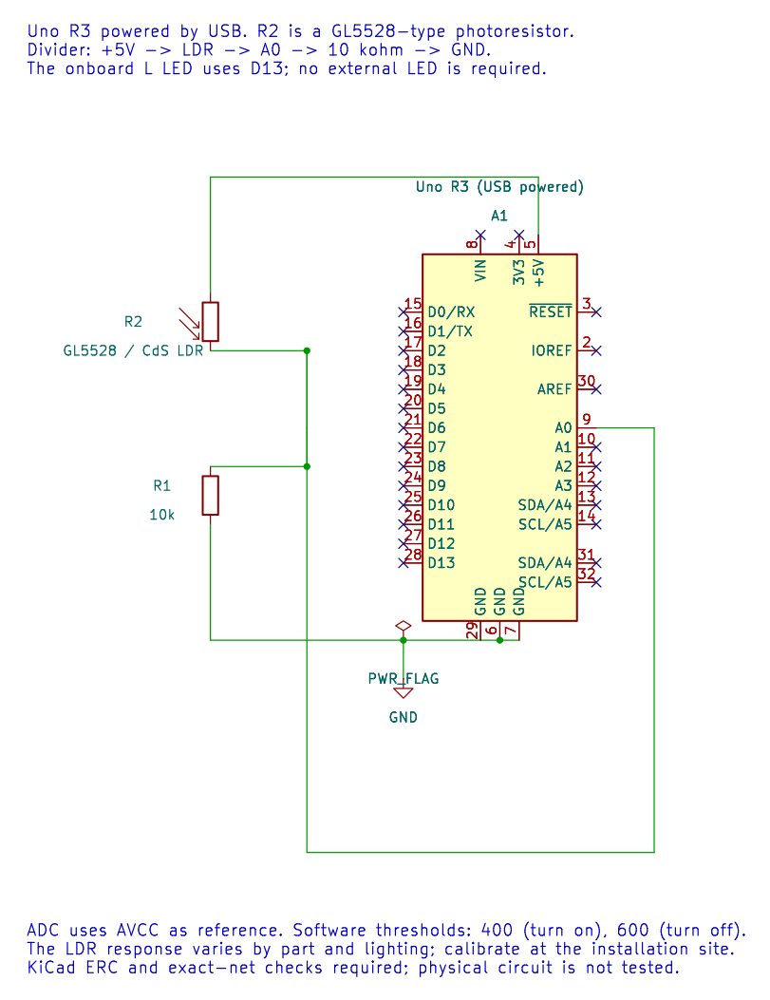

# Case Study: an Automatic Night Light

## Objectives and Prerequisites

Follow a small product idea through requirements, circuit, firmware decision, build checks and physical test plan. Review [embedded systems](embedded-system.md), [system comparison](embedded-vs-computer.md) and the [ATmega328P specification](atmega328p-specs.md).

## Product Behavior

Build a simple lamp that turns on when the room is dark and turns off in bright light. For this teaching example, an LDR divider feeds ADC0, and the Uno's onboard LED indicates the lamp state. The [17-ldr firmware](<https://github.com/arnabdasbwn/atmega328p-labs/blob/main/examples/17-ldr/main.c>) uses two thresholds so small changes near one reading do not make the output flicker.

| Requirement | Teaching implementation |
| --- | --- |
| Read ambient light | Sample the divider voltage on A0 / ADC0 |
| Turn on in darkness | Set the state when the ADC code falls below 400 |
| Turn off in bright light | Clear the state when the code rises above 600 |
| Hold state near threshold | Keep the last state for codes 400 through 600 |
| Update responsively | Poll about every 20 ms |
| Show the output | Use the Uno's onboard LED on D13 |
| Operate safely | Keep the sensor network within board supply and input limits; LED is already current-limited on the board |

These thresholds are starting values for this circuit, not universal lux values. LDR resistance varies between parts, with light spectrum and with the divider resistor. A production product would define calibrated light levels and account for sensor aging, temperature, enclosure and installation.

## Hardware and Wiring

Parts: Arduino Uno R3 with ATmega328P, one GL5528-type CdS photoresistor, one 10 kOhm resistor, a breadboard and jumper wires. USB powers the Uno. No external LED is needed; the board's L LED is connected to D13.



| Connection | Uno / component pin | Notes |
| --- | --- | --- |
| Uno 5V | One LDR lead | Top of the divider in this orientation |
| LDR other lead | A0 and one end of 10 kOhm resistor | This junction is the ADC measurement |
| Other end of 10 kOhm resistor | GND | Completes the divider |
| Uno D13 | Onboard L LED | Already connected on the Uno R3; do not add a second load |

Power the board from USB. Turn power off before changing breadboard wiring. Keep the sensor voltage between ground and the Uno's analog supply/reference range. The diagram's source, ERC report and exact net checks are in `assets/circuits/ldr-night-light/`.

## Work the Sensor Calculation

The divider places the LDR above the fixed resistor. Its junction voltage is:

```text
V_A0 = V_CC × R_fixed / (R_LDR + R_fixed)
```

Suppose a particular sensor measures 40 kOhm in darkness and 10 kOhm is the fixed resistor. Then `V_A0 = 5 V × 10 kOhm / (40 kOhm + 10 kOhm) = 1.0 V`. With an ideal 5 V ADC reference, that is about `1.0 V / 5 V × 1024 = 205` counts, below the 400 turn-on threshold.

If the measured LDR resistance in bright light is 5 kOhm, then `V_A0 = 5 V × 10 kOhm / (5 kOhm + 10 kOhm) = 3.33 V`, or about 682 counts. That is above the 600 turn-off threshold. These are example resistance measurements; check your own LDR and lighting rather than assuming those values.

The ADC conversion is quantized and the reference is not an exact meter standard. Record raw counts in the actual enclosure and choose thresholds with enough separation to avoid chatter.

## Software Decision and Build

The program starts with the lamp state off. Each successful ADC reading is compared with the thresholds:

```text
sample < 400: state becomes on
sample > 600: state becomes off
otherwise:    state is unchanged
```

This is hysteresis: the on and off boundaries differ. The test avoids rapid state changes when the reading jitters around one threshold. A later state-machine lesson can add explicit startup, sensor-fault and timeout behavior.

Build with both supported compiler paths:

```powershell
python "atmega328p-labs/tools/build.py" 17-ldr --compiler gcc
python "atmega328p-labs/tools/build.py" 17-ldr --compiler xc8
```

The [complete C source](<https://github.com/arnabdasbwn/atmega328p-labs/blob/main/examples/17-ldr/main.c>) uses the documented ADC and GPIO HAL. Compilation verifies the firmware and resource budget; it does not prove that the LDR is wired correctly or that the chosen thresholds match a room.

## Test Plan and Troubleshooting

1. Build the two toolchain versions and check Flash/SRAM reports.
2. With the board powered, measure A0 relative to GND and inspect ADC readings using a suitable temporary serial diagnostic or debugger.
3. Cover the LDR and note the count; uncover it under bright light and note the count.
4. Confirm that the LED changes only after crossing the corresponding threshold and remains steady between thresholds.
5. Adjust the thresholds for the actual LDR, divider and lighting. Record the tested conditions.

If the reading is fixed at zero, check the 5 V source, ground and A0 connection. If it is fixed near full scale, check for an open ground-side resistor or an incorrect divider connection. If the lamp changes in the opposite direction, verify that the LDR is above the resistor as shown. If the reading varies but the LED never changes, compare it with 400 and 600 before changing the firmware.

**Validation status:** both compiler builds pass; KiCad ERC and required net memberships pass. The physical LDR/breadboard response has not been tested. Do not treat the schematic check as a hardware measurement.

## Exercise with Answer

Your light readings are 380, 430, 570, 620 and 590. Starting with the lamp off, what state follows each reading?

**Answer:** 380 turns it on; 430 leaves it on; 570 leaves it on; 620 turns it off; 590 leaves it off. The middle band preserves the previous state.

## Code Walkthrough

### LDR threshold lamp
The example's `main()` configures its peripherals, runs the algorithm and reports or displays the result. These source operations are listed in execution order:

- `bool on = false;` - Stores this intermediate or output value for the next algorithm step. Check the units and range represented by each operand.
- `(void)avr_adc_init(AVR_ADC_AVCC);` - Selects the reference in ADMUX and enables the ADC in ADCSRA with a divide-by-128 prescaler. At 16 MHz, the ADC clock is 125 kHz. The HAL keeps the result right-adjusted, waits for reference settling and leaves ADC interrupts disabled.
- `(void)avr_gpio_mode(13U, AVR_GPIO_OUTPUT);` - Maps the Uno header pin to its AVR port, sets its DDR direction bit and prepares the PORT latch for the requested initial level or pull-up.
- `for (;;)` - Repeats the foreground task indefinitely; each pass checks inputs, advances the calculation or services the peripheral shown below.
- `if (avr_adc_read(0U, &sample, AVR_POLL_BUDGET) == AVR_OK)` - The body runs only when the conversion succeeds and its code is between 1 and 1022. The HAL selects the channel in ADMUX, disables the digital buffer through DIDR0, discards the first conversion after a channel change, and polls with a finite budget.
- `if (sample < 400U)` - Tests the stated condition; the following block handles the matching case and the other path is skipped.
- `on = true;` - Stores this intermediate or output value for the next algorithm step. Check the units and range represented by each operand.
- `else if (sample > 600U)` - This statement participates in the operation sequence; follow its expression to see which state or output changes.
- `on = false;` - Stores this intermediate or output value for the next algorithm step. Check the units and range represented by each operand.
- `(void)avr_gpio_write(13U, on);` - Changes the pin's PORT output latch; for an input pin this selects its pull-up state.
- `_delay_ms(20);` - Waits for the stated interval; the foreground does no other work during this blocking delay.

Algorithm: With the LDR on top, darkness raises its resistance and lowers the divider output. Separate on/off thresholds prevent rapid chatter near one boundary.
Expected behaviour: Covering the LDR turns L on after crossing the lower threshold
**HAL source files in this repository:** [ATmega328P HAL on GitHub](https://github.com/arnabdasbwn/atmega328p-hal)

- [`include/avr_hal/adc.h`](https://github.com/arnabdasbwn/atmega328p-hal/blob/main/include/avr_hal/adc.h)
- [`include/avr_hal/gpio.h`](https://github.com/arnabdasbwn/atmega328p-hal/blob/main/include/avr_hal/gpio.h)
- [`src/adc.c`](https://github.com/arnabdasbwn/atmega328p-hal/blob/main/src/adc.c)
- [`src/gpio.c`](https://github.com/arnabdasbwn/atmega328p-hal/blob/main/src/gpio.c)


## References

For current device details, use the [Microchip ATmega328P documentation](https://www.microchip.com/en-us/product/ATMEGA328P). Check the document listed for your exact device and package; board-level pin labels and circuitry are covered by the [Uno R3 pinout](https://www.arnabkumardas.com/pinout/arduino-uno-r3/).
