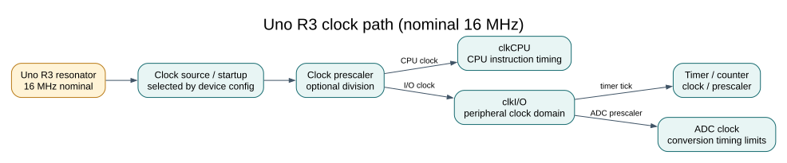

# The Uno Clock and AVR Clock Domains
## Objectives and Prerequisites

Explain the difference between a clock source, CPU clock and timer tick. Calculate a timer counter period from the Uno's 16 MHz clock and a prescaler. This lesson assumes you know the [ATmega328P resources](atmega328p-specs.md) and [pin functions](pin-multiplexing.md).

## The Board Supplies the Course Clock

The Uno R3 uses a 16 MHz resonator as the ATmega328P's clock source. For this course, the board runs the CPU at a nominal 16 MHz. The datasheet also describes clock sources, startup delays, fuse selections and clock scaling; those device options do not change the board's specified configuration automatically.



The CPU executes work using `clkCPU`. Timer/counter peripherals use the relevant peripheral clock and a selected prescaler. The ADC has its own clock path and must run within its recommended conversion range. When a timer counts from `clkI/O` divided by a prescaler, changing that prescaler changes the time between timer increments.

`F_CPU` is a compiler build-time constant used by some libraries and delay calculations. It does not set the silicon clock. If software is compiled for 16 MHz while the hardware actually runs at another frequency, baud-rate, delay and timer calculations will be wrong.

## Worked Timer Calculation

Suppose Timer1 counts from a 16 MHz clock divided by 8. The timer input frequency is:

```text
16,000,000 Hz / 8 = 2,000,000 timer ticks per second
```

Each tick takes `1 / 2,000,000 = 0.5 microseconds`. A free-running 16-bit counter takes `65,536 × 0.5 microseconds = 32.768 ms` to wrap. A compare match can schedule an event sooner; its exact period also depends on the compare value and whether the counter counts from zero or resets on match.

This is calculated from the nominal board clock and timer configuration. Component tolerance, temperature and clock error add timing error. It is not a measurement of your board.

## Clock Ownership and Arduino Timing

Timer clock configuration is a shared hardware resource. The Arduino AVR core uses Timer0 for timekeeping, so bare-metal code that changes Timer0 prescaling affects `millis()`, `micros()` and related functions. Arduino libraries may also claim timers for PWM or servo output. Keep the timer owner explicit, as shown in the [pin-multiplexing lesson](pin-multiplexing.md).

The ATmega328P also supports fuse-selected clock sources and a clock prescaler register. Fuse configuration can make a device appear unresponsive if software and clock hardware no longer agree. These lessons do not write fuses or change the Uno's clock source; the examples use the board as supplied. Inspect configuration read-only when needed and preserve the factory/board configuration.

## Observe a Timer Example

Build the HAL self-test with both toolchains and compare its size report:

```powershell
python "atmega328p-labs/tools/build.py" 90-selftest --compiler gcc
python "atmega328p-labs/tools/build.py" 90-selftest --compiler xc8
```

The test exercises software-level assumptions; it does not measure the actual resonator frequency. To check real timing, use an oscilloscope or logic analyzer on a documented output and compare the measured period with the calculation. Do not infer exact timing from a C delay loop.

## Exercise with Answer

A timer receives 16 MHz divided by 64. How long does one counter increment take?

**Answer:** `16,000,000 / 64 = 250,000` ticks per second, so one tick is `1 / 250,000 = 4 microseconds`. A counter overflow period also depends on its width and counting mode.

## Code Walkthrough


**Example code on GitHub:**
- [Register-level Blink (`01-blink-register`)](https://github.com/arnabdasbwn/atmega328p-labs/blob/main/examples/01-blink-register/main.c)
- [HAL Software Self-Test (`90-selftest`)](https://github.com/arnabdasbwn/atmega328p-labs/blob/main/examples/90-selftest/main.c)

### Register-level Blink
The example's `main()` configures its peripherals, runs the algorithm and reports or displays the result. These source operations are listed in execution order:

- `PORTB &= (uint8_t)~_BV(PORTB5);` - Sets or clears the Port B output latch. When the pin is an output, this determines its output level; on an input, it controls the pull-up.
- `DDRB |= _BV(DDB5);` - Sets the Port B direction bits; a set bit selects output mode.
- `for (;;)` - Repeats the foreground task indefinitely; each pass checks inputs, advances the calculation or services the peripheral shown below.
- `PINB = _BV(PINB5);` - Writing a one to a PINB bit toggles that pin's PORTB output latch on the ATmega328P.
- `_delay_ms(500);` - Waits for the stated interval; the foreground does no other work during this blocking delay.

Algorithm: Pin direction and output latch are separate hardware state.
Expected behaviour: L toggles every 500 ms
**HAL source files in this repository:** [ATmega328P HAL on GitHub](https://github.com/arnabdasbwn/atmega328p-hal)


### HAL Software Self-Test
The example's `main()` configures its peripherals, runs the algorithm and reports or displays the result. These source operations are listed in execution order:

- `avr_debounce_t button;` - Use the linked public header for this function's parameters, register ownership, blocking behavior and status values.
- `uint8_t result = 0U;` - Clears the state/counter after its threshold is reached so the next interval starts from zero.
- `(void)avr_uart_init(9600UL);` - Configures USART0 for asynchronous 8N1. It chooses a baud divisor and normal/double-speed mode, programs UBRR0/UCSR0A/UCSR0C, then enables receive and transmit in UCSR0B.
- `CHECK(avr_gpio_mode(20U, AVR_GPIO_OUTPUT) == AVR_ERROR_ARGUMENT);` - Maps the Uno header pin to its AVR port, sets its DDR direction bit and prepares the PORT latch for the requested initial level or pull-up.
- `CHECK(avr_gpio_read(13U, NULL) == AVR_ERROR_ARGUMENT);` - Reads the electrical level through PINx without changing direction or the output latch.
- `CHECK(avr_timer_ctc(AVR_TIMER0, 32U, 100U) == AVR_ERROR_ARGUMENT);` - Configures 0 in CTC mode with prescaler 32 and OCRnA TOP 100; event rate is 16 MHz / (32 x (100 + 1)) = 4950.5 Hz. The HAL disables this timer's interrupt sources and leaves flag polling to the caller.
- `CHECK(avr_timer_ctc(AVR_TIMER0, 64U, 256U) == AVR_ERROR_ARGUMENT);` - Configures 0 in CTC mode with prescaler 64 and OCRnA TOP 256; event rate is 16 MHz / (64 x (256 + 1)) = 972.763 Hz. The HAL disables this timer's interrupt sources and leaves flag polling to the caller.
- `CHECK(avr_timer_ctc(AVR_TIMER2, 128U, 124U) == AVR_OK);` - Configures 2 in CTC mode with prescaler 128 and OCRnA TOP 124; event rate is 16 MHz / (128 x (124 + 1)) = 1000 Hz. The HAL disables this timer's interrupt sources and leaves flag polling to the caller.
- `CHECK((TCCR2B & 7U) == 5U);` - Selects Timer2 clock/prescaler and remaining waveform bits. Timer2 has distinct prescaler encodings.
- `CHECK(avr_timer1_pwm(8U, 40000U, 3000U) == AVR_OK);` - Configures Timer1 mode 14 with prescaler 8; ICR1 becomes 39999, giving a 20 ms frame, and OCR1A starts at 3000 ticks (1500 us high).
- `CHECK(ICR1 == 39999U && OCR1A == 3000U);` - Timer1 input-capture register and, in the selected PWM mode, the TOP value. Timer1 Compare A; it sets the match point or PWM pulse width.
- `CHECK(avr_adc_millivolts(512U, 5000U) == 2500U);` - Calls `avr_adc_millivolts()`; its public HAL header defines the arguments, register ownership, blocking behavior and status results.
- `CHECK(avr_adc_read(6U, NULL, 0U) == AVR_ERROR_ARGUMENT);` - Calls `avr_adc_read()`; its public HAL header defines the arguments, register ownership, blocking behavior and status results.
- `CHECK(avr_eeprom_read(1024U, &result, 0UL) == AVR_ERROR_ARGUMENT);` - Calls `avr_eeprom_read()`; its public HAL header defines the arguments, register ownership, blocking behavior and status results.
- `CHECK(avr_twi_transfer(0U, NULL, 0U, NULL, 0U, 0UL) == AVR_ERROR_ARGUMENT);` - Calls `avr_twi_transfer()`; its public HAL header defines the arguments, register ownership, blocking behavior and status results.
- `CHECK(avr_elapsed(5UL, UINT32_MAX - 4UL, 10UL));` - Calls `avr_elapsed()`; its public HAL header defines the arguments, register ownership, blocking behavior and status results.
- `CHECK(!avr_elapsed(5UL, UINT32_MAX - 4UL, 11UL));` - Calls `avr_elapsed()`; its public HAL header defines the arguments, register ownership, blocking behavior and status results.
- `avr_debounce_init(&button, true, UINT32_MAX - 10UL);` - Calls `avr_debounce_init()`; its public HAL header defines the arguments, register ownership, blocking behavior and status results.
- `CHECK(!avr_debounce_update(&button, false, UINT32_MAX - 9UL, 20U));` - Calls `avr_debounce_update()`; its public HAL header defines the arguments, register ownership, blocking behavior and status results.
- `CHECK(!avr_debounce_update(&button, false, 9UL, 20U));` - Calls `avr_debounce_update()`; its public HAL header defines the arguments, register ownership, blocking behavior and status results.
- `CHECK(avr_debounce_update(&button, false, 10UL, 20U));` - Accepts a changed input only after it remains stable for the requested interval, then reports that accepted change once.
- `CHECK(!avr_debounce_update(&button, false, 11UL, 20U));` - Accepts a changed input only after it remains stable for the requested interval, then reports that accepted change once.
- `(void)avr_uart_write((const uint8_t *)"PASS\n", 5U, AVR_POLL_BUDGET);` - Sends the specified bytes through USART0; a timeout can occur after a prefix has already been sent.
- `for (;;)` - Repeats the foreground task indefinitely; each pass checks inputs, advances the calculation or services the peripheral shown below.

Algorithm: A bounded self-test checks software contracts and links a second source file so header-owned definitions are detected.
Expected behaviour: The fixture prints PASS after argument, timer-range, debounce and independent-translation-unit checks; otherwise it prints FAIL and stops
**HAL source files in this repository:** [ATmega328P HAL on GitHub](https://github.com/arnabdasbwn/atmega328p-hal)

- [`include/avr_hal/adc.h`](https://github.com/arnabdasbwn/atmega328p-hal/blob/main/include/avr_hal/adc.h)
- [`include/avr_hal/common.h`](https://github.com/arnabdasbwn/atmega328p-hal/blob/main/include/avr_hal/common.h)
- [`include/avr_hal/eeprom.h`](https://github.com/arnabdasbwn/atmega328p-hal/blob/main/include/avr_hal/eeprom.h)
- [`include/avr_hal/gpio.h`](https://github.com/arnabdasbwn/atmega328p-hal/blob/main/include/avr_hal/gpio.h)
- [`include/avr_hal/timer.h`](https://github.com/arnabdasbwn/atmega328p-hal/blob/main/include/avr_hal/timer.h)
- [`include/avr_hal/twi.h`](https://github.com/arnabdasbwn/atmega328p-hal/blob/main/include/avr_hal/twi.h)
- [`include/avr_hal/uart.h`](https://github.com/arnabdasbwn/atmega328p-hal/blob/main/include/avr_hal/uart.h)
- [`lib/drivers/debounce.c`](https://github.com/arnabdasbwn/atmega328p-hal/blob/main/lib/drivers/debounce.c)
- [`lib/drivers/debounce.h`](https://github.com/arnabdasbwn/atmega328p-hal/blob/main/lib/drivers/debounce.h)
- [`src/adc.c`](https://github.com/arnabdasbwn/atmega328p-hal/blob/main/src/adc.c)
- [`src/common.c`](https://github.com/arnabdasbwn/atmega328p-hal/blob/main/src/common.c)
- [`src/eeprom.c`](https://github.com/arnabdasbwn/atmega328p-hal/blob/main/src/eeprom.c)
- [`src/gpio.c`](https://github.com/arnabdasbwn/atmega328p-hal/blob/main/src/gpio.c)
- [`src/timer.c`](https://github.com/arnabdasbwn/atmega328p-hal/blob/main/src/timer.c)
- [`src/twi.c`](https://github.com/arnabdasbwn/atmega328p-hal/blob/main/src/twi.c)
- [`src/uart.c`](https://github.com/arnabdasbwn/atmega328p-hal/blob/main/src/uart.c)


## References

For current device details, use the [Microchip ATmega328P documentation](https://www.microchip.com/en-us/product/ATMEGA328P). Check the document listed for your exact device and package; board-level pin labels and circuitry are covered by the [Uno R3 pinout](https://www.arnabkumardas.com/pinout/arduino-uno-r3/).
