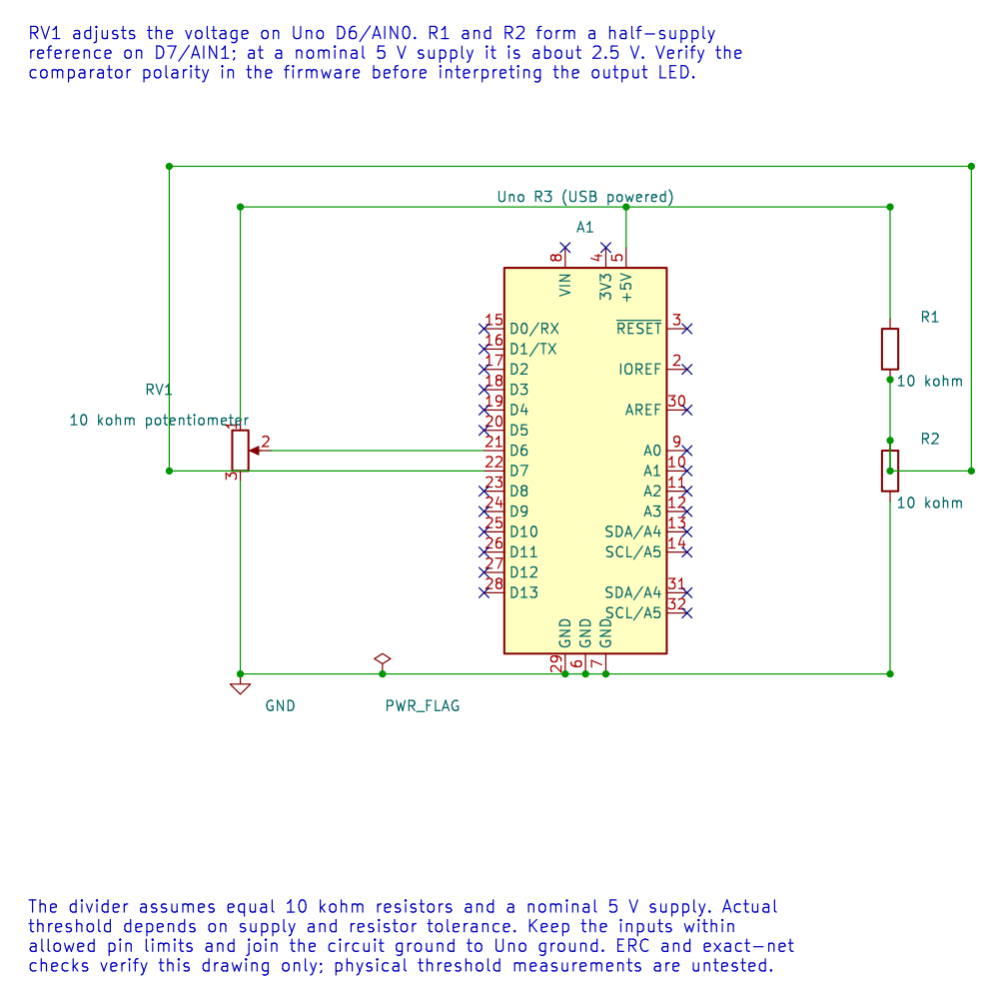

# Build an Analog Comparator Threshold Example

## Parts and Wiring

Use a 10 kΩ potentiometer, two 10 kΩ resistors and the Uno onboard LED. The comparator example uses D6/AIN0 for the adjustable voltage and D7/AIN1 for a nominal half-supply threshold.

| Connection | Destination |
| --- | --- |
| Potentiometer ends | Uno 5 V and GND |
| Potentiometer wiper | D6/AIN0 |
| Divider upper 10 kΩ | Uno 5 V to D7/AIN1 node |
| Divider lower 10 kΩ | D7/AIN1 node to GND |
| Uno GND | Common circuit ground |



An equal resistor divider gives `5 V × 10 kΩ / (10 kΩ + 10 kΩ) = 2.5 V` ideally. Actual supply and resistor tolerances change the threshold slightly.

## Build and Observe

The [complete comparator program](<https://github.com/arnabdasbwn/atmega328p-labs/blob/main/examples/23-comparator/main.c>) enables the analogue comparator and mirrors its result on the onboard LED. Build it under both supported compilers:

```powershell
python atmega328p-labs/tools/build.py 23-comparator --compiler gcc
python atmega328p-labs/tools/build.py 23-comparator --compiler xc8
```

After wiring and upload, turn the potentiometer slowly through the midpoint. The output should change state once the relative input voltages cross. Noise can make the LED flicker near the threshold; that indicates the need for hysteresis, not a higher-resolution conversion.

## Exercise with Answer

Why might the LED change state several times while the knob is held near the midpoint?

**Answer:** The two analogue voltages are close, and noise or movement can make their order change repeatedly. Add hysteresis or another stability method if one clean transition is required.

## Code Walkthrough

### Analog comparator threshold
The example's `main()` configures its peripherals, runs the algorithm and reports or displays the result. These source operations are listed in execution order:

- `avr_comparator_init();` - Use the linked public header for this function's parameters, register ownership, blocking behavior and status values.
- `(void)avr_gpio_mode(13U, AVR_GPIO_OUTPUT);` - Maps the Uno header pin to its AVR port, sets its DDR direction bit and prepares the PORT latch for the requested initial level or pull-up.
- `for (;;)` - Repeats the foreground task indefinitely; each pass checks inputs, advances the calculation or services the peripheral shown below.
- `(void)avr_gpio_write(13U, avr_comparator_output());` - Changes the pin's PORT output latch; for an input pin this selects its pull-up state.

Algorithm: A comparator reports which input is larger, not the voltage difference. Near the threshold, noise can create multiple transitions; use hysteresis for a clean switching decision.
Expected behaviour: L turns on when the wiper voltage exceeds approximately 2.5 V
**HAL source files in this repository:** [ATmega328P HAL on GitHub](https://github.com/arnabdasbwn/atmega328p-hal)

- [`include/avr_hal/gpio.h`](https://github.com/arnabdasbwn/atmega328p-hal/blob/main/include/avr_hal/gpio.h)
- [`include/avr_hal/system.h`](https://github.com/arnabdasbwn/atmega328p-hal/blob/main/include/avr_hal/system.h)
- [`src/gpio.c`](https://github.com/arnabdasbwn/atmega328p-hal/blob/main/src/gpio.c)
- [`src/system.c`](https://github.com/arnabdasbwn/atmega328p-hal/blob/main/src/system.c)


## References

- [Comparator source and wiring notes](<https://github.com/arnabdasbwn/atmega328p-labs/blob/main/examples/23-comparator/main.c>)
- [Comparator fundamentals](comparator.md)
- Use the ATmega328P datasheet and resistor tolerances when estimating the actual threshold.
- Editable KiCad schematic, ERC report and netlist
