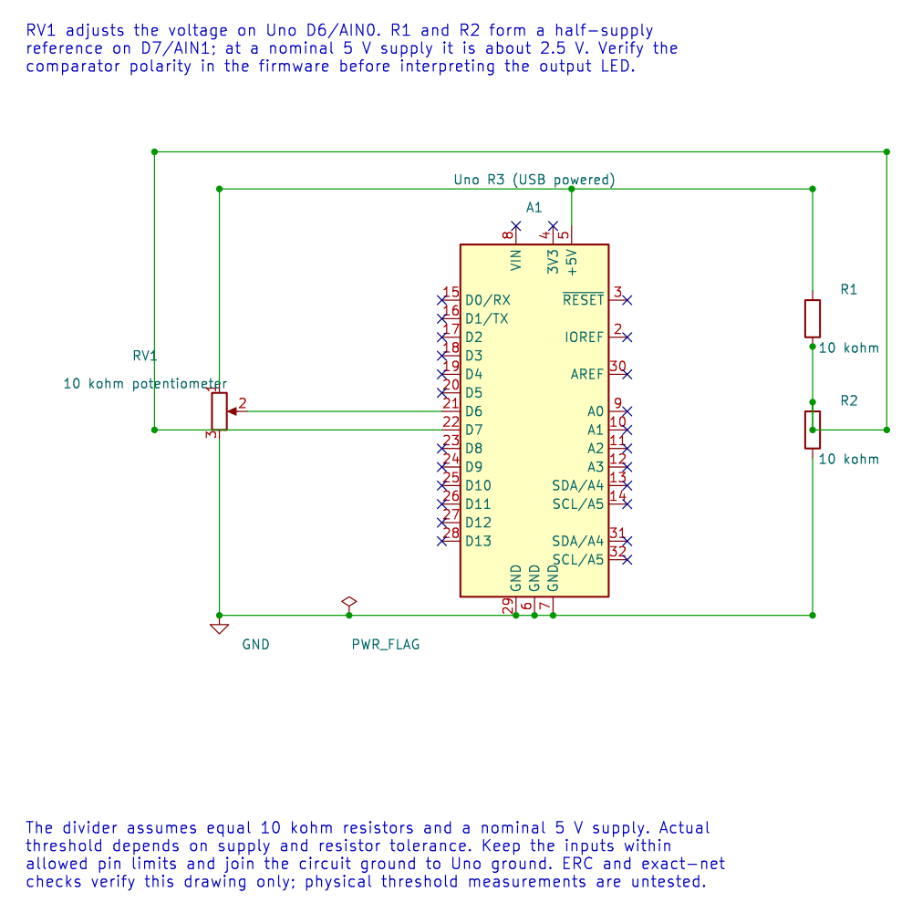

# The ATmega328P Analog Comparator

## What the Comparator Tells You

The analogue comparator compares two input voltages and reports which one is higher. It gives a one-bit result; it does not measure the voltage difference. On the Uno R3, the external comparator inputs are AIN0 on D6 and AIN1 on D7. The comparator can also generate an interrupt or provide a signal to Timer1 input capture.

Use the comparator when the decision is simply "above or below this threshold". Choose the ADC when you need a numeric measurement, more than one threshold, or software calibration. The ADC and comparator share some pin and internal-reference resources, so read the pin-multiplexing section of the data sheet before enabling both.

## A Divider Gives a Known Threshold

In [Lab 23](<https://github.com/arnabdasbwn/atmega328p-labs/blob/main/examples/23-comparator/main.c>), a potentiometer wiper feeds AIN0, and two equal 10 kOhm resistors make a threshold for AIN1. With the divider across 5 V, the nominal threshold is:



`V_threshold = 5 V x 10 kOhm / (10 kOhm + 10 kOhm) = 2.5 V`

When the wiper is higher than the divider voltage, the comparator result changes state. The actual threshold follows the actual supply and resistor tolerances; it may not be exactly 2.500 V. Keep the inputs within the allowed pin voltage range and connect the circuit ground to Uno ground.

## Configure the Peripheral Deliberately

`ACSR` holds the comparator control and status bits. `ACD` disables the comparator. `ACIE` enables its interrupt, and `ACIS1:0` choose which output transition triggers it. The `ACI` interrupt flag is cleared by writing one. Use the data sheet's recommended register write, not a read-modify-write that may acknowledge a pending flag by accident.

The `ACBG` bit selects the internal bandgap on the comparator's positive input. The input multiplexer controlled through `ADCSRB.ACME` can route an ADC input channel to the negative input when the ADC is disabled; otherwise the external AIN1 path is used. This changes which physical pin is being compared, so check both `ADMUX` and `ADCSRB` before wiring. Do not assume AIN1 remains connected to D7 after enabling the multiplexer.

For a polling design, read `ACO` from `ACSR`. For an interrupt design, keep the interrupt service routine short: capture the event or update a small state value, then do longer work in the main loop. The comparator interrupt does not remove analogue noise at the threshold.

## Handle Noise Near the Threshold

Build Lab 23 with both supported compilers before wiring the threshold circuit:

```powershell
python atmega328p-labs/tools/build.py 23-comparator --compiler gcc
python atmega328p-labs/tools/build.py 23-comparator --compiler xc8
```

These are software checks; they do not measure the divider or the LED transition on hardware.

If the input has noise or changes slowly, the result can toggle repeatedly around the crossing point. Use a comparator with built-in hysteresis where available, add a suitable external hysteresis network, or apply a carefully bounded digital filter. A large software delay can hide events and is not a substitute for a properly designed threshold circuit.

## Exercise with Answer

**The comparator reports that AIN0 is above AIN1. Does it tell you whether the difference is 1 mV or 1 V?**
No. Its result has one bit and only indicates the comparison outcome. Use the ADC if the voltage magnitude is required.

## Code Walkthrough

### Analog comparator threshold
The example's `main()` configures its peripherals, runs the algorithm and reports or displays the result. These source operations are listed in execution order:

- `avr_comparator_init();` - Use the linked public header for this function's parameters, register ownership, blocking behavior and status values.
- `(void)avr_gpio_mode(13U, AVR_GPIO_OUTPUT);` - Maps the Uno header pin to its AVR port, sets its DDR direction bit and prepares the PORT latch for the requested initial level or pull-up.
- `for (;;)` - Repeats the foreground task indefinitely; each pass checks inputs, advances the calculation or services the peripheral shown below.
- `(void)avr_gpio_write(13U, avr_comparator_output());` - Changes the pin's PORT output latch; for an input pin this selects its pull-up state.

Algorithm: A comparator reports which input is larger, not the voltage difference. Near the threshold, noise can create multiple transitions; use hysteresis for a clean switching decision.
Expected behaviour: L turns on when the wiper voltage exceeds approximately 2.5 V
**HAL source files in this repository:** [ATmega328P HAL on GitHub](https://github.com/arnabdasbwn/atmega328p-hal)

- [`include/avr_hal/gpio.h`](https://github.com/arnabdasbwn/atmega328p-hal/blob/main/include/avr_hal/gpio.h)
- [`include/avr_hal/system.h`](https://github.com/arnabdasbwn/atmega328p-hal/blob/main/include/avr_hal/system.h)
- [`src/gpio.c`](https://github.com/arnabdasbwn/atmega328p-hal/blob/main/src/gpio.c)
- [`src/system.c`](https://github.com/arnabdasbwn/atmega328p-hal/blob/main/src/system.c)


## References

- Microchip, [ATmega328P documentation](https://www.microchip.com/en-us/product/ATMEGA328P), comparator, ADC multiplexer and Timer1 capture descriptions.
- [Comparator example](<https://github.com/arnabdasbwn/atmega328p-labs/blob/main/examples/23-comparator/main.c>) and [ADC concepts](adc-concepts.md).
- Editable comparator schematic and netlist
