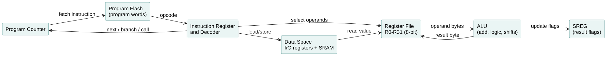

# How the AVR CPU Executes Instructions
## Objectives and Prerequisites

Trace a simple addition through the ATmega328P, explain what the status flags mean,
and connect a C expression to the work performed by the processor. You should know
binary notation and the AVR integer widths from the earlier lessons.

## The Cpu'S Job

The CPU repeatedly selects an instruction, decodes it, reads its operands, performs
an operation and chooses what instruction comes next. The ATmega328P's AVR core has
32 general-purpose registers, each 8 bits wide, plus an arithmetic and logic unit
(ALU), a status register, a program counter and a stack pointer. It accesses program
Flash and data space over separate paths, which is the Harvard architecture.



The program counter (PC) identifies the next instruction in program Flash. Most AVR
instructions occupy one 16-bit word; some occupy two. The core fetches the next
instruction while the current one executes, so many register-to-register operations
can complete in one clock cycle. A taken branch, a memory access, a call or an
interrupt can take more cycles. The exact instruction count must come from the
compiled program, not from counting C lines.

## Worked Example: 200 + 100

The arithmetic is:

```text
  11001000   200 (0xC8)
+ 01100100   100 (0x64)
----------
1 00101100   300 (0x12C)
```

If the ALU adds these bytes into an 8-bit destination, it stores the low byte
`00101100` (`0x2C`, or 44) and sets the carry flag because a ninth bit was produced.
The Zero flag is clear because the stored byte is not zero. The AVR Status Register
(SREG) also records signed overflow, sign, half-carry, negative and bit-test
information as appropriate for the instruction.

In C, `uint8_t` operands are promoted to AVR's 16-bit `int` for this addition. The
mathematical sum, 300, fits in that type; the explicit conversion back to `uint8_t`
produces 44. The C result is portable and defined. Do not assume that every compiler
will produce the same assembly sequence: inspect the actual output when cycle counts
matter.

## Registers, Flags and Control Flow

The register file holds temporary 8-bit values close to the ALU. The register pairs
X (`R27:R26`), Y (`R29:R28`) and Z (`R31:R30`) can hold 16-bit data-space addresses;
Z is also used by some instructions to read constants from program Flash. Special
register names in C headers refer to hardware-mapped registers, not ordinary
variables.

After arithmetic, the instruction updates selected SREG flags. C comparison and
branch instructions are generated from these results. A conditional branch either
continues to the next sequential address or changes the PC to its target. Calls save
the return address on the stack; interrupt entry also saves the return position and
starts at a vector. The compiler's startup code initializes the stack before `main`.
Later lessons examine stack bounds and interrupt context in detail.

## Connect the Model to the First Lab

In [register-level Blink](<https://github.com/arnabdasbwn/atmega328p-labs/blob/main/examples/01-blink-register/main.c>),
`DDRB` and `PINB` are memory-mapped hardware registers. The compiled instructions
read, mask or write those locations using the CPU's data-space path. Writing a one
to `PINB5` toggles the output latch because the peripheral defines that behavior;
the ALU itself does not know that the bit controls an LED. See [the pinout](https://www.arnabkumardas.com/pinout/arduino-uno-r3/)
for the board pin mapping.

Build the program, then inspect its instructions with the AVR GCC toolchain:

```powershell
python "atmega328p-labs/tools/build.py" 01-blink-register --compiler gcc
avr-objdump -d -S "atmega328p-labs/build/gcc/01-blink-register/firmware.elf"
python "atmega328p-labs/tools/build.py" 01-blink-register --compiler xc8
avr-objdump -d -S "atmega328p-labs/build/xc8/01-blink-register/firmware.elf"
```

`-S` interleaves source lines where debug information permits. The instruction
sequence and timing may differ between GCC and XC8, compiler versions or
optimization settings.
Builds and disassembly do not prove the physical LED is blinking.

## Exercise with Answer

The ALU adds `0xFF` and `0x01` into an 8-bit destination. What value is stored, and
what happens to carry and zero?

**Answer:** the full sum is `0x100`. The stored byte is `0x00`; carry is set and zero
is set because the stored result equals zero. These flags describe the result of
that instruction and can be overwritten by a later instruction.

## Code Walkthrough


**Example code on GitHub:**
- [HAL Software Self-Test (`90-selftest`)](https://github.com/arnabdasbwn/atmega328p-labs/blob/main/examples/90-selftest/main.c)

### Register-level Blink
The example's `main()` configures its peripherals, runs the algorithm and reports or displays the result. These source operations are listed in execution order:

- `PORTB &= (uint8_t)~_BV(PORTB5);` - Sets or clears the Port B output latch. When the pin is an output, this determines its output level; on an input, it controls the pull-up.
- `DDRB |= _BV(DDB5);` - Sets the Port B direction bits; a set bit selects output mode.
- `for (;;)` - Repeats the foreground task indefinitely; each pass checks inputs, advances the calculation or services the peripheral shown below.
- `PINB = _BV(PINB5);` - Writing a one to a PINB bit toggles that pin's PORTB output latch on the ATmega328P.
- `_delay_ms(500);` - Waits for the stated interval; the foreground does no other work during this blocking delay.

Algorithm: Pin direction and output latch are separate hardware state.
Expected behaviour: L toggles every 500 ms
**HAL source files in this repository:** [ATmega328P HAL on GitHub](https://github.com/arnabdasbwn/atmega328p-hal)


### HAL Software Self-Test
The example's `main()` configures its peripherals, runs the algorithm and reports or displays the result. These source operations are listed in execution order:

- `avr_debounce_t button;` - Use the linked public header for this function's parameters, register ownership, blocking behavior and status values.
- `uint8_t result = 0U;` - Clears the state/counter after its threshold is reached so the next interval starts from zero.
- `(void)avr_uart_init(9600UL);` - Configures USART0 for asynchronous 8N1. It chooses a baud divisor and normal/double-speed mode, programs UBRR0/UCSR0A/UCSR0C, then enables receive and transmit in UCSR0B.
- `CHECK(avr_gpio_mode(20U, AVR_GPIO_OUTPUT) == AVR_ERROR_ARGUMENT);` - Maps the Uno header pin to its AVR port, sets its DDR direction bit and prepares the PORT latch for the requested initial level or pull-up.
- `CHECK(avr_gpio_read(13U, NULL) == AVR_ERROR_ARGUMENT);` - Reads the electrical level through PINx without changing direction or the output latch.
- `CHECK(avr_timer_ctc(AVR_TIMER0, 32U, 100U) == AVR_ERROR_ARGUMENT);` - Configures 0 in CTC mode with prescaler 32 and OCRnA TOP 100; event rate is 16 MHz / (32 x (100 + 1)) = 4950.5 Hz. The HAL disables this timer's interrupt sources and leaves flag polling to the caller.
- `CHECK(avr_timer_ctc(AVR_TIMER0, 64U, 256U) == AVR_ERROR_ARGUMENT);` - Configures 0 in CTC mode with prescaler 64 and OCRnA TOP 256; event rate is 16 MHz / (64 x (256 + 1)) = 972.763 Hz. The HAL disables this timer's interrupt sources and leaves flag polling to the caller.
- `CHECK(avr_timer_ctc(AVR_TIMER2, 128U, 124U) == AVR_OK);` - Configures 2 in CTC mode with prescaler 128 and OCRnA TOP 124; event rate is 16 MHz / (128 x (124 + 1)) = 1000 Hz. The HAL disables this timer's interrupt sources and leaves flag polling to the caller.
- `CHECK((TCCR2B & 7U) == 5U);` - Selects Timer2 clock/prescaler and remaining waveform bits. Timer2 has distinct prescaler encodings.
- `CHECK(avr_timer1_pwm(8U, 40000U, 3000U) == AVR_OK);` - Configures Timer1 mode 14 with prescaler 8; ICR1 becomes 39999, giving a 20 ms frame, and OCR1A starts at 3000 ticks (1500 us high).
- `CHECK(ICR1 == 39999U && OCR1A == 3000U);` - Timer1 input-capture register and, in the selected PWM mode, the TOP value. Timer1 Compare A; it sets the match point or PWM pulse width.
- `CHECK(avr_adc_millivolts(512U, 5000U) == 2500U);` - Calls `avr_adc_millivolts()`; its public HAL header defines the arguments, register ownership, blocking behavior and status results.
- `CHECK(avr_adc_read(6U, NULL, 0U) == AVR_ERROR_ARGUMENT);` - Calls `avr_adc_read()`; its public HAL header defines the arguments, register ownership, blocking behavior and status results.
- `CHECK(avr_eeprom_read(1024U, &result, 0UL) == AVR_ERROR_ARGUMENT);` - Calls `avr_eeprom_read()`; its public HAL header defines the arguments, register ownership, blocking behavior and status results.
- `CHECK(avr_twi_transfer(0U, NULL, 0U, NULL, 0U, 0UL) == AVR_ERROR_ARGUMENT);` - Calls `avr_twi_transfer()`; its public HAL header defines the arguments, register ownership, blocking behavior and status results.
- `CHECK(avr_elapsed(5UL, UINT32_MAX - 4UL, 10UL));` - Calls `avr_elapsed()`; its public HAL header defines the arguments, register ownership, blocking behavior and status results.
- `CHECK(!avr_elapsed(5UL, UINT32_MAX - 4UL, 11UL));` - Calls `avr_elapsed()`; its public HAL header defines the arguments, register ownership, blocking behavior and status results.
- `avr_debounce_init(&button, true, UINT32_MAX - 10UL);` - Calls `avr_debounce_init()`; its public HAL header defines the arguments, register ownership, blocking behavior and status results.
- `CHECK(!avr_debounce_update(&button, false, UINT32_MAX - 9UL, 20U));` - Calls `avr_debounce_update()`; its public HAL header defines the arguments, register ownership, blocking behavior and status results.
- `CHECK(!avr_debounce_update(&button, false, 9UL, 20U));` - Calls `avr_debounce_update()`; its public HAL header defines the arguments, register ownership, blocking behavior and status results.
- `CHECK(avr_debounce_update(&button, false, 10UL, 20U));` - Accepts a changed input only after it remains stable for the requested interval, then reports that accepted change once.
- `CHECK(!avr_debounce_update(&button, false, 11UL, 20U));` - Accepts a changed input only after it remains stable for the requested interval, then reports that accepted change once.
- `(void)avr_uart_write((const uint8_t *)"PASS\n", 5U, AVR_POLL_BUDGET);` - Sends the specified bytes through USART0; a timeout can occur after a prefix has already been sent.
- `for (;;)` - Repeats the foreground task indefinitely; each pass checks inputs, advances the calculation or services the peripheral shown below.

Algorithm: A bounded self-test checks software contracts and links a second source file so header-owned definitions are detected.
Expected behaviour: The fixture prints PASS after argument, timer-range, debounce and independent-translation-unit checks; otherwise it prints FAIL and stops
**HAL source files in this repository:** [ATmega328P HAL on GitHub](https://github.com/arnabdasbwn/atmega328p-hal)

- [`include/avr_hal/adc.h`](https://github.com/arnabdasbwn/atmega328p-hal/blob/main/include/avr_hal/adc.h)
- [`include/avr_hal/common.h`](https://github.com/arnabdasbwn/atmega328p-hal/blob/main/include/avr_hal/common.h)
- [`include/avr_hal/eeprom.h`](https://github.com/arnabdasbwn/atmega328p-hal/blob/main/include/avr_hal/eeprom.h)
- [`include/avr_hal/gpio.h`](https://github.com/arnabdasbwn/atmega328p-hal/blob/main/include/avr_hal/gpio.h)
- [`include/avr_hal/timer.h`](https://github.com/arnabdasbwn/atmega328p-hal/blob/main/include/avr_hal/timer.h)
- [`include/avr_hal/twi.h`](https://github.com/arnabdasbwn/atmega328p-hal/blob/main/include/avr_hal/twi.h)
- [`include/avr_hal/uart.h`](https://github.com/arnabdasbwn/atmega328p-hal/blob/main/include/avr_hal/uart.h)
- [`lib/drivers/debounce.c`](https://github.com/arnabdasbwn/atmega328p-hal/blob/main/lib/drivers/debounce.c)
- [`lib/drivers/debounce.h`](https://github.com/arnabdasbwn/atmega328p-hal/blob/main/lib/drivers/debounce.h)
- [`src/adc.c`](https://github.com/arnabdasbwn/atmega328p-hal/blob/main/src/adc.c)
- [`src/common.c`](https://github.com/arnabdasbwn/atmega328p-hal/blob/main/src/common.c)
- [`src/eeprom.c`](https://github.com/arnabdasbwn/atmega328p-hal/blob/main/src/eeprom.c)
- [`src/gpio.c`](https://github.com/arnabdasbwn/atmega328p-hal/blob/main/src/gpio.c)
- [`src/timer.c`](https://github.com/arnabdasbwn/atmega328p-hal/blob/main/src/timer.c)
- [`src/twi.c`](https://github.com/arnabdasbwn/atmega328p-hal/blob/main/src/twi.c)
- [`src/uart.c`](https://github.com/arnabdasbwn/atmega328p-hal/blob/main/src/uart.c)


## References

For current device details, use the [Microchip ATmega328P documentation](https://www.microchip.com/en-us/product/ATMEGA328P). Check the document listed for your exact device and package; board-level pin labels and circuitry are covered by the [Uno R3 pinout](https://www.arnabkumardas.com/pinout/arduino-uno-r3/).
