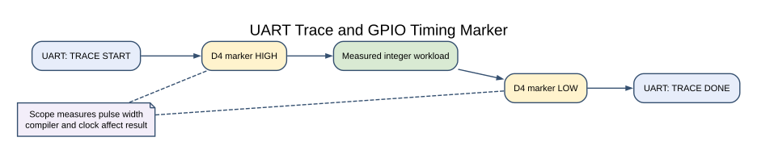

# Debugging with Traces and Instruments

## Why Embedded Debugging Needs a Plan

An Uno has limited memory and no general-purpose operating system to collect logs for you. You need to decide what to observe: a state change, a received byte, an error code, a voltage or a timing edge. A short, repeatable observation is easier to explain than a large stream of unstructured debug text.

This lesson pairs two methods. A UART trace identifies the part of the program that is running. A GPIO marker lets a scope or logic analyser measure how long a small section takes. Each method has limits, and both can affect the behaviour being measured.

## Tools and Safe Connections

For this lab you need an Uno R3, a USB cable, a serial terminal and an oscilloscope or logic analyser if available. The terminal uses the Uno USB serial bridge at 9600 baud, 8 data bits, no parity and one stop bit.

| Uno pin | Connection | Use |
| --- | --- | --- |
| D0 / RX | USB serial bridge | Terminal input; do not add another driver |
| D1 / TX | USB serial bridge | Terminal output; do not connect to another TX output |
| D4 | Scope or logic analyser input | Timing marker |
| GND | Instrument ground | Common reference for a logic-level measurement |

Keep the probe within the instrument and board voltage limits. This course does not cover probing mains voltage. If you use the USB serial terminal, leave D0 and D1 free of other modules.

## The Measurement Lab



Lab 65 writes `TRACE START` before the measurement, raises D4, runs a fixed integer workload, lowers D4 and then writes `TRACE DONE`. The UART messages stay outside the marker window because serial transmission is much slower than the short calculation.

Build it with either supported toolchain:

```powershell
python atmega328p-labs/tools/build.py 65-debug-marker --compiler gcc
python atmega328p-labs/tools/build.py 65-debug-marker --compiler xc8
```

The build step does not upload firmware. After uploading through the normal course workflow, open a serial terminal and observe the repeating text. If a scope or logic analyser is available, measure D4 high time and record the compiler, optimization setting, clock and instrument sample rate. Then change the workload count and compare the pulse width.

The width will depend on the compiler and generated instructions. It is not a promised execution time. A GPIO pin is also shared with other board functions in general; confirm ownership before using a marker in a larger application.

## UART Traces and Their Limits

A text trace is helpful for state transitions and fault codes, but formatted output consumes Flash and time. This lab uses fixed strings and a bounded UART function; it does not call `printf`. If you add logging to a time-critical path, account for its effect on the schedule and memory use.

For a serial fault, check the supply and ground first, then crossed TX/RX, baud rate, frame format and received data. For I²C, check pull-up resistors, address, ACK/NACK and clock. Change one condition at a time and record the expected and actual observation.

## Using the JTAGICE3 Carefully

The Uno ATmega328P can use debugWIRE through RESET, but that mode changes how RESET behaves and depends on the DWEN fuse. The course machine's Uno has DWEN enabled, and the user has requested that fuse values remain unchanged. The tutorial therefore treats the JTAGICE3 as an optional tool and does not instruct students to change fuses for routine debugging. Use serial logging or external instruments unless you have checked the exact device and debug workflow.

An ISP programmer and a debug probe are not interchangeable in every operation. Before any programming action, preserve the Optiboot bootloader region and confirm that the image and tool command do not alter fuses or lock bits. The normal lesson builds do not communicate with the programmer.

## Code Walkthrough


**Example code on GitHub:**
- [GPIO Timing Marker and UART Trace (`65-debug-marker`)](https://github.com/arnabdasbwn/atmega328p-labs/blob/main/examples/65-debug-marker/main.c)

### GPIO Timing Marker and UART Trace
The example's `main()` configures its peripherals, runs the algorithm and reports or displays the result. These source operations are listed in execution order:

- `static const uint8_t start_message[] = "TRACE START\r\n";` - Stores this intermediate or output value for the next algorithm step. Check the units and range represented by each operand.
- `static const uint8_t done_message[] = "TRACE DONE\r\n";` - Stores this intermediate or output value for the next algorithm step. Check the units and range represented by each operand.
- `if ((avr_gpio_mode(4U, AVR_GPIO_OUTPUT) != AVR_OK) || (avr_uart_init(UINT32_C(9600)) != AVR_OK))` - This checks for any setup or transfer error before the program continues. Maps the Uno header pin to its AVR port, sets its DDR direction bit and prepares the PORT latch for the requested initial level or pull-up. Configures USART0 for asynchronous 8N1. It chooses a baud divisor and normal/double-speed mode, programs UBRR0/UCSR0A/UCSR0C, then enables receive and transmit in UCSR0B.
- `return 1;` - Stops this path and returns the indicated status when setup or validation cannot continue.
- `for (;;)` - Repeats the foreground task indefinitely; each pass checks inputs, advances the calculation or services the peripheral shown below.
- `volatile uint16_t last_checksum = 0U;` - Clears the state/counter after its threshold is reached so the next interval starts from zero.
- `if (avr_uart_write(start_message, sizeof(start_message) - 1U, AVR_DEBUG_UART_BUDGET) !=` - This condition chooses the next path based on the API result. Sends the specified bytes through USART0; a timeout can occur after a prefix has already been sent.
- `if (avr_gpio_write(4U, true) != AVR_OK)` - This checks for any setup or transfer error before the program continues. Changes the pin's PORT output latch; for an input pin this selects its pull-up state.
- `last_checksum = avr_debug_work(AVR_DEBUG_WORK_COUNT);` - Use the linked public header for this function's parameters, register ownership, blocking behavior and status values.
- `if (avr_gpio_write(4U, false) != AVR_OK)` - This checks for any setup or transfer error before the program continues. Changes the pin's PORT output latch; for an input pin this selects its pull-up state.
- `if (avr_uart_write(done_message, sizeof(done_message) - 1U, AVR_DEBUG_UART_BUDGET) !=` - This condition chooses the next path based on the API result. Sends the specified bytes through USART0; a timeout can occur after a prefix has already been sent.
- `_delay_ms(1000);` - Waits for the stated interval; the foreground does no other work during this blocking delay.

Algorithm: A GPIO marker gives a direct timing observation, while serial text identifies the surrounding application state.
Expected behaviour: Terminal shows TRACE START and TRACE DONE. D4 is high only around the deterministic workload; pulse width depends on compiler settings
**HAL source files in this repository:** [ATmega328P HAL on GitHub](https://github.com/arnabdasbwn/atmega328p-hal)

- [`include/avr_hal/gpio.h`](https://github.com/arnabdasbwn/atmega328p-hal/blob/main/include/avr_hal/gpio.h)
- [`include/avr_hal/uart.h`](https://github.com/arnabdasbwn/atmega328p-hal/blob/main/include/avr_hal/uart.h)
- [`src/gpio.c`](https://github.com/arnabdasbwn/atmega328p-hal/blob/main/src/gpio.c)
- [`src/uart.c`](https://github.com/arnabdasbwn/atmega328p-hal/blob/main/src/uart.c)


## Common Problems

- **No terminal text:** Check the port, baud rate and whether another program has opened the port.
- **Unreadable characters:** Check baud, frame format and common ground.
- **No marker pulse:** Confirm D4 is configured as output and the instrument ground is connected.
- **Measured time changes after adding logging:** The logging work may be longer than the code being measured. Keep it outside the measured interval or remove it for the final timing measurement.
- **Unexpected reset or upload issue with a debugger attached:** Inspect reset/debug configuration without changing fuses casually; the Uno bootloader and RESET function are part of the board's normal workflow.

## Check Your Understanding

1. Why does Lab 65 print the UART messages outside the D4 high interval?
2. What information should you record with a scope timing measurement?
3. Why can adding a debug message change the fault you are trying to observe?

**Suggested answers:** UART transmission would dominate the calculation's timing. Record the compiler, optimization, clock, probe connection and sample rate so the measurement can be repeated. Logging consumes time and memory and can change scheduling or timing.

## Source and Further Reading

- Lab 65: `atmega328p-labs/examples/65-debug-marker/`
- [Microchip ATmega328P Documentation](https://www.microchip.com/en-us/product/ATMEGA328P), datasheet sections on USART, GPIO and debugWIRE.
- [Microchip MPLAB for VS Code Workflow](https://developerhelp.microchip.com/xwiki/bin/view/software-tools/ides/extensions/workflow/)
