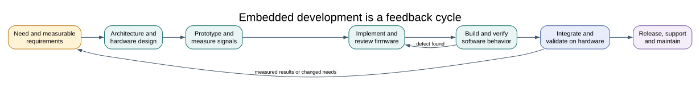

# From Product Requirement to Maintained Firmware

## Objectives and Prerequisites

Describe the main steps from a product need to supported firmware. For each step, name an artifact that helps another person review or reproduce the result. Read the [night-light case study](case-study.md) and [test strategy](testing.md) first.

## The Work Repeats as Evidence Arrives

Embedded development is a cycle. A measured prototype may reveal that a requirement is unclear; a review may reveal a pin conflict; a field report may expose a missing reset case. Record the change and repeat the affected design and test steps rather than treating the first build as a finished product.

## Apply the Lifecycle to the Night Light

| Stage | Night-light activity | Evidence to keep |
| --- | --- | --- |
| Need and requirements | Define when the lamp should turn on, how quickly it responds and what indicates failure | Written requirements with measurable thresholds and response time |
| Feasibility and risk | Check Uno voltage, ADC range, LDR variability, available pins and memory | Risk list, datasheet references and initial resource estimates |
| Architecture | Choose the divider, A0, ADC reference, D13 output and threshold state | Block diagram, pin ownership notes and interface decisions |
| Prototype | Wire the GL5528-type LDR and 10 kOhm resistor; inspect raw ADC values | Versioned KiCad schematic, wiring record and measured sample ranges |
| Implementation | Convert the threshold and hysteresis rules into small C functions | Reviewed source with documented APIs and a buildable project |
| Verification | Compile with GCC and XC8; test threshold boundaries and state transitions | Build logs, unit or simulation results, and a test matrix |
| Integration and validation | Observe the actual LED response while changing light at the sensor | Board revision, firmware hash, lighting conditions and measured outcome |
| Release and maintenance | Package the source, schematic, instructions and supported versions | Release manifest, known limitations and a way to report defects |

Verification asks whether the implementation meets its stated requirements. Validation asks whether those requirements describe the behavior the user actually needs. A passing compiler check is verification evidence for the build step; it does not validate the lamp's response in a room.

## Plan Tests Before Coding

For the two-threshold behavior, define boundary cases first:

| Starting state | ADC sample | Expected next state |
| --- | ---: | --- |
| Off | 399 | On |
| Off | 400 | Off (hold region) |
| On | 600 | On (hold region) |
| On | 601 | Off |

Then add sensor extremes, startup behavior and interrupted or invalid conversion handling. The exact implementation uses `sample < 400` to turn on and `sample > 600` to turn off. These strict comparisons explain why values 400 and 600 remain in the hold band.

Test boundaries in software first, then verify the real circuit with measured ADC readings and the onboard LED. Keep the physical test conditions with the result: LDR type, resistor value, board clock, reference voltage, room lighting and compiler image. If changing the threshold, update the requirement, test cases and lesson notes together.

## Reproducibility and Change Control

Record the source commit, compiler and version, board, clock assumption, memory report, wiring, and test status. Separate results for build, simulation and physical operation. Preserve third-party licenses and generated artifacts needed by the release; do not include local tool installations or machine-specific paths.

For student exercises, start from the maintained [17-ldr lab](<https://github.com/arnabdasbwn/atmega328p-labs/blob/main/examples/17-ldr/main.c>) and build it with both toolchains. The current software builds and schematic checks pass, but the LDR hardware behavior has not been measured. A later test record must not silently change this validation status until a physical observation is made.

## Exercise with Answer

A program compiles successfully, but the lamp turns on when the room is bright. Which lifecycle evidence should you inspect first?

**Answer:** compare measured A0/ADC readings with the divider orientation and the stated thresholds. The build log only shows that compilation succeeded. The circuit schematic, raw readings and requirement/test record can reveal whether the hardware orientation, expected polarity or requirement is wrong.

## Code Walkthrough

**Example code on GitHub:**
- [HAL Software Self-Test (`90-selftest`)](https://github.com/arnabdasbwn/atmega328p-labs/blob/main/examples/90-selftest/main.c)

### LDR threshold lamp
The example's `main()` configures its peripherals, runs the algorithm and reports or displays the result. These source operations are listed in execution order:

- `bool on = false;` - Stores this intermediate or output value for the next algorithm step. Check the units and range represented by each operand.
- `(void)avr_adc_init(AVR_ADC_AVCC);` - Selects the reference in ADMUX and enables the ADC in ADCSRA with a divide-by-128 prescaler. At 16 MHz, the ADC clock is 125 kHz. The HAL keeps the result right-adjusted, waits for reference settling and leaves ADC interrupts disabled.
- `(void)avr_gpio_mode(13U, AVR_GPIO_OUTPUT);` - Maps the Uno header pin to its AVR port, sets its DDR direction bit and prepares the PORT latch for the requested initial level or pull-up.
- `for (;;)` - Repeats the foreground task indefinitely; each pass checks inputs, advances the calculation or services the peripheral shown below.
- `if (avr_adc_read(0U, &sample, AVR_POLL_BUDGET) == AVR_OK)` - The body runs only when the conversion succeeds and its code is between 1 and 1022. The HAL selects the channel in ADMUX, disables the digital buffer through DIDR0, discards the first conversion after a channel change, and polls with a finite budget.
- `if (sample < 400U)` - Tests the stated condition; the following block handles the matching case and the other path is skipped.
- `on = true;` - Stores this intermediate or output value for the next algorithm step. Check the units and range represented by each operand.
- `else if (sample > 600U)` - This statement participates in the operation sequence; follow its expression to see which state or output changes.
- `on = false;` - Stores this intermediate or output value for the next algorithm step. Check the units and range represented by each operand.
- `(void)avr_gpio_write(13U, on);` - Changes the pin's PORT output latch; for an input pin this selects its pull-up state.
- `_delay_ms(20);` - Waits for the stated interval; the foreground does no other work during this blocking delay.

Algorithm: With the LDR on top, darkness raises its resistance and lowers the divider output. Separate on/off thresholds prevent rapid chatter near one boundary.
Expected behaviour: Covering the LDR turns L on after crossing the lower threshold
**HAL source files in this repository:** [ATmega328P HAL on GitHub](https://github.com/arnabdasbwn/atmega328p-hal)

- [`include/avr_hal/adc.h`](https://github.com/arnabdasbwn/atmega328p-hal/blob/main/include/avr_hal/adc.h)
- [`include/avr_hal/gpio.h`](https://github.com/arnabdasbwn/atmega328p-hal/blob/main/include/avr_hal/gpio.h)
- [`src/adc.c`](https://github.com/arnabdasbwn/atmega328p-hal/blob/main/src/adc.c)
- [`src/gpio.c`](https://github.com/arnabdasbwn/atmega328p-hal/blob/main/src/gpio.c)

### HAL Software Self-Test
The example's `main()` configures its peripherals, runs the algorithm and reports or displays the result. These source operations are listed in execution order:

- `avr_debounce_t button;` - Use the linked public header for this function's parameters, register ownership, blocking behavior and status values.
- `uint8_t result = 0U;` - Clears the state/counter after its threshold is reached so the next interval starts from zero.
- `(void)avr_uart_init(9600UL);` - Configures USART0 for asynchronous 8N1. It chooses a baud divisor and normal/double-speed mode, programs UBRR0/UCSR0A/UCSR0C, then enables receive and transmit in UCSR0B.
- `CHECK(avr_gpio_mode(20U, AVR_GPIO_OUTPUT) == AVR_ERROR_ARGUMENT);` - Maps the Uno header pin to its AVR port, sets its DDR direction bit and prepares the PORT latch for the requested initial level or pull-up.
- `CHECK(avr_gpio_read(13U, NULL) == AVR_ERROR_ARGUMENT);` - Reads the electrical level through PINx without changing direction or the output latch.
- `CHECK(avr_timer_ctc(AVR_TIMER0, 32U, 100U) == AVR_ERROR_ARGUMENT);` - Configures 0 in CTC mode with prescaler 32 and OCRnA TOP 100; event rate is 16 MHz / (32 x (100 + 1)) = 4950.5 Hz. The HAL disables this timer's interrupt sources and leaves flag polling to the caller.
- `CHECK(avr_timer_ctc(AVR_TIMER0, 64U, 256U) == AVR_ERROR_ARGUMENT);` - Configures 0 in CTC mode with prescaler 64 and OCRnA TOP 256; event rate is 16 MHz / (64 x (256 + 1)) = 972.763 Hz. The HAL disables this timer's interrupt sources and leaves flag polling to the caller.
- `CHECK(avr_timer_ctc(AVR_TIMER2, 128U, 124U) == AVR_OK);` - Configures 2 in CTC mode with prescaler 128 and OCRnA TOP 124; event rate is 16 MHz / (128 x (124 + 1)) = 1000 Hz. The HAL disables this timer's interrupt sources and leaves flag polling to the caller.
- `CHECK((TCCR2B & 7U) == 5U);` - Selects Timer2 clock/prescaler and remaining waveform bits. Timer2 has distinct prescaler encodings.
- `CHECK(avr_timer1_pwm(8U, 40000U, 3000U) == AVR_OK);` - Configures Timer1 mode 14 with prescaler 8; ICR1 becomes 39999, giving a 20 ms frame, and OCR1A starts at 3000 ticks (1500 us high).
- `CHECK(ICR1 == 39999U && OCR1A == 3000U);` - Timer1 input-capture register and, in the selected PWM mode, the TOP value. Timer1 Compare A; it sets the match point or PWM pulse width.
- `CHECK(avr_adc_millivolts(512U, 5000U) == 2500U);` - Calls `avr_adc_millivolts()`; its public HAL header defines the arguments, register ownership, blocking behavior and status results.
- `CHECK(avr_adc_read(6U, NULL, 0U) == AVR_ERROR_ARGUMENT);` - Calls `avr_adc_read()`; its public HAL header defines the arguments, register ownership, blocking behavior and status results.
- `CHECK(avr_eeprom_read(1024U, &result, 0UL) == AVR_ERROR_ARGUMENT);` - Calls `avr_eeprom_read()`; its public HAL header defines the arguments, register ownership, blocking behavior and status results.
- `CHECK(avr_twi_transfer(0U, NULL, 0U, NULL, 0U, 0UL) == AVR_ERROR_ARGUMENT);` - Calls `avr_twi_transfer()`; its public HAL header defines the arguments, register ownership, blocking behavior and status results.
- `CHECK(avr_elapsed(5UL, UINT32_MAX - 4UL, 10UL));` - Calls `avr_elapsed()`; its public HAL header defines the arguments, register ownership, blocking behavior and status results.
- `CHECK(!avr_elapsed(5UL, UINT32_MAX - 4UL, 11UL));` - Calls `avr_elapsed()`; its public HAL header defines the arguments, register ownership, blocking behavior and status results.
- `avr_debounce_init(&button, true, UINT32_MAX - 10UL);` - Calls `avr_debounce_init()`; its public HAL header defines the arguments, register ownership, blocking behavior and status results.
- `CHECK(!avr_debounce_update(&button, false, UINT32_MAX - 9UL, 20U));` - Calls `avr_debounce_update()`; its public HAL header defines the arguments, register ownership, blocking behavior and status results.
- `CHECK(!avr_debounce_update(&button, false, 9UL, 20U));` - Calls `avr_debounce_update()`; its public HAL header defines the arguments, register ownership, blocking behavior and status results.
- `CHECK(avr_debounce_update(&button, false, 10UL, 20U));` - Accepts a changed input only after it remains stable for the requested interval, then reports that accepted change once.
- `CHECK(!avr_debounce_update(&button, false, 11UL, 20U));` - Accepts a changed input only after it remains stable for the requested interval, then reports that accepted change once.
- `(void)avr_uart_write((const uint8_t *)"PASS\n", 5U, AVR_POLL_BUDGET);` - Sends the specified bytes through USART0; a timeout can occur after a prefix has already been sent.
- `for (;;)` - Repeats the foreground task indefinitely; each pass checks inputs, advances the calculation or services the peripheral shown below.

Algorithm: A bounded self-test checks software contracts and links a second source file so header-owned definitions are detected.
Expected behaviour: The fixture prints PASS after argument, timer-range, debounce and independent-translation-unit checks; otherwise it prints FAIL and stops
**HAL source files in this repository:** [ATmega328P HAL on GitHub](https://github.com/arnabdasbwn/atmega328p-hal)

- [`include/avr_hal/adc.h`](https://github.com/arnabdasbwn/atmega328p-hal/blob/main/include/avr_hal/adc.h)
- [`include/avr_hal/common.h`](https://github.com/arnabdasbwn/atmega328p-hal/blob/main/include/avr_hal/common.h)
- [`include/avr_hal/eeprom.h`](https://github.com/arnabdasbwn/atmega328p-hal/blob/main/include/avr_hal/eeprom.h)
- [`include/avr_hal/gpio.h`](https://github.com/arnabdasbwn/atmega328p-hal/blob/main/include/avr_hal/gpio.h)
- [`include/avr_hal/timer.h`](https://github.com/arnabdasbwn/atmega328p-hal/blob/main/include/avr_hal/timer.h)
- [`include/avr_hal/twi.h`](https://github.com/arnabdasbwn/atmega328p-hal/blob/main/include/avr_hal/twi.h)
- [`include/avr_hal/uart.h`](https://github.com/arnabdasbwn/atmega328p-hal/blob/main/include/avr_hal/uart.h)
- [`lib/drivers/debounce.c`](https://github.com/arnabdasbwn/atmega328p-hal/blob/main/lib/drivers/debounce.c)
- [`lib/drivers/debounce.h`](https://github.com/arnabdasbwn/atmega328p-hal/blob/main/lib/drivers/debounce.h)
- [`src/adc.c`](https://github.com/arnabdasbwn/atmega328p-hal/blob/main/src/adc.c)
- [`src/common.c`](https://github.com/arnabdasbwn/atmega328p-hal/blob/main/src/common.c)
- [`src/eeprom.c`](https://github.com/arnabdasbwn/atmega328p-hal/blob/main/src/eeprom.c)
- [`src/gpio.c`](https://github.com/arnabdasbwn/atmega328p-hal/blob/main/src/gpio.c)
- [`src/timer.c`](https://github.com/arnabdasbwn/atmega328p-hal/blob/main/src/timer.c)
- [`src/twi.c`](https://github.com/arnabdasbwn/atmega328p-hal/blob/main/src/twi.c)
- [`src/uart.c`](https://github.com/arnabdasbwn/atmega328p-hal/blob/main/src/uart.c)

## References

See the [night-light schematic](../assets/circuits/ldr-night-light/ldr-night-light.svg), its editable KiCad source and ERC/net report, and the [17-ldr firmware](<https://github.com/arnabdasbwn/atmega328p-labs/blob/main/examples/17-ldr/main.c>). The datasheet supports electrical and timing constraints; measured product behavior must come from the actual board and sensor.
