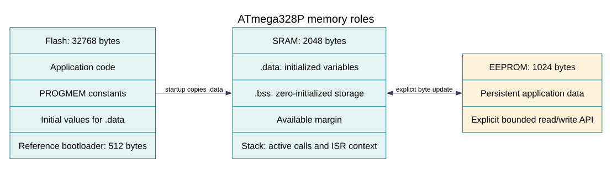

# Store Data in EEPROM

## Keep a Small Amount of Data Across Power Loss



The ATmega328P has 1 KB of EEPROM. Unlike SRAM, EEPROM retains its contents when power is removed. It is useful for settings that change occasionally, such as a calibrated offset, a selected mode or a device identifier.

EEPROM addresses range from 0 through 1023. A byte access must stay inside that range. Multi-byte values also need an agreed byte order and layout so later firmware can decode them consistently. Add a format version or validity marker if the data may outlive more than one firmware release.

The data sheet specifies finite write endurance: at least 100,000 write/erase cycles under its stated conditions. This is not a target frequency. Writing a value repeatedly can wear a location; a typical sensor sample should remain in RAM unless the application has a specific persistence requirement.

## Update Only When the Value Changes

The HAL's `avr_eeprom_update()` compares the existing byte and skips a write when the byte already matches. This helps avoid needless wear, but it does not make a group of bytes atomic. If power disappears during a multi-byte update, a record can contain a mixture of old and new data.

A common robust pattern uses two slots. Each slot stores a version, sequence number, payload, checksum and commit marker. Write the inactive slot first, verify it, and write its commit marker last. On startup, validate both slots and use the newest valid sequence. This design still needs careful handling of sequence wrap, interrupted writes and endurance. It is more work than a single byte and should be introduced only when the application needs recovery guarantees.

Do not start another EEPROM operation while the previous one is busy. The HAL waits with a finite timeout and returns a status, so callers can report or recover from a failure instead of blocking forever. Avoid EEPROM writes in an interrupt service routine; record the event in RAM and perform the storage operation from the main loop.

## Try the Counter Example

Build Lab 24:

```powershell
python "atmega328p-labs/tools/build.py" 24-eeprom --compiler xc8
```

Upload through the Uno's serial bootloader, open the serial monitor, and observe the count over resets. Opening a serial terminal may toggle DTR and reset the Uno, so the count can advance when the monitor connects. This lab demonstrates persistence; it does not test power-fail recovery or measure EEPROM endurance.

## Exercises with Answers

1. **Why is it poor practice to write the same counter every millisecond?**
   It consumes the cell's finite write endurance. Keep rapidly changing state in SRAM and save only when necessary.
2. **Does `update` make a 32-bit value atomic?**
   No. The bytes are written separately and power can fail between them. Use a record scheme with validation and a recovery rule if atomic recovery matters.
3. **Can an EEPROM address of 1024 be used?**
   No. The final valid byte address is 1023; address 1024 is one byte beyond the device's 1 KB EEPROM.

## Code Walkthrough

### EEPROM persistent counter
The example's `main()` configures its peripherals, runs the algorithm and reports or displays the result. These source operations are listed in execution order:

- `uint8_t value = 0U;` - Clears the state/counter after its threshold is reached so the next interval starts from zero.
- `(void)avr_uart_init(9600UL);` - Configures USART0 for asynchronous 8N1. It chooses a baud divisor and normal/double-speed mode, programs UBRR0/UCSR0A/UCSR0C, then enables receive and transmit in UCSR0B.
- `if (avr_eeprom_read(0U, &value, AVR_POLL_BUDGET) == AVR_OK)` - The operation runs only after this API reports AVR_OK. Reads an EEPROM address after range checking and waits within the supplied completion budget.
- `if (value == 255U)` - Tests the stated condition; the following block handles the matching case and the other path is skipped.
- `value = 0U;` - Clears the state/counter after its threshold is reached so the next interval starts from zero.
- `++value;` - Advances the event/sample counter once for the condition just observed.
- `if (avr_eeprom_update(0U, value, AVR_POLL_BUDGET) == AVR_OK)` - The operation runs only after this API reports AVR_OK. Writes only when the stored value differs, reducing unnecessary EEPROM wear; the completion wait is bounded.
- `(void)avr_uart_u16(value);` - Formats an unsigned integer as decimal digits and sends them on USART0; it does not add a newline.
- `for (;;)` - Repeats the foreground task indefinitely; each pass checks inputs, advances the calculation or services the peripheral shown below.

Algorithm: Only one write occurs at boot. Writing continuously in the main loop would consume finite EEPROM endurance. This single-byte demonstration is not a power-fail-safe multi-byte record format.
Expected behaviour: Counter advances once per reset; opening a terminal may itself reset the Uno
**HAL source files in this repository:** [ATmega328P HAL on GitHub](https://github.com/arnabdasbwn/atmega328p-hal)

- [`include/avr_hal/eeprom.h`](https://github.com/arnabdasbwn/atmega328p-hal/blob/main/include/avr_hal/eeprom.h)
- [`include/avr_hal/uart.h`](https://github.com/arnabdasbwn/atmega328p-hal/blob/main/include/avr_hal/uart.h)
- [`src/eeprom.c`](https://github.com/arnabdasbwn/atmega328p-hal/blob/main/src/eeprom.c)
- [`src/uart.c`](https://github.com/arnabdasbwn/atmega328p-hal/blob/main/src/uart.c)


## References

- Microchip, [ATmega328P device documentation](https://www.microchip.com/en-us/product/ATMEGA328P), EEPROM characteristics and programming sequence.
- [EEPROM lab](<https://github.com/arnabdasbwn/atmega328p-labs/blob/main/examples/24-eeprom/main.c>) and [EEPROM HAL header](https://github.com/arnabdasbwn/atmega328p-hal/blob/main/include/avr_hal/eeprom.h).
- [Memory architecture](memory-architecture.md).
