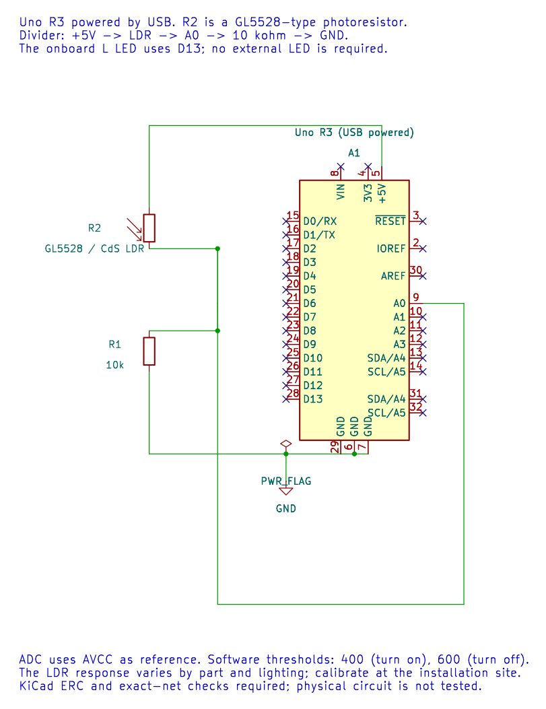

# Logic Levels, Supplies and Safe Loads

## Start with the Actual Part

An Uno R3 built around the ATmega328P uses 5 V logic. A GPIO pin is designed to read or produce a signal; it is not a general-purpose supply for every connected module. Breakout boards can contain regulators and level shifters, but the presence of those parts must be confirmed from their schematic or data sheet.

Before wiring a module, record its permitted supply range, input thresholds, output levels, current draw and ground reference. Do not assume that a label such as `VCC` means 5 V is safe, or that a module's output is safe for a 5 V MCU input.

## Ground and Signal Reference

When two circuits exchange a voltage signal, they need a shared reference unless a documented isolation interface is used. Connect the Uno and module grounds as specified by their instructions. Keep supply and signal wiring short enough for the circuit, and place decoupling capacitors close to modules that require them.

Ground is a return path, not an unlimited sink for current. Motor and relay current should return through a suitable driver and power path rather than through a microcontroller pin or a thin signal trace.

## Calculate a Simple LED Resistor

For a 5 V source, an LED forward voltage of 2 V and a target current of 5 mA:

`R = (5 V - 2 V) / 0.005 A = 600 Ω`

A standard 680 Ω resistor would produce about 4.4 mA under those assumptions. Check the LED's current rating and the ATmega328P's recommended per-pin and total-port current limits. The calculation is an estimate, not permission to operate at a device's absolute maximum rating.

## Switch Loads with a Driver

See the [relay driver diagram](../assets/diagrams/relay-driver.svg) for a transistor, base resistor, flyback path and external coil supply.

A motor, relay coil or solenoid may require more current than a GPIO pin can supply. Use a transistor or dedicated driver with a suitable supply. Inductive loads can generate a voltage spike when switched; use a protection path such as a flyback diode when the driver topology and component documentation call for one. Keep the load's supply voltage within its own rating and connect grounds as required by the driver circuit.

## Before Applying Power

1. Check polarity and supply voltage against every connected part's documentation.
2. Confirm a common ground or the specified isolation barrier.
3. Check current-limiting resistors and driver ratings.
4. Inspect for shorts between supply rails and ground.
5. Power the circuit and measure voltages before connecting sensitive signal pins.

## Exercise with Answer

A 3.3 V sensor module drives a logic-high output, and it is connected to an ATmega328P input. Is matching ground enough to prove the connection safe?

**Answer:** No. Check the ATmega328P input threshold at the selected supply voltage, the sensor's output level and the module's absolute maximum rating. Ground provides a voltage reference; it does not establish logic compatibility by itself.

## Code Walkthrough

**Example code on GitHub:**
- [Debounced push button (`03-button`)](https://github.com/arnabdasbwn/atmega328p-labs/blob/main/examples/03-button/main.c)
- [LDR threshold lamp (`17-ldr`)](https://github.com/arnabdasbwn/atmega328p-labs/blob/main/examples/17-ldr/main.c)
- [Low-voltage relay driver (`33-relay`)](https://github.com/arnabdasbwn/atmega328p-labs/blob/main/examples/33-relay/main.c)

### Debounced push button
The example's `main()` configures its peripherals, runs the algorithm and reports or displays the result. These source operations are listed in execution order:

- `avr_debounce_t button;` - Use the linked public header for this function's parameters, register ownership, blocking behavior and status values.
- `bool level = true;` - Stores this intermediate or output value for the next algorithm step. Check the units and range represented by each operand.
- `bool led = false;` - Stores this intermediate or output value for the next algorithm step. Check the units and range represented by each operand.
- `(void)avr_gpio_mode(2U, AVR_GPIO_INPUT_PULLUP);` - Maps the Uno header pin to its AVR port, sets its DDR direction bit and prepares the PORT latch for the requested initial level or pull-up.
- `(void)avr_gpio_mode(13U, AVR_GPIO_OUTPUT);` - Maps the Uno header pin to its AVR port, sets its DDR direction bit and prepares the PORT latch for the requested initial level or pull-up.
- `avr_tick_init();` - Configures the course millisecond tick interrupt source; it does not enable global interrupts itself.
- `avr_debounce_init(&button, true, 0UL);` - Seeds the stable/candidate input state and timestamp so the next transition is timed consistently.
- `sei();` - Enables global interrupts after the example has configured its sources and shared state.
- `for (;;)` - Repeats the foreground task indefinitely; each pass checks inputs, advances the calculation or services the peripheral shown below.
- `(void)avr_gpio_read(2U, &level);` - Reads the electrical level through PINx without changing direction or the output latch.
- `if (avr_debounce_update(&button, level, avr_tick_ms(), 20U) && !button.stable)` - This condition chooses the next path based on the API result. Accepts a changed input only after it remains stable for the requested interval, then reports that accepted change once.
- `led = !led;` - Stores this intermediate or output value for the next algorithm step. Check the units and range represented by each operand.
- `(void)avr_gpio_write(13U, led);` - Changes the pin's PORT output latch; for an input pin this selects its pull-up state.

Algorithm: A candidate input must remain unchanged for 20 ms before becoming stable. No delay occurs inside an ISR.
Expected behaviour: Each press toggles L once; holding the button does not repeat
**HAL source files in this repository:** [ATmega328P HAL on GitHub](https://github.com/arnabdasbwn/atmega328p-hal)

- [`include/avr_hal/gpio.h`](https://github.com/arnabdasbwn/atmega328p-hal/blob/main/include/avr_hal/gpio.h)
- [`include/avr_hal/tick.h`](https://github.com/arnabdasbwn/atmega328p-hal/blob/main/include/avr_hal/tick.h)
- [`lib/drivers/debounce.c`](https://github.com/arnabdasbwn/atmega328p-hal/blob/main/lib/drivers/debounce.c)
- [`lib/drivers/debounce.h`](https://github.com/arnabdasbwn/atmega328p-hal/blob/main/lib/drivers/debounce.h)
- [`lib/interrupts/tick.c`](https://github.com/arnabdasbwn/atmega328p-hal/blob/main/lib/interrupts/tick.c)
- [`src/gpio.c`](https://github.com/arnabdasbwn/atmega328p-hal/blob/main/src/gpio.c)

### LDR threshold lamp
The example's `main()` configures its peripherals, runs the algorithm and reports or displays the result. These source operations are listed in execution order:

- `bool on = false;` - Stores this intermediate or output value for the next algorithm step. Check the units and range represented by each operand.
- `(void)avr_adc_init(AVR_ADC_AVCC);` - Selects the reference in ADMUX and enables the ADC in ADCSRA with a divide-by-128 prescaler. At 16 MHz, the ADC clock is 125 kHz. The HAL keeps the result right-adjusted, waits for reference settling and leaves ADC interrupts disabled.
- `(void)avr_gpio_mode(13U, AVR_GPIO_OUTPUT);` - Maps the Uno header pin to its AVR port, sets its DDR direction bit and prepares the PORT latch for the requested initial level or pull-up.
- `for (;;)` - Repeats the foreground task indefinitely; each pass checks inputs, advances the calculation or services the peripheral shown below.
- `if (avr_adc_read(0U, &sample, AVR_POLL_BUDGET) == AVR_OK)` - The body runs only when the conversion succeeds and its code is between 1 and 1022. The HAL selects the channel in ADMUX, disables the digital buffer through DIDR0, discards the first conversion after a channel change, and polls with a finite budget.
- `if (sample < 400U)` - Tests the stated condition; the following block handles the matching case and the other path is skipped.
- `on = true;` - Stores this intermediate or output value for the next algorithm step. Check the units and range represented by each operand.
- `else if (sample > 600U)` - This statement participates in the operation sequence; follow its expression to see which state or output changes.
- `on = false;` - Stores this intermediate or output value for the next algorithm step. Check the units and range represented by each operand.
- `(void)avr_gpio_write(13U, on);` - Changes the pin's PORT output latch; for an input pin this selects its pull-up state.
- `_delay_ms(20);` - Waits for the stated interval; the foreground does no other work during this blocking delay.

Algorithm: With the LDR on top, darkness raises its resistance and lowers the divider output. Separate on/off thresholds prevent rapid chatter near one boundary.
Expected behaviour: Covering the LDR turns L on after crossing the lower threshold
**HAL source files in this repository:** [ATmega328P HAL on GitHub](https://github.com/arnabdasbwn/atmega328p-hal)

- [`include/avr_hal/adc.h`](https://github.com/arnabdasbwn/atmega328p-hal/blob/main/include/avr_hal/adc.h)
- [`include/avr_hal/gpio.h`](https://github.com/arnabdasbwn/atmega328p-hal/blob/main/include/avr_hal/gpio.h)
- [`src/adc.c`](https://github.com/arnabdasbwn/atmega328p-hal/blob/main/src/adc.c)
- [`src/gpio.c`](https://github.com/arnabdasbwn/atmega328p-hal/blob/main/src/gpio.c)

### Low-voltage relay driver
The example's `main()` configures its peripherals, runs the algorithm and reports or displays the result. These source operations are listed in execution order:

- `(void)avr_gpio_mode(4U, AVR_GPIO_OUTPUT);` - Maps the Uno header pin to its AVR port, sets its DDR direction bit and prepares the PORT latch for the requested initial level or pull-up.
- `for (;;)` - Repeats the foreground task indefinitely; each pass checks inputs, advances the calculation or services the peripheral shown below.
- `(void)avr_gpio_write(4U, true);` - Changes the pin's PORT output latch; for an input pin this selects its pull-up state.
- `_delay_ms(1000);` - Waits for the stated interval; the foreground does no other work during this blocking delay.
- `(void)avr_gpio_write(4U, false);` - Changes the pin's PORT output latch; for an input pin this selects its pull-up state.
- `_delay_ms(2000);` - Waits for the stated interval; the foreground does no other work during this blocking delay.

Algorithm: A coil is an inductive load. The transistor supplies coil current and the diode provides a path when that current is interrupted. GPIO alone cannot drive the coil.
Expected behaviour: Relay energizes one second and rests two seconds
**HAL source files in this repository:** [ATmega328P HAL on GitHub](https://github.com/arnabdasbwn/atmega328p-hal)

- [`include/avr_hal/gpio.h`](https://github.com/arnabdasbwn/atmega328p-hal/blob/main/include/avr_hal/gpio.h)
- [`src/gpio.c`](https://github.com/arnabdasbwn/atmega328p-hal/blob/main/src/gpio.c)

## References

- Microchip, [ATmega328P product documentation](https://www.microchip.com/en-us/product/ATMEGA328P), electrical characteristics and pin current limits.
- [Arduino Uno R3 board documentation](https://docs.arduino.cc/hardware/uno-rev3/)
- [Arduino Uno R3 pinout](https://www.arnabkumardas.com/pinout/arduino-uno-r3/)
