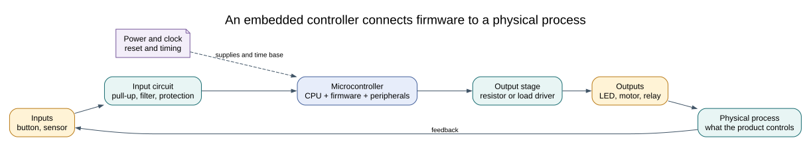

# What Makes a System Embedded?

## Objectives and Prerequisites

Describe an embedded system as a combination of electronics and firmware built to perform a defined job. Identify its inputs, processing, outputs, timing needs and limits. Read the [CPU execution](cpu-core.md) and [clock](clock.md) lessons first.

## From a Job to a System

An embedded system is a computer placed inside a larger product or process. It reads information from its environment, applies rules in firmware and controls an output. A desktop computer can run many different applications; an embedded controller is usually designed around a narrower set of jobs and the hardware needed for them.

A useful first model is:

The physical system and electronics are part of the design. A switch produces an electrical signal, not a C Boolean value. A microcontroller pin produces a voltage, not enough current to drive every load. Circuit protection, grounding, wiring, reset behavior and component tolerances affect what the firmware sees and does.

## Worked Example: a Button-Controlled Indicator

Consider an indicator that lights while a button is pressed. It has a power source, a button with a pull-up, an Uno R3, a series resistor and an LED. The button is an input; the ATmega328P samples that input; firmware decides the LED state; the GPIO output drives the LED through its resistor.

| Part | Role | Design question |
| --- | --- | --- |
| Button and pull-up | Input circuit | Is the input at a defined level when the button is released? |
| ATmega328P input pin | Measurement | Which port bit does the selected Uno header use? |
| Firmware | Decision | Is the signal active-high or active-low? |
| GPIO output | Control signal | Does another peripheral share the pin? |
| Resistor and LED | Output load | Is the current within the circuit and device limits? |
| Clock and timer | Time base | How often should the firmware sample and update? |

The [button lab](<https://github.com/arnabdasbwn/atmega328p-labs/blob/main/examples/03-button/main.c>) reads a GPIO input and controls an LED; the [register Blink lab](<https://github.com/arnabdasbwn/atmega328p-labs/blob/main/examples/01-blink-register/main.c>) isolates the output behavior. Compare the circuit notes before wiring. The board's input pull-up keeps a disconnected switch input from floating, and the LED requires a series resistor.

## Constraints Shape the Solution

The Uno has limited Flash and SRAM, a fixed nominal 16 MHz clock, a small number of timers and pins with shared functions. The design also has physical limits: supply voltage, load current, environmental noise, heat and the mechanical life of a switch. The firmware must finish its work within timing needs and respond sensibly to resets or invalid input.

Real-time behaviour means that a response must arrive before a stated deadline. It does not necessarily mean the processor is fast. A button response within 20 ms may be adequate for a human interface; a motor-control protection loop might need a much shorter and more carefully bounded response. Specify the deadline and verify it instead of describing a system as real-time based only on its CPU frequency.

## Development Loop

For each controller feature:

1. Describe the physical behavior and how success will be observed.
2. Identify signals, levels, loads, timing and resource owners.
3. Draw the circuit and select safe components.
4. Implement one behavior in firmware with clear state and bounds.
5. Build and inspect compiler output and memory use.
6. Test software logic, then measure the physical circuit with suitable tools.
7. Record the board, toolchain, wiring and observed result so another person can reproduce it.

The [test and debugging lesson](testing.md) separates source compilation, simulation and physical evidence. A successful build alone validates only the compilation stage.

## Exercise with Answer

A microcontroller pin is configured as an output and connected directly to a relay coil. What important system element is missing?

**Answer:** A driver stage rated for the coil current, along with suitable inductive-load protection such as a flyback path when appropriate. The GPIO signal controls the driver; it should not be treated as a power output for the relay coil.

## Code Walkthrough

### Debounced push button
The example's `main()` configures its peripherals, runs the algorithm and reports or displays the result. These source operations are listed in execution order:

- `avr_debounce_t button;` - Use the linked public header for this function's parameters, register ownership, blocking behavior and status values.
- `bool level = true;` - Stores this intermediate or output value for the next algorithm step. Check the units and range represented by each operand.
- `bool led = false;` - Stores this intermediate or output value for the next algorithm step. Check the units and range represented by each operand.
- `(void)avr_gpio_mode(2U, AVR_GPIO_INPUT_PULLUP);` - Maps the Uno header pin to its AVR port, sets its DDR direction bit and prepares the PORT latch for the requested initial level or pull-up.
- `(void)avr_gpio_mode(13U, AVR_GPIO_OUTPUT);` - Maps the Uno header pin to its AVR port, sets its DDR direction bit and prepares the PORT latch for the requested initial level or pull-up.
- `avr_tick_init();` - Configures the course millisecond tick interrupt source; it does not enable global interrupts itself.
- `avr_debounce_init(&button, true, 0UL);` - Seeds the stable/candidate input state and timestamp so the next transition is timed consistently.
- `sei();` - Enables global interrupts after the example has configured its sources and shared state.
- `for (;;)` - Repeats the foreground task indefinitely; each pass checks inputs, advances the calculation or services the peripheral shown below.
- `(void)avr_gpio_read(2U, &level);` - Reads the electrical level through PINx without changing direction or the output latch.
- `if (avr_debounce_update(&button, level, avr_tick_ms(), 20U) && !button.stable)` - This condition chooses the next path based on the API result. Accepts a changed input only after it remains stable for the requested interval, then reports that accepted change once.
- `led = !led;` - Stores this intermediate or output value for the next algorithm step. Check the units and range represented by each operand.
- `(void)avr_gpio_write(13U, led);` - Changes the pin's PORT output latch; for an input pin this selects its pull-up state.

Algorithm: A candidate input must remain unchanged for 20 ms before becoming stable. No delay occurs inside an ISR.
Expected behaviour: Each press toggles L once; holding the button does not repeat
**HAL source files in this repository:** [ATmega328P HAL on GitHub](https://github.com/arnabdasbwn/atmega328p-hal)

- [`include/avr_hal/gpio.h`](https://github.com/arnabdasbwn/atmega328p-hal/blob/main/include/avr_hal/gpio.h)
- [`include/avr_hal/tick.h`](https://github.com/arnabdasbwn/atmega328p-hal/blob/main/include/avr_hal/tick.h)
- [`lib/drivers/debounce.c`](https://github.com/arnabdasbwn/atmega328p-hal/blob/main/lib/drivers/debounce.c)
- [`lib/drivers/debounce.h`](https://github.com/arnabdasbwn/atmega328p-hal/blob/main/lib/drivers/debounce.h)
- [`lib/interrupts/tick.c`](https://github.com/arnabdasbwn/atmega328p-hal/blob/main/lib/interrupts/tick.c)
- [`src/gpio.c`](https://github.com/arnabdasbwn/atmega328p-hal/blob/main/src/gpio.c)

### Register-level Blink
The example's `main()` configures its peripherals, runs the algorithm and reports or displays the result. These source operations are listed in execution order:

- `PORTB &= (uint8_t)~_BV(PORTB5);` - Sets or clears the Port B output latch. When the pin is an output, this determines its output level; on an input, it controls the pull-up.
- `DDRB |= _BV(DDB5);` - Sets the Port B direction bits; a set bit selects output mode.
- `for (;;)` - Repeats the foreground task indefinitely; each pass checks inputs, advances the calculation or services the peripheral shown below.
- `PINB = _BV(PINB5);` - Writing a one to a PINB bit toggles that pin's PORTB output latch on the ATmega328P.
- `_delay_ms(500);` - Waits for the stated interval; the foreground does no other work during this blocking delay.

Algorithm: Pin direction and output latch are separate hardware state.
Expected behaviour: L toggles every 500 ms
**HAL source files in this repository:** [ATmega328P HAL on GitHub](https://github.com/arnabdasbwn/atmega328p-hal)

## References

For current device details, use the [Microchip ATmega328P documentation](https://www.microchip.com/en-us/product/ATMEGA328P). Check the document listed for your exact device and package; board-level pin labels and circuitry are covered by the [Uno R3 pinout](https://www.arnabkumardas.com/pinout/arduino-uno-r3/).
