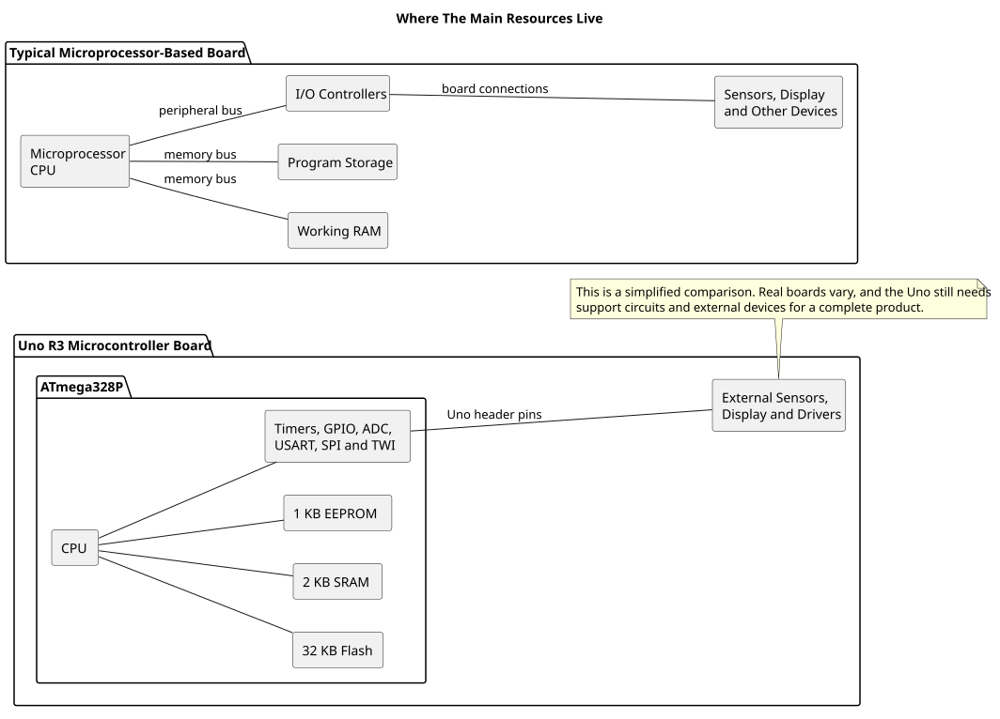

# Embedded Controller or General-Purpose Computer?

## Objectives and Prerequisites

Compare an embedded system with a general-purpose computer by asking what job it serves, what resources it must fit, how it interacts with the physical world and how it is maintained. Read [the embedded-system lesson](embedded-system.md) first.

## Compare the Design Goals

| Question | Embedded controller | General-purpose computer |
| --- | --- | --- |
| Main goal | Perform a defined product function reliably | Run a wide range of applications selected by users |
| Hardware | Chosen for required signals, cost, size and environment | Chosen for broad compatibility, user interaction and performance |
| Software | Often organized around fixed control tasks | Often includes an operating system and application environment |
| Inputs and outputs | Sensors, switches, motors, relays, serial buses | Keyboard, display, storage and network interfaces, with physical I/O added as needed |
| Resources | May have strict Flash, SRAM, power and timing budgets | Usually has more memory and storage, though budgets still exist |
| Timing | Response deadlines may be part of product behavior | Timing may be less visible to users, but can also be critical |
| Maintenance | Updates can be tightly controlled and hardware-specific | Users commonly install and update software and peripherals |

This is a useful comparison, not a definition that every product must fit exactly. A modern embedded system may run a large operating system and network services. A general-purpose computer can run real-time software or control industrial machinery. The distinction comes from the system's purpose, integration and constraints, not only its CPU or operating system.

## Worked Comparison: Kitchen Timer and Desktop Application

A simple kitchen timer needs a clock, a start button, a display or buzzer and a way to keep time while the user does something else. A small microcontroller can perform this fixed task with low power and a few components. It must respond to button input, count elapsed time and signal when the interval expires.

A desktop timer application can offer multiple timers, themes, history, network synchronization and accessibility controls because it shares a general-purpose computer's display, storage and operating system. It also depends on that computer being powered on, the application being available and operating-system scheduling. Neither implementation is automatically better; the required product determines the trade-off.

For the Uno version, the [button lab](<https://github.com/arnabdasbwn/atmega328p-labs/blob/main/examples/03-button/main.c>) demonstrates an input and output path. A complete timer would additionally require a time base, state management, a display or buzzer and tests for rollover and reset behavior. The Uno is a teaching platform for these ideas, not a finished consumer appliance.

## Use Constraints to Choose Architecture

Ask concrete questions before choosing the processor or programming model:

- What event must be detected, and how soon must the system respond?
- Which signals and loads need hardware interfaces?
- What happens if power is interrupted or a sensor wire disconnects?
- How much energy, size, heat and cost can the product use?
- Does the software need network access, a filesystem or a user interface?
- How will it be tested and safely updated after delivery?

The answers determine whether a small bare-metal controller, a larger embedded computer or a general-purpose computer is suitable. A small chip is not a virtue by itself; it is useful when it meets the product requirements with enough margin and can be maintained.

## Exercise with Answer

A device reads a temperature sensor every second and switches a fan when a threshold is crossed. Is it embedded only because it uses a microcontroller?

**Answer:** no. It is embedded because it is integrated into a product or process for a defined control job, with physical inputs, outputs and timing/resource requirements. A computer with a sensor interface could implement the same job and would still be part of an embedded control system if integrated that way.

## Code Walkthrough

**Example code on GitHub:**
- [HAL Software Self-Test (`90-selftest`)](https://github.com/arnabdasbwn/atmega328p-labs/blob/main/examples/90-selftest/main.c)

### Debounced push button
The example's `main()` configures its peripherals, runs the algorithm and reports or displays the result. These source operations are listed in execution order:

- `avr_debounce_t button;` - Use the linked public header for this function's parameters, register ownership, blocking behavior and status values.
- `bool level = true;` - Stores this intermediate or output value for the next algorithm step. Check the units and range represented by each operand.
- `bool led = false;` - Stores this intermediate or output value for the next algorithm step. Check the units and range represented by each operand.
- `(void)avr_gpio_mode(2U, AVR_GPIO_INPUT_PULLUP);` - Maps the Uno header pin to its AVR port, sets its DDR direction bit and prepares the PORT latch for the requested initial level or pull-up.
- `(void)avr_gpio_mode(13U, AVR_GPIO_OUTPUT);` - Maps the Uno header pin to its AVR port, sets its DDR direction bit and prepares the PORT latch for the requested initial level or pull-up.
- `avr_tick_init();` - Configures the course millisecond tick interrupt source; it does not enable global interrupts itself.
- `avr_debounce_init(&button, true, 0UL);` - Seeds the stable/candidate input state and timestamp so the next transition is timed consistently.
- `sei();` - Enables global interrupts after the example has configured its sources and shared state.
- `for (;;)` - Repeats the foreground task indefinitely; each pass checks inputs, advances the calculation or services the peripheral shown below.
- `(void)avr_gpio_read(2U, &level);` - Reads the electrical level through PINx without changing direction or the output latch.
- `if (avr_debounce_update(&button, level, avr_tick_ms(), 20U) && !button.stable)` - This condition chooses the next path based on the API result. Accepts a changed input only after it remains stable for the requested interval, then reports that accepted change once.
- `led = !led;` - Stores this intermediate or output value for the next algorithm step. Check the units and range represented by each operand.
- `(void)avr_gpio_write(13U, led);` - Changes the pin's PORT output latch; for an input pin this selects its pull-up state.

Algorithm: A candidate input must remain unchanged for 20 ms before becoming stable. No delay occurs inside an ISR.
Expected behaviour: Each press toggles L once; holding the button does not repeat
**HAL source files in this repository:** [ATmega328P HAL on GitHub](https://github.com/arnabdasbwn/atmega328p-hal)

- [`include/avr_hal/gpio.h`](https://github.com/arnabdasbwn/atmega328p-hal/blob/main/include/avr_hal/gpio.h)
- [`include/avr_hal/tick.h`](https://github.com/arnabdasbwn/atmega328p-hal/blob/main/include/avr_hal/tick.h)
- [`lib/drivers/debounce.c`](https://github.com/arnabdasbwn/atmega328p-hal/blob/main/lib/drivers/debounce.c)
- [`lib/drivers/debounce.h`](https://github.com/arnabdasbwn/atmega328p-hal/blob/main/lib/drivers/debounce.h)
- [`lib/interrupts/tick.c`](https://github.com/arnabdasbwn/atmega328p-hal/blob/main/lib/interrupts/tick.c)
- [`src/gpio.c`](https://github.com/arnabdasbwn/atmega328p-hal/blob/main/src/gpio.c)

### HAL Software Self-Test
The example's `main()` configures its peripherals, runs the algorithm and reports or displays the result. These source operations are listed in execution order:

- `avr_debounce_t button;` - Use the linked public header for this function's parameters, register ownership, blocking behavior and status values.
- `uint8_t result = 0U;` - Clears the state/counter after its threshold is reached so the next interval starts from zero.
- `(void)avr_uart_init(9600UL);` - Configures USART0 for asynchronous 8N1. It chooses a baud divisor and normal/double-speed mode, programs UBRR0/UCSR0A/UCSR0C, then enables receive and transmit in UCSR0B.
- `CHECK(avr_gpio_mode(20U, AVR_GPIO_OUTPUT) == AVR_ERROR_ARGUMENT);` - Maps the Uno header pin to its AVR port, sets its DDR direction bit and prepares the PORT latch for the requested initial level or pull-up.
- `CHECK(avr_gpio_read(13U, NULL) == AVR_ERROR_ARGUMENT);` - Reads the electrical level through PINx without changing direction or the output latch.
- `CHECK(avr_timer_ctc(AVR_TIMER0, 32U, 100U) == AVR_ERROR_ARGUMENT);` - Configures 0 in CTC mode with prescaler 32 and OCRnA TOP 100; event rate is 16 MHz / (32 x (100 + 1)) = 4950.5 Hz. The HAL disables this timer's interrupt sources and leaves flag polling to the caller.
- `CHECK(avr_timer_ctc(AVR_TIMER0, 64U, 256U) == AVR_ERROR_ARGUMENT);` - Configures 0 in CTC mode with prescaler 64 and OCRnA TOP 256; event rate is 16 MHz / (64 x (256 + 1)) = 972.763 Hz. The HAL disables this timer's interrupt sources and leaves flag polling to the caller.
- `CHECK(avr_timer_ctc(AVR_TIMER2, 128U, 124U) == AVR_OK);` - Configures 2 in CTC mode with prescaler 128 and OCRnA TOP 124; event rate is 16 MHz / (128 x (124 + 1)) = 1000 Hz. The HAL disables this timer's interrupt sources and leaves flag polling to the caller.
- `CHECK((TCCR2B & 7U) == 5U);` - Selects Timer2 clock/prescaler and remaining waveform bits. Timer2 has distinct prescaler encodings.
- `CHECK(avr_timer1_pwm(8U, 40000U, 3000U) == AVR_OK);` - Configures Timer1 mode 14 with prescaler 8; ICR1 becomes 39999, giving a 20 ms frame, and OCR1A starts at 3000 ticks (1500 us high).
- `CHECK(ICR1 == 39999U && OCR1A == 3000U);` - Timer1 input-capture register and, in the selected PWM mode, the TOP value. Timer1 Compare A; it sets the match point or PWM pulse width.
- `CHECK(avr_adc_millivolts(512U, 5000U) == 2500U);` - Calls `avr_adc_millivolts()`; its public HAL header defines the arguments, register ownership, blocking behavior and status results.
- `CHECK(avr_adc_read(6U, NULL, 0U) == AVR_ERROR_ARGUMENT);` - Calls `avr_adc_read()`; its public HAL header defines the arguments, register ownership, blocking behavior and status results.
- `CHECK(avr_eeprom_read(1024U, &result, 0UL) == AVR_ERROR_ARGUMENT);` - Calls `avr_eeprom_read()`; its public HAL header defines the arguments, register ownership, blocking behavior and status results.
- `CHECK(avr_twi_transfer(0U, NULL, 0U, NULL, 0U, 0UL) == AVR_ERROR_ARGUMENT);` - Calls `avr_twi_transfer()`; its public HAL header defines the arguments, register ownership, blocking behavior and status results.
- `CHECK(avr_elapsed(5UL, UINT32_MAX - 4UL, 10UL));` - Calls `avr_elapsed()`; its public HAL header defines the arguments, register ownership, blocking behavior and status results.
- `CHECK(!avr_elapsed(5UL, UINT32_MAX - 4UL, 11UL));` - Calls `avr_elapsed()`; its public HAL header defines the arguments, register ownership, blocking behavior and status results.
- `avr_debounce_init(&button, true, UINT32_MAX - 10UL);` - Calls `avr_debounce_init()`; its public HAL header defines the arguments, register ownership, blocking behavior and status results.
- `CHECK(!avr_debounce_update(&button, false, UINT32_MAX - 9UL, 20U));` - Calls `avr_debounce_update()`; its public HAL header defines the arguments, register ownership, blocking behavior and status results.
- `CHECK(!avr_debounce_update(&button, false, 9UL, 20U));` - Calls `avr_debounce_update()`; its public HAL header defines the arguments, register ownership, blocking behavior and status results.
- `CHECK(avr_debounce_update(&button, false, 10UL, 20U));` - Accepts a changed input only after it remains stable for the requested interval, then reports that accepted change once.
- `CHECK(!avr_debounce_update(&button, false, 11UL, 20U));` - Accepts a changed input only after it remains stable for the requested interval, then reports that accepted change once.
- `(void)avr_uart_write((const uint8_t *)"PASS\n", 5U, AVR_POLL_BUDGET);` - Sends the specified bytes through USART0; a timeout can occur after a prefix has already been sent.
- `for (;;)` - Repeats the foreground task indefinitely; each pass checks inputs, advances the calculation or services the peripheral shown below.

Algorithm: A bounded self-test checks software contracts and links a second source file so header-owned definitions are detected.
Expected behaviour: The fixture prints PASS after argument, timer-range, debounce and independent-translation-unit checks; otherwise it prints FAIL and stops
**HAL source files in this repository:** [ATmega328P HAL on GitHub](https://github.com/arnabdasbwn/atmega328p-hal)

- [`include/avr_hal/adc.h`](https://github.com/arnabdasbwn/atmega328p-hal/blob/main/include/avr_hal/adc.h)
- [`include/avr_hal/common.h`](https://github.com/arnabdasbwn/atmega328p-hal/blob/main/include/avr_hal/common.h)
- [`include/avr_hal/eeprom.h`](https://github.com/arnabdasbwn/atmega328p-hal/blob/main/include/avr_hal/eeprom.h)
- [`include/avr_hal/gpio.h`](https://github.com/arnabdasbwn/atmega328p-hal/blob/main/include/avr_hal/gpio.h)
- [`include/avr_hal/timer.h`](https://github.com/arnabdasbwn/atmega328p-hal/blob/main/include/avr_hal/timer.h)
- [`include/avr_hal/twi.h`](https://github.com/arnabdasbwn/atmega328p-hal/blob/main/include/avr_hal/twi.h)
- [`include/avr_hal/uart.h`](https://github.com/arnabdasbwn/atmega328p-hal/blob/main/include/avr_hal/uart.h)
- [`lib/drivers/debounce.c`](https://github.com/arnabdasbwn/atmega328p-hal/blob/main/lib/drivers/debounce.c)
- [`lib/drivers/debounce.h`](https://github.com/arnabdasbwn/atmega328p-hal/blob/main/lib/drivers/debounce.h)
- [`src/adc.c`](https://github.com/arnabdasbwn/atmega328p-hal/blob/main/src/adc.c)
- [`src/common.c`](https://github.com/arnabdasbwn/atmega328p-hal/blob/main/src/common.c)
- [`src/eeprom.c`](https://github.com/arnabdasbwn/atmega328p-hal/blob/main/src/eeprom.c)
- [`src/gpio.c`](https://github.com/arnabdasbwn/atmega328p-hal/blob/main/src/gpio.c)
- [`src/timer.c`](https://github.com/arnabdasbwn/atmega328p-hal/blob/main/src/timer.c)
- [`src/twi.c`](https://github.com/arnabdasbwn/atmega328p-hal/blob/main/src/twi.c)
- [`src/uart.c`](https://github.com/arnabdasbwn/atmega328p-hal/blob/main/src/uart.c)

## References

Use the course's [ATmega328P specification](atmega328p-specs.md), [clock](clock.md) and [testing](testing.md) lessons to examine the Uno resource limits, timing assumptions and validation methods. Product architecture depends on the full system requirements, not a processor feature list alone.
