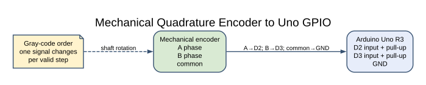
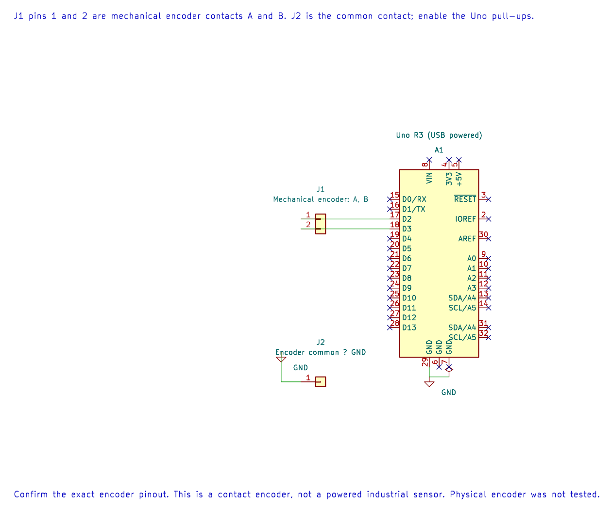

# Quadrature Rotary Encoder

## What You Will Learn

A quadrature encoder produces two digital signals, usually called A and B. The signals change in a Gray-code sequence: at each valid step, one bit changes. The order of those changes tells the firmware which direction the shaft is turning.

## Wiring

Lab 41 assumes a mechanical encoder with common and two switch outputs. Confirm the pinout for your encoder; some boards include a push-button or different pin arrangement.

| Encoder | Uno R3 | Purpose |
| --- | --- | --- |
| A | D2 | First phase; Uno pull-up enabled |
| B | D3 | Second phase; Uno pull-up enabled |
| Common | GND | Switch return |

The internal pull-ups are weak, so keep the wires short. Add external pull-ups or filtering only after measuring the signal and checking the encoder's electrical requirements.

## How the Decoder Works





The editable KiCad connection sheet shows the contact pin map and common ground. Enable the Uno pull-ups as described in the lab instructions.

The program stores the previous two-bit state and combines it with the current state to index a 16-entry transition table. Valid adjacent transitions add or subtract one. A transition where both bits changed is rejected because it may indicate missed polling or contact bounce.

The displayed position begins at 1000 and is limited to the range 0 through 2000. It is a relative count, not an absolute angle. The example sends a new number over USART for each accepted step.

Mechanical contacts can bounce, and the foreground loop can miss transitions when the shaft turns quickly. Serial output also takes time and limits how quickly the program can poll. A production design may use an interrupt-based decoder, a hardware counter or a proper debounce method, then report position less often.

## Build and Try the Lab

```powershell
python atmega328p-labs/tools/build.py 41-encoder --compiler gcc
python atmega328p-labs/tools/build.py 41-encoder --compiler xc8
```

After uploading, open a 9600-baud terminal and turn the encoder slowly in both directions. The count should increase in one direction and decrease in the other. Turn it quickly and observe whether missed transitions or bounce affect the count.

## Code Walkthrough

### Quadrature polling decoder
The example's `main()` configures its peripherals, runs the algorithm and reports or displays the result. These source operations are listed in execution order:

- `uint8_t previous = 0U;` - Clears the state/counter after its threshold is reached so the next interval starts from zero.
- `uint16_t position = 1000U;` - Stores this intermediate or output value for the next algorithm step. Check the units and range represented by each operand.
- `(void)avr_gpio_mode(2U, AVR_GPIO_INPUT_PULLUP);` - Maps the Uno header pin to its AVR port, sets its DDR direction bit and prepares the PORT latch for the requested initial level or pull-up.
- `(void)avr_gpio_mode(3U, AVR_GPIO_INPUT_PULLUP);` - Maps the Uno header pin to its AVR port, sets its DDR direction bit and prepares the PORT latch for the requested initial level or pull-up.
- `(void)avr_uart_init(9600UL);` - Configures USART0 for asynchronous 8N1. It chooses a baud divisor and normal/double-speed mode, programs UBRR0/UCSR0A/UCSR0C, then enables receive and transmit in UCSR0B.
- `for (;;)` - Repeats the foreground task indefinitely; each pass checks inputs, advances the calculation or services the peripheral shown below.
- `(void)avr_gpio_read(2U, &a);` - Reads the electrical level through PINx without changing direction or the output latch.
- `(void)avr_gpio_read(3U, &b);` - Reads the electrical level through PINx without changing direction or the output latch.
- `uint8_t state = (uint8_t)((a ? 2U : 0U) | (b ? 1U : 0U));` - Stores this intermediate or output value for the next algorithm step. Check the units and range represented by each operand.
- `int8_t delta = movement[(uint8_t)((previous << 2U) | state)];` - Stores this intermediate or output value for the next algorithm step. Check the units and range represented by each operand.
- `previous = state;` - Stores this intermediate value for the next step of the algorithm; check the operands and units.
- `if (delta > 0 && position < 2000U)` - Tests this condition to choose which algorithm path runs.
- `++position;` - Advances the counter or sequence by one after the current event.
- `else if (delta < 0 && position > 0U)` - This statement participates in the operation sequence; follow its expression to see which state or output changes.
- `--position;` - This statement participates in the operation sequence; follow its expression to see which state or output changes.
- `(void)avr_uart_u16(position);` - Formats an unsigned integer as decimal digits and sends them on USART0; it does not add a newline.
- `(void)avr_uart_put('\n', AVR_POLL_BUDGET);` - Waits for the USART transmit buffer within its poll budget, then writes the byte to UDR0.

Algorithm: Quadrature uses the order of two phase-shifted signals. The lookup table rejects transitions where both bits change; serial printing limits polling rate.
Expected behaviour: Position changes in opposite directions when rotating slowly
**HAL source files in this repository:** [ATmega328P HAL on GitHub](https://github.com/arnabdasbwn/atmega328p-hal)

- [`include/avr_hal/gpio.h`](https://github.com/arnabdasbwn/atmega328p-hal/blob/main/include/avr_hal/gpio.h)
- [`include/avr_hal/uart.h`](https://github.com/arnabdasbwn/atmega328p-hal/blob/main/include/avr_hal/uart.h)
- [`src/gpio.c`](https://github.com/arnabdasbwn/atmega328p-hal/blob/main/src/gpio.c)
- [`src/uart.c`](https://github.com/arnabdasbwn/atmega328p-hal/blob/main/src/uart.c)


## Common Problems

- **The count changes without turning:** Check for floating wires, long leads and contact bounce.
- **Direction is reversed:** Swap A and B or reverse the sign convention in the decoder.
- **Fast turning loses counts:** Polling and serial output limit throughput; use interrupts or a hardware counter for a faster design.
- **The count stops at 0 or 2000:** This is the example's intentional saturation limit.

## Check Your Understanding

1. Why does the order of A/B transitions show direction?
2. Why does the lookup table reject a transition where both bits changed?
3. Is the displayed count an absolute shaft angle?

**Suggested answers:** The phase relationship reverses when direction reverses. Both bits changing suggests that one or more intermediate states were missed or corrupted. No; it is a relative count with an arbitrary starting value.

## Source and Further Reading

- [Lab 41 source](<https://github.com/arnabdasbwn/atmega328p-labs/blob/main/examples/41-encoder/main.c>)
- [ATmega328P Documentation](https://www.microchip.com/en-us/product/ATMEGA328P), GPIO and external interrupt sections.
- Check the chosen encoder's pinout, contact rating and detent specification.
