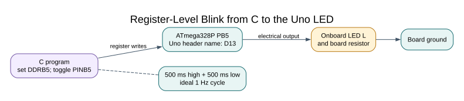

# Your First Register-Level Blink

## Objective and Prerequisites

Build a C application for the Uno R3, identify the output-direction and output-latch registers, and explain a one-second LED cycle. Basic C and an installed AVR toolchain are required. No external components are needed: the board already has an LED marked L connected to D13 through its board circuitry.

## Circuit and Pin Mapping

| Signal | Uno connection | MCU function |
| --- | --- | --- |
| LED L | D13 | PB5 / SCK |
| Power | USB | Board-regulated supply |

Do not attach an SPI peripheral during this first exercise: D13 is also SCK. For later external LEDs use a series resistor; an MCU output is not a current regulator. See the [interactive pinout](https://www.arnabkumardas.com/pinout/arduino-uno-r3/).



## Three Registers, Three Jobs

`DDRB` selects input or output for each Port B pin. Setting bit 5 makes PB5 an output. `PORTB` holds its output latch. `PINB` normally reads the electrical inputs, but writing a **one** to a bit toggles that output latch. Writing zero does nothing. That special behavior is why the example assigns `PINB = mask` rather than applying `|=` to PINB: reading other high input bits and writing them back could toggle unintended outputs.

## Complete Register-Level Program

<!-- source: atmega328p-labs/examples/01-blink-register/main.c -->

```c
/**
 * @file main.c
 * @brief Register-level Blink.
 * @details Pin direction and output latch are separate hardware state.
 * @par Wiring
 * - D13 -> onboard LED; USB powers Uno R3
 * @par Expected observation
 * L toggles every 500 ms.
 * 
 * @copyright Copyright (c) 2026 Arnab Kumar Das. CC-BY-SA-3.0.
 */
#include <avr/io.h>
#include <util/delay.h>
/**
 * @brief Run register-level Blink.
 * @return Does not return; the foreground demonstration runs indefinitely.
 * @details Configures the peripherals shown in this file, then executes the foreground
 * demonstration. Interrupt-driven work is limited to the explicitly documented handlers.
 */
int main(void)
{
    PORTB &= (uint8_t)~_BV(PORTB5);
    DDRB |= _BV(DDB5);
    for (;;)
    {
        PINB = _BV(PINB5); /* Writing ONE toggles just this latch. */
        _delay_ms(500);
    }
}
```

<!-- /source -->

The program clears the latch before enabling the output, then toggles it every 500 ms. The ideal cycle is 500 ms high plus 500 ms low: **1 Hz, approximately 50% duty cycle**. Software loop overhead and clock tolerance make the physical result slightly different.

`_delay_ms` uses `F_CPU` when compiling. It does not measure the board clock. Building for 8 MHz and running at 16 MHz would approximately halve the intended delay. The build sets `F_CPU=16000000UL` and enables optimization, which the delay implementation expects.

## Build

From the course root:

```powershell
python "atmega328p-labs/tools/build.py" 01-blink-register --compiler gcc
python "atmega328p-labs/tools/build.py" 01-blink-register --compiler xc8
```

The resulting `firmware.hex` is under `atmega328p-labs/build/<compiler>/01-blink-register/`. Compilation does not upload anything. First inspect the safe upload command with a dry run:

```powershell
python "atmega328p-labs/tools/upload.py" "atmega328p-labs/build/gcc/01-blink-register/firmware.hex" --port COM4
```

Replace `COM4` with the port shown for your Uno. Add `--upload` only when you are ready to program the board:

```powershell
python "atmega328p-labs/tools/upload.py" "atmega328p-labs/build/gcc/01-blink-register/firmware.hex" --port COM4 --upload
```

The uploader checks every Intel HEX checksum and rejects data at or above `0x7E00`, the start of the standard 512-byte Uno bootloader region. Its AVRDUDE command uses the serial `arduino` protocol, `-D` to disable automatic chip erase, and one `flash:w` operation. It never issues a fuse or lock-bit operation. A successful build still does not prove the upload or physical behavior; record each separately.

## The HAL Version

<!-- source: atmega328p-labs/examples/02-blink-hal/main.c -->

```c
/**
 * @file main.c
 * @brief HAL Blink.
 * @details Pin direction and output latch are separate hardware state.
 * @par Wiring
 * - D13 -> onboard LED; USB powers Uno R3
 * @par Expected observation
 * L toggles every 500 ms.
 * 
 * @copyright Copyright (c) 2026 Arnab Kumar Das. CC-BY-SA-3.0.
 */
#include "avr_hal/gpio.h"
#include "board.h"
#include <util/delay.h>
/**
 * @brief Run HAL Blink.
 * @return Returns 1 if a checked initialization step fails; otherwise the foreground loop never
 * returns.
 * @details Configures the peripherals shown in this file, then executes the foreground
 * demonstration. Interrupt-driven work is limited to the explicitly documented handlers.
 */
int main(void)
{
    if (avr_gpio_mode(AVR_BOARD_LED, AVR_GPIO_OUTPUT) != AVR_OK)
    {
        return 1;
    }
    for (;;)
    {
        (void)avr_gpio_toggle(AVR_BOARD_LED);
        _delay_ms(500);
    }
}
```

<!-- /source -->

The HAL accepts the board pin number 13 and translates it to PB5. Its implementation is separately compiled; no executable definitions are hidden inside the public header. Build this variant by replacing the example ID with `02-blink-hal`.

## Expected Result and Troubleshooting

After a successful upload, LED L should change state about twice per second. An always-on LED suggests the wrong image or pin. An upload timeout suggests the wrong COM port, a busy serial monitor, cable trouble or bootloader configuration. A factor-of-two timing error suggests a clock/build mismatch. Verify the board is an Uno R3, not an Uno R4.

## Exercise and Answer

Change both the timing prediction and source to produce a 2 Hz square wave. **Answer:** a 2 Hz period is 500 ms, so each half-cycle is 250 ms. Change the delay to 250 ms; do not simply halve the CPU frequency definition.

## Evidence and References

For current device details, use the [Microchip ATmega328P documentation](https://www.microchip.com/en-us/product/ATMEGA328P). Check the document listed for your exact device and package; board-level pin labels and circuitry are covered by the [Uno R3 pinout](https://www.arnabkumardas.com/pinout/arduino-uno-r3/).

## Code Walkthrough


**Example code on GitHub:**
- [Register-level Blink (`01-blink-register`)](https://github.com/arnabdasbwn/atmega328p-labs/blob/main/examples/01-blink-register/main.c)
- [HAL Blink (`02-blink-hal`)](https://github.com/arnabdasbwn/atmega328p-labs/blob/main/examples/02-blink-hal/main.c)

### Register-level Blink
The example's `main()` configures its peripherals, runs the algorithm and reports or displays the result. These source operations are listed in execution order:

- `PORTB &= (uint8_t)~_BV(PORTB5);` - Sets or clears the Port B output latch. When the pin is an output, this determines its output level; on an input, it controls the pull-up.
- `DDRB |= _BV(DDB5);` - Sets the Port B direction bits; a set bit selects output mode.
- `for (;;)` - Repeats the foreground task indefinitely; each pass checks inputs, advances the calculation or services the peripheral shown below.
- `PINB = _BV(PINB5);` - Writing a one to a PINB bit toggles that pin's PORTB output latch on the ATmega328P.
- `_delay_ms(500);` - Waits for the stated interval; the foreground does no other work during this blocking delay.

Algorithm: Pin direction and output latch are separate hardware state.
Expected behaviour: L toggles every 500 ms
**HAL source files in this repository:** [ATmega328P HAL on GitHub](https://github.com/arnabdasbwn/atmega328p-hal)


### HAL Blink
The example's `main()` configures its peripherals, runs the algorithm and reports or displays the result. These source operations are listed in execution order:

- `if (avr_gpio_mode(AVR_BOARD_LED, AVR_GPIO_OUTPUT) != AVR_OK)` - This checks for any setup or transfer error before the program continues. Maps the Uno header pin to its AVR port, sets its DDR direction bit and prepares the PORT latch for the requested initial level or pull-up.
- `return 1;` - Stops this path and returns the indicated status when setup or validation cannot continue.
- `for (;;)` - Repeats the foreground task indefinitely; each pass checks inputs, advances the calculation or services the peripheral shown below.
- `(void)avr_gpio_toggle(AVR_BOARD_LED);` - Atomically toggles the selected pin output latch.
- `_delay_ms(500);` - Waits for the stated interval; the foreground does no other work during this blocking delay.

Algorithm: Pin direction and output latch are separate hardware state.
Expected behaviour: L toggles every 500 ms
**HAL source files in this repository:** [ATmega328P HAL on GitHub](https://github.com/arnabdasbwn/atmega328p-hal)

- [`include/avr_hal/gpio.h`](https://github.com/arnabdasbwn/atmega328p-hal/blob/main/include/avr_hal/gpio.h)
- [`src/gpio.c`](https://github.com/arnabdasbwn/atmega328p-hal/blob/main/src/gpio.c)
