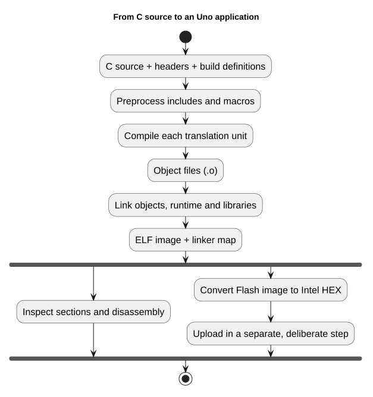
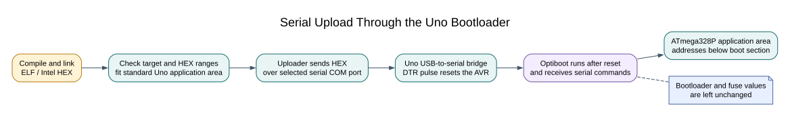

# Upload and Verify Blink

## Build Before You Connect

The [first Blink lesson](first-blink.md) explains the register-level source and its HAL counterpart. Build the example with XC8 or AVR GCC, then read the report. Confirm that the compiler selected an ATmega328P, used the Uno's 16 MHz clock definition and placed the application below the bootloader boundary.

The file to upload is `firmware.hex`. The `.elf` file retains symbols for inspection and debugging; it is not the file sent through the serial bootloader. Keep the `.map` and JSON reports because they show memory use and the build configuration.

## Preview and Upload

First use the dry-run command in [Upload Uno R3 Firmware Through USB](upload-usb.md). Check that the port is the Uno and that the image belongs to the lab you built. Close serial tools, then add `--upload` only when you are ready to write the image.

The serial bootloader starts when the board resets and listens briefly for an upload. If the application is already running, the Uno's USB interface normally triggers reset as the port opens. The uploader sends the image, checks the bootloader response and reports whether the operation completed. Never assume that opening a COM port has uploaded a program.

## Verify the Result

For Blink, observe the onboard LED and compare its cadence with the delay or timer calculation in the source. For better evidence, measure the LED output or the assigned GPIO pin with a logic analyser or oscilloscope. A visual blink confirms basic execution but does not prove every timing value or peripheral behaviour.

Record the board model, build compiler, command, port and observed result. Keep the outcomes distinct:

| Check | What it demonstrates |
| --- | --- |
| Build succeeds | Source compiled and linked for the selected target |
| Upload reports success | The bootloader accepted the image according to the tool's protocol |
| LED or signal observed | The program ran and produced an observable output |
| Measured timing matches | The output timing was checked against a stated tolerance |

Course validation currently confirms the Blink builds; it does not confirm a serial upload or LED observation on the reference Uno. Optiboot has been restored and verified, but serial synchronisation has not succeeded with that board's existing fuse configuration. The fuses remain unchanged. Use a Uno with a working serial bootloader for this lab, or report the result as software-only validation.

## Exercise with Answer

The uploader reports success, but the LED stays off. Name two checks to make before editing the code.

**Answer:** Confirm the correct board and output pin, then inspect the HEX path and verify the expected LED wiring or onboard LED polarity. Also check reset and supply conditions. Compare the source's pin setup with the board pinout before assuming the upload failed.

## Code Walkthrough

**Example code on GitHub:**
- [Register-level Blink (`01-blink-register`)](https://github.com/arnabdasbwn/atmega328p-labs/blob/main/examples/01-blink-register/main.c)
- [HAL Blink (`02-blink-hal`)](https://github.com/arnabdasbwn/atmega328p-labs/blob/main/examples/02-blink-hal/main.c)

### Register-level Blink
The example's `main()` configures its peripherals, runs the algorithm and reports or displays the result. These source operations are listed in execution order:

- `PORTB &= (uint8_t)~_BV(PORTB5);` - Sets or clears the Port B output latch. When the pin is an output, this determines its output level; on an input, it controls the pull-up.
- `DDRB |= _BV(DDB5);` - Sets the Port B direction bits; a set bit selects output mode.
- `for (;;)` - Repeats the foreground task indefinitely; each pass checks inputs, advances the calculation or services the peripheral shown below.
- `PINB = _BV(PINB5);` - Writing a one to a PINB bit toggles that pin's PORTB output latch on the ATmega328P.
- `_delay_ms(500);` - Waits for the stated interval; the foreground does no other work during this blocking delay.

Algorithm: Pin direction and output latch are separate hardware state.
Expected behaviour: L toggles every 500 ms
**HAL source files in this repository:** [ATmega328P HAL on GitHub](https://github.com/arnabdasbwn/atmega328p-hal)

### HAL Blink
The example's `main()` configures its peripherals, runs the algorithm and reports or displays the result. These source operations are listed in execution order:

- `if (avr_gpio_mode(AVR_BOARD_LED, AVR_GPIO_OUTPUT) != AVR_OK)` - This checks for any setup or transfer error before the program continues. Maps the Uno header pin to its AVR port, sets its DDR direction bit and prepares the PORT latch for the requested initial level or pull-up.
- `return 1;` - Stops this path and returns the indicated status when setup or validation cannot continue.
- `for (;;)` - Repeats the foreground task indefinitely; each pass checks inputs, advances the calculation or services the peripheral shown below.
- `(void)avr_gpio_toggle(AVR_BOARD_LED);` - Atomically toggles the selected pin output latch.
- `_delay_ms(500);` - Waits for the stated interval; the foreground does no other work during this blocking delay.

Algorithm: Pin direction and output latch are separate hardware state.
Expected behaviour: L toggles every 500 ms
**HAL source files in this repository:** [ATmega328P HAL on GitHub](https://github.com/arnabdasbwn/atmega328p-hal)

- [`include/avr_hal/gpio.h`](https://github.com/arnabdasbwn/atmega328p-hal/blob/main/include/avr_hal/gpio.h)
- [`src/gpio.c`](https://github.com/arnabdasbwn/atmega328p-hal/blob/main/src/gpio.c)

## References

- [First register-level Blink](first-blink.md)
- [Upload Uno R3 firmware through USB](upload-usb.md)
- [Arduino Uno R3 pinout](https://www.arnabkumardas.com/pinout/arduino-uno-r3/)
