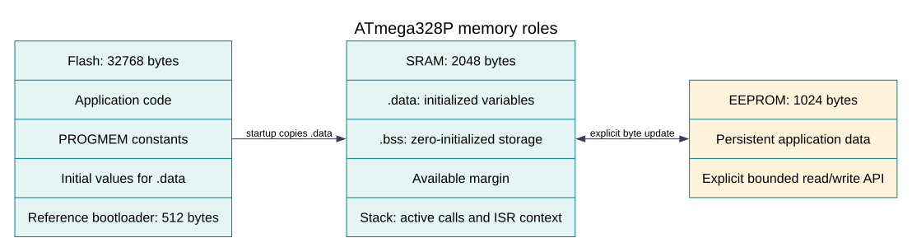

# Read Constants from Flash Memory

## Flash and SRAM Have Different Jobs



The ATmega328P stores instructions in Flash, while ordinary mutable C objects and the stack use SRAM. The Uno has 32 KB of Flash and 2 KB of SRAM. These memories have different address spaces and access rules on classic AVR devices.

`const` tells the compiler that code should not modify an object. On AVR, it does not by itself ensure that a large lookup table uses no SRAM. The course example marks its table with `PROGMEM` and reads each word with `pgm_read_word()`. That keeps the table in program memory and uses the device-specific access path.

The [Flash constants lab](<https://github.com/arnabdasbwn/atmega328p-labs/blob/main/examples/25-flash-constants/main.c>) stores the squares of zero through seven. The table needs 16 bytes because each value is a 16-bit word. Its result is small enough to print over USART and inspect in a serial terminal.

## Check the Address Space and Type

When reading a table, use an index within its declared element count and use a read function matching the element width. For example, `pgm_read_byte()` reads one byte; `pgm_read_word()` reads a 16-bit value. Do not take a normal SRAM pointer to a `PROGMEM` object and dereference it as though it were a RAM array.

Compiler support varies across AVR toolchains. The examples use the selected AVR-GCC/XC8 AVR interfaces and are built with both toolchains. When moving the code to another compiler or MCU family, check that compiler's program-memory annotations and read functions rather than copying macros blindly.

## Reading Is Not Self-Programming

This lesson only reads constants while the application runs. It does not erase or program Flash. Self-programming involves page erase/write operations and the bootloader section, reset vector, lock bits and fuse configuration. It is outside the beginner exercises.

The course Uno image reserves the top 512 bytes for its Optiboot bootloader, beginning at byte address `0x7E00`. The course uploader rejects application data at or above that boundary and uses serial bootloader programming. Do not use a self-programming routine or a bootloader-burn operation to update an application. Preserve the installed bootloader and fuse settings.

## Build and Inspect the Example

```powershell
python "atmega328p-labs/tools/build.py" 25-flash-constants --compiler xc8
```

Compare the Flash and SRAM totals in the build report. The build is evidence that both selected compilers accept the example; it does not prove the runtime table values on a physical board. The example does not write to program memory.

## Exercises with Answers

1. **Why may normal pointer dereferencing fail for a `PROGMEM` table?**
   Classic AVR separates program memory from ordinary SRAM access. Use the matching program-memory read operation.
2. **Does `const` always mean zero SRAM use on an 8-bit AVR?**
   No. Placement depends on the target and compiler. Use and verify the target's program-memory mechanism.
3. **Does the table-reading lab exercise bootloader self-programming?**
   No. It only reads constants. It preserves the installed Optiboot image and fuse settings.

## Code Walkthrough

### Read a lookup table from Flash
The example's `main()` configures its peripherals, runs the algorithm and reports or displays the result. These source operations are listed in execution order:

- `(void)avr_uart_init(9600UL);` - Configures USART0 for asynchronous 8N1. It chooses a baud divisor and normal/double-speed mode, programs UBRR0/UCSR0A/UCSR0C, then enables receive and transmit in UCSR0B.
- `for (uint8_t i = 0U; i < 8U; ++i)` - Repeats while `i < 8U` is true; `uint8_t i = 0U` sets the starting state and `++i` advances it each pass.
- `uint16_t value = pgm_read_word(&squares[i]);` - Reads the table entry with the AVR program-memory access function; ordinary data-space dereferencing is not used for this Flash table.
- `(void)avr_uart_u16(value);` - Formats an unsigned integer as decimal digits and sends them on USART0; it does not add a newline.
- `(void)avr_uart_put('\n', AVR_POLL_BUDGET);` - Waits for the USART transmit buffer within its poll budget, then writes the byte to UDR0.
- `for (;;)` - Repeats the foreground task indefinitely; each pass checks inputs, advances the calculation or services the peripheral shown below.

Algorithm: PROGMEM keeps the table in program memory; pgm_read_word uses the appropriate Flash access. A const qualifier alone does not describe the AVR storage/access mechanism in all toolchains.
Expected behaviour: Prints the squares of 0..7
**HAL source files in this repository:** [ATmega328P HAL on GitHub](https://github.com/arnabdasbwn/atmega328p-hal)

- [`include/avr_hal/uart.h`](https://github.com/arnabdasbwn/atmega328p-hal/blob/main/include/avr_hal/uart.h)
- [`src/uart.c`](https://github.com/arnabdasbwn/atmega328p-hal/blob/main/src/uart.c)


## References

- [Flash constants example](<https://github.com/arnabdasbwn/atmega328p-labs/blob/main/examples/25-flash-constants/main.c>).
- [Memory architecture](memory-architecture.md) and [build artifacts](build-link.md).
- Microchip, [ATmega328P device documentation](https://www.microchip.com/en-us/product/ATMEGA328P), Flash and bootloader sections.
