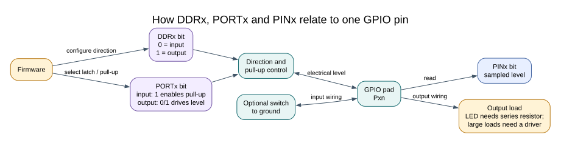

# GPIO Concepts

## Objectives and Prerequisites

General-purpose input/output (GPIO) pins connect firmware to digital signals. In this lesson, you will distinguish an input from an output, explain why an unconnected input can behave unpredictably, and identify when a driver circuit is needed. Review the [equipment and safe-circuit notes](requirements.md) before connecting external circuits.

## A Digital Pin Measures Voltage

A digital input reports whether its voltage is interpreted as logic low or logic high. It does not receive a C `true` or `false` value directly. The device has input thresholds, and voltages in the transition region may not have a reliable logic interpretation. For an Uno R3, use the board's 5 V logic only with components whose data sheets permit those levels.

An input left unconnected is **floating**. It has no firm connection to a high or low level, so noise or nearby circuits can change the reading. A pull-up resistor connects the input weakly to the supply; a pull-down connects it weakly to ground. The ATmega328P can enable internal pull-ups on GPIO inputs.

## Active-Low Inputs

The common button circuit connects D2 to ground when pressed and enables the internal pull-up. Released reads high; pressed reads low. This is called **active-low** because the action is represented by a low electrical level.

| Button state | D2 connection | Pin reading |
| --- | --- | --- |
| Released | Pull-up holds input high | Logic high |
| Pressed | Switch connects input to ground | Logic low |

An active-low signal is not an error. It is a circuit choice. Firmware should name the state clearly and avoid assuming that “pressed” always means a one bit.

## A Pin Is Not a Power Supply

An output pin creates a logic signal within the device's electrical limits. It is not a general-purpose power source. An LED needs a series resistor, and motors, relay coils and other larger loads need a suitable driver and protection circuit. Check the absolute maximum ratings and recommended operating conditions in the datasheet; do not treat absolute maximum values as normal design targets.

## Exercise with Answer

Why can an unconnected input sometimes read high and sometimes low?

**Answer:** The pin has no defined voltage source. Electrical noise and coupling can move its voltage across the input threshold. Add a suitable pull-up or pull-down, or connect it to a circuit that defines the level.

## Code Walkthrough

**Example code on GitHub:**
- [Register-level Blink (`01-blink-register`)](https://github.com/arnabdasbwn/atmega328p-labs/blob/main/examples/01-blink-register/main.c)
- [Debounced push button (`03-button`)](https://github.com/arnabdasbwn/atmega328p-labs/blob/main/examples/03-button/main.c)

### Register-level Blink
The example's `main()` configures its peripherals, runs the algorithm and reports or displays the result. These source operations are listed in execution order:

- `PORTB &= (uint8_t)~_BV(PORTB5);` - Sets or clears the Port B output latch. When the pin is an output, this determines its output level; on an input, it controls the pull-up.
- `DDRB |= _BV(DDB5);` - Sets the Port B direction bits; a set bit selects output mode.
- `for (;;)` - Repeats the foreground task indefinitely; each pass checks inputs, advances the calculation or services the peripheral shown below.
- `PINB = _BV(PINB5);` - Writing a one to a PINB bit toggles that pin's PORTB output latch on the ATmega328P.
- `_delay_ms(500);` - Waits for the stated interval; the foreground does no other work during this blocking delay.

Algorithm: Pin direction and output latch are separate hardware state.
Expected behaviour: L toggles every 500 ms
**HAL source files in this repository:** [ATmega328P HAL on GitHub](https://github.com/arnabdasbwn/atmega328p-hal)

### Debounced push button
The example's `main()` configures its peripherals, runs the algorithm and reports or displays the result. These source operations are listed in execution order:

- `avr_debounce_t button;` - Use the linked public header for this function's parameters, register ownership, blocking behavior and status values.
- `bool level = true;` - Stores this intermediate or output value for the next algorithm step. Check the units and range represented by each operand.
- `bool led = false;` - Stores this intermediate or output value for the next algorithm step. Check the units and range represented by each operand.
- `(void)avr_gpio_mode(2U, AVR_GPIO_INPUT_PULLUP);` - Maps the Uno header pin to its AVR port, sets its DDR direction bit and prepares the PORT latch for the requested initial level or pull-up.
- `(void)avr_gpio_mode(13U, AVR_GPIO_OUTPUT);` - Maps the Uno header pin to its AVR port, sets its DDR direction bit and prepares the PORT latch for the requested initial level or pull-up.
- `avr_tick_init();` - Configures the course millisecond tick interrupt source; it does not enable global interrupts itself.
- `avr_debounce_init(&button, true, 0UL);` - Seeds the stable/candidate input state and timestamp so the next transition is timed consistently.
- `sei();` - Enables global interrupts after the example has configured its sources and shared state.
- `for (;;)` - Repeats the foreground task indefinitely; each pass checks inputs, advances the calculation or services the peripheral shown below.
- `(void)avr_gpio_read(2U, &level);` - Reads the electrical level through PINx without changing direction or the output latch.
- `if (avr_debounce_update(&button, level, avr_tick_ms(), 20U) && !button.stable)` - This condition chooses the next path based on the API result. Accepts a changed input only after it remains stable for the requested interval, then reports that accepted change once.
- `led = !led;` - Stores this intermediate or output value for the next algorithm step. Check the units and range represented by each operand.
- `(void)avr_gpio_write(13U, led);` - Changes the pin's PORT output latch; for an input pin this selects its pull-up state.

Algorithm: A candidate input must remain unchanged for 20 ms before becoming stable. No delay occurs inside an ISR.
Expected behaviour: Each press toggles L once; holding the button does not repeat
**HAL source files in this repository:** [ATmega328P HAL on GitHub](https://github.com/arnabdasbwn/atmega328p-hal)

- [`include/avr_hal/gpio.h`](https://github.com/arnabdasbwn/atmega328p-hal/blob/main/include/avr_hal/gpio.h)
- [`include/avr_hal/tick.h`](https://github.com/arnabdasbwn/atmega328p-hal/blob/main/include/avr_hal/tick.h)
- [`lib/drivers/debounce.c`](https://github.com/arnabdasbwn/atmega328p-hal/blob/main/lib/drivers/debounce.c)
- [`lib/drivers/debounce.h`](https://github.com/arnabdasbwn/atmega328p-hal/blob/main/lib/drivers/debounce.h)
- [`lib/interrupts/tick.c`](https://github.com/arnabdasbwn/atmega328p-hal/blob/main/lib/interrupts/tick.c)
- [`src/gpio.c`](https://github.com/arnabdasbwn/atmega328p-hal/blob/main/src/gpio.c)

## References

- [ATmega328P product page and datasheet](https://www.microchip.com/en-us/product/ATMEGA328P), digital input/output electrical characteristics.
- [Uno R3 pinout](https://www.arnabkumardas.com/pinout/arduino-uno-r3/)
- [GPIO registers](gpio-registers.md)
- [Button and safe-load wiring](button.md)
