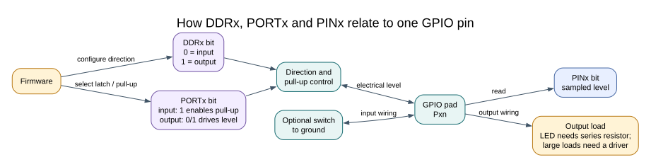

# Using the GPIO HAL

## Why Use a GPIO Interface?

Direct register access is useful for learning the device. Repeated board-specific register code can become difficult to review and port. The GPIO HAL offers functions that accept Uno header pin numbers, map them to ATmega328P registers and report invalid arguments through a status value.

Its public interface is in [`avr_hal/gpio.h`](https://github.com/arnabdasbwn/atmega328p-hal/blob/main/include/avr_hal/gpio.h); the implementation is in [`gpio.c`](https://github.com/arnabdasbwn/atmega328p-hal/blob/main/src/gpio.c). Headers declare the interface, while executable code and state remain in C files.

## Available Operations

| Function | Purpose | Important behaviour |
| --- | --- | --- |
| `avr_gpio_mode()` | Select input, input with pull-up or output | Output mode initializes the latch low |
| `avr_gpio_read()` | Sample an electrical input | One immediate sample; no debounce |
| `avr_gpio_write()` | Set an output latch | On an input, this controls its pull-up |
| `avr_gpio_toggle()` | Toggle one output latch | Uses the AVR `PINx` write-one toggle behaviour |

The API accepts Uno header numbers 0–19; A0–A5 are 14–19. A return value of `AVR_OK` indicates success. An invalid pin returns `AVR_ERROR_ARGUMENT` and leaves the registers unchanged. Read the header contract for null-pointer rules and the exact result behaviour.

## Example and Ownership

The [HAL Blink example](<https://github.com/arnabdasbwn/atmega328p-labs/blob/main/examples/02-blink-hal/main.c>) configures D13 as an output and toggles it. The [button example](<https://github.com/arnabdasbwn/atmega328p-labs/blob/main/examples/03-button/main.c>) reads D2 with a pull-up and writes D13 after debounce. Neither API call enables global interrupts.

The HAL's atomic register updates protect a single operation from an interrupt changing the same register midway through its read-modify-write sequence. Applications still need clear pin ownership: two modules that both configure D13 can interfere even if each function call is atomic.

## Build and Exercise

Build a HAL consumer with `python "atmega328p-labs/tools/build.py" 02-blink-hal --compiler xc8`. Inspect the source for the initialization order and read its `lab.json` before wiring anything. Builds do not prove electrical behaviour.

What does `avr_gpio_read(2U, &high)` do if D2 is configured as an input with pull-up?

**Answer:** It samples the current electrical level and stores the result in `high`. It does not wait for a transition, debounce the switch, change the pin mode or enable interrupts.

## Code Walkthrough

### HAL Blink
The example's `main()` configures its peripherals, runs the algorithm and reports or displays the result. These source operations are listed in execution order:

- `if (avr_gpio_mode(AVR_BOARD_LED, AVR_GPIO_OUTPUT) != AVR_OK)` - This checks for any setup or transfer error before the program continues. Maps the Uno header pin to its AVR port, sets its DDR direction bit and prepares the PORT latch for the requested initial level or pull-up.
- `return 1;` - Stops this path and returns the indicated status when setup or validation cannot continue.
- `for (;;)` - Repeats the foreground task indefinitely; each pass checks inputs, advances the calculation or services the peripheral shown below.
- `(void)avr_gpio_toggle(AVR_BOARD_LED);` - Atomically toggles the selected pin output latch.
- `_delay_ms(500);` - Waits for the stated interval; the foreground does no other work during this blocking delay.

Algorithm: Pin direction and output latch are separate hardware state.
Expected behaviour: L toggles every 500 ms
**HAL source files in this repository:** [ATmega328P HAL on GitHub](https://github.com/arnabdasbwn/atmega328p-hal)

- [`include/avr_hal/gpio.h`](https://github.com/arnabdasbwn/atmega328p-hal/blob/main/include/avr_hal/gpio.h)
- [`src/gpio.c`](https://github.com/arnabdasbwn/atmega328p-hal/blob/main/src/gpio.c)

### Debounced push button
The example's `main()` configures its peripherals, runs the algorithm and reports or displays the result. These source operations are listed in execution order:

- `avr_debounce_t button;` - Use the linked public header for this function's parameters, register ownership, blocking behavior and status values.
- `bool level = true;` - Stores this intermediate or output value for the next algorithm step. Check the units and range represented by each operand.
- `bool led = false;` - Stores this intermediate or output value for the next algorithm step. Check the units and range represented by each operand.
- `(void)avr_gpio_mode(2U, AVR_GPIO_INPUT_PULLUP);` - Maps the Uno header pin to its AVR port, sets its DDR direction bit and prepares the PORT latch for the requested initial level or pull-up.
- `(void)avr_gpio_mode(13U, AVR_GPIO_OUTPUT);` - Maps the Uno header pin to its AVR port, sets its DDR direction bit and prepares the PORT latch for the requested initial level or pull-up.
- `avr_tick_init();` - Configures the course millisecond tick interrupt source; it does not enable global interrupts itself.
- `avr_debounce_init(&button, true, 0UL);` - Seeds the stable/candidate input state and timestamp so the next transition is timed consistently.
- `sei();` - Enables global interrupts after the example has configured its sources and shared state.
- `for (;;)` - Repeats the foreground task indefinitely; each pass checks inputs, advances the calculation or services the peripheral shown below.
- `(void)avr_gpio_read(2U, &level);` - Reads the electrical level through PINx without changing direction or the output latch.
- `if (avr_debounce_update(&button, level, avr_tick_ms(), 20U) && !button.stable)` - This condition chooses the next path based on the API result. Accepts a changed input only after it remains stable for the requested interval, then reports that accepted change once.
- `led = !led;` - Stores this intermediate or output value for the next algorithm step. Check the units and range represented by each operand.
- `(void)avr_gpio_write(13U, led);` - Changes the pin's PORT output latch; for an input pin this selects its pull-up state.

Algorithm: A candidate input must remain unchanged for 20 ms before becoming stable. No delay occurs inside an ISR.
Expected behaviour: Each press toggles L once; holding the button does not repeat
**HAL source files in this repository:** [ATmega328P HAL on GitHub](https://github.com/arnabdasbwn/atmega328p-hal)

- [`include/avr_hal/gpio.h`](https://github.com/arnabdasbwn/atmega328p-hal/blob/main/include/avr_hal/gpio.h)
- [`include/avr_hal/tick.h`](https://github.com/arnabdasbwn/atmega328p-hal/blob/main/include/avr_hal/tick.h)
- [`lib/drivers/debounce.c`](https://github.com/arnabdasbwn/atmega328p-hal/blob/main/lib/drivers/debounce.c)
- [`lib/drivers/debounce.h`](https://github.com/arnabdasbwn/atmega328p-hal/blob/main/lib/drivers/debounce.h)
- [`lib/interrupts/tick.c`](https://github.com/arnabdasbwn/atmega328p-hal/blob/main/lib/interrupts/tick.c)
- [`src/gpio.c`](https://github.com/arnabdasbwn/atmega328p-hal/blob/main/src/gpio.c)

## References

- [GPIO HAL header](https://github.com/arnabdasbwn/atmega328p-hal/blob/main/include/avr_hal/gpio.h) and [implementation](https://github.com/arnabdasbwn/atmega328p-hal/blob/main/src/gpio.c)
The current HAL headers and implementation are documented in the HAL Library README and API comments.
- [GPIO concepts](gpio-concepts.md) and [GPIO registers](gpio-registers.md)
