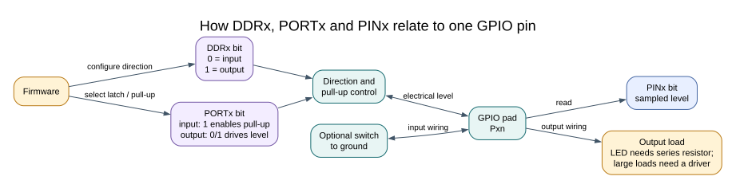

# Programming GPIO in C

## Objectives and Prerequisites

This lesson turns the GPIO register model into a small C program. You will configure a pin once, change its output, and understand why masks are safer than writing an entire port value. Read [binary masks](binary.md) and [integer widths](integer-width.md) if bitwise expressions are new to you.



## Configure Before You Use the Pin

For an output, set its `DDRx` bit. For an input, clear the direction bit. If the input needs the internal pull-up, set the matching `PORTx` bit after selecting input mode. Then sample the electrical level from `PINx`.

The course's [register-level Blink program](<https://github.com/arnabdasbwn/atmega328p-labs/blob/main/examples/01-blink-register/main.c>) shows direct configuration of Uno D13. Its [HAL version](<https://github.com/arnabdasbwn/atmega328p-labs/blob/main/examples/02-blink-hal/main.c>) calls `avr_gpio_mode()`, `avr_gpio_write()` and `avr_gpio_toggle()`. Both are valid learning examples. The HAL centralises pin mapping and input checks; the register example shows the hardware operation directly.


## Change Only the Bits You Own

This expression sets PB5 while preserving the other bits in `PORTB`:

```c
PORTB |= _BV(PORTB5);
```

This expression clears PB5 while preserving the other bits:

```c
PORTB &= (uint8_t)~_BV(PORTB5);
```

Avoid assigning a whole port value unless the module owns every bit on that port and the values are intentional. If multiple contexts update one register, define ownership or protect the update; `volatile` alone does not prevent a race.

## Build and Observe

From the repository root, build either Blink target with XC8 or AVR GCC:

```powershell
python "atmega328p-labs/tools/build.py" 01-blink-register --compiler xc8
python "atmega328p-labs/tools/build.py" 02-blink-hal --compiler gcc
```

The build reports Flash and static SRAM use. Compilation does not upload the image or verify a circuit. Follow the [upload lesson](upload-usb.md) only when a board with a working serial bootloader is connected.

## Troubleshooting and Exercise

If the output pin never changes, check the DDR direction, port mapping, peripheral pin multiplexing and whether another module controls the pin. If an input changes unexpectedly, check the pull-up/pull-down and wiring before adding software filtering.

Why is `PORTB = _BV(PORTB5);` potentially harmful on an Uno?

**Answer:** It writes zero to every other bit in `PORTB`. Those bits may control other outputs or pull-ups. A masked update preserves them, provided one owner or an appropriate critical section protects concurrent accesses.

## Code Walkthrough

### Register-level Blink
The example's `main()` configures its peripherals, runs the algorithm and reports or displays the result. These source operations are listed in execution order:

- `PORTB &= (uint8_t)~_BV(PORTB5);` - Sets or clears the Port B output latch. When the pin is an output, this determines its output level; on an input, it controls the pull-up.
- `DDRB |= _BV(DDB5);` - Sets the Port B direction bits; a set bit selects output mode.
- `for (;;)` - Repeats the foreground task indefinitely; each pass checks inputs, advances the calculation or services the peripheral shown below.
- `PINB = _BV(PINB5);` - Writing a one to a PINB bit toggles that pin's PORTB output latch on the ATmega328P.
- `_delay_ms(500);` - Waits for the stated interval; the foreground does no other work during this blocking delay.

Algorithm: Pin direction and output latch are separate hardware state.
Expected behaviour: L toggles every 500 ms
**HAL source files in this repository:** [ATmega328P HAL on GitHub](https://github.com/arnabdasbwn/atmega328p-hal)


### HAL Blink
The example's `main()` configures its peripherals, runs the algorithm and reports or displays the result. These source operations are listed in execution order:

- `if (avr_gpio_mode(AVR_BOARD_LED, AVR_GPIO_OUTPUT) != AVR_OK)` - This checks for any setup or transfer error before the program continues. Maps the Uno header pin to its AVR port, sets its DDR direction bit and prepares the PORT latch for the requested initial level or pull-up.
- `return 1;` - Stops this path and returns the indicated status when setup or validation cannot continue.
- `for (;;)` - Repeats the foreground task indefinitely; each pass checks inputs, advances the calculation or services the peripheral shown below.
- `(void)avr_gpio_toggle(AVR_BOARD_LED);` - Atomically toggles the selected pin output latch.
- `_delay_ms(500);` - Waits for the stated interval; the foreground does no other work during this blocking delay.

Algorithm: Pin direction and output latch are separate hardware state.
Expected behaviour: L toggles every 500 ms
**HAL source files in this repository:** [ATmega328P HAL on GitHub](https://github.com/arnabdasbwn/atmega328p-hal)

- [`include/avr_hal/gpio.h`](https://github.com/arnabdasbwn/atmega328p-hal/blob/main/include/avr_hal/gpio.h)
- [`src/gpio.c`](https://github.com/arnabdasbwn/atmega328p-hal/blob/main/src/gpio.c)


## References

- [ATmega328P product documentation](https://www.microchip.com/en-us/product/ATMEGA328P)
- [GPIO registers](gpio-registers.md)
- [Register-level Blink source](<https://github.com/arnabdasbwn/atmega328p-labs/blob/main/examples/01-blink-register/main.c>)
- [HAL GPIO interface](https://github.com/arnabdasbwn/atmega328p-hal/blob/main/include/avr_hal/gpio.h)
