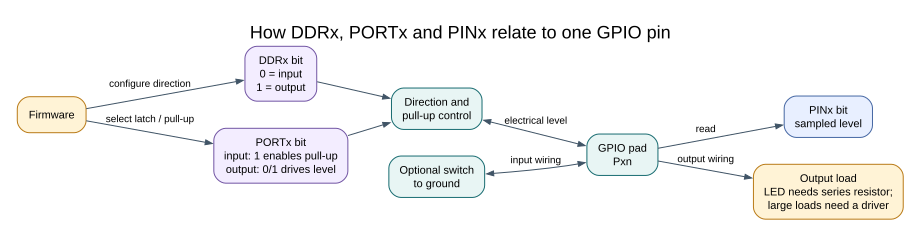

# ATmega328P GPIO Registers



## Three Registers with Different Jobs

Each ATmega328P I/O port uses three related registers. The `x` in `DDRx`, `PORTx` and `PINx` stands for a port letter such as B, C or D. The register names are part of the vendor device header; include `<avr/io.h>` rather than redefining them.

| Register | Main use | Example for Port B, bit 5 |
| --- | --- | --- |
| `DDRB` | Set input (`0`) or output (`1`) direction | `DDRB |= _BV(DDB5);` |
| `PORTB` | Write an output level; on an input, control its pull-up | `PORTB |= _BV(PORTB5);` |
| `PINB` | Read sampled electrical levels on the port | `if ((PINB & _BV(PINB5)) != 0U) { ... }` |

On the Uno R3, D13 maps to PB5. The register-level Blink lab sets the corresponding direction bit, then changes the output latch. Port C and Port D have their own register triplets.


## Set and Clear Bits Deliberately

To set one bit without changing the other bits, use a mask:

```c
DDRB |= _BV(DDB5);       /* Select PB5 as an output. */
PORTB |= _BV(PORTB5);    /* Drive its output latch high. */
PORTB &= (uint8_t)~_BV(PORTB5); /* Drive its output latch low. */
```

The complement is cast to the register width to make the intended 8-bit mask clear. AVR's special register semantics matter: writing a one to a `PINx` bit toggles the corresponding output latch. It does not perform a normal write of a sampled input value. The HAL toggle function uses this hardware behaviour explicitly.

Read the pin with `PINx`; writing `PORTx` and reading `PINx` are different operations. Also give one module ownership of a port register. If an ISR and foreground code both update the same port, a read-modify-write can lose an update unless access is coordinated.

## Worked Example: Read a Button

With D2 configured as an input and its pull-up enabled, the electrical level is read from `PIND` bit 2. Pressing the button to ground produces a zero in that bit. The [Button lab](<https://github.com/arnabdasbwn/atmega328p-labs/blob/main/examples/03-button/main.c>) uses the HAL so the board pin mapping is explicit; the [register Blink lab](<https://github.com/arnabdasbwn/atmega328p-labs/blob/main/examples/01-blink-register/main.c>) shows direct register access.

## Exercise with Answer

Which register do you read to sample whether Uno D2 is low?

**Answer:** Read `PIND` and test bit 2. `DDRD` controls the pin direction, while `PORTD` controls the output latch or internal pull-up.

## Code Walkthrough

### Register-level Blink
The example's `main()` configures its peripherals, runs the algorithm and reports or displays the result. These source operations are listed in execution order:

- `PORTB &= (uint8_t)~_BV(PORTB5);` - Sets or clears the Port B output latch. When the pin is an output, this determines its output level; on an input, it controls the pull-up.
- `DDRB |= _BV(DDB5);` - Sets the Port B direction bits; a set bit selects output mode.
- `for (;;)` - Repeats the foreground task indefinitely; each pass checks inputs, advances the calculation or services the peripheral shown below.
- `PINB = _BV(PINB5);` - Writing a one to a PINB bit toggles that pin's PORTB output latch on the ATmega328P.
- `_delay_ms(500);` - Waits for the stated interval; the foreground does no other work during this blocking delay.

Algorithm: Pin direction and output latch are separate hardware state.
Expected behaviour: L toggles every 500 ms
**HAL source files in this repository:** [ATmega328P HAL on GitHub](https://github.com/arnabdasbwn/atmega328p-hal)


### Debounced push button
The example's `main()` configures its peripherals, runs the algorithm and reports or displays the result. These source operations are listed in execution order:

- `avr_debounce_t button;` - Use the linked public header for this function's parameters, register ownership, blocking behavior and status values.
- `bool level = true;` - Stores this intermediate or output value for the next algorithm step. Check the units and range represented by each operand.
- `bool led = false;` - Stores this intermediate or output value for the next algorithm step. Check the units and range represented by each operand.
- `(void)avr_gpio_mode(2U, AVR_GPIO_INPUT_PULLUP);` - Maps the Uno header pin to its AVR port, sets its DDR direction bit and prepares the PORT latch for the requested initial level or pull-up.
- `(void)avr_gpio_mode(13U, AVR_GPIO_OUTPUT);` - Maps the Uno header pin to its AVR port, sets its DDR direction bit and prepares the PORT latch for the requested initial level or pull-up.
- `avr_tick_init();` - Configures the course millisecond tick interrupt source; it does not enable global interrupts itself.
- `avr_debounce_init(&button, true, 0UL);` - Seeds the stable/candidate input state and timestamp so the next transition is timed consistently.
- `sei();` - Enables global interrupts after the example has configured its sources and shared state.
- `for (;;)` - Repeats the foreground task indefinitely; each pass checks inputs, advances the calculation or services the peripheral shown below.
- `(void)avr_gpio_read(2U, &level);` - Reads the electrical level through PINx without changing direction or the output latch.
- `if (avr_debounce_update(&button, level, avr_tick_ms(), 20U) && !button.stable)` - This condition chooses the next path based on the API result. Accepts a changed input only after it remains stable for the requested interval, then reports that accepted change once.
- `led = !led;` - Stores this intermediate or output value for the next algorithm step. Check the units and range represented by each operand.
- `(void)avr_gpio_write(13U, led);` - Changes the pin's PORT output latch; for an input pin this selects its pull-up state.

Algorithm: A candidate input must remain unchanged for 20 ms before becoming stable. No delay occurs inside an ISR.
Expected behaviour: Each press toggles L once; holding the button does not repeat
**HAL source files in this repository:** [ATmega328P HAL on GitHub](https://github.com/arnabdasbwn/atmega328p-hal)

- [`include/avr_hal/gpio.h`](https://github.com/arnabdasbwn/atmega328p-hal/blob/main/include/avr_hal/gpio.h)
- [`include/avr_hal/tick.h`](https://github.com/arnabdasbwn/atmega328p-hal/blob/main/include/avr_hal/tick.h)
- [`lib/drivers/debounce.c`](https://github.com/arnabdasbwn/atmega328p-hal/blob/main/lib/drivers/debounce.c)
- [`lib/drivers/debounce.h`](https://github.com/arnabdasbwn/atmega328p-hal/blob/main/lib/drivers/debounce.h)
- [`lib/interrupts/tick.c`](https://github.com/arnabdasbwn/atmega328p-hal/blob/main/lib/interrupts/tick.c)
- [`src/gpio.c`](https://github.com/arnabdasbwn/atmega328p-hal/blob/main/src/gpio.c)


## References

- Microchip, [ATmega328P product documentation](https://www.microchip.com/en-us/product/ATMEGA328P), I/O ports and register descriptions.
- [Uno pin names and alternate functions](pin-multiplexing.md)
- [GPIO concepts](gpio-concepts.md)
