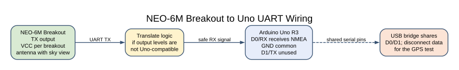
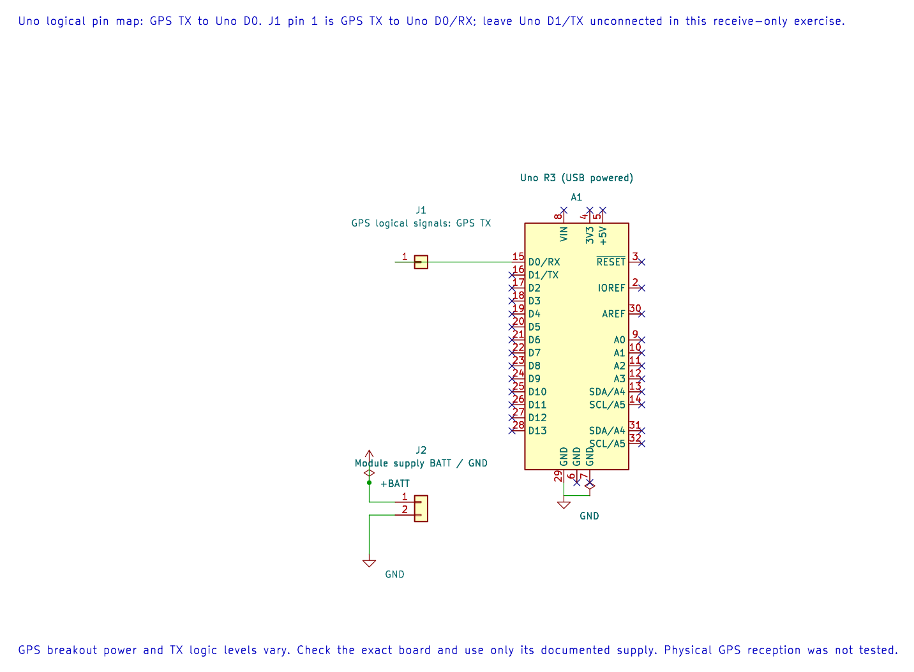

# GPS Receiver and NMEA Data

## Learning Goals

This lesson shows how to receive position data from a NEO-6M module, recognise a valid position sentence, and keep a parser within fixed memory limits.

## GPS Data Comes as Serial Sentences

Many receiver boards send NMEA text over a UART. A common sentence is RMC, which includes a time, fix status, latitude, longitude and other navigation fields. NEO-6 modules commonly use a 9600 baud serial connection and can emit several NMEA sentence types; the exact breakout and firmware settings may differ.

An RMC sentence is a comma-separated record that ends with `*` and a two-digit hexadecimal checksum, followed by carriage return and line feed. The checksum is the XOR of the sentence characters between `$` and `*`. A readable string is not necessarily a trustworthy position: the parser must check the checksum, field boundaries, status and coordinate ranges.

## Wiring the NEO-6M Breakout

This receive-only example connects the GPS transmitter to the Uno's hardware USART. Breakout power and signal levels vary. The NEO-6 receiver IC itself is a 2.7–3.6 V device, so do not apply 5 V directly to the bare module. Check the exact breakout's regulator, antenna and UART output levels. Add suitable level translation when the logic levels are not compatible with the Uno.

| Arduino Uno R3 | GPS Breakout | Note |
| --- | --- | --- |
| D0 / RX | TX | GPS output into the Uno; level translation as required |
| GND | GND | Common ground |
| Supply | VCC or VIN as documented on the exact breakout | Never infer the input voltage from a module name |
| D1 / TX | Not connected | The example only receives data |

Disconnect the Uno's USB data link after upload because the USB-to-serial bridge shares D0 and D1. Power the Uno and receiver from suitable regulated supplies during the GPS test. Place the antenna with a clear view of the sky; an indoor test may not obtain a position fix.

## How the Parser Protects Memory





The editable KiCad pin map shows the receive-only UART connection. Breakout supply and output levels vary, so check the exact board documentation.

The shared NMEA parser stores at most 82 bytes in a fixed array. It accepts a sentence only after LF arrives, checks the checksum, then examines RMC fields. It supports the `$GPRMC` and `$GNRMC` talker prefixes and active (`A`) or void (`V`) fix status. Coordinate values are returned as integer microdegrees with a separate hemisphere letter; no floating-point operations are needed.

An oversized sentence is discarded until a new `$` marker or the next LF. A damaged or incomplete sentence does not update the caller's record. The GPS demonstration stores its parser state on the stack, so allow about 83 bytes of stack space for its line buffer in addition to the usual function-call stack.

## Build and Observe

Build the Uno experiment and the deterministic parser fixture:

```powershell
python atmega328p-labs/tools/build.py 51-gps --compiler gcc
python atmega328p-labs/tools/build.py 51-gps --compiler xc8
python atmega328p-labs/tools/build.py 92-nmea-rmc-test --compiler gcc
python atmega328p-labs/tools/build.py 92-nmea-rmc-test --compiler xc8
npm run test:firmware
```

The receiver example turns on the onboard D13 LED after a valid RMC sentence reports an active fix. It turns the LED off when a valid RMC sentence reports no fix. Invalid, incomplete and unsupported sentences leave the last accepted state unchanged. The example intentionally does not print coordinates because the GPS and USB bridge share the serial pins.

The software fixture feeds a published-style reference sentence through the same compiled parser and checks that it returns approximately 48.117300° N, 11.516666° E. It then corrupts the checksum and confirms that the previous valid record is not overwritten. The fixture tests parser software only; it is not a model of a receiver, antenna, sky view or electrical connection.

## Source Files

- [NEO-6M Uno Example](<https://github.com/arnabdasbwn/atmega328p-labs/blob/main/examples/51-gps/main.c>)
- [NMEA RMC Parser Header](https://github.com/arnabdasbwn/atmega328p-hal/blob/main/lib/drivers/nmea_rmc.h)
- [NMEA RMC Parser Implementation](https://github.com/arnabdasbwn/atmega328p-hal/blob/main/lib/drivers/nmea_rmc.c)
- [Deterministic Parser Fixture](<https://github.com/arnabdasbwn/atmega328p-labs/blob/main/examples/92-nmea-rmc-test/main.c>)
- [USART Fundamentals](uart-concepts.md)

## Troubleshooting

- **No LED change:** verify the GPS is transmitting at the configured baud rate, then move the antenna outdoors and wait for a fix.
- **Serial overrun or garbled data:** confirm the receiver baud and disconnect the Uno USB data link during operation.
- **Checksum errors:** check that the UART voltage level is compatible and that no inverter or extra bytes were added to the stream.
- **Build fits but stack is tight:** static RAM reports do not include all stack usage. Include the 83-byte parser state and call depth when checking the Uno's 2 KB SRAM budget.
- **Different module pin labels:** follow the breakout documentation; the bare NEO-6 module and hobby breakout are not interchangeable wiring references.

## Code Walkthrough

### NEO-6M GPS Fix Indicator
The example's `main()` configures its peripherals, runs the algorithm and reports or displays the result. These source operations are listed in execution order:

- `avr_nmea_rmc_parser_t parser;` - Use the linked public header for this function's parameters, register ownership, blocking behavior and status values.
- `avr_nmea_rmc_record_t record;` - Use the linked public header for this function's parameters, register ownership, blocking behavior and status values.
- `if ((avr_gpio_mode(13U, AVR_GPIO_OUTPUT) != AVR_OK) || (avr_uart_init(9600UL) != AVR_OK))` - This checks for any setup or transfer error before the program continues. Maps the Uno header pin to its AVR port, sets its DDR direction bit and prepares the PORT latch for the requested initial level or pull-up. Configures USART0 for asynchronous 8N1. It chooses a baud divisor and normal/double-speed mode, programs UBRR0/UCSR0A/UCSR0C, then enables receive and transmit in UCSR0B.
- `return 1;` - Stops this path and returns the indicated status when setup or validation cannot continue.
- `avr_nmea_rmc_reset(&parser);` - Use the linked public header for this function's parameters, register ownership, blocking behavior and status values.
- `for (;;)` - Repeats the foreground task indefinitely; each pass checks inputs, advances the calculation or services the peripheral shown below.
- `if (avr_uart_get(&byte, AVR_POLL_BUDGET) == AVR_OK)` - The operation runs only after this API reports AVR_OK. Use the linked public header for this function's parameters, register ownership, blocking behavior and status values.
- `if (avr_nmea_rmc_feed(&parser, byte, &record) == AVR_NMEA_RECORD)` - This condition chooses the next path based on the API result. Use the linked public header for this function's parameters, register ownership, blocking behavior and status values.
- `(void)avr_gpio_write(13U, record.fix_valid);` - Changes the pin's PORT output latch; for an input pin this selects its pull-up state.

Algorithm: NMEA records are bounded text frames. The RMC parser checks the XOR checksum, validates coordinate ranges and does not expose partial records.
Expected behaviour: The onboard D13 LED turns on after a checksum-valid RMC sentence reports an active position fix and turns off on a valid void-status record
**HAL source files in this repository:** [ATmega328P HAL on GitHub](https://github.com/arnabdasbwn/atmega328p-hal)

- [`include/avr_hal/gpio.h`](https://github.com/arnabdasbwn/atmega328p-hal/blob/main/include/avr_hal/gpio.h)
- [`include/avr_hal/uart.h`](https://github.com/arnabdasbwn/atmega328p-hal/blob/main/include/avr_hal/uart.h)
- [`lib/drivers/nmea_rmc.c`](https://github.com/arnabdasbwn/atmega328p-hal/blob/main/lib/drivers/nmea_rmc.c)
- [`lib/drivers/nmea_rmc.h`](https://github.com/arnabdasbwn/atmega328p-hal/blob/main/lib/drivers/nmea_rmc.h)
- [`src/gpio.c`](https://github.com/arnabdasbwn/atmega328p-hal/blob/main/src/gpio.c)
- [`src/uart.c`](https://github.com/arnabdasbwn/atmega328p-hal/blob/main/src/uart.c)


### NMEA RMC Parser Software Fixture
The example's `main()` configures its peripherals, runs the algorithm and reports or displays the result. These source operations are listed in execution order:

- `const char sentence[] =` - This statement participates in the operation sequence; follow its expression to see which state or output changes.
- `const char damaged[] =` - This statement participates in the operation sequence; follow its expression to see which state or output changes.
- `avr_nmea_rmc_parser_t parser;` - Use the linked public header for this function's parameters, register ownership, blocking behavior and status values.
- `avr_nmea_rmc_record_t record = {false, 0U, 0U, '\0', '\0'};` - Use the linked public header for this function's parameters, register ownership, blocking behavior and status values.
- `avr_nmea_result_t result = AVR_NMEA_PENDING;` - Use the linked public header for this function's parameters, register ownership, blocking behavior and status values.
- `(void)avr_uart_init(9600UL);` - Configures USART0 for asynchronous 8N1. It chooses a baud divisor and normal/double-speed mode, programs UBRR0/UCSR0A/UCSR0C, then enables receive and transmit in UCSR0B.
- `avr_nmea_rmc_reset(&parser);` - Use the linked public header for this function's parameters, register ownership, blocking behavior and status values.
- `for (size_t index = 0U; index < (sizeof(sentence) - 1U); index++)` - Repeats while `index < (sizeof(sentence) - 1U)` is true; `size_t index = 0U` sets the starting state and `index++` advances it each pass.
- `result = avr_nmea_rmc_feed(&parser, (uint8_t)sentence[index], &record);` - Use the linked public header for this function's parameters, register ownership, blocking behavior and status values.
- `if ((result != AVR_NMEA_RECORD) || !record.fix_valid ||` - Tests the stated condition; the following block handles the matching case and the other path is skipped.
- `(record.latitude_microdegrees != UINT32_C(48117300)) ||` - This statement advances the operation sequence; follow its expression to see the state change.
- `(record.longitude_microdegrees != UINT32_C(11516666)) ||` - This statement advances the operation sequence; follow its expression to see the state change.
- `(record.latitude_hemisphere != 'N') || (record.longitude_hemisphere != 'E'))` - This statement advances the operation sequence; follow its expression to see the state change.
- `(void)avr_uart_write((const uint8_t *)"FAIL1\n", 6U, AVR_POLL_BUDGET);` - Sends the specified bytes through USART0; a timeout can occur after a prefix has already been sent.
- `return 1;` - Stops this path and returns the indicated status when setup or validation cannot continue.
- `for (size_t index = 0U; index < (sizeof(damaged) - 1U); index++)` - Repeats while `index < (sizeof(damaged) - 1U)` is true; `size_t index = 0U` initializes the loop and `index++` advances it.
- `result = avr_nmea_rmc_feed(&parser, (uint8_t)damaged[index], &record);` - Calls `avr_nmea_rmc_feed()`; its public HAL header defines the arguments, register ownership, blocking behavior and status results.
- `if ((result != AVR_NMEA_INVALID) || !record.fix_valid ||` - Tests this condition to choose which algorithm path runs.
- `(record.latitude_microdegrees != UINT32_C(48117300)))` - This statement participates in the operation sequence; follow its expression to see which state or output changes.
- `(void)avr_uart_write((const uint8_t *)"FAIL2\n", 6U, AVR_POLL_BUDGET);` - Sends the specified bytes through USART0; a timeout can occur after a prefix has already been sent.
- `(void)avr_uart_write((const uint8_t *)"PASS\n", 5U, AVR_POLL_BUDGET);` - Sends the specified bytes through USART0; a timeout can occur after a prefix has already been sent.
- `return 0;` - Stops this path and returns the indicated status when setup or validation cannot continue.

Algorithm: Pure protocol parsing can be tested with deterministic input without claiming physical GPS validation.
Expected behaviour: The fixture prints PASS after parsing the reference RMC fix and rejecting a bad checksum
**HAL source files in this repository:** [ATmega328P HAL on GitHub](https://github.com/arnabdasbwn/atmega328p-hal)

- [`include/avr_hal/uart.h`](https://github.com/arnabdasbwn/atmega328p-hal/blob/main/include/avr_hal/uart.h)
- [`lib/drivers/nmea_rmc.c`](https://github.com/arnabdasbwn/atmega328p-hal/blob/main/lib/drivers/nmea_rmc.c)
- [`lib/drivers/nmea_rmc.h`](https://github.com/arnabdasbwn/atmega328p-hal/blob/main/lib/drivers/nmea_rmc.h)
- [`src/uart.c`](https://github.com/arnabdasbwn/atmega328p-hal/blob/main/src/uart.c)


## Check Your Understanding

1. Which bytes are included in the NMEA checksum calculation?
2. Why should a checksum error leave the previous fix state unchanged?
3. How does integer microdegree storage avoid floating-point work in the parser?

**Suggested answers:** XOR the characters after `$` and before `*`. A damaged line is not valid evidence of a new fix state. Integer microdegrees store a scaled whole number, so calculations use integer arithmetic and a separate N/S or E/W sign indicator.

## References

- u-blox, [NEO-6 Data Sheet](https://content.u-blox.com/sites/default/files/products/documents/NEO-6_DataSheet_%28GPS.G6-HW-09005%29.pdf), protocol and electrical interface information.
- Microchip, [ATmega328P Device Documentation](https://www.microchip.com/en-us/product/ATMEGA328P), USART chapter and electrical characteristics.
- Check the exact receiver breakout's power and logic documentation before connecting it.

**Validation status:** Both compilers build the receiver example and parser fixture. The software fixture is intended for AVR8js execution. No GPS board, antenna or physical fix test is available in this workspace.
