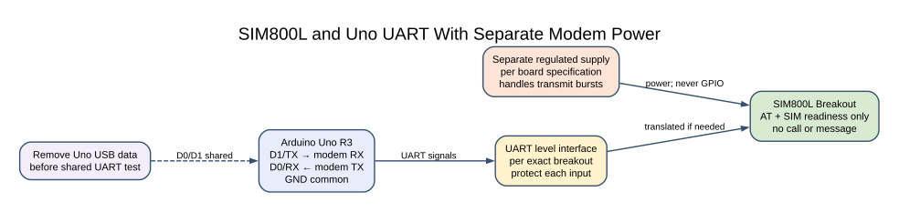
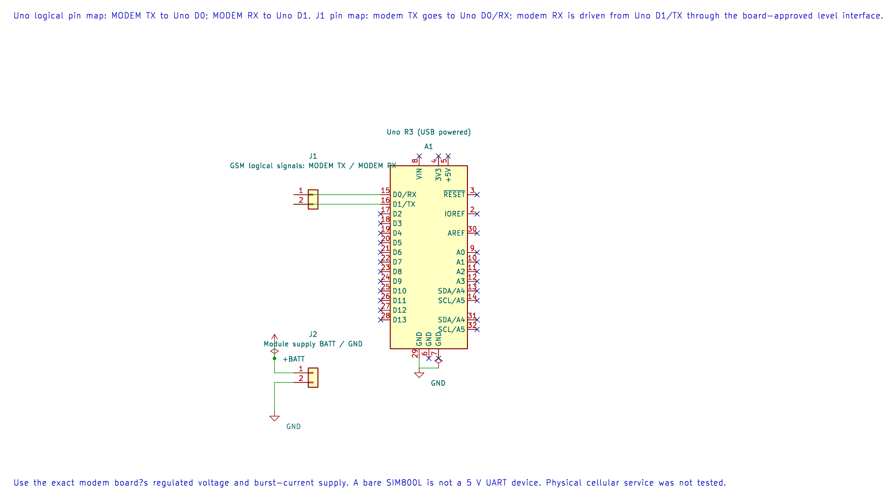
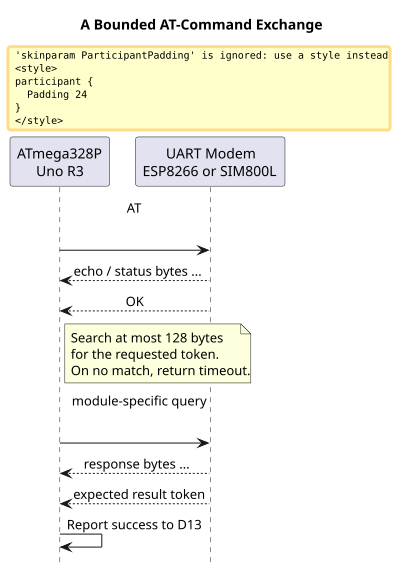
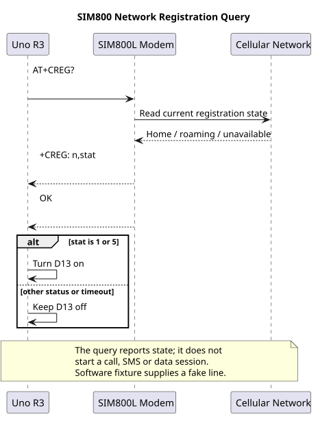

# SIM800L GSM Modem

## Learning Goals

This lesson checks two separate things: whether the SIM800L responds to AT commands, and whether its SIM reports ready. You will use the Uno USART to query the modem and watch the onboard D13 LED for the result. The example does not register on a cellular network, place a call or send a message.

SIM800L is a 2G GSM/GPRS modem. Network bands, operator support and service availability depend on location and can change. Before choosing this module for a project in India, check the current service in the places where it will operate. Do not assume an old 2G modem will be supported everywhere.

## Parts and Wiring

Use an Uno R3 and a SIM800L breakout whose power and UART requirements you have checked. The bare modem module and common breakout boards do not all expose the same voltage limits or onboard regulation. The SIMCom hardware design gives a nominal supply near 4.0 V for the module; follow the document for the exact module revision and the carrier-board instructions. A supply must handle transmit current bursts without the voltage collapsing. Do not power the modem from an Uno GPIO or its 3.3 V output.

| Uno R3 | SIM800L Breakout | Notes |
| --- | --- | --- |
| D1 / TX | Modem RX through the board's supported level interface | The Uno TX output is 5 V logic. Check whether the breakout includes translation. |
| D0 / RX | Modem TX through a safe logic interface if required | Verify the modem output voltage is valid for the Uno input. |
| GND | GND | Join signal grounds, while keeping modem current off the Uno ground-return path where practical. |
| Separate regulated supply | Modem power input | Set voltage for the exact breakout and size the supply for current bursts. |
| SIM holder | Activated SIM of a supported size | Insert the SIM with power off unless its board documentation says otherwise. |

Use short, low-resistance power wiring and place the bypass capacitance specified by the board or module design near its supply pins. Do not copy a capacitor value from a different breakout without checking its design. The Uno USB-to-serial bridge shares D0/D1, so upload first, then remove the Uno USB data connection before connecting the modem to the hardware USART.

## How the Example Works





The editable KiCad pin map records the UART assignment. Use the exact board?s burst-capable supply and suitable UART level interface.

The first program sends `AT` and waits for `OK`. It then sends `AT+CPIN?` and scans for `+CPIN: READY`. D13 turns on only after both bounded waits succeed. The helper consumes bytes as it searches; it does not save a full modem log or parse every response line.



The maintained readiness source is [`56-sim800l-at`](https://github.com/arnabdasbwn/atmega328p-labs/blob/main/examples/56-sim800l-at/main.c). Its modem voltage and supply requirements are hardware-specific; compile success does not verify the breakout wiring or power design.

## Read Registration State

SIM readiness does not mean that the modem has registered with an operator. Lab 73 sends the query `AT+CREG?` and parses the `+CREG:` response as a bounded line. It lights D13 for status 1 (registered on the home network) or status 5 (registered while roaming). Searching, denied, unknown and not-registered results leave the LED off. SIMCom identifies status 3 as registration denied; it is a diagnostic result, not success.

The example uses Timer0's millisecond tick for a five-second response deadline and bounds the total number of response bytes. It checks registration only; it does not start a GPRS data session, place a call or send an SMS. A registration result may change as the modem moves or the network becomes unavailable.



Build [`73-sim800-registration`](https://github.com/arnabdasbwn/atmega328p-labs/blob/main/examples/73-sim800-registration/main.c):

```powershell
python atmega328p-labs/tools/build.py 73-sim800-registration --compiler gcc
python atmega328p-labs/tools/build.py 73-sim800-registration --compiler xc8
```

The parser accepts a home-network response such as `+CREG: 0,1` and a roaming response such as `+CREG: 0,5`. It does not log the location code or cell identifier that may follow. Keep those values private when they appear in diagnostic logs.

## Build the Example

From the course folder, run either build command:

```powershell
python atmega328p-labs/tools/build.py 56-sim800l-at --compiler gcc
python atmega328p-labs/tools/build.py 56-sim800l-at --compiler xc8
```

The source uses the shared `avr_at_send()` and `avr_at_wait_token()` helpers. Each response search inspects at most 128 bytes. The polling budget is a loop count rather than a time value, so this introductory code should not be treated as a safety-critical modem timeout. A real product should use an elapsed-time deadline and parse complete result lines and asynchronous status notifications.

## Observe and Troubleshoot

With compatible hardware, D13 should turn on when the modem accepts `AT` and the SIM reports `READY`. If it does not, measure the voltage at the modem while it is active. A UART response can fail because of a low supply, incorrect TX/RX wiring, unsuitable logic levels, a different baud rate, a SIM PIN lock, or an unsupported module configuration.

An `AT` response does not prove SIM readiness, and SIM readiness does not prove network registration. Keep those checks separate when diagnosing the system. The SIMCom AT command manual and hardware design document describe the exact response and electrical requirements for their supported module revision. Breakout manufacturers may add circuitry that changes how those requirements appear at the board connector.

## Exercises

1. Why does the program check SIM readiness separately from the `AT` response?
2. What could cause repeated modem resets when the network is not available?
3. What extra information should a full modem logger retain, and what information must it protect?

**Suggested answers:** The AT response verifies the command channel, while `+CPIN: READY` checks a SIM state. Supply droop can reset a modem during current bursts; also check the power wiring and carrier board. A full logger should retain bounded timestamped lines and command state for diagnosis, while removing SIM PINs, phone numbers, credentials and private message contents.

## Validation and References

Labs 56 and 73 build with AVR GCC and XC8. The [98-sim800-registration-test fixture](https://github.com/arnabdasbwn/atmega328p-labs/blob/main/examples/98-sim800-registration-test/main.c) supplies a scripted `+CREG: 0,1` response to the Lab 73 parser and checks the D13 success state. It does not model a SIM, radio, antenna or operator network. No physical SIM800L test has been performed. Check current local 2G service before selecting hardware; TRAI provides guidance on checking mobile service coverage through its [wireless internet FAQ](https://www.trai.gov.in/faqcategory/wireless-internet).

- [SIMCom SIM800 Product Page And Technical Files](https://en.simcom.com/product/SIM800.html)
- [SIMCom Network Registration Troubleshooting](https://www.simcom.com/questions_related_to_network.html)
- [SIM800L Hardware Design V2.02](https://www.electrokit.com/upload/product/41018/41018214/SIM800L-SIMCom.pdf)
- [ATmega328P Device Documentation](https://www.microchip.com/en-us/product/ATMEGA328P)
- [Uno R3 Pinout](https://www.arnabkumardas.com/pinout/arduino-uno-r3/)

## Code Walkthrough

### SIM800L AT And SIM Readiness Check
The example's `main()` configures its peripherals, runs the algorithm and reports or displays the result. These source operations are listed in execution order:

- `static const uint8_t at_command[] = "AT\r\n";` - Stores this intermediate or output value for the next algorithm step. Check the units and range represented by each operand.
- `static const uint8_t sim_query[] = "AT+CPIN?\r\n";` - Stores this intermediate or output value for the next algorithm step. Check the units and range represented by each operand.
- `static const uint8_t ok_token[] = "OK";` - Stores this intermediate or output value for the next algorithm step. Check the units and range represented by each operand.
- `static const uint8_t ready_token[] = "+CPIN: READY";` - Stores this intermediate or output value for the next algorithm step. Check the units and range represented by each operand.
- `(void)avr_gpio_mode(13U, AVR_GPIO_OUTPUT);` - Maps the Uno header pin to its AVR port, sets its DDR direction bit and prepares the PORT latch for the requested initial level or pull-up.
- `(void)avr_gpio_write(13U, false);` - Changes the pin's PORT output latch; for an input pin this selects its pull-up state.
- `if (avr_uart_init(9600UL) != AVR_OK)` - This checks for any setup or transfer error before the program continues. Configures USART0 for asynchronous 8N1. It chooses a baud divisor and normal/double-speed mode, programs UBRR0/UCSR0A/UCSR0C, then enables receive and transmit in UCSR0B.
- `return 1;` - Stops this path and returns the indicated status when setup or validation cannot continue.
- `if ((avr_at_send(at_command, (sizeof(at_command) - 1U)) != AVR_OK) ||` - This checks for any setup or transfer error before the program continues. Use the linked public header for this function's parameters, register ownership, blocking behavior and status values.
- `(avr_at_wait_token(ok_token, 2U, AVR_SIM800L_RESPONSE_BYTES, AVR_POLL_BUDGET) != AVR_OK) ||` - Use the linked public header for this function's parameters, register ownership, blocking behavior and status values.
- `(avr_at_send(sim_query, (sizeof(sim_query) - 1U)) != AVR_OK) ||` - Calls `avr_at_send()`; its public HAL header defines the arguments, register ownership, blocking behavior and status results.
- `(avr_at_wait_token(ready_token, 12U, AVR_SIM800L_RESPONSE_BYTES, AVR_POLL_BUDGET) !=` - Use the linked public header for this function's parameters, register ownership, blocking behavior and status values.
- `(void)avr_gpio_write(13U, true);` - Changes the pin's PORT output latch; for an input pin this selects its pull-up state.
- `for (;;)` - Repeats the foreground task indefinitely; each pass checks inputs, advances the calculation or services the peripheral shown below.
- `_delay_ms(1000);` - Waits for the stated interval; the foreground does no other work during this blocking delay.

Algorithm: AT response lines may include echoes and status text; the bounded matcher looks for a specific token without retaining a full log.
Expected behaviour: D13 turns on after AT responds and AT+CPIN? contains +CPIN: READY
**HAL source files in this repository:** [ATmega328P HAL on GitHub](https://github.com/arnabdasbwn/atmega328p-hal)

- [`include/avr_hal/gpio.h`](https://github.com/arnabdasbwn/atmega328p-hal/blob/main/include/avr_hal/gpio.h)
- [`include/avr_hal/uart.h`](https://github.com/arnabdasbwn/atmega328p-hal/blob/main/include/avr_hal/uart.h)
- [`lib/drivers/at_client.c`](https://github.com/arnabdasbwn/atmega328p-hal/blob/main/lib/drivers/at_client.c)
- [`lib/drivers/at_client.h`](https://github.com/arnabdasbwn/atmega328p-hal/blob/main/lib/drivers/at_client.h)
- [`src/gpio.c`](https://github.com/arnabdasbwn/atmega328p-hal/blob/main/src/gpio.c)
- [`src/uart.c`](https://github.com/arnabdasbwn/atmega328p-hal/blob/main/src/uart.c)


### SIM800 Registration Status Query
The example's `main()` configures its peripherals, runs the algorithm and reports or displays the result. These source operations are listed in execution order:

- `static const uint8_t registration_query[] = "AT+CREG?\r\n";` - Stores this intermediate or output value for the next algorithm step. Check the units and range represented by each operand.
- `uint8_t state = 0U;` - Clears the state/counter after its threshold is reached so the next interval starts from zero.
- `(void)avr_gpio_mode(13U, AVR_GPIO_OUTPUT);` - Maps the Uno header pin to its AVR port, sets its DDR direction bit and prepares the PORT latch for the requested initial level or pull-up.
- `(void)avr_gpio_write(13U, false);` - Changes the pin's PORT output latch; for an input pin this selects its pull-up state.
- `avr_tick_init();` - Configures the course millisecond tick interrupt source; it does not enable global interrupts itself.
- `if (avr_uart_init(9600UL) != AVR_OK)` - This checks for any setup or transfer error before the program continues. Configures USART0 for asynchronous 8N1. It chooses a baud divisor and normal/double-speed mode, programs UBRR0/UCSR0A/UCSR0C, then enables receive and transmit in UCSR0B.
- `return 1;` - Stops this path and returns the indicated status when setup or validation cannot continue.
- `sei();` - Enables global interrupts after the example has configured its sources and shared state.
- `if ((avr_at_send(registration_query, sizeof(registration_query) - 1U) != AVR_OK) ||` - This checks for any setup or transfer error before the program continues. Use the linked public header for this function's parameters, register ownership, blocking behavior and status values.
- `(creg_read_state(&state) != AVR_OK))` - This statement participates in the operation sequence; follow its expression to see which state or output changes.
- `if ((state == 1U) || (state == 5U))` - Tests the stated condition; the following block handles the matching case and the other path is skipped.
- `(void)avr_gpio_write(13U, true);` - Changes the pin's PORT output latch; for an input pin this selects its pull-up state.
- `for (;;)` - Repeats the foreground task indefinitely; each pass checks inputs, advances the calculation or services the peripheral shown below.

Algorithm: Parses a bounded +CREG query line; Timer0 provides a five-second response deadline.
Expected behaviour: D13 turns on only when +CREG reports home registration (1) or roaming registration (5)
**HAL source files in this repository:** [ATmega328P HAL on GitHub](https://github.com/arnabdasbwn/atmega328p-hal)

- [`include/avr_hal/gpio.h`](https://github.com/arnabdasbwn/atmega328p-hal/blob/main/include/avr_hal/gpio.h)
- [`include/avr_hal/tick.h`](https://github.com/arnabdasbwn/atmega328p-hal/blob/main/include/avr_hal/tick.h)
- [`include/avr_hal/uart.h`](https://github.com/arnabdasbwn/atmega328p-hal/blob/main/include/avr_hal/uart.h)
- [`lib/drivers/at_client.c`](https://github.com/arnabdasbwn/atmega328p-hal/blob/main/lib/drivers/at_client.c)
- [`lib/drivers/at_client.h`](https://github.com/arnabdasbwn/atmega328p-hal/blob/main/lib/drivers/at_client.h)
- [`lib/interrupts/tick.c`](https://github.com/arnabdasbwn/atmega328p-hal/blob/main/lib/interrupts/tick.c)
- [`src/gpio.c`](https://github.com/arnabdasbwn/atmega328p-hal/blob/main/src/gpio.c)
- [`src/uart.c`](https://github.com/arnabdasbwn/atmega328p-hal/blob/main/src/uart.c)


### SIM800 Registration Parser Fixture
The example's `main()` configures its peripherals, runs the algorithm and reports or displays the result. These source operations are listed in execution order:


Algorithm: Tests bounded USART line parsing for the home-network registered state.
Expected behaviour: A scripted +CREG: 0,1 response sets the D13 success output
**HAL source files in this repository:** [ATmega328P HAL on GitHub](https://github.com/arnabdasbwn/atmega328p-hal)

- [`lib/interrupts/tick.c`](https://github.com/arnabdasbwn/atmega328p-hal/blob/main/lib/interrupts/tick.c)
