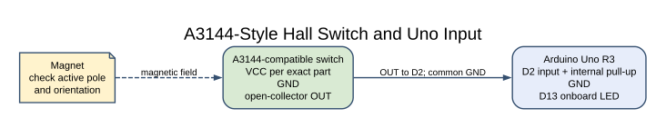
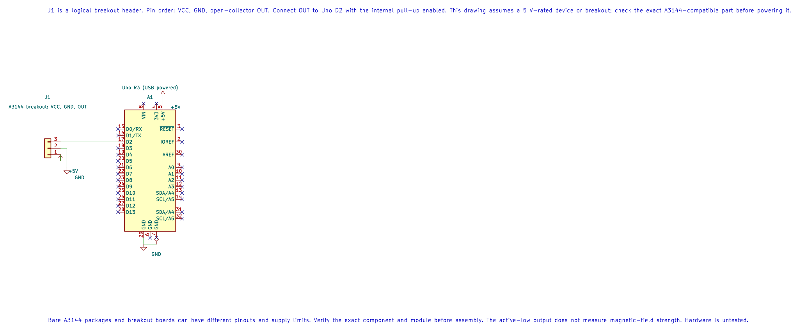

# A3144 Hall-Effect Switch

## What You Will Learn

A Hall-effect switch changes its output when a magnetic field of the required polarity and strength reaches the sensor. The common A3144-style device is a digital switch, not a linear sensor: its output changes state near its magnetic threshold and returns when the field falls below its release level.

Many A3144-compatible parts have an open-collector output. The output transistor can pull the line low, but it cannot drive the line high by itself. A pull-up resistor or the Uno's internal pull-up provides the high level.

## Check the Exact Part and Wiring

Bare packages and breakout boards can have different pinouts and supply requirements. Read the marking and datasheet for the exact part before powering it. The Lab 34 reference uses an open-collector output on D2 with a 10 kΩ pull-up to 5 V; the sensor supply must follow the exact component's rating.

| Sensor signal | Uno R3 or circuit | Purpose |
| --- | --- | --- |
| Supply | Correct rated sensor supply | Powers Hall device |
| GND | Uno GND | Shared reference |
| Open-collector output | D2; Lab 34 enables the internal pull-up | Active-low digital signal; add an external 10 kΩ pull-up only if the setup needs it |
| Uno onboard LED | D13 | Shows the inverse of D2 input level |

Do not use the wiring for a linear Hall sensor or a breakout with a push-pull output without checking its circuit.

## What Lab 34 Demonstrates



The KiCad diagram below shows the Uno connection and the A3144 breakout's logical pin order. The connector is not a promise about the order on a particular board: check its silkscreen and documentation before wiring. The editable KiCad schematic, ERC report and netlist are available with the course.



The program enables the D2 pull-up and reads the input continuously. When D2 reads low, it turns on the onboard LED. This demonstrates a digital sensor level; it does not measure field strength or count rotation. The active magnetic pole and output polarity depend on the actual sensor and orientation.

To count magnet passes on a rotating wheel, use a suitable interrupt or capture input, keep the interrupt handler short and read any multi-byte count atomically. Account for the number of magnets and the encoder's pulses per revolution before converting counts to speed.

## Build and Try the Lab

```powershell
python atmega328p-labs/tools/build.py 34-digital-sensors --compiler gcc
python atmega328p-labs/tools/build.py 34-digital-sensors --compiler xc8
```

After confirming the part pinout, bring a small magnet close to the sensor and try both poles. Watch D13 and record which pole activates the output. No Hall device or magnet was available for this course's physical test.

## Code Walkthrough

### IR Interrupter and Hall Switch
The example's `main()` configures its peripherals, runs the algorithm and reports or displays the result. These source operations are listed in execution order:

- `(void)avr_gpio_mode(2U, AVR_GPIO_INPUT_PULLUP);` - Maps the Uno header pin to its AVR port, sets its DDR direction bit and prepares the PORT latch for the requested initial level or pull-up.
- `(void)avr_gpio_mode(13U, AVR_GPIO_OUTPUT);` - Maps the Uno header pin to its AVR port, sets its DDR direction bit and prepares the PORT latch for the requested initial level or pull-up.
- `for (;;)` - Repeats the foreground task indefinitely; each pass checks inputs, advances the calculation or services the peripheral shown below.
- `if (avr_gpio_read(2U, &high) == AVR_OK)` - The operation runs only after this API reports AVR_OK. Reads the electrical level through PINx without changing direction or the output latch.
- `(void)avr_gpio_write(13U, !high);` - Changes the pin's PORT output latch; for an input pin this selects its pull-up state.

Algorithm: Open-collector outputs pull down but do not drive high. The pull-up creates the high level. Reflective and interrupter modules may invert their comparator output; test the actual module.
Expected behaviour: L indicates an active LOW sensor output
**HAL source files in this repository:** [ATmega328P HAL on GitHub](https://github.com/arnabdasbwn/atmega328p-hal)

- [`include/avr_hal/gpio.h`](https://github.com/arnabdasbwn/atmega328p-hal/blob/main/include/avr_hal/gpio.h)
- [`src/gpio.c`](https://github.com/arnabdasbwn/atmega328p-hal/blob/main/src/gpio.c)


## Common Problems

- **The signal is always high:** Check the sensor supply, output pin and magnet orientation; an open output naturally reads high through the pull-up.
- **The signal is always low:** Check for a short, wrong pinout or a magnet held at the active pole.
- **A logic transition works but speed is wrong:** Verify magnets per revolution and how many transitions the firmware counts.
- **A reed switch behaves differently:** A reed switch is a mechanical contact; it is not a Hall sensor.

## Check Your Understanding

1. Why does the open-collector output need a pull-up?
2. What does the low level mean in Lab 34?
3. Why should a magnetic pole test use the exact sensor orientation?

**Suggested answers:** The transistor can pull the output low but cannot source the high level. Low turns the D13 LED on in the example. The active pole and package orientation determine whether the device switches.

## Source and Further Reading

- [Lab 34 source](<https://github.com/arnabdasbwn/atmega328p-labs/blob/main/examples/34-digital-sensors/main.c>)
- Check the exact A3144-compatible device datasheet for supply, output current, polarity and pinout.
- [ATmega328P Documentation](https://www.microchip.com/en-us/product/ATMEGA328P), GPIO and interrupt sections.
