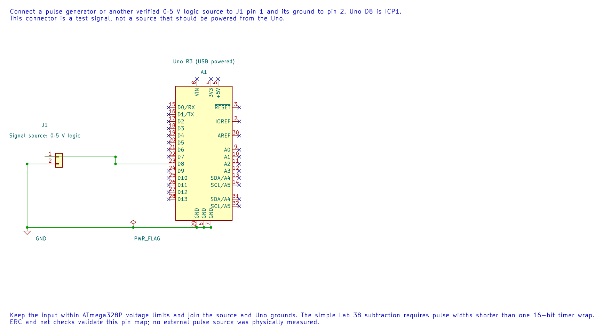

# Measure Pulse Width with Input Capture

## Capture the Timer at the Edge

Timer1 input capture copies the counter into `ICR1` when an edge arrives on D8/ICP1. Because the hardware performs the copy at the edge, ISR entry latency does not shift the captured timestamp. This makes input capture useful for measuring pulse widths and periods.

At 16 MHz with a divide-by-8 prescaler, one timer tick is `8 / 16 MHz = 0.5 µs`. A measured difference of 3,000 ticks corresponds to `1,500 µs`. The 16-bit counter wraps every 32.768 ms at this rate.

## Measure a High Pulse

The [input-capture example](<https://github.com/arnabdasbwn/atmega328p-labs/blob/main/examples/38-input-capture/main.c>) captures a rising edge, then a falling edge, and subtracts the stored timestamps.

| Signal source | Uno R3 |
| --- | --- |
| Logic output, verified as 0–5 V | D8 / ICP1 |
| Ground | GND |

The editable KiCad schematic shows this signal connection. Keep the pulse width shorter than one timer wrap for the simple subtraction example. Do not apply a signal outside the ATmega328P input limits.

If the interval can span a wrap, extend the timestamp with an overflow counter and carefully handle a capture that occurs near an overflow. A single 16-bit subtraction cannot reveal how many complete wraps occurred.

## Build and Exercise

Build with `python "atmega328p-labs/tools/build.py" 38-input-capture --compiler xc8`. After connecting a known pulse source, the program reports high width in 0.5 µs ticks. The course has not performed this physical measurement.

What is the high-pulse width in microseconds for a capture difference of 3,000 ticks?

**Answer:** `3,000 × 0.5 µs = 1,500 µs`. If the pulse can exceed one timer wrap, the example's simple difference is not enough.

## Code Walkthrough

### Timer1 hardware edge timestamp
The example's `main()` configures its peripherals, runs the algorithm and reports or displays the result. These source operations are listed in execution order:

- `(void)avr_uart_init(9600UL);` - Configures USART0 for asynchronous 8N1. It chooses a baud divisor and normal/double-speed mode, programs UBRR0/UCSR0A/UCSR0C, then enables receive and transmit in UCSR0B.
- `(void)avr_timer1_capture(8U, true);` - Starts Timer1 input capture at ICP1 (Uno D8), choosing the edge and prescaler. The application still owns any capture ISR and overflow accounting.
- `TIMSK1 = _BV(ICIE1);` - Controls Timer1 interrupt enables; only the selected event sources can request an interrupt.
- `sei();` - Enables global interrupts after the example has configured its sources and shared state.
- `for (;;)` - Repeats the foreground task indefinitely; each pass checks inputs, advances the calculation or services the peripheral shown below.
- `uint16_t copy = 0U;` - Clears the state/counter after its threshold is reached so the next interval starts from zero.
- `bool available = false;` - Stores this intermediate or output value for the next algorithm step. Check the units and range represented by each operand.
- `if (ready != 0U)` - Tests the stated condition; the following block handles the matching case and the other path is skipped.
- `copy = width;` - Stores this intermediate or output value for the next algorithm step. Check the units and range represented by each operand.
- `ready = 0U;` - Clears the state/counter after its threshold is reached so the next interval starts from zero.
- `available = true;` - Stores this intermediate or output value for the next algorithm step. Check the units and range represented by each operand.
- `if (available)` - Tests the stated condition; the following block handles the matching case and the other path is skipped.
- `(void)avr_uart_u16(copy);` - Formats an unsigned integer as decimal digits and sends them on USART0; it does not add a newline.
- `(void)avr_uart_put('\n', AVR_POLL_BUDGET);` - Waits for the USART transmit buffer within its poll budget, then writes the byte to UDR0.

Algorithm: ICR1 captures the counter at the hardware edge; interrupt latency does not shift that timestamp. One unsigned subtraction handles one wrap, not multiple wraps.
Expected behaviour: Prints high-pulse width in 0.5 us ticks
**HAL source files in this repository:** [ATmega328P HAL on GitHub](https://github.com/arnabdasbwn/atmega328p-hal)

- [`include/avr_hal/timer.h`](https://github.com/arnabdasbwn/atmega328p-hal/blob/main/include/avr_hal/timer.h)
- [`include/avr_hal/uart.h`](https://github.com/arnabdasbwn/atmega328p-hal/blob/main/include/avr_hal/uart.h)
- [`src/timer.c`](https://github.com/arnabdasbwn/atmega328p-hal/blob/main/src/timer.c)
- [`src/uart.c`](https://github.com/arnabdasbwn/atmega328p-hal/blob/main/src/uart.c)

## References

- [Input-capture source and wiring record](<https://github.com/arnabdasbwn/atmega328p-labs/blob/main/examples/38-input-capture/main.c>)
- [Timer1](timer1.md)
- [ATmega328P documentation](https://www.microchip.com/en-us/product/ATMEGA328P), input-capture unit and Timer1.
