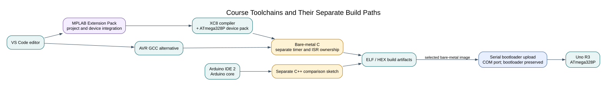

# Installing VS Code, MPLAB and XC8



## Understand the Pieces

VS Code edits source. Microchip's MPLAB extensions provide project and device
integration. XC8 compiles the AVR C program; its ATmega device pack supplies device
descriptions. A programmer or the Uno's serial bootloader transfers the resulting
image. Installing an editor extension alone does not complete all four jobs.

This lesson prepares a Windows workstation and checks a build without changing
the board. You need an Uno R3 for later upload lessons, but compilation can be
verified before connecting it. Atmel Studio is not required for this course.

## Install and Inspect

1. Obtain VS Code from Microsoft's official download page. On Windows the User
   setup is suitable for a normal personal account. Finish installation and reopen
   the terminal so any PATH changes take effect. Microsoft's
   [Windows installation guide](https://code.visualstudio.com/docs/setup/windows)
   covers the installer choices.
2. In VS Code, open **Extensions**, search for **MPLAB Extension Pack**, and
   confirm the publisher is **Microchip**. Install the pack, let its included
   extensions finish, then reload VS Code if requested. The course recommends
   this extension in `.vscode/extensions.json`.
3. Download and install **MPLAB XC8** from Microchip. XC8's current AVR compiler
   support uses the ATmega device-pack files, so install the Microchip AVR device
   pack that lists the **ATmega328P**. Do not substitute the ATmega328PB pack or a
   PIC device pack. Prefer the installer's standard Microchip location; the VS
   Code extension scans standard locations for XC toolchains. If XC8 was installed
   while VS Code was open, use the command palette's **MPLAB: Add Toolchain** and
   select **Auto (scan)**. Then run **MPLAB: List Toolchains** and confirm the XC8
   executable appears. These command names and scan behaviour are described in
   Microchip's [toolchain setup guide](https://developerhelp.microchip.com/xwiki/bin/view/software-tools/ides/extensions/mplabx-to-vscode/setup/).
4. Install Python 3 if it is not already available. Open a new PowerShell window
   and check `python --version`; the course build scripts use Python's standard
   library and do not need pip packages. If the `python` command is not found,
   finish the Python installer setup and open a new terminal before continuing.
5. Open the course repository root in VS Code. Press **Ctrl+Shift+B** and select
   the default **Uno: build with XC8** task, then enter `01-blink-register` when
   prompted. The `.vscode/tasks.json` file also offers AVR GCC and CMake builds.
   The course task is the reproducible path used for these sources; a wizard-made
   native MPLAB project is not required and is not yet checked in for every lab.

The reference PC has MPLAB Extension Pack 1.2.9, XC8 4.00 and ATmega DFP 3.6.299.
Course builds with XC8 and AVR GCC have both been verified. The installed versions
are a tested snapshot; Microchip and VS Code may publish newer versions. Keep the
compiler and device pack compatible, and repeat the Blink build after updating.

## Reference Installation

These versions were observed on the authoring PC, not inferred from download-page
labels. Record your own versions if you use newer compatible tools.

| Component | Recorded version |
| --- | --- |
| MPLAB extension pack | 1.2.9 |
| XC8 | 4.00 |
| Microchip ATmega DFP | 3.6.299 |
| Arduino IDE | 2.3.10 |
| Arduino AVR Boards | 1.8.8 |
| Python | 3.14.6 |

Tool paths differ by computer. The course builder discovers common Windows
installations and supports explicit environment overrides. `XC8_CC` names `xc8-cc.exe`;
`AVR_DFP` names the pack's `xc8` directory, which contains an `avr` subdirectory.
Do not set it to the pack's parent directory or to an unrelated PIC device pack.

## Prove the Compiler Works

Install Python 3 if it is absent, open a new terminal at the course root and run:

```powershell
python --version
python "atmega328p-labs/tools/build.py" 01-blink-register --compiler xc8
```

Expected result: a PASS line with Flash/static-RAM counts, plus ELF, HEX, map and
JSON files under `atmega328p-labs/build/xc8/01-blink-register/`. The output does not
mean Blink was uploaded. Inspect the recorded command: the device must be
ATmega328P and the frequency definition must be `16000000UL`.

For the second compiler, Arduino AVR Boards supplies AVR GCC. The build task can
discover that installation, or you can set `AVR_GCC` to another supported AVR GCC
executable. Run the task **Uno: build with AVR GCC** and compare diagnostics.

## Arduino Comparison Environment

Install Arduino IDE 2 from the [official installation instructions](https://docs.arduino.cc/software/ide-v2/tutorials/getting-started/ide-v2-downloading-and-installing/).
In Boards Manager install Arduino AVR Boards and select **Arduino Uno**. Board
selection controls compilation; port selection identifies a connected device.
Keep Arduino sketches in their separate comparison directories, because Arduino
core initialization and ISR ownership differ from bare-metal applications.

## Troubleshooting and Checkpoint

“Compiler not found” means discovery failed: inspect the installed location and
set the relevant override for this terminal. A device-pack error usually means
the directory level or family is wrong. A missing `avr/io.h` can indicate the
host compiler was selected. Read the first diagnostic before reinstalling tools.

Why can a build succeed without a COM port? **Answer:** compilation works on files
on the PC. A port becomes relevant when a programmer communicates with the board.
Why is `F_CPU` not a clock-setting command? **Answer:** it informs compiled timing
calculations; it does not change clock hardware or fuses.

Validation: the listed tools and command-line builds were checked on the authoring
PC. Fresh-machine installation and native MPLAB project walkthroughs remain
pending. Authoring tools such as Node, KiCad and Doxygen are not required to compile
the first example.

## Code Walkthrough


**Example code on GitHub:**
- [Register-level Blink (`01-blink-register`)](https://github.com/arnabdasbwn/atmega328p-labs/blob/main/examples/01-blink-register/main.c)

### Register-level Blink
The example's `main()` configures its peripherals, runs the algorithm and reports or displays the result. These source operations are listed in execution order:

- `PORTB &= (uint8_t)~_BV(PORTB5);` - Sets or clears the Port B output latch. When the pin is an output, this determines its output level; on an input, it controls the pull-up.
- `DDRB |= _BV(DDB5);` - Sets the Port B direction bits; a set bit selects output mode.
- `for (;;)` - Repeats the foreground task indefinitely; each pass checks inputs, advances the calculation or services the peripheral shown below.
- `PINB = _BV(PINB5);` - Writing a one to a PINB bit toggles that pin's PORTB output latch on the ATmega328P.
- `_delay_ms(500);` - Waits for the stated interval; the foreground does no other work during this blocking delay.

Algorithm: Pin direction and output latch are separate hardware state.
Expected behaviour: L toggles every 500 ms
**HAL source files in this repository:** [ATmega328P HAL on GitHub](https://github.com/arnabdasbwn/atmega328p-hal)


## References

- [Microchip MPLAB extension workflow](https://developerhelp.microchip.com/xwiki/bin/view/software-tools/ides/extensions/workflow/)
- [Microchip XC8 installation](https://developerhelp.microchip.com/xwiki/bin/view/software-tools/compilers/xc8/install/)
- [Microchip XC8 device-pack setup for VS Code](https://developerhelp.microchip.com/xwiki/bin/view/software-tools/ides/extensions/mplabx-to-vscode/setup/)
- [MPLAB extension getting started](https://developerhelp.microchip.com/xwiki/bin/view/software-tools/ides/extensions/get-started/)
- [MPLAB VS Code project migration and setup](https://developerhelp.microchip.com/xwiki/bin/view/software-tools/ides/extensions/mplabx-to-vscode/setup/)
- [VS Code on Windows](https://code.visualstudio.com/docs/setup/windows)
- [Arduino IDE 2 installation](https://docs.arduino.cc/software/ide-v2/tutorials/getting-started/ide-v2-downloading-and-installing/)
