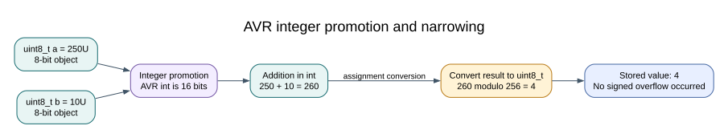

# Integer Widths and Promotions

## The Target Matters

For the course AVR compiler configuration, `char` is one byte, `int` is 16 bits
and `long` is 32 bits. A desktop compiler often uses a 32-bit `int`. A calculation
that appears correct in a PC test can overflow on the Uno before assignment to a
larger destination. Use `uint8_t`, `uint16_t` and `uint32_t` for known-width data;
still reason about the types of intermediate expressions.

The objective is to explain conversions, choose a sufficiently wide intermediate,
and identify when wraparound is deliberate. You need [bit masks](binary.md) and
basic C arithmetic. This is a paper/source-inspection lesson; no circuit is needed.

## Widen Before Multiplying

A ten-bit ADC sample can reach 1023. With a 5000 mV reference, the intermediate
`1023 * 5000` is **5,115,000**, far beyond 16-bit signed or unsigned range.
Assigning that already-overflowed result to a `uint32_t` does not repair it.

The HAL's conversion first widens the sample and multiplies using a 32-bit value.
Read [adc.c](https://github.com/arnabdasbwn/atmega328p-hal/blob/main/src/adc.c) and its
[contract](https://github.com/arnabdasbwn/atmega328p-hal/blob/main/include/avr_hal/adc.h). The scale uses 1024 ADC bins;
half a bin is added before integer division to round to the nearest millivolt.
With sample 512 and 5000 mV reference, the calculation yields **2500 mV**.
For sample 1023 it yields approximately 4995 mV; the largest code does not denote
an ideal exact endpoint equal to the reference.

For positive values, integer division discards the fractional remainder. If a
sensor reports 237 tenths of a degree, printing 23 does not mean the measurement
was exactly 23 degrees; retain the remainder to show `.7`.

## Small Operands Are Promoted

Eight-bit operands usually undergo integer promotion before arithmetic. On this
target, every `uint8_t` value fits in signed `int`, so `a + b` for two `uint8_t`
objects is computed as `int`. Their maximum sum is 510 and fits. Assigning that sum
back to `uint8_t` narrows it modulo 256. For example, 250 + 10 becomes 4 after that
conversion. Check the range before narrowing when wrapping is not intended.

Unsigned 16-bit addition wraps modulo 65536. Signed overflow is undefined C
behavior; do not use it as a rollover mechanism. Comparisons between signed and
unsigned values can also convert a negative value into a large positive value.
Validate a signed input before converting it to an unsigned count.

## Shifts and Complements

The literal `1` has type `int`. On the AVR, `1 << 15` attempts to produce a value
outside positive signed 16-bit range. Use an unsigned, sufficiently wide operand
and prove the shift count. For a 32-bit mask, `UINT32_C(1) << bit` requires
`bit < 32`. No cast after an invalid shift makes the shift valid.

Complementing an eight-bit mask does not necessarily produce an eight-bit result:
integer promotions happen first. An explicit narrowing cast can state that only
the low eight bits belong in an eight-bit register. A cast documents a justified
conversion; it is not a general way to silence warnings.

## Exercises with Answers

1. Can `uint16_t samples[100]` fit in 100 bytes? **Answer:** no, it uses 200 bytes
   before considering any surrounding object or stack overhead.
2. A period is 50 ms and a tick is 0.5 us. How many ticks? **Answer:** 100000,
   which exceeds a 16-bit timer's count range. Choose another divider or mode.
3. Why widen the ADC sample before multiplication? **Answer:** the multiply is
   evaluated using its operands' types, independently of the destination type.

## Verify Your Reasoning

Build `90-selftest` and run the parent `npm run test:firmware` command. It checks
selected conversion and boundary cases on an AVR instruction model. This is
stronger evidence for target integer behavior than running only a host executable,
but it does not prove all possible inputs correct. `-Wconversion` is enabled in
both compiler profiles to help expose unintended narrowing.

For current device details, use the [Microchip ATmega328P documentation](https://www.microchip.com/en-us/product/ATMEGA328P). Check the document listed for your exact device and package; board-level pin labels and circuitry are covered by the [Uno R3 pinout](https://www.arnabkumardas.com/pinout/arduino-uno-r3/).

## Code Walkthrough

**Example code on GitHub:**
- [Measure an analog voltage (`15-adc-voltage`)](https://github.com/arnabdasbwn/atmega328p-labs/blob/main/examples/15-adc-voltage/main.c)
- [HAL Software Self-Test (`90-selftest`)](https://github.com/arnabdasbwn/atmega328p-labs/blob/main/examples/90-selftest/main.c)

### Measure an analog voltage
The example's `main()` configures its peripherals, runs the algorithm and reports or displays the result. These source operations are listed in execution order:

- `(void)avr_uart_init(9600UL);` - Configures USART0 for asynchronous 8N1. It chooses a baud divisor and normal/double-speed mode, programs UBRR0/UCSR0A/UCSR0C, then enables receive and transmit in UCSR0B.
- `(void)avr_adc_init(AVR_ADC_AVCC);` - Selects the reference in ADMUX and enables the ADC in ADCSRA with a divide-by-128 prescaler. At 16 MHz, the ADC clock is 125 kHz. The HAL keeps the result right-adjusted, waits for reference settling and leaves ADC interrupts disabled.
- `for (;;)` - Repeats the foreground task indefinitely; each pass checks inputs, advances the calculation or services the peripheral shown below.
- `if (avr_adc_read(0U, &sample, AVR_POLL_BUDGET) == AVR_OK)` - The body runs only when the conversion succeeds and its code is between 1 and 1022. The HAL selects the channel in ADMUX, disables the digital buffer through DIDR0, discards the first conversion after a channel change, and polls with a finite budget.
- `(void)avr_uart_u16(avr_adc_millivolts(sample, 5000U));` - Formats an unsigned integer as decimal digits and sends them on USART0; it does not add a newline. Scales the ADC code with a 32-bit intermediate and the supplied reference voltage. This ideal calculation does not calibrate the reference.
- `(void)avr_uart_put('\n', AVR_POLL_BUDGET);` - Waits for the USART transmit buffer within its poll budget, then writes the byte to UDR0.
- `_delay_ms(100);` - Waits for the stated interval; the foreground does no other work during this blocking delay.

Algorithm: With a nominal 5000 mV reference, one step is 5000/1024=4.8828125 mV. Measure AVCC for accurate scaling; USB supply is not a precision reference.
Expected behaviour: Terminal reports approximately 0..4995 mV as the wiper moves
**HAL source files in this repository:** [ATmega328P HAL on GitHub](https://github.com/arnabdasbwn/atmega328p-hal)

- [`include/avr_hal/adc.h`](https://github.com/arnabdasbwn/atmega328p-hal/blob/main/include/avr_hal/adc.h)
- [`include/avr_hal/uart.h`](https://github.com/arnabdasbwn/atmega328p-hal/blob/main/include/avr_hal/uart.h)
- [`src/adc.c`](https://github.com/arnabdasbwn/atmega328p-hal/blob/main/src/adc.c)
- [`src/uart.c`](https://github.com/arnabdasbwn/atmega328p-hal/blob/main/src/uart.c)

### HAL Software Self-Test
The example's `main()` configures its peripherals, runs the algorithm and reports or displays the result. These source operations are listed in execution order:

- `avr_debounce_t button;` - Use the linked public header for this function's parameters, register ownership, blocking behavior and status values.
- `uint8_t result = 0U;` - Clears the state/counter after its threshold is reached so the next interval starts from zero.
- `(void)avr_uart_init(9600UL);` - Configures USART0 for asynchronous 8N1. It chooses a baud divisor and normal/double-speed mode, programs UBRR0/UCSR0A/UCSR0C, then enables receive and transmit in UCSR0B.
- `CHECK(avr_gpio_mode(20U, AVR_GPIO_OUTPUT) == AVR_ERROR_ARGUMENT);` - Maps the Uno header pin to its AVR port, sets its DDR direction bit and prepares the PORT latch for the requested initial level or pull-up.
- `CHECK(avr_gpio_read(13U, NULL) == AVR_ERROR_ARGUMENT);` - Reads the electrical level through PINx without changing direction or the output latch.
- `CHECK(avr_timer_ctc(AVR_TIMER0, 32U, 100U) == AVR_ERROR_ARGUMENT);` - Configures 0 in CTC mode with prescaler 32 and OCRnA TOP 100; event rate is 16 MHz / (32 x (100 + 1)) = 4950.5 Hz. The HAL disables this timer's interrupt sources and leaves flag polling to the caller.
- `CHECK(avr_timer_ctc(AVR_TIMER0, 64U, 256U) == AVR_ERROR_ARGUMENT);` - Configures 0 in CTC mode with prescaler 64 and OCRnA TOP 256; event rate is 16 MHz / (64 x (256 + 1)) = 972.763 Hz. The HAL disables this timer's interrupt sources and leaves flag polling to the caller.
- `CHECK(avr_timer_ctc(AVR_TIMER2, 128U, 124U) == AVR_OK);` - Configures 2 in CTC mode with prescaler 128 and OCRnA TOP 124; event rate is 16 MHz / (128 x (124 + 1)) = 1000 Hz. The HAL disables this timer's interrupt sources and leaves flag polling to the caller.
- `CHECK((TCCR2B & 7U) == 5U);` - Selects Timer2 clock/prescaler and remaining waveform bits. Timer2 has distinct prescaler encodings.
- `CHECK(avr_timer1_pwm(8U, 40000U, 3000U) == AVR_OK);` - Configures Timer1 mode 14 with prescaler 8; ICR1 becomes 39999, giving a 20 ms frame, and OCR1A starts at 3000 ticks (1500 us high).
- `CHECK(ICR1 == 39999U && OCR1A == 3000U);` - Timer1 input-capture register and, in the selected PWM mode, the TOP value. Timer1 Compare A; it sets the match point or PWM pulse width.
- `CHECK(avr_adc_millivolts(512U, 5000U) == 2500U);` - Calls `avr_adc_millivolts()`; its public HAL header defines the arguments, register ownership, blocking behavior and status results.
- `CHECK(avr_adc_read(6U, NULL, 0U) == AVR_ERROR_ARGUMENT);` - Calls `avr_adc_read()`; its public HAL header defines the arguments, register ownership, blocking behavior and status results.
- `CHECK(avr_eeprom_read(1024U, &result, 0UL) == AVR_ERROR_ARGUMENT);` - Calls `avr_eeprom_read()`; its public HAL header defines the arguments, register ownership, blocking behavior and status results.
- `CHECK(avr_twi_transfer(0U, NULL, 0U, NULL, 0U, 0UL) == AVR_ERROR_ARGUMENT);` - Calls `avr_twi_transfer()`; its public HAL header defines the arguments, register ownership, blocking behavior and status results.
- `CHECK(avr_elapsed(5UL, UINT32_MAX - 4UL, 10UL));` - Calls `avr_elapsed()`; its public HAL header defines the arguments, register ownership, blocking behavior and status results.
- `CHECK(!avr_elapsed(5UL, UINT32_MAX - 4UL, 11UL));` - Calls `avr_elapsed()`; its public HAL header defines the arguments, register ownership, blocking behavior and status results.
- `avr_debounce_init(&button, true, UINT32_MAX - 10UL);` - Calls `avr_debounce_init()`; its public HAL header defines the arguments, register ownership, blocking behavior and status results.
- `CHECK(!avr_debounce_update(&button, false, UINT32_MAX - 9UL, 20U));` - Calls `avr_debounce_update()`; its public HAL header defines the arguments, register ownership, blocking behavior and status results.
- `CHECK(!avr_debounce_update(&button, false, 9UL, 20U));` - Calls `avr_debounce_update()`; its public HAL header defines the arguments, register ownership, blocking behavior and status results.
- `CHECK(avr_debounce_update(&button, false, 10UL, 20U));` - Accepts a changed input only after it remains stable for the requested interval, then reports that accepted change once.
- `CHECK(!avr_debounce_update(&button, false, 11UL, 20U));` - Accepts a changed input only after it remains stable for the requested interval, then reports that accepted change once.
- `(void)avr_uart_write((const uint8_t *)"PASS\n", 5U, AVR_POLL_BUDGET);` - Sends the specified bytes through USART0; a timeout can occur after a prefix has already been sent.
- `for (;;)` - Repeats the foreground task indefinitely; each pass checks inputs, advances the calculation or services the peripheral shown below.

Algorithm: A bounded self-test checks software contracts and links a second source file so header-owned definitions are detected.
Expected behaviour: The fixture prints PASS after argument, timer-range, debounce and independent-translation-unit checks; otherwise it prints FAIL and stops
**HAL source files in this repository:** [ATmega328P HAL on GitHub](https://github.com/arnabdasbwn/atmega328p-hal)

- [`include/avr_hal/adc.h`](https://github.com/arnabdasbwn/atmega328p-hal/blob/main/include/avr_hal/adc.h)
- [`include/avr_hal/common.h`](https://github.com/arnabdasbwn/atmega328p-hal/blob/main/include/avr_hal/common.h)
- [`include/avr_hal/eeprom.h`](https://github.com/arnabdasbwn/atmega328p-hal/blob/main/include/avr_hal/eeprom.h)
- [`include/avr_hal/gpio.h`](https://github.com/arnabdasbwn/atmega328p-hal/blob/main/include/avr_hal/gpio.h)
- [`include/avr_hal/timer.h`](https://github.com/arnabdasbwn/atmega328p-hal/blob/main/include/avr_hal/timer.h)
- [`include/avr_hal/twi.h`](https://github.com/arnabdasbwn/atmega328p-hal/blob/main/include/avr_hal/twi.h)
- [`include/avr_hal/uart.h`](https://github.com/arnabdasbwn/atmega328p-hal/blob/main/include/avr_hal/uart.h)
- [`lib/drivers/debounce.c`](https://github.com/arnabdasbwn/atmega328p-hal/blob/main/lib/drivers/debounce.c)
- [`lib/drivers/debounce.h`](https://github.com/arnabdasbwn/atmega328p-hal/blob/main/lib/drivers/debounce.h)
- [`src/adc.c`](https://github.com/arnabdasbwn/atmega328p-hal/blob/main/src/adc.c)
- [`src/common.c`](https://github.com/arnabdasbwn/atmega328p-hal/blob/main/src/common.c)
- [`src/eeprom.c`](https://github.com/arnabdasbwn/atmega328p-hal/blob/main/src/eeprom.c)
- [`src/gpio.c`](https://github.com/arnabdasbwn/atmega328p-hal/blob/main/src/gpio.c)
- [`src/timer.c`](https://github.com/arnabdasbwn/atmega328p-hal/blob/main/src/timer.c)
- [`src/twi.c`](https://github.com/arnabdasbwn/atmega328p-hal/blob/main/src/twi.c)
- [`src/uart.c`](https://github.com/arnabdasbwn/atmega328p-hal/blob/main/src/uart.c)
