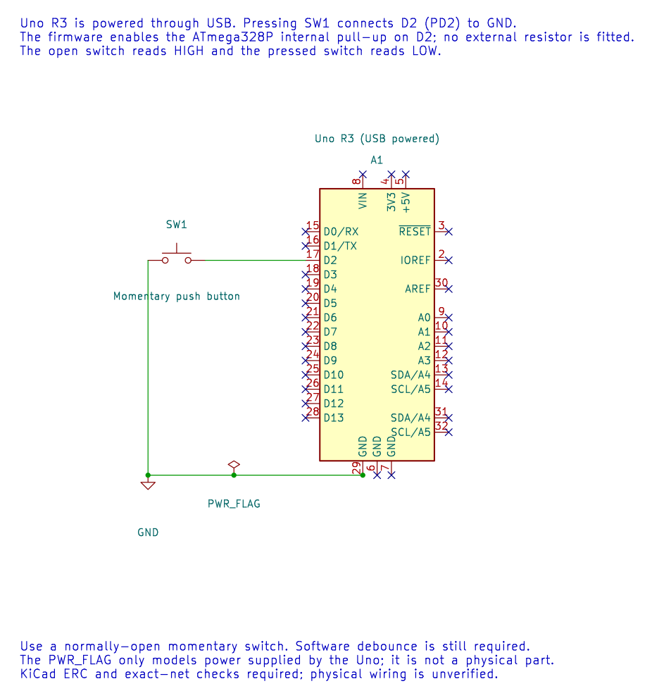

# External and Internal Interrupts

## Objectives and Prerequisites

After this lesson, you should be able to distinguish polling from interrupts, name the Uno's two external interrupt pins, configure a basic INT0 falling-edge event and explain why an ISR should do very little. Read the lessons on [AVR architecture](avr-architecture.md), [clocking](clock.md) and [volatile and atomic access](volatile-atomic.md) first.

## Polling or Interrupt?

With **polling**, foreground code repeatedly checks a flag or input. Polling is easy to follow when the check interval is short and predictable. It can waste time if the program must wait for a rare event.

With an **interrupt**, a peripheral raises a request when an event occurs. The CPU finishes the current instruction, saves the return location and jumps to a handler associated with that interrupt vector. When the handler returns, foreground code resumes. Interrupts help respond to events without repeatedly checking for them, but add shared-state and timing responsibilities.

The timer, ADC, USART, SPI, TWI and external pins can all generate interrupts on the ATmega328P. Each enabled source has a vector and associated configuration. Use only the sources needed by the design and document who owns each vector.

## External Interrupt Pins and Registers

On the Uno R3, **INT0 is D2** and **INT1 is D3**. The external interrupt control register `EICRA` selects low-level, any logical change, falling-edge or rising-edge triggering for these two lines. `EIMSK` enables the selected interrupt, and `EIFR` contains interrupt flags. The port-change interrupt groups cover additional pins through `PCICR`, `PCMSK0..2` and `PCIFR`.

For the example, connect a normally-open button between D2 and GND. The internal pull-up holds D2 high while the button is released; pressing it makes a falling edge. The same circuit appears in the [button wiring lesson](button.md):



For a falling-edge INT0 event, the relevant setup is conceptually:

1. Configure D2 as an input and provide a defined idle level, such as the internal pull-up.
2. Select falling-edge sensing in `EICRA`.
3. Clear a stale `INTF0` flag by writing a one to its bit in `EIFR`.
4. Enable INT0 in `EIMSK`.
5. Enable global interrupts only after shared state and peripherals are ready.

The flag is **write one to clear**. Do not clear it with a read-modify-write expression that might write ones to other pending flags. Use the device header's bit masks and the register access rules from the datasheet.

## Worked Example: Count Button Edges

The [INT0 event-counter example](<https://github.com/arnabdasbwn/atmega328p-labs/blob/main/examples/37-external-interrupt/main.c>) connects a button from D2 to ground and enables the internal pull-up. Pressing the button creates a falling edge. The ISR increments a saturating 8-bit event count; foreground code copies and clears that count inside an atomic block, then prints it over UART.

The ISR does not print or wait. UART transmission can take many bit periods, so doing it inside the handler could delay other work and make interrupt latency unpredictable. The example also does not debounce the switch: one physical press can produce several electrical edges as the contacts settle. Use a timed state machine for button debounce.

Build it from the course root with either compiler:

```powershell
python "atmega328p-labs/tools/build.py" 37-external-interrupt --compiler xc8
python "atmega328p-labs/tools/build.py" 37-external-interrupt --compiler gcc
```

The example also needs a USB-to-serial connection at 9600 baud to display the event count after upload. Build success does not confirm the physical interrupt pin or button wiring.

## Internal Interrupt Sources

An internal peripheral can request an interrupt too. A timer can signal a compare match, the ADC can signal conversion completion, and the USART can signal received data. Configure the peripheral first, clear any pending flags according to its datasheet rules, enable its local interrupt, then enable global interrupts after the program is ready.

Keep interrupt handlers short, bounded and nonblocking. Capture a byte, update a counter or set a flag, then return. Process the larger task in foreground code. A multi-byte value shared between an ISR and foreground code may need an atomic snapshot because the 8-bit CPU cannot read all of it in one instruction.

## Troubleshooting and Exercise

If an interrupt never runs, check the pin mapping, input level, edge selection, local enable, global interrupt state and flag-clearing sequence. If it runs too often, inspect the signal for bounce or noise and confirm the selected trigger mode.

Why can the button example report more than one event for a single press?

**Answer:** Mechanical contacts can bounce and create several falling edges. The interrupt reports electrical edges, not a human intention. Debounce the input in a separate timed state machine.

## Code Walkthrough


**Example code on GitHub:**
- [Interrupt tick and cooperative tasks (`10-scheduler`)](https://github.com/arnabdasbwn/atmega328p-labs/blob/main/examples/10-scheduler/main.c)
- [ADC conversion-complete event (`39-adc-interrupt`)](https://github.com/arnabdasbwn/atmega328p-labs/blob/main/examples/39-adc-interrupt/main.c)

### INT0 event counter
The example's `main()` configures its peripherals, runs the algorithm and reports or displays the result. These source operations are listed in execution order:

- `(void)avr_gpio_mode(2U, AVR_GPIO_INPUT_PULLUP);` - Maps the Uno header pin to its AVR port, sets its DDR direction bit and prepares the PORT latch for the requested initial level or pull-up.
- `(void)avr_uart_init(9600UL);` - Configures USART0 for asynchronous 8N1. It chooses a baud divisor and normal/double-speed mode, programs UBRR0/UCSR0A/UCSR0C, then enables receive and transmit in UCSR0B.
- `EICRA = _BV(ISC01);` - Selects INT0/INT1 trigger behavior; ISC01:ISC00 encode the INT0 edge or level mode.
- `EIFR = _BV(INTF0);` - Contains external-interrupt pending flags; these are write-one-to-clear.
- `EIMSK = _BV(INT0);` - Enables the selected external-interrupt sources.
- `sei();` - Enables global interrupts after the example has configured its sources and shared state.
- `for (;;)` - Repeats the foreground task indefinitely; each pass checks inputs, advances the calculation or services the peripheral shown below.
- `count = events;` - Stores this intermediate or output value for the next algorithm step. Check the units and range represented by each operand.
- `events = 0U;` - Clears the state/counter after its threshold is reached so the next interval starts from zero.
- `if (count != 0U)` - Tests the stated condition; the following block handles the matching case and the other path is skipped.
- `(void)avr_uart_u16(count);` - Formats an unsigned integer as decimal digits and sends them on USART0; it does not add a newline.
- `(void)avr_uart_put('\n', AVR_POLL_BUDGET);` - Waits for the USART transmit buffer within its poll budget, then writes the byte to UDR0.

Algorithm: The ISR counts edges rather than debouncing. Moving printing to foreground bounds interrupt time.
Expected behaviour: Serial reports falling-edge events; a mechanical press can produce several
**HAL source files in this repository:** [ATmega328P HAL on GitHub](https://github.com/arnabdasbwn/atmega328p-hal)

- [`include/avr_hal/gpio.h`](https://github.com/arnabdasbwn/atmega328p-hal/blob/main/include/avr_hal/gpio.h)
- [`include/avr_hal/uart.h`](https://github.com/arnabdasbwn/atmega328p-hal/blob/main/include/avr_hal/uart.h)
- [`src/gpio.c`](https://github.com/arnabdasbwn/atmega328p-hal/blob/main/src/gpio.c)
- [`src/uart.c`](https://github.com/arnabdasbwn/atmega328p-hal/blob/main/src/uart.c)


### Interrupt tick and cooperative tasks
The example's `main()` configures its peripherals, runs the algorithm and reports or displays the result. These source operations are listed in execution order:

- `uint32_t led_start = 0UL, report_start = 0UL;` - Clears the state/counter after its threshold is reached so the next interval starts from zero.
- `(void)avr_gpio_mode(13U, AVR_GPIO_OUTPUT);` - Maps the Uno header pin to its AVR port, sets its DDR direction bit and prepares the PORT latch for the requested initial level or pull-up.
- `(void)avr_uart_init(9600UL);` - Configures USART0 for asynchronous 8N1. It chooses a baud divisor and normal/double-speed mode, programs UBRR0/UCSR0A/UCSR0C, then enables receive and transmit in UCSR0B.
- `avr_tick_init();` - Configures the course millisecond tick interrupt source; it does not enable global interrupts itself.
- `sei();` - Enables global interrupts after the example has configured its sources and shared state.
- `for (;;)` - Repeats the foreground task indefinitely; each pass checks inputs, advances the calculation or services the peripheral shown below.
- `uint32_t now = avr_tick_ms();` - Use the linked public header for this function's parameters, register ownership, blocking behavior and status values.
- `if (avr_elapsed(now, led_start, 500UL))` - This branch runs only after the requested interval has elapsed. Uses unsigned subtraction to test elapsed time safely across a 32-bit tick wraparound.
- `led_start = now;` - Stores this intermediate or output value for the next algorithm step. Check the units and range represented by each operand.
- `(void)avr_gpio_toggle(13U);` - Atomically toggles the selected pin output latch.
- `if (avr_elapsed(now, report_start, 1000UL))` - This branch runs only after the requested interval has elapsed. Uses unsigned subtraction to test elapsed time safely across a 32-bit tick wraparound.
- `report_start = now;` - Stores this intermediate or output value for the next algorithm step. Check the units and range represented by each operand.
- `(void)avr_uart_u16((uint16_t)(now / 1000UL));` - Formats an unsigned integer as decimal digits and sends them on USART0; it does not add a newline.
- `(void)avr_uart_put('\n', AVR_POLL_BUDGET);` - Waits for the USART transmit buffer within its poll budget, then writes the byte to UDR0.

Algorithm: The ISR increments a tick; foreground code snapshots it atomically. Unsigned subtraction remains valid across wraparound for the documented interval range.
Expected behaviour: LED toggles twice per second while elapsed seconds print independently
**HAL source files in this repository:** [ATmega328P HAL on GitHub](https://github.com/arnabdasbwn/atmega328p-hal)

- [`include/avr_hal/gpio.h`](https://github.com/arnabdasbwn/atmega328p-hal/blob/main/include/avr_hal/gpio.h)
- [`include/avr_hal/tick.h`](https://github.com/arnabdasbwn/atmega328p-hal/blob/main/include/avr_hal/tick.h)
- [`include/avr_hal/uart.h`](https://github.com/arnabdasbwn/atmega328p-hal/blob/main/include/avr_hal/uart.h)
- [`lib/interrupts/tick.c`](https://github.com/arnabdasbwn/atmega328p-hal/blob/main/lib/interrupts/tick.c)
- [`src/gpio.c`](https://github.com/arnabdasbwn/atmega328p-hal/blob/main/src/gpio.c)
- [`src/uart.c`](https://github.com/arnabdasbwn/atmega328p-hal/blob/main/src/uart.c)


### ADC conversion-complete event
The example's `main()` configures its peripherals, runs the algorithm and reports or displays the result. These source operations are listed in execution order:

- `(void)avr_uart_init(9600UL);` - Configures USART0 for asynchronous 8N1. It chooses a baud divisor and normal/double-speed mode, programs UBRR0/UCSR0A/UCSR0C, then enables receive and transmit in UCSR0B.
- `(void)avr_adc_init(AVR_ADC_AVCC);` - Selects the reference in ADMUX and enables the ADC in ADCSRA with a divide-by-128 prescaler. At 16 MHz, the ADC clock is 125 kHz. The HAL keeps the result right-adjusted, waits for reference settling and leaves ADC interrupts disabled.
- `ADMUX = (uint8_t)(ADMUX & 0xF0U);` - Clears the ADMUX channel-selection nibble to choose ADC0 while preserving REFS1:0 reference settings.
- `ADCSRA |= _BV(ADIF);` - Writes one to ADIF to clear a pending ADC completion flag; ADIF is write-one-to-clear.
- `ADCSRA |= _BV(ADIE);` - Sets ADIE so ADC conversion completion requests the configured ADC interrupt.
- `sei();` - Enables global interrupts after the example has configured its sources and shared state.
- `for (;;)` - Repeats the foreground task indefinitely; each pass checks inputs, advances the calculation or services the peripheral shown below.
- `ADCSRA = (uint8_t)((ADCSRA & (uint8_t)~_BV(ADIF)) | _BV(ADSC));` - Controls ADC enable, prescaling, conversion start and optional interrupt. ADSC starts a conversion; ADIF is write-one-to-clear.
- `uint32_t budget = AVR_POLL_BUDGET;` - Stores this intermediate or output value for the next algorithm step. Check the units and range represented by each operand.
- `while (ready == 0U && budget > 0UL)` - Waits for this condition to change; inspect the nearby counter or budget to see the bound on blocking.
- `--budget;` - This statement advances the operation sequence; follow its expression to see the state change.
- `uint16_t sample = 0U;` - Clears the state/counter after its threshold is reached so the next interval starts from zero.
- `bool available = false;` - Stores this intermediate or output value for the next algorithm step. Check the units and range represented by each operand.
- `if (ready != 0U)` - Tests the stated condition; the following block handles the matching case and the other path is skipped.
- `sample = latest;` - Stores this intermediate value for the next step of the algorithm; check the operands and units.
- `ready = 0U;` - Clears the state/counter after its threshold is reached so the next interval starts from zero.
- `available = true;` - Stores this intermediate or output value for the next algorithm step. Check the units and range represented by each operand.
- `if (available)` - Tests the stated condition; the following block handles the matching case and the other path is skipped.
- `(void)avr_uart_u16(sample);` - Formats an unsigned integer as decimal digits and sends them on USART0; it does not add a newline.
- `(void)avr_uart_put('\n', AVR_POLL_BUDGET);` - Waits for the USART transmit buffer within its poll budget, then writes the byte to UDR0.
- `_delay_ms(100);` - Waits for the stated interval; the foreground does no other work during this blocking delay.

Algorithm: The interrupt reports completion; it does not make the conversion faster. The two-byte sample and ready flag must be transferred consistently.
Expected behaviour: Conversion ISR saves a result; foreground prints it
**HAL source files in this repository:** [ATmega328P HAL on GitHub](https://github.com/arnabdasbwn/atmega328p-hal)

- [`include/avr_hal/adc.h`](https://github.com/arnabdasbwn/atmega328p-hal/blob/main/include/avr_hal/adc.h)
- [`include/avr_hal/uart.h`](https://github.com/arnabdasbwn/atmega328p-hal/blob/main/include/avr_hal/uart.h)
- [`src/adc.c`](https://github.com/arnabdasbwn/atmega328p-hal/blob/main/src/adc.c)
- [`src/uart.c`](https://github.com/arnabdasbwn/atmega328p-hal/blob/main/src/uart.c)


## References

- Microchip, [ATmega328P product page and datasheet](https://www.microchip.com/en-us/product/ATMEGA328P), sections covering external interrupts, I/O pins and interrupt response.
- [Uno R3 pinout](https://www.arnabkumardas.com/pinout/arduino-uno-r3/)
- [INT0 event-counter source](<https://github.com/arnabdasbwn/atmega328p-labs/blob/main/examples/37-external-interrupt/main.c>) and its [`lab.json`](<https://github.com/arnabdasbwn/atmega328p-labs/blob/main/examples/37-external-interrupt/lab.json>).
- [Volatile and atomic access](volatile-atomic.md)
