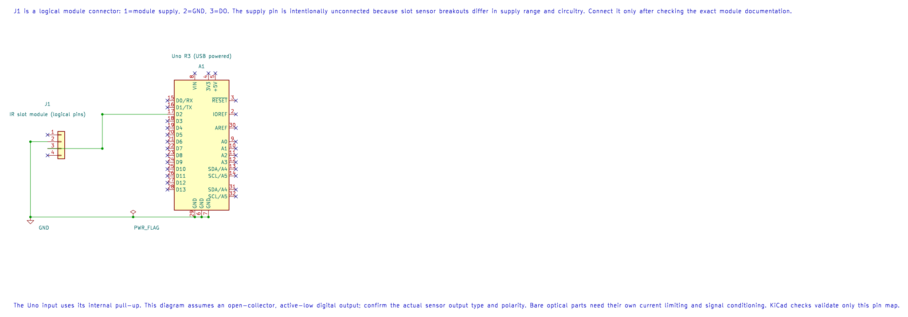

# IR Slot Interrupter

## What You Will Learn

A photo-interrupter places an infrared LED and a photodetector on opposite sides of a gap. A flag passing through the gap blocks the light. The detector output changes state, which lets the Uno detect an object or count wheel slots.

Bare sensors expose the LED and detector separately. Many breakout boards add a comparator and provide a digital output. Lab 34 assumes a conditioned or open-collector output that is active low; the bare optical components need their own current-limiting and signal-conditioning circuit.

## Wiring the Digital Output

Check whether the module output is open collector and whether the output is active high or active low. Lab 34 configures D2 as an input with the Uno's internal pull-up. A 10 kΩ external pull-up to 5 V may be used if the exact output circuit needs one; do not add it to a push-pull output without checking the board.



The editable schematic leaves module supply open because breakout requirements differ. Connect supply only after checking the exact module documentation.

| Interrupter module | Uno R3 | Purpose |
| --- | --- | --- |
| VCC | Module-rated supply | Powers the emitter/detector circuit |
| GND | GND | Shared reference |
| Digital OUT | D2 | Slot state; example uses internal pull-up |
| Uno onboard LED | D13 | Indicates the inverse of the D2 logic level |

For a bare IR LED, choose a series resistor from `R = (Vsupply − Vf) / If`. Use the LED datasheet's forward voltage and safe current; do not connect its emitter directly to a GPIO pin.

## What Lab 34 Demonstrates

The firmware reads D2 and turns the onboard LED on when the sensor line is low. Move a card or an opaque flag through a slot and note the state change. This lab does not count or debounce edges; it demonstrates the digital input level.

For a rotating slotted wheel, count transitions using an interrupt or timer capture. Keep the interrupt work short and account for the number of slots per revolution. Optical edges usually avoid mechanical contact bounce, but dirt, misalignment, ambient light and electrical noise can still create false transitions.

## Build and Try the Lab

```powershell
python atmega328p-labs/tools/build.py 34-digital-sensors --compiler gcc
python atmega328p-labs/tools/build.py 34-digital-sensors --compiler xc8
```

With the correct module wiring, move a card slowly through the slot and watch D13. If your output logic is inverted, record the actual high/low behavior rather than assuming it matches the example. No module was available for physical verification.

## Code Walkthrough

### IR Interrupter and Hall Switch
The example's `main()` configures its peripherals, runs the algorithm and reports or displays the result. These source operations are listed in execution order:

- `(void)avr_gpio_mode(2U, AVR_GPIO_INPUT_PULLUP);` - Maps the Uno header pin to its AVR port, sets its DDR direction bit and prepares the PORT latch for the requested initial level or pull-up.
- `(void)avr_gpio_mode(13U, AVR_GPIO_OUTPUT);` - Maps the Uno header pin to its AVR port, sets its DDR direction bit and prepares the PORT latch for the requested initial level or pull-up.
- `for (;;)` - Repeats the foreground task indefinitely; each pass checks inputs, advances the calculation or services the peripheral shown below.
- `if (avr_gpio_read(2U, &high) == AVR_OK)` - The operation runs only after this API reports AVR_OK. Reads the electrical level through PINx without changing direction or the output latch.
- `(void)avr_gpio_write(13U, !high);` - Changes the pin's PORT output latch; for an input pin this selects its pull-up state.

Algorithm: Open-collector outputs pull down but do not drive high. The pull-up creates the high level. Reflective and interrupter modules may invert their comparator output; test the actual module.
Expected behaviour: L indicates an active LOW sensor output
**HAL source files in this repository:** [ATmega328P HAL on GitHub](https://github.com/arnabdasbwn/atmega328p-hal)

- [`include/avr_hal/gpio.h`](https://github.com/arnabdasbwn/atmega328p-hal/blob/main/include/avr_hal/gpio.h)
- [`src/gpio.c`](https://github.com/arnabdasbwn/atmega328p-hal/blob/main/src/gpio.c)


## Common Problems

- **The LED stays on or off:** Check the module pinout, supply, output type and whether its output is active low.
- **The output floats:** A bare phototransistor or open-collector output may need a pull-up; check the module circuit.
- **The emitter does not glow visibly:** Infrared light is invisible to the eye. Check the circuit with a suitable camera or meter, not by looking into the emitter.
- **Wheel counts are inconsistent:** Align the slot, control ambient light and use an interrupt/capture method with a suitable maximum edge rate.

## Check Your Understanding

1. What physical event changes the detector output?
2. Why is a bare IR LED not connected directly to D2?
3. Does Lab 34 calculate wheel speed?

**Suggested answers:** The flag blocks the infrared light path. The LED needs a current-limiting resistor and is an output device, while D2 is an input. No; the lab only indicates the current logic state.

## Source and Further Reading

- [Lab 34 source](<https://github.com/arnabdasbwn/atmega328p-labs/blob/main/examples/34-digital-sensors/main.c>)
- Check the selected interrupter datasheet for pinout, emitter current, detector circuit and output polarity.
- [ATmega328P Documentation](https://www.microchip.com/en-us/product/ATMEGA328P), GPIO and interrupt sections.
