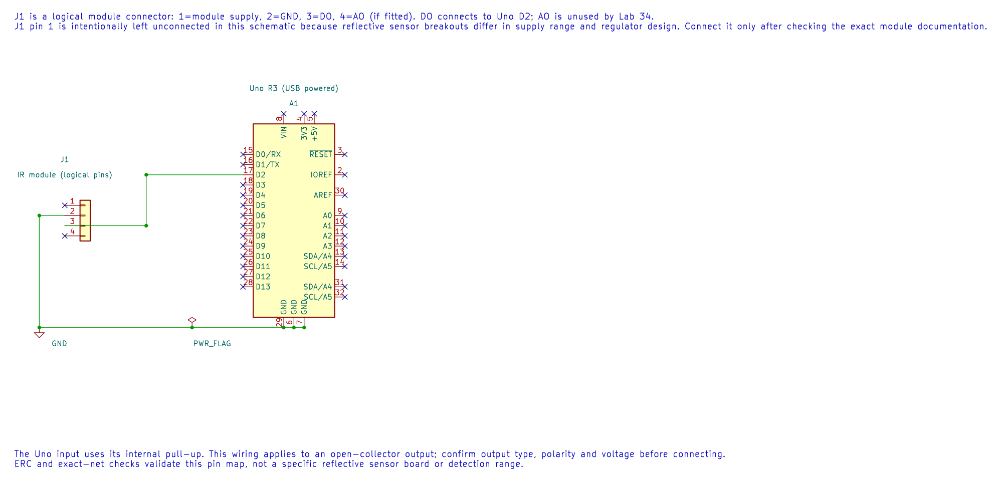

# Using an IR Reflective Sensor Module

## Objectives and Prerequisites

An infrared reflective module shines light from an IR emitter and measures light returned by a nearby surface. In this lesson, you will connect a module's digital output to the Uno and identify what affects its reading. Read [GPIO concepts](gpio-concepts.md) first, then check the exact module's documentation before applying power.

## Identify the Breakout

Modules sold as “IR obstacle sensor” or “TCRT5000 sensor” differ. Some provide an analogue output, some a comparator's digital output, and their output polarity and electrical drive can vary. Identify the board markings and schematic. Record the supply range, output type, active level and potentiometer function before wiring it.

| Module signal | Uno connection |
| --- | --- |
| VCC | A supply voltage allowed by the module documentation |
| GND | Uno GND; both circuits need a common reference |
| DO or digital output | D2 after checking its output voltage and type |
| AO, if present | An analogue input only when its voltage is within the ATmega328P ADC range |

The editable KiCad pin map leaves the module supply unconnected on purpose: breakout voltage requirements vary. Its ERC and exact-net checks verify the DO and ground connections, not an unidentified module.

Do not assume the module accepts 5 V or that its output is 5 V-safe. If it has an open-collector output, it needs a pull-up to a suitable voltage. If the board drives its output high, confirm that level is safe for the Uno input.

## What Changes the Reading?

The sensor detects reflected IR, not a universal “object present” state. Surface colour, angle, distance, ambient IR, module adjustment and sensor alignment affect the result. A black surface may return less IR than a light surface, but materials vary; tune and test the actual setup.

Many modules include a comparator threshold potentiometer and an indicator LED. Use the LED for a quick check, then read the digital output in firmware. Record a threshold and distance for your particular module instead of promising one detection range for all units.

## Build and Test

The maintained [digital sensor example](<https://github.com/arnabdasbwn/atmega328p-labs/blob/main/examples/34-digital-sensors/main.c>) reads an active-low digital input on D2 and reflects its state on the Uno LED at D13. It is written for an open-collector style output with a pull-up; verify that your module matches this interface before connecting it. Build with `python "atmega328p-labs/tools/build.py" 34-digital-sensors --compiler xc8`.

Test first with the module's output indicator, then check D2 with a meter or serial diagnostic. Change one condition at a time: target distance, angle, surface or threshold. The course has not physically validated a particular reflective module variant.

## Exercise with Answer

The module LED changes when a target moves, but the Uno input does not. Name two things to check.

**Answer:** Confirm the module's digital-output pin is wired to D2 and that grounds are connected. Then check whether its output is open-collector or push-pull, whether the pull-up is present, and whether its active polarity matches the firmware.

## Code Walkthrough

### IR Interrupter and Hall Switch
The example's `main()` configures its peripherals, runs the algorithm and reports or displays the result. These source operations are listed in execution order:

- `(void)avr_gpio_mode(2U, AVR_GPIO_INPUT_PULLUP);` - Maps the Uno header pin to its AVR port, sets its DDR direction bit and prepares the PORT latch for the requested initial level or pull-up.
- `(void)avr_gpio_mode(13U, AVR_GPIO_OUTPUT);` - Maps the Uno header pin to its AVR port, sets its DDR direction bit and prepares the PORT latch for the requested initial level or pull-up.
- `for (;;)` - Repeats the foreground task indefinitely; each pass checks inputs, advances the calculation or services the peripheral shown below.
- `if (avr_gpio_read(2U, &high) == AVR_OK)` - The operation runs only after this API reports AVR_OK. Reads the electrical level through PINx without changing direction or the output latch.
- `(void)avr_gpio_write(13U, !high);` - Changes the pin's PORT output latch; for an input pin this selects its pull-up state.

Algorithm: Open-collector outputs pull down but do not drive high. The pull-up creates the high level. Reflective and interrupter modules may invert their comparator output; test the actual module.
Expected behaviour: L indicates an active LOW sensor output
**HAL source files in this repository:** [ATmega328P HAL on GitHub](https://github.com/arnabdasbwn/atmega328p-hal)

- [`include/avr_hal/gpio.h`](https://github.com/arnabdasbwn/atmega328p-hal/blob/main/include/avr_hal/gpio.h)
- [`src/gpio.c`](https://github.com/arnabdasbwn/atmega328p-hal/blob/main/src/gpio.c)

## References

- [ATmega328P input and ADC documentation](https://www.microchip.com/en-us/product/ATMEGA328P)
- [Digital sensor lab source and wiring record](<https://github.com/arnabdasbwn/atmega328p-labs/blob/main/examples/34-digital-sensors/main.c>)
- [Uno R3 pinout](https://www.arnabkumardas.com/pinout/arduino-uno-r3/)
- Use the data sheet for the exact sensor and breakout-board schematic supplied with the kit.
