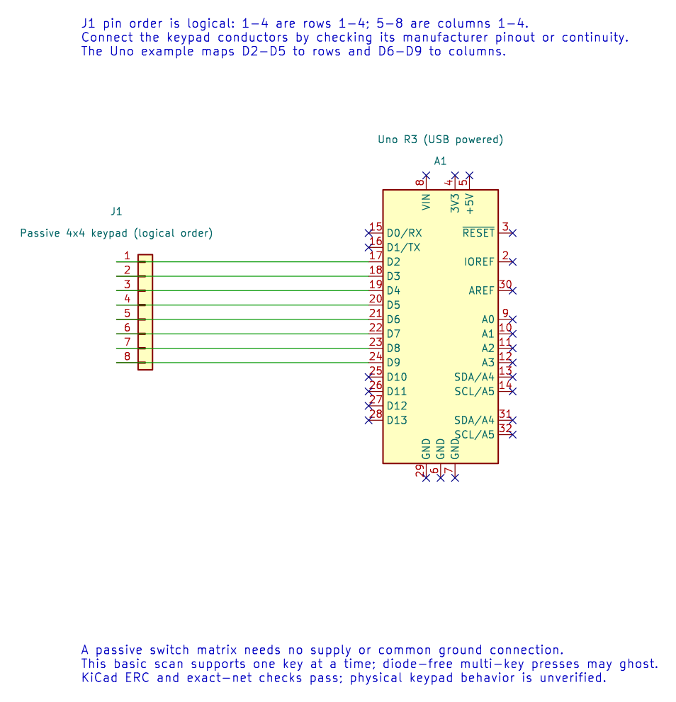

# Interfacing a 4×4 Matrix Keypad

## Objectives and Prerequisites

A matrix keypad arranges switches at row-and-column crossings. Eight GPIO pins can scan sixteen keys. This lesson explains the scan sequence and its limits; it uses the course's 4×4 keypad example. Review [GPIO programming](gpio-programming.md) and [button debounce](button.md) first.

## Parts and Wiring

Use a passive 4×4 matrix keypad and jumper wires. The keypad ribbon ordering varies, so identify its four row and four column wires from the product data or a continuity test.

| Uno pin group | Keypad connection |
| --- | --- |
| D2–D5 | Rows 1–4 |
| D6–D9 | Columns 1–4 |

No external power is normally required for a passive switch matrix. Do not apply voltage to a keypad pin; the Uno pins provide the scan signals. Confirm common ground is not needed for a passive matrix with only these signal wires; if your breakout includes electronics, use its own wiring guide.

The editable KiCad schematic labels the connector pins in logical row and column order. Keypad ribbon orders vary, so map the physical cable using the manufacturer's pinout or a continuity test. ERC and exact-net checks pass; the keypad has not been physically tested.

## Scan One Row at a Time

The example sets keypad pins as pulled-up inputs. It selects one row by driving that row low, then reads all four column inputs. A pressed key connects one column to the selected low row, so that column reads low. The program restores the row to an input before selecting the next one; this avoids driving different rows high and low into a closed set of switches.

The [complete keypad program](<https://github.com/arnabdasbwn/atmega328p-labs/blob/main/examples/06-keypad/main.c>) reports `row × 4 + column` over UART while a key is detected. It scans every 50 ms and can print repeatedly while a key is held. The returned number is a scan index, not a character label; add a lookup table for labels such as `0`–`9`, `A`–`D`, `*` and `#`.

## Debounce and Ghosting

Mechanical keypad contacts bounce like a push button. Apply a debounce state machine and generate one event after a stable press, then wait for a stable release before accepting another press.

Some diode-free matrices can **ghost**: pressing several keys creates an electrical path that looks like another key. This basic example is intended for single-key input. Multi-key rollover needs a suitable matrix design, per-key diodes and scan logic that detects ambiguous combinations.

## Build and Expected Result

Build with `python "atmega328p-labs/tools/build.py" 06-keypad --compiler xc8`. After wiring and upload, open a serial terminal at the example's configured baud rate, 9600 baud, 8 data bits, no parity and 1 stop bit. Pressing a key should print its row/column index; held keys may print repeatedly.

## Exercise with Answer

Why does the example temporarily turn only one row into an output?

**Answer:** It drives one row low while the other row pins remain high-impedance inputs. If multiple rows drove opposite levels while multiple keys were pressed, switches could connect an output high directly to an output low.

## Code Walkthrough

### 4x4 matrix keypad
The example's `main()` configures its peripherals, runs the algorithm and reports or displays the result. These source operations are listed in execution order:

- `(void)avr_uart_init(9600UL);` - Configures USART0 for asynchronous 8N1. It chooses a baud divisor and normal/double-speed mode, programs UBRR0/UCSR0A/UCSR0C, then enables receive and transmit in UCSR0B.
- `for (uint8_t i = 2U; i < 10U; ++i)` - Repeats while `i < 10U` is true; `uint8_t i = 2U` sets the starting state and `++i` advances it each pass.
- `(void)avr_gpio_mode(i, AVR_GPIO_INPUT_PULLUP);` - Maps the Uno header pin to its AVR port, sets its DDR direction bit and prepares the PORT latch for the requested initial level or pull-up.
- `for (;;)` - Repeats the foreground task indefinitely; each pass checks inputs, advances the calculation or services the peripheral shown below.
- `for (uint8_t row = 0U; row < 4U; ++row)` - Repeats while `row < 4U` is true; `uint8_t row = 0U` sets the starting state and `++row` advances it each pass.
- `(void)avr_gpio_mode((uint8_t)(row + 2U), AVR_GPIO_OUTPUT);` - Maps the Uno header pin to its AVR port, sets its DDR direction bit and prepares the PORT latch for the requested initial level or pull-up.
- `_delay_us(5);` - Waits for the stated interval; the foreground does no other work during this blocking delay.
- `for (uint8_t col = 0U; col < 4U; ++col)` - Repeats while `col < 4U` is true; `uint8_t col = 0U` sets the starting state and `++col` advances it each pass.
- `(void)avr_gpio_read((uint8_t)(col + 6U), &high);` - Reads the electrical level through PINx without changing direction or the output latch.
- `if (!high)` - Tests the stated condition; the following block handles the matching case and the other path is skipped.
- `(void)avr_uart_u16((uint16_t)(row * 4U + col));` - Formats an unsigned integer as decimal digits and sends them on USART0; it does not add a newline.
- `(void)avr_uart_put('\n', AVR_POLL_BUDGET);` - Waits for the USART transmit buffer within its poll budget, then writes the byte to UDR0.
- `(void)avr_gpio_mode((uint8_t)(row + 2U), AVR_GPIO_INPUT_PULLUP);` - Maps the Uno header pin to its AVR port, sets its DDR direction bit and prepares the PORT latch for the requested initial level or pull-up.
- `_delay_ms(50);` - Waits for the stated interval; the foreground does no other work during this blocking delay.

Algorithm: Only one row drives LOW. Other rows remain inputs to avoid shorting HIGH and LOW outputs when multiple keys close. A diode-free keypad can ghost; this baseline is single-key use.
Expected behaviour: Serial prints row*4+column while a key is held
**HAL source files in this repository:** [ATmega328P HAL on GitHub](https://github.com/arnabdasbwn/atmega328p-hal)

- [`include/avr_hal/gpio.h`](https://github.com/arnabdasbwn/atmega328p-hal/blob/main/include/avr_hal/gpio.h)
- [`include/avr_hal/uart.h`](https://github.com/arnabdasbwn/atmega328p-hal/blob/main/include/avr_hal/uart.h)
- [`src/gpio.c`](https://github.com/arnabdasbwn/atmega328p-hal/blob/main/src/gpio.c)
- [`src/uart.c`](https://github.com/arnabdasbwn/atmega328p-hal/blob/main/src/uart.c)

## References

- [Keypad lab source and wiring record](<https://github.com/arnabdasbwn/atmega328p-labs/blob/main/examples/06-keypad/main.c>)
- [GPIO registers](gpio-registers.md)
- [UART echo and serial settings](<https://github.com/arnabdasbwn/atmega328p-labs/blob/main/examples/14-uart-echo/main.c>)
- Use the keypad manufacturer's pinout to map the ribbon conductors to rows and columns.
