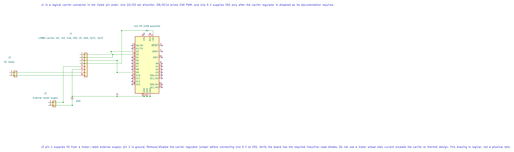

# L298N Motor Driver Interfacing

## What You Will Learn

- Explain why a motor needs a driver between its terminals and Uno GPIO.
- Connect one L298N carrier to a brushed motor and an external supply.
- Set direction with two logic inputs and speed with Timer1 PWM.
- Recognize the L298N's bipolar output loss and check the carrier's current and thermal limits.

You should know the Uno GPIO and Timer1 PWM basics. This lab uses a common L298N carrier, but carrier layouts differ. Read the labels on your board and its regulator jumper before wiring.

## How the H-Bridge Controls a Motor

The L298 contains two full bridges. Each bridge can apply either polarity across a motor, so the motor can run in either direction. The enable input gates the bridge; the two input pins select the output polarity while the bridge is enabled.

This example uses only one direction and switches the enable input with PWM. At 16 MHz, Timer1 Fast PWM with prescaler 64 runs at:

```text
16,000,000 / (64 x 256) = 976.5625 Hz
OCR1A = 128 gives approximately 50 percent duty
```

This does not set a specific motor speed. Load, supply voltage, friction, winding resistance, and driver voltage loss all affect speed and starting torque.

## Hardware and Wiring

Use one small motor whose stall current and voltage are within the exact L298N carrier's ratings, a current-limited external motor supply, and a regulated Uno power connection. Do not connect a motor directly to an Uno pin.



| Uno Or Supply | L298N Carrier | Purpose |
| --- | --- | --- |
| D2 | IN1 | Direction input 1 |
| D3 | IN2 | Direction input 2 |
| D9 / OC1A | ENA | Timer1 PWM enable; configure the carrier jumper for external control |
| Motor supply positive | VS or +12V | Motor supply input within the motor and carrier limits |
| Supply negative and Uno GND | GND | Common reference |
| OUT1 and OUT2 | Motor terminals | One H-bridge output |
| Logic 5 V | 5V / VSS | Follow the carrier revision and regulator jumper instructions |

Many L298N carriers include a 5 V regulator and a jumper that changes what the 5 V terminal does. Do not connect the carrier's regulator output to the Uno 5 V rail unless the board documentation explicitly allows it. Remove or fit the ENA jumper only as required to route D9 PWM. Check whether the carrier has the external flyback diodes required by the L298 application circuit.

The L298 uses bipolar output transistors and can lose a noticeable part of the motor supply across the bridge. At a low motor voltage, this can leave too little voltage for the motor. The IC's ratings also do not promise that a small carrier PCB can dissipate the same heat.

## Build and Observe

Build Lab 75 without connecting the motor supply:

```powershell
python "atmega328p-labs/tools/build.py" 75-l298n-motor --compiler gcc
python "atmega328p-labs/tools/build.py" 75-l298n-motor --compiler xc8
```

The source configures D9 low first, sets IN1/IN2 to a fixed polarity, then alternates between 128/255 PWM and zero. It uses Timer1, so it cannot run alongside another Timer1 owner such as the servo lab.

After reviewing the exact carrier diagram, check polarity and ground with a multimeter. Secure the motor and first test it unloaded with a current-limited supply. Expected result: forward drive for one second, then the bridge enable is low for one second. A build does not test wiring, motor current, rotation, or temperature.

<!-- source: atmega328p-labs/examples/75-l298n-motor/main.c -->

```c
/**
 * @file main.c
 * @brief Run one DC motor from an L298N carrier.
 * @details Uno R3, ATmega328P at 16 MHz. D2/D3 select forward polarity and D9/OC1A supplies
 * 8-bit Fast PWM to ENA. Use a carrier whose logic, motor supply and jumper arrangement are known.
 * Motor current comes from a separate supply; connect its ground to Uno ground. Test unloaded.
 * Expected observation: one second of forward PWM followed by one second with ENA low.
 * Hardware has not been tested; build and simulation evidence are recorded separately.
 * @copyright Copyright (c) 2026 Arnab Kumar Das. CC-BY-SA-3.0.
 */
#include "avr_hal/gpio.h"
#include "avr_hal/timer.h"
#include <avr/io.h>
#include <util/delay.h>

/**
 * @brief Run the L298N forward/coast demonstration.
 * @return Does not return after successful initialization.
 * @details Starts with the enable output low, configures one bridge direction, then alternates
 * between about 50 percent PWM and a disabled bridge. A configuration error leaves the motor
 * disabled and stops in a fail-safe loop. Foreground only; owns Timer1 and D9/OC1A.
 */
int main(void)
{
    (void)avr_gpio_mode(2U, AVR_GPIO_OUTPUT);
    (void)avr_gpio_mode(3U, AVR_GPIO_OUTPUT);
    (void)avr_gpio_mode(9U, AVR_GPIO_OUTPUT);
    (void)avr_gpio_write(9U, false);
    (void)avr_gpio_write(2U, false);
    (void)avr_gpio_write(3U, false);
    if (avr_timer_pwm8(AVR_TIMER1, 64U, 0U, 0U) != AVR_OK)
    {
        for (;;)
        {
            /* A failed timer configuration must not start the bridge. */
        }
    }
    (void)avr_gpio_write(2U, true);
    (void)avr_gpio_write(3U, false);
    for (;;)
    {
        OCR1A = 128U;
        _delay_ms(1000);
        OCR1A = 0U;
        _delay_ms(1000);
    }
}
```

<!-- /source -->

## Code Walkthrough

### L298N forward PWM motor control
The example's `main()` configures its peripherals, runs the algorithm and reports or displays the result. These source operations are listed in execution order:

- `(void)avr_gpio_mode(2U, AVR_GPIO_OUTPUT);` - Maps the Uno header pin to its AVR port, sets its DDR direction bit and prepares the PORT latch for the requested initial level or pull-up.
- `(void)avr_gpio_mode(3U, AVR_GPIO_OUTPUT);` - Maps the Uno header pin to its AVR port, sets its DDR direction bit and prepares the PORT latch for the requested initial level or pull-up.
- `(void)avr_gpio_mode(9U, AVR_GPIO_OUTPUT);` - Maps the Uno header pin to its AVR port, sets its DDR direction bit and prepares the PORT latch for the requested initial level or pull-up.
- `(void)avr_gpio_write(9U, false);` - Changes the pin's PORT output latch; for an input pin this selects its pull-up state.
- `(void)avr_gpio_write(2U, false);` - Changes the pin's PORT output latch; for an input pin this selects its pull-up state.
- `(void)avr_gpio_write(3U, false);` - Changes the pin's PORT output latch; for an input pin this selects its pull-up state.
- `if (avr_timer_pwm8(AVR_TIMER1, 64U, 0U, 0U) != AVR_OK)` - This checks for any setup or transfer error before the program continues. Selects 8-bit fast PWM, connects the chosen timer compare outputs, loads OCRnA/OCRnB and starts the prescaled clock. This takes ownership of that timer and its output pins.
- `for (;;)` - Repeats the foreground task indefinitely; each pass checks inputs, advances the calculation or services the peripheral shown below.
- `(void)avr_gpio_write(2U, true);` - Changes the pin's PORT output latch; for an input pin this selects its pull-up state.
- `OCR1A = 128U;` - Timer1 Compare A sets the match point or PWM pulse width, depending on the selected mode.
- `_delay_ms(1000);` - Waits for the stated interval; the foreground does no other work during this blocking delay.
- `OCR1A = 0U;` - Timer1 Compare A sets the match point or PWM pulse width, depending on the selected mode.

Algorithm: The bridge switches motor current from VS while GPIO pins provide logic. Timer1 Fast PWM at 16 MHz / 64 / 256 is about 976.6 Hz. PWM duty does not directly set speed.
Expected behaviour: The example drives the motor in one direction at nominal 50 percent PWM for one second, then disables ENA for one second
**HAL source files in this repository:** [ATmega328P HAL on GitHub](https://github.com/arnabdasbwn/atmega328p-hal)

- [`include/avr_hal/gpio.h`](https://github.com/arnabdasbwn/atmega328p-hal/blob/main/include/avr_hal/gpio.h)
- [`include/avr_hal/timer.h`](https://github.com/arnabdasbwn/atmega328p-hal/blob/main/include/avr_hal/timer.h)
- [`src/gpio.c`](https://github.com/arnabdasbwn/atmega328p-hal/blob/main/src/gpio.c)
- [`src/timer.c`](https://github.com/arnabdasbwn/atmega328p-hal/blob/main/src/timer.c)


## Common Problems

- **The motor does not turn:** Check the ENA jumper, D9 PWM, IN1/IN2, motor supply, and common ground.
- **The Uno resets when the motor starts:** The supply may sag or motor noise may reach the logic rail. Check the motor current and supply arrangement.
- **The motor is weak:** Measure voltage across the motor under load. The L298 bridge's voltage drop may be significant.
- **The driver becomes hot:** Stop. Check stall current, load, heat sinking, and the exact carrier rating.
- **The motor runs continuously:** Check whether ENA is still tied high by a jumper rather than connected to D9.

## Try It Yourself

Why might a motor rated for 6 V run poorly from a 6 V supply through an L298 bridge?

**Answer:** The bridge transistors drop part of the supply voltage. The motor therefore receives less than 6 V while current flows. Measure the actual motor-terminal voltage and select a driver appropriate for the motor.

## References

- [Lab 75 source and wiring metadata](<https://github.com/arnabdasbwn/atmega328p-labs/blob/main/examples/75-l298n-motor/main.c>)
- [ST L298 product page and documentation](https://www.st.com/en/motor-drivers/l298.html)
- [ST L298 datasheet](https://www.st.com/resource/en/datasheet/l298.pdf)
- [Motor-driver comparison](motor-drivers.md)
- Editable KiCad schematic and ERC/netlist reports
