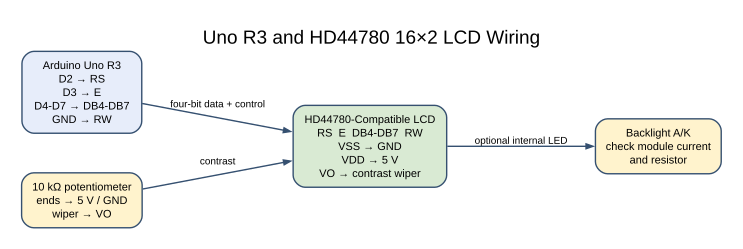
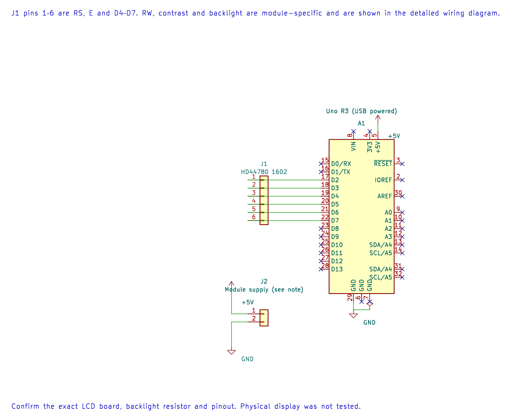

# HD44780 16×2 Character LCD

## What You Will Learn

An HD44780-compatible character LCD accepts commands and character bytes. In four-bit mode the Uno sends each byte as two nibbles using only four data wires. The display has its own controller; it is not a matrix of GPIO LEDs.

## Parts and Wiring

Use a 5 V 16×2 module that supports the common HD44780 parallel interface. Check the exact module's backlight pinout and current requirement.

| LCD signal | Uno or circuit connection | Purpose |
| --- | --- | --- |
| VSS | GND | Ground |
| VDD | 5 V | Logic supply |
| VO | Wiper of 10 kΩ contrast potentiometer | Contrast adjustment |
| RS | D2 | Select command or character data |
| RW | GND | Write-only operation |
| E | D3 | Enable strobe |
| DB4–DB7 | D4–D7 | Four-bit data bus |
| LED A/K | As marked by the module | Backlight; add a limiter if the module requires one |

Connect a 100 nF bypass capacitor near the module if recommended by its datasheet. Do not assume every LCD board includes a backlight resistor.

## Sending a Byte in Four-Bit Mode





The editable KiCad connection sheet complements the full wiring diagram. It shows signal and supply connections; the contrast control and backlight details remain board-specific.

Lab 26 uses the documented HAL driver. For each command or character, it places the high nibble on D4–D7 and pulses E, then sends the low nibble and pulses E again. RS is low for a command and high for character data; RW is tied low.

The driver performs the power-on synchronization sequence before it selects two-line, four-bit operation. It writes `Embedded C` on the first row and `Uno R3 / XC8` on the second. The LCD's internal character memory and controller are separate from the Uno's SRAM.

## Build and Try the Lab

```powershell
python atmega328p-labs/tools/build.py 26-lcd --compiler gcc
python atmega328p-labs/tools/build.py 26-lcd --compiler xc8
```

After uploading, adjust the contrast potentiometer slowly. If wiring and initialization are correct, both text rows should become visible. The code does not use UART, so the USB serial monitor is not part of this experiment.

## Code Walkthrough

### HD44780 parallel LCD
The example's `main()` configures its peripherals, runs the algorithm and reports or displays the result. These source operations are listed in execution order:

- `const avr_lcd_t lcd = {2U, 3U, {4U, 5U, 6U, 7U}};` - Use the linked public header for this function's parameters, register ownership, blocking behavior and status values.
- `if (avr_lcd_init(&lcd) == AVR_OK)` - The operation runs only after this API reports AVR_OK. Initialises the HD44780-compatible display using the pin mapping in the configuration structure.
- `(void)avr_lcd_write(&lcd, "Embedded C", 10U);` - Sends the requested number of text bytes to the configured display.
- `(void)avr_lcd_position(&lcd, 1U, 0U);` - Selects the display row and column for the next write.
- `(void)avr_lcd_write(&lcd, "Uno R3 / XC8", 12U);` - Sends the requested number of text bytes to the configured display.
- `for (;;)` - Repeats the foreground task indefinitely; each pass checks inputs, advances the calculation or services the peripheral shown below.

Algorithm: Four-bit mode sends the high nibble then the low nibble. The power-on synchronization sequence works even when the controller did not start in the expected mode.
Expected behaviour: Two lines display the course and board/toolchain labels
**HAL source files in this repository:** [ATmega328P HAL on GitHub](https://github.com/arnabdasbwn/atmega328p-hal)

- [`lib/drivers/hd44780.c`](https://github.com/arnabdasbwn/atmega328p-hal/blob/main/lib/drivers/hd44780.c)
- [`lib/drivers/hd44780.h`](https://github.com/arnabdasbwn/atmega328p-hal/blob/main/lib/drivers/hd44780.h)


## Common Problems

- **Backlight is on but no characters appear:** Adjust VO and check RW is grounded.
- **Black blocks appear on the first row:** Power and contrast may be present, but initialization or data wiring is wrong.
- **Characters are corrupted:** Check DB4–DB7 order and the E/RS pins.
- **Backlight is dim or hot:** Check the module's backlight current and resistor requirement.
- **Build succeeds but screen stays blank:** A build cannot verify the physical pin map, module controller compatibility or contrast setting.

## Check Your Understanding

1. How many enable pulses are needed to send one byte in four-bit mode?
2. What does RS select?
3. Why is RW tied to ground in this example?

**Suggested answers:** Two nibble transfers, each with its own enable pulse. RS selects command versus character data. The example only writes to the LCD, so it does not need to read the busy flag or display memory.

## Source and Further Reading

- [Lab 26 source](<https://github.com/arnabdasbwn/atmega328p-labs/blob/main/examples/26-lcd/main.c>)
- [HD44780U Controller Datasheet](https://www.sparkfun.com/datasheets/LCD/HD44780.pdf)
- [ATmega328P Documentation](https://www.microchip.com/en-us/product/ATMEGA328P)
